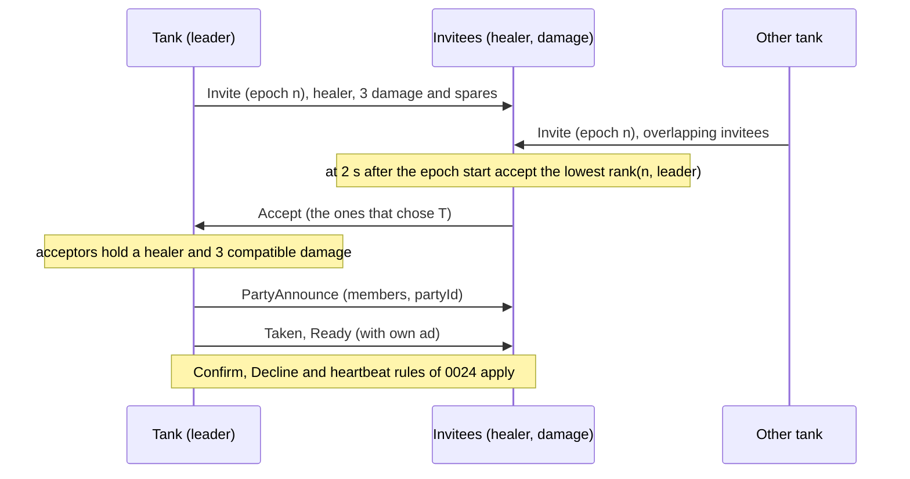

# 0025. Peers agree on a party by leader invitations: a tank invites from its own sample, invitees follow the best-ranked leader

* **Status:** Accepted, implemented in `engine`. Supersedes [0010](0010-converging-announcements.md) and the proposer model that 0010 left open. Amends [0024](0024-liveness-and-decline.md). The author's review of this change is pending.
* **Date:** 2026-11-21
* **Deciders:** Hugh Kaznowski (decision proposed from the spike S0 simulation work)

## Context

Spike S0 simulated the two candidates of [0010](0010-converging-announcements.md) on the pure engine (3,000 peers, sample of 100, modelled sample divergence). Neither reached the plan's floor of 70% of eligible peers committed within 3 epochs:

* converging announcements: 1.9% at delivery 0.95, 56.3% at delivery 1.00;
* the proposer model: 8.6% to 25.5%.

Two causes, both found by looking at who ends up in whose sample:

1. Converging announcements need five peers to compute the same party from different samples. Any divergence breaks it.
2. The sample rule dropped the higher peer ID among ads at the same level distance, so that same-level peers keep almost the same sample. With 3,000 peers and about 316 per level, the 100 lowest IDs of a level are in every sample and the other two thirds are in nobody's. Those peers could never be named in anyone's party. This hurts every mechanism that picks from samples.

## Decision

**One peer builds the party, from its own sample, and the others follow it.** Nothing needs the samples to agree.

* **Leader.** The party's tank is its leader (tanks are the scarce role). Once per epoch a free tank looks at its own sample, picks one healer and three damage peers that are compatible with it and with each other (`engine::lead::plan_invites`), and sends each a direct `Invite` with its own ad. It also invites 2 spare healers and 5 spare damage peers who fit, so that a party survives the loss of one invitation to a better-ranked leader. Candidates are tried in the leader's own order, `pair_rank(epoch, leader, candidate)`, so different tanks try different candidates first.
* **Invitee.** At `epochStart + 2 s` (`INVITE_WINDOW`) an invitee looks at the invitations it got for that epoch. It drops those from non-tanks, from authors that do not match the ad inside, from banned peers and from incompatible leaders, then accepts the leader with the lowest `rank(epoch, leader)` with one direct `Accept` and ignores the rest. Everyone uses the same order, so the best-ranked leader always gets everyone it invited (serial dictatorship), which guarantees progress.
* **Commit.** As soon as a leader's acceptors contain a healer and three damage peers that are compatible with each other (`choose_party`), it sends a direct `PartyAnnounce` to the four, commits itself, and broadcasts `Taken` and `Ready` as before. An invitee commits only on a `PartyAnnounce` from the leader it accepted, for that epoch, that names it. A peer answers one epoch once and holds one lease at a time, so it is in at most one committed party.
* **After the commit** nothing changes: `Ready` within 4 s, human Confirm within 15 s, `Decline` without penalty, a silent member is banned locally for 60 s and never gossiped, [0024](0024-liveness-and-decline.md). `Ready` now carries the sender's own ad, because an invitee has not necessarily seen the other members' ads. Names and details of the other members come from their own `Ready`.
* **Epoch** is 5 s (was 10 s): an invite, accept and commit exchange takes about 2 s. Decision windows are 2 s (invitee) and 4 s (`Ready`).
* **Sample rule.** Among ads at the same level distance a peer drops the one with the highest `pair_rank(0, owner, peer)` instead of the highest peer ID, so each peer keeps its own random part of a level and every ad is in about the same share of samples.
* **Messages.** New: `Invite {peer, epoch, ad}`, `Accept {peer, epoch}` (both direct). `PartyAnnounce` is now direct from the leader. `Ready` gains `ad`. Everything is signed by its author as before ([0019](0019-signed-gossip-messages.md)). Engine events `InviteReceived` and `AcceptReceived` are added and `ReadyReceived` carries the ad. `Action` and `Network` are unchanged.

## Evidence

Source: `src-tauri/src/engine/sim.rs`, run `cargo test --release --lib -- --ignored --nocapture engine::sim::tests::report`; table and caveats in `docs/spike-s0.md`. Seeded, same population and the same eligible peers as the old rows (the share of peers with a compatible five in their sample that are committed; this is the plan's floor). The leader columns keep samples across epochs the way the engine does (re-drawn at the 45 s keep-alive).

| Scenario (3,000 peers, sample 100, delivery 0.95 unless stated) | Converging, 3 epochs | Proposer, 3 cycles | Leader, 3 rounds (15 s) | Leader, 6 rounds (30 s) |
|---|---|---|---|---|
| headline | 1.9% | 12.1% | 74.6% | 77.4% |
| delivery 0.80 | 0.0% | 18.9% | 71.4% | 76.2% |
| delivery 1.00 | 56.3% | 8.6% | 73.0% | 76.3% |
| 8 seeds, headline | | | min 69.7%, mean 73.0%, max 75.0% | min 74.6%, mean 78.4%, max 81.6% |

* The floor is "70% within 3 epochs", measured in epochs of 10 s, that is 30 s. The new epoch is 5 s, so **30 s is 6 rounds: mean 78.4%, every one of 8 seeds above 74.6%**. At 3 rounds (15 s) the mean is 73.0% and one seed in eight is under 70% (69.7%). The floor is met in wall-clock time, not in a count of rounds at the new epoch length. This is a deviation from the plan's wording and is stated here on purpose.
* **The role mix caps the metric.** Every party needs a tank, so 15% tanks can commit at most 75% of all peers. A central greedy build over everyone (the oracle) commits 2,235 of 3,000 in the headline run. The leader model commits 2,155 of that in 3 rounds (96%) and all 2,235 in 6 rounds. The remaining gap to 100% of the eligible peers is not a mechanism gap. With 8% tanks every tank is committed (capacity 100%) and the eligible share is 49% in every mechanism, so the floor as worded cannot be met there by any mechanism. The plan should define the floor against capacity (what a central build commits) as well; this ADR does not change the floor.
* The sample rule matters. With the old tie-break (and fresh samples each round) the leader mechanism reaches 35.9% in 3 rounds and 67.5% in 6.
* Sensitivity: 5% of direct messages lost, no retransmission: 63.6% in 3 rounds, 76.6% in 6. 20% lost: 26.4% and 47.3%. With one retry per message: 74.7% and 77.3% at 5%, 68.3% and 77.2% at 20%.
* Other scenarios in the doc: 300 and 100 peers (68.9%, 64.2%, with capacity 100%: everything that can form does), 10,000 peers (72.5% and 74.3%), 30% tanks (70.9% and 85.0%, capacity 77.6% at 3 rounds because many tanks compete for few healers).

## Consequences

* The floor is met in the model within 30 s. It is thin at 3 rounds, and the model has not been tested on a live network. The model has no churn (peers that leave without a `Taken`) and assumes that a lost direct message is lost for good. iroh direct streams are reliable, so a lost message mostly means an unreachable peer, which retransmission would not fix. **The engine does not retransmit.** If S0 on a live network shows message loss, a retry of `Invite` and `PartyAnnounce` is the first fix and the simulation says it works.
* A commit message that is lost or arrives after the invitee moved on makes that member fail the `Ready` check, so the rest ban it locally for 60 s through the existing rule, which can be unfair to a peer that only lost one message.
* Tanks do the work and the party is placed in tank order, not in a global optimum. Healers and damage peers have no say beyond the lowest-rank leader. A topic with no tanks forms no party (it could not anyway). The leader could be the scarcest role of the topic instead of always the tank; that is not simulated.
* Direct messages reveal nothing new: ads were already public on the topic. A tank sends at most 11 invitations per epoch (4 for the party, 7 spares); an invitee keeps at most 64 leaders per epoch and answers one.
* `build_parties` in `engine::party` is no longer used by the engine. It stays for the simulation's baseline and oracle.
* The plan's floor, spike row and constants change (epoch 5 s, `INVITE_WINDOW` 2 s, the proposer window constants are gone).

## Alternatives considered

* **Converging announcements** ([0010](0010-converging-announcements.md)): measured at 1.9% to 56%. Rejected.
* **Proposer with response windows**: measured at 8.6% to 25.5%, because a group gains one member per cycle and fails when a cycle adds nobody. Rejected. Leader invitations are its fast form: the party is built in one round from invitations with spares and a global preference order for leases.
* **Announcements that carry the full member list, with others adopting the lowest-hash announcement; rank-based leader election per compatibility cluster; direct acks with retransmit; ads re-sent when a peer joins.** Considered. Not simulated one by one. The first two need every member to be in the announcer's sample, which the old sample rule made false for two thirds of the peers, and the leader model is their simplified form (one announcement, one author, no election because the tank is the leader). Retransmit is measured above and not built. Re-sending ads on join already exists.
* **An elected coordinator per shard** ([Alternative J](../docs/designs/forever-together.md#alternative-j-a-proposer-with-per-peer-leases-or-an-elected-coordinator-per-shard)): still rejected, it is a supernode ([0023](0023-no-supernodes.md)). Every tank here is an ordinary peer that leads for one epoch.
