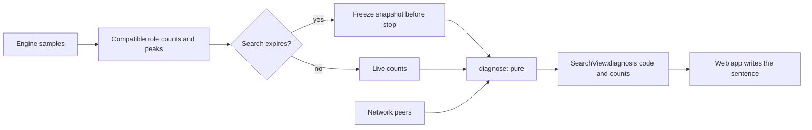

# 0026. The app reports search health from this peer's own observations

* **Status:** Accepted for the first slice. Amends [0011](0011-search-widening.md) (what a search shows while it widens and when it ends). Cites [0003](0003-self-reported-data.md), [0005](0005-topic-without-level.md) and [0025](0025-leader-invitations.md). Every threshold is unverified until a live run (see `docs/spike-s0.md`).
* **Date:** 2026-11-21
* **Deciders:** Hugh Kaznowski (resolutions in `docs/notes/search_diagnosis_concepts_brief.md`)

## Context

A search can run for ten minutes and end with nothing. The player cannot tell whether the app is broken, the network is empty, or the group they need (usually a tank) does not exist. Today the web app shows one count, "Players searching", which is every stored ad (stale and incompatible ones included), and an expired search shows nothing, because `tick_searching` calls `stop()`, which drops the search, before the expired view is built.

## Decision

* **Observation only.** The diagnosis uses what this node saw and nothing else: peers connected, and the other players in its own samples that are compatible under the current stage's rules (same faction, level and item-level limits of the stage, fresh, not locally banned) with a count per role. It does not say what the network contains, and it does not promise a group. All counts are self-reported claims from a sample ([0003](0003-self-reported-data.md)); topics are per region, realm, faction and dungeon ([0005](0005-topic-without-level.md)), so a count is about that slice only. "None seen" is never "none exist".
* **Hedged situations, closed list.** One code per search: `warming_up` (under 30 s, live only), `not_connected` (no peers), `alone` (none seen), `no_tank`, `no_healer`, `short_on_damage` (the party needs 1 tank, 1 healer, 3 damage, counting the player in their own role), `healthy`. First match wins in that order. `healthy` means the roles seen could fill a party, nothing more. There is no score and no "a group will form". The classifier is the pure function `engine::diagnose::diagnose`: no clock, no I/O, same observations give the same code.
* **In-memory retention of the end snapshot.** The engine keeps the peak count per role, whether a sample hit its cap, the highest stage reached and the elapsed time. When a search expires the engine freezes these before `stop()` and keeps them until the next `start` or a stop by the player. A stop by the player maps to Idle and shows nothing. The snapshot holds counts only: no peer id, no name. Nothing is persisted by this decision (persisted history is a later, separate ADR that extends [0008](0008-iroh-and-local-storage.md)).
* **Engine and UI split.** The backend sends a situation code plus counts in one optional `SearchView.diagnosis` (`situation`, `ended`, `seen {players, tanks, healers, damage}`, `ownRole`, `sampleFull`, `networkPeers`); `situation` is a string so a newer server can add codes and an older web bundle falls back to its previous copy. The frontend owns every sentence, which must say what was seen and not what exists. While ended, the counts are the peak over the search, not live.
* **Not in the first slice:** attempt counters (added by the amendment below), hysteresis, and any use of history.

## Consequences

* The counts are rough: a full sample is a slice (`sampleFull`), per-role peaks need not come from one moment, and a burst of commits (`Taken`) can empty the sample and look like a quiet network.
* Thresholds (30 s warm-up, the party mix) and the compatibility rule are unverified against a live network. Changing the counting rule later changes what any stored data would mean.
* Adds no store key, schema or message. Adds one field to the local API, which the webapp types and fixtures mirror.

## Amendment 2026-11-21: attempt counters, two more situations

Staging item 6 of the brief. It changes the first slice only by adding to it.

* **Counters** (`SearchStats.attempts`, per search, reset on `start`, frozen in the end snapshot before `stop()` like the peak, counts only, no peer id or name):
  * `invites_sent`: invitations this node sent as a leader, one per invited peer, counted where the engine emits them.
  * `accepts_got`: accepts that matched the open invitations (once per peer and epoch).
  * `invites_got`: invitations this node kept as an invitee (valid, compatible, once per leader and epoch).
  * `taken_seen`: distinct peers whose ads were in a sample and were removed because a party-taken notice ([0024](0024-liveness-and-decline.md)) named them. Own party members and this node itself are not counted.
  * `drops` and `declines`: the same two counters the history facts use ([0027](0027-search-history.md)): a member that did not answer, and a declined or unconfirmed party. Not double-counted: each cause adds to one of them.
* **Situations**, still one code, first match wins: `warming_up`, `not_connected`, `others_grouping`, `alone`, `no_tank`, `no_healer`, `short_on_damage`, `nobody_answered`, `healthy`.
  * `others_grouping`: `taken_seen > 0` and fewer than `TINY_SAMPLE` (4, the other players a party needs) compatible others seen. The empty-looking sample is explained by parties forming now. Checked before `alone` and after `not_connected`, so it never hides a dead connection.
  * `nobody_answered`: this node sent at least `MIN_ATTEMPTS` (6) invitations and got no accept, and the role checks passed. It sits before `healthy`, so `healthy` is no longer said when invitations went unanswered. It is not said while a role is missing: that gap is the better explanation.
* **Wire:** `diagnosis.attempts { invitesSent, acceptsGot, invitesGot, takenSeen, drops, declines }` (all numbers, `#[serde(default)]` so an older payload parses with zeros); `situation` may be the two new strings. The web app owns the wording and falls back for codes it does not know.
* **Deliberately not counted:**
  * Why an invitee did not accept. A silent peer, a lost message ([0025](0025-leader-invitations.md): the engine does not retransmit direct messages), an invitee that chose a better-ranked leader, and a peer that left all look the same to the leader. `nobody_answered` therefore says "nobody answered", never "nobody wants you". Invitees do not tell a leader they ignored it, and no message is added for this.
  * Invitations that arrived after the decision time or were dropped for the per-epoch cap.
  * Accepts a leader got for a party it later lost (they stay in `accepts_got`).
  * Rounds as a unit: a round invites the whole sample's party plus spares, so the invitation count is a count of messages, not of epochs.
* **Unverified.** `MIN_ATTEMPTS = 6` (a little over one small round of 4 to 11 invitations; fewer would call one epoch's silence a pattern) and `TINY_SAMPLE` are guesses until a live run. (The 2 s flicker this allowed is fixed in the amendment below.)

## Amendment 2026-11-21 (later): rounds before `nobody_answered`, and the `outlook` clause

* **Flicker fixed.** `nobody_answered` could show for the 2 s between a round's invitations and the first accept. It now also needs invitations sent in at least `MIN_INVITE_EPOCHS` (2) different epochs, besides `invites_sent >= MIN_ATTEMPTS` and no accept at all. The engine counts this as `Attempts.invite_epochs` (epochs in which this node sent invitations, one increment per epoch, reset on `start`, frozen in the end snapshot). By the second round (5 s later) the first round's accepts have come back, so one lost accept cannot be mistaken for a pattern. `MIN_ATTEMPTS` stays 6. `invite_epochs` is not on the wire. Unverified like the other thresholds.
* **`diagnosis.outlook`** (`string | null`, `#[serde(default)]`): `usually_found`, `sometimes_found` or `rarely_found`. It is the one banded clause history may add ([0027](0027-search-history.md), brief Resolution 8). The situation code is never changed by history; `diagnose` stays pure and takes no history. Rules, enforced in one function and table-tested:
  * Never while `ended`, and never with `warming_up` or `not_connected`.
  * `usually_found` only with `healthy` or `others_grouping`: it is never shown next to `no_tank`, `no_healer`, `short_on_damage`, `nobody_answered` or `alone`, so history cannot reassure against a live problem.
  * `sometimes_found` and `rarely_found` may accompany any other situation.
  * No number, date or count from history is ever sent. The web app owns the wording and should give a provenance ("in your earlier searches").

## Amendment 2026-11-21 (show, don't tell): where the hedge moved

* **The logic is unchanged.** Situation codes, thresholds, `attempts`, `outlook` and the rule that `usually_found` is dropped next to a live problem are the same. Only the wording and its placement in the web app changed (author decision D6 of the "show, don't tell" audit).
* **The hedge now lives in structure, not in every sentence.** The role row carries the label "Seen from here" and a `~` before rough counts (it replaces "about"). The full sentence ("Not a promise that a group will form", with the note that counts are rough) sits in one info tip beside the headline. The label and the `~` stay visible, because a hedge behind a tap may go unread.
* **Role row.** Three roles against what a party needs (1 tank, 1 healer, 3 damage), the player's own role pre-filled. Grey, never red, for "not seen", so none seen does not read as none exist. The row is not shown while warming up or not connected.
* **Headline** is one sentence stating the consequence ("No tank seen, so a party can't form yet."). Detail and outlook sentences are inside Details. Short chips replace the attempts row: "Asked 6 players to join, none replied" and "Others are forming groups".
* **Dropped** sentences that explained a missing field or defended the app, and the words peer, computer and invited/accepted. Still true: nothing reassures while a role is missing or the app is offline, counts are rough, no numbers or percentages come from history.
* **Search card.** The stage list, the network field, the countdown to the next widening and the duplicate "Players seen" field are gone; a "Searching wider" chip with the rule in an info tip replaces them. An ended search offers "Search again" and "Change dungeon".
