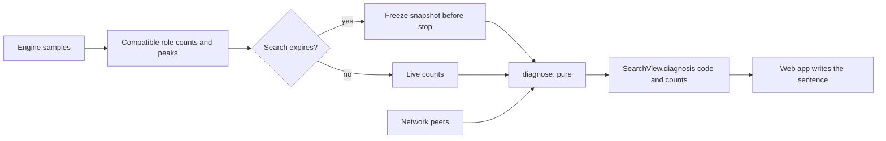

# 0026. The app reports search health from this peer's own observations

* **Status:** Accepted for the first slice. Amends [0011](0011-search-widening.md) (what a search shows while it widens and when it ends). Cites [0003](0003-self-reported-data.md), [0005](0005-topic-without-level.md) and [0025](0025-leader-invitations.md). Every threshold is unverified until a live run (see `docs/spike-s0.md`).
* **Date:** 2026-11-21
* **Deciders:** Hugh Kaznowski (resolutions in `docs/notes/search_diagnosis_concepts_brief.md`)

## Context

A search can run for ten minutes and end with nothing. The player cannot tell whether the app is broken, the network is empty, or the group they need (usually a tank) does not exist. Today the web app shows one count, "Players searching", which is every stored ad (stale and incompatible ones included), and an expired search shows nothing, because `tick_searching` calls `stop()`, which drops the search, before the expired view is built.

## Decision

* **Observation only.** The diagnosis uses what this node saw and nothing else: peers connected, and the other players in its own samples that are compatible under the current stage's rules (same faction, level and item-level limits of the stage, fresh, not locally banned) with a count per role. It does not say what the network contains, and it does not promise a group. All counts are self-reported claims from a sample ([0003](0003-self-reported-data.md)); topics are per region, realm, faction and dungeon ([0005](0005-topic-without-level.md)), so a count is about that slice only. "None seen" is never "none exist".
* **Hedged situations, closed list.** One code per search: `warming_up` (under 30 s, live only), `not_connected` (no peers), `alone` (none seen), `no_tank`, `no_healer`, `short_on_damage` (the party needs 1 tank, 1 healer, 3 damage, counting the player in their own role), `healthy`. First match wins in that order. `healthy` means the roles seen could fill a party, nothing more. There is no score and no "a group will form". The classifier is the pure function `engine::diagnose::diagnose`: no clock, no I/O, same observations give the same code.
* **In-memory retention of the end snapshot.** The engine keeps the peak count per role, whether a sample hit its cap, the highest stage reached and the elapsed time. When a search expires the engine freezes these before `stop()` and keeps them until the next `start` or a stop by the player. A stop by the player maps to Idle and shows nothing. The snapshot holds counts only: no peer id, no name. Nothing is persisted by this decision (persisted history is a later, separate ADR that extends [0008](0008-iroh-and-local-storage.md)).
* **Engine and UI split.** The backend sends a situation code plus counts in one optional `SearchView.diagnosis` (`situation`, `ended`, `seen {players, tanks, healers, damage}`, `ownRole`, `sampleFull`, `networkPeers`); `situation` is a string so a newer server can add codes and an older web bundle falls back to its previous copy. The frontend owns every sentence, which must say what was seen and not what exists. While ended, the counts are the peak over the search, not live.
* **Not in this slice:** attempt counters (invitations, accepts, drops by cause), hysteresis, and any use of history.

## Consequences

* The counts are rough: a full sample is a slice (`sampleFull`), per-role peaks need not come from one moment, and a burst of commits (`Taken`) can empty the sample and look like a quiet network.
* Thresholds (30 s warm-up, the party mix) and the compatibility rule are unverified against a live network. Changing the counting rule later changes what any stored data would mean.
* Adds no store key, schema or message. Adds one field to the local API, which the webapp types and fixtures mirror.
