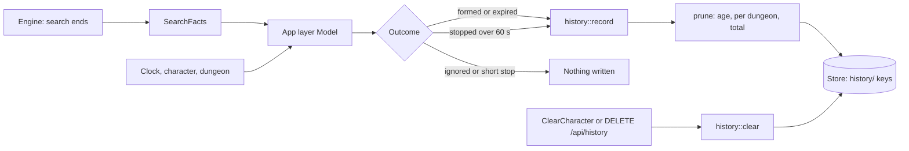

# 0027. The app keeps a local history of finished searches, one entry each, and shows none of it

* **Status:** Accepted for stage 8a (record only). Extends [0008](0008-iroh-and-local-storage.md) (local storage). Amends [0013](0013-single-rust-crate.md) (the module list gains `history`). Cites [0003](0003-self-reported-data.md) and [0026](0026-search-health-from-own-observations.md). Every number below is an unverified starting value.
* **Date:** 2026-11-21
* **Deciders:** Hugh Kaznowski (resolutions 5, 9, 11 to 14 in `docs/notes/search_diagnosis_concepts_brief.md`)

## Context

[0026](0026-search-health-from-own-observations.md) tells the player what this node saw during one search. A later estimate ("searches like this usually find a group") needs the results of earlier searches, and the data takes weeks to collect: a player makes a few searches a week. The thresholds and the counting rule are still unverified against a live network. So the first step is to record, and to change nothing the player sees.

## Decision

* **Entries, not buckets.** One entry per search, written once, at the terminal event. A table by dungeon, day and hour was rejected: it would blame the clock for what is usually a missing role.
* **Stage 8a records only.** No estimate, no new field on `AppState` or `SearchView`, no UI. History is never shown as data. Estimates and any player-visible wording are stage 8b, and wait for a live capture that shows the fields are stable.
* **Entry fields** (`history::Entry`, serde): `schema_version`, `rules_version`; `start_utc` and `end_utc` in UTC seconds; `utc_offset_secs`; `region`, `realm` and `faction` (each is a separate network, so a fit must not mix them); `dungeon` (the first one chosen) and `topic_count`; `level` at the start; `own_role`; `checkpoint_1` and `checkpoint_2`; `peak`; `stage_reached`; `outcome`; `drops`, `declines`; `first_formed_at`. No name, no peer id, no zone text ([0003](0003-self-reported-data.md): all counts are self-reported claims from a sample).
* **Outcomes.**
  * `formed`: every member confirmed (`Mode::Final`).
  * `expired`: the limit passed. A failure sample.
  * `stopped`: the player stopped after more than 60 s. Incomplete data, not a failure: the app's own advice causes stops, and a group might have come later. A later estimator treats it as censored ("at least this long"). A stop of 60 s or less is not recorded.
  * Ignored, not recorded: a restart, a character change or clearing the character, and anything else that is not a result. A quit loses the search in progress: there is no shutdown hook, and that is accepted.
  * A drop after a commit returns the engine to searching and does not end the entry: it adds to `drops` (a member did not answer) and `first_formed_at` keeps the first commit. A declined or unconfirmed party adds to `declines`: the player's choice, not a failure.
* **Checkpoints.** The counts of compatible players (total and by role), the widening stage in force and `sample_full`, taken on the first searching tick at or after 55 s and at 115 s from the search start (`config::CHECKPOINT_1`, `CHECKPOINT_2`). They sit just before the 60 s and 120 s widening steps, and 120 s is also the ad lifetime, so the counts describe the rules still in force. A search that ends first stores `None`, never zeros. No checkpoint is taken while a party is committed.
* **Peak.** Each role's own maximum over the search (the roles need not come from one moment), from the same compatible counts as [0026](0026-search-health-from-own-observations.md).
* **Where it is recorded.** The engine stays pure: no clock, no I/O. On each terminal event it emits a plain `SearchFacts` record (`Action::SearchEnded`), with durations from its own `now` values using `saturating_sub`. The app layer (`Model`) owns the clock, the store and the lifecycle: it adds region, realm, faction, dungeon and the wall-clock time, builds the entry and calls `history::record_facts`. A character change turns the engine's `Stopped` into an ignored search. The write happens only at the terminal event, and a failed write is logged (never the entry) and the search carries on.
* **Time.** UTC seconds. `utc_offset_secs` is stored with each entry so local time of day can be derived later. The standard library cannot tell the local offset and a date-time dependency is not worth it for a field nothing reads, so it is 0 for now; the browser knows it and could supply it later.
* **Store layout and versions.** One key per entry, `history/<start UTC seconds, zero-padded to 12 digits>`, like `known_peers/` ([0008](0008-iroh-and-local-storage.md)), so keys sort by time and the module lists, writes and deletes single entries. `schema_version` is the layout. `rules_version` names what the counts mean (epoch length, widening step, sample size, limit, ad lifetime, checkpoints and the matching-rules number); a test keeps it equal to the config. An entry that fails to decode or has an unknown schema version is skipped when read and never an error. A change of the counting rule bumps `rules_version`, and an estimator then ignores older entries.
* **Pruning, on append, in this order:** entries older than 180 days, then more than 100 per dungeon, then more than 500 in all, oldest first each time. Each delete stands alone, so a crash half way is harmless. The age limit is longer than the first proposal of 90 days so that a later estimator can reach its gate at a few searches a week.
* **Retention and privacy.** The history is a log of when the player plays, what they queue for, their level and role. So: a clear action (`DELETE /api/history`, 204, loopback only like pairing, so a phone cannot call it; the UI is a separate change), the history is also deleted with the character (`ClearCharacter`), and it never appears in logs, exports, pairing or the API. Tests and dev data use invented characters only. This narrows the non-goal "no character data" to "no names, peer ids or zone text".

## Consequences

* Data accumulates from the first live run, before any estimator exists. The thresholds (180 days, 100, 500, 55 s, 115 s, 60 s) are starting values to check against the data.
* The history is the first behavioural log on disk. The clear action and the link to `ClearCharacter` are part of the decision, not extras.
* Adds one key prefix to the store and one loopback route to the API, and nothing else to the API or `AppState`.
* The engine gains one action (`SearchEnded`) that hosts other than the app ignore. The checkpoint rule and the counting rule are part of what `rules_version` describes, so changing either is a version bump.

## Amendment 2026-11-21: three attempt counters per entry

`Entry` gains `invites_sent`, `accepts_got` and `taken_seen` (u32, the counters of [0026](0026-search-health-from-own-observations.md) at the terminal event, from `SearchFacts`). They are additive with `#[serde(default)]`: entries written before decode with 0. `schema_version` stays 1. `rules_version` is not bumped: no existing field changed meaning. An estimator must not read a 0 in an old entry as "no invitations": it cannot tell an old entry from a quiet search, so it should only use these fields for entries whose `rules_version` and write time it trusts (stage 8b's concern). `invites_got`, `drops` and `declines` are not repeated: `drops` and `declines` already exist, and `invites_got` is not needed to tell the situations apart.
