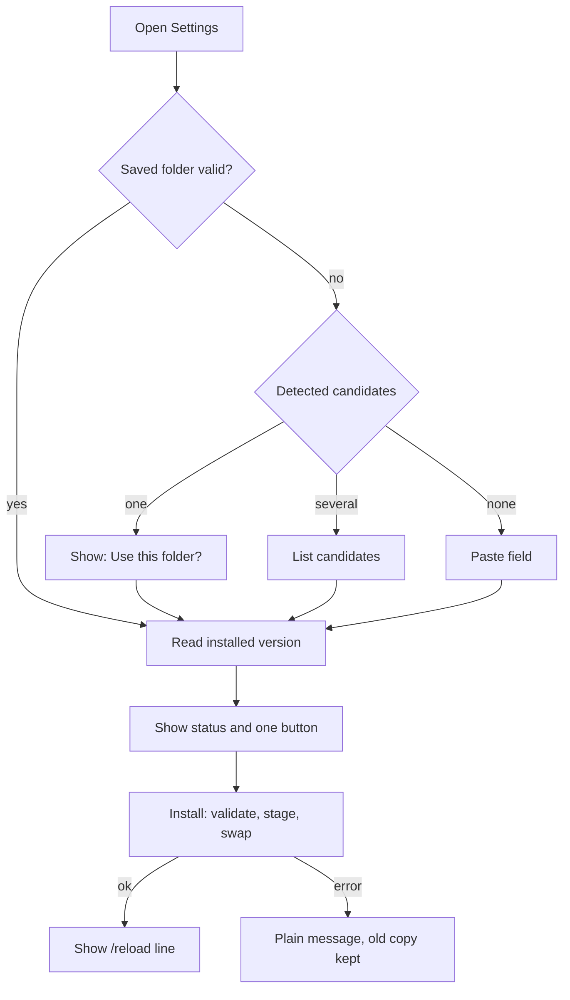

# 0028. The desktop app installs the bundled addon

* **Status:** Accepted (first slice). Amends [0002](0002-addon-shows-data-only.md) (the addon stays data only; the app writes its files and never reads saved variables), [0013](0013-single-rust-crate.md) (the module list gains `addon_install`) and [0020](0020-one-new-repository-standalone-addon.md) (the addon is also embedded in the binary). [0012](0012-one-web-app-for-phone-and-desktop.md) is unchanged: no Tauri IPC is used, and the picker is a later server-side dialog. Several facts below are unverified until a live run on a real install (see the last section).
* **Date:** 2026-11-21
* **Deciders:** Hugh Kaznowski (decisions 1 to 7 and the open questions in `docs/design-process/archive/addon_installer_concepts_brief.md`, resolved 2026-11-21)

## Context

Today a player installs the addon with `mise run install-addon`, which needs a repo checkout, bash and rsync. That is a developer path. A player has the desktop app, so the app should show whether the addon is in the game's AddOns folder, which version, and install or update it in one click. No network is used.

An endpoint that writes to a folder chosen by the caller is a write-and-delete primitive. Loopback and the token stop phones, but any local process or a DNS-rebinding page can still reach loopback, so the limits live in the installer and not only in the route. The main window also has no IPC permissions on purpose (`app/capabilities/default.json`, [0012](0012-one-web-app-for-phone-and-desktop.md)), so a JS dialog plugin is not an option.

## Decision

**Bundle.** `app/build.rs` walks `../addon/ForeverTogether/`, skips dot files, and emits a sorted table of `(relative path, bytes)` using `include_bytes!`. It prints `cargo:rerun-if-changed=../addon/ForeverTogether`. It parses the `## Version:` line of the `.toc` at build time, so a malformed version fails the build. No new crate (`include_dir`, `rust-embed` and Tauri `bundle.resources` were weighed and rejected: no crate for 8 files, and resources are missing in headless runs and tests). The source stays one copy, `addon/ForeverTogether/`, proven by a test.

**Where the code lives.** `app/src/addon_install.rs` is pure logic with no HTTP and no Tauri: version parser, status comparison, folder validation, the per-OS candidate list (environment passed in so tests can fake it), inspection and install, and a closed `AddonError` enum that maps `io::ErrorKind` to a stable code. `app/src/server/addon_routes.rs` translates HTTP to the module. File work runs in `spawn_blocking` behind a mutex so two installs cannot overlap. `Settings` gains one field, `addon_dir: Option<String>` (`#[serde(default)]`, so old stored settings load). It is in `touches_loopback_only()`.

**Folder rules (containment).** Applied on save and again on every install:

1. Absolute path. Strip surrounding quotes and whitespace. Reject `..` and NUL. Expand `~` only on a pasted path.
2. Canonicalise, then require: it exists, is a directory, its last component is `AddOns` (case-insensitive on Windows and macOS), and its parent is `Interface`.
3. The writable target is the constant `<AddOns>/ForeverTogether`. The client never sends a sub-name.
4. Refuse if `ForeverTogether` is a symlink (the message says it is a link, for example a developer link to the repo) or contains symlinked entries.
5. Never remove anything outside that one folder.

The grandparent folder name (`_forever_`, `_classic_`) is not enforced, because the client's folder name is unverified and the `Interface/AddOns` shape already blocks `/` or a home directory.

**Install algorithm.** Stage, then swap, in the same `AddOns` folder:

1. Remove a leftover `.ForeverTogether.new` from an earlier failed run.
2. Write every bundled file into `.ForeverTogether.new`.
3. Rename `ForeverTogether` to `.ForeverTogether.old`, rename `.ForeverTogether.new` to `ForeverTogether`, remove `.ForeverTogether.old`.
4. If a rename fails, report the mapped error, leave the previous folder in place and remove the stage.

The whole `ForeverTogether` folder is replaced, so files a player added inside it are removed, like the developer script. The UI says so. A second install of the same bundle succeeds and changes nothing visible. The game is assumed to ignore dot-prefixed folders (unverified).

**Version rules.** Read the first `## Version:` line (key case-insensitive; strip a BOM, CRLF and whitespace). If both values parse as dotted numbers, compare numerically; otherwise compare as plain text for equality only and show both strings. Equal version and equal bytes is `up_to_date`; equal version and different bytes is `files_differ`; installed higher is `installed_newer`; a missing `.toc` or no parseable line is `unknown_version`. Install is allowed in every state except `no_folder` and `folder_invalid`. For `installed_newer` the same single button is used ("Install 0.x anyway"), with no second click. The author bumps the `.toc` version by hand and players use release builds, so `installed_newer` is rare.

**Detection.** A table of candidates, kept as data in one place and marked unverified:

* macOS: `/Applications/World of Warcraft/_forever_/Interface/AddOns`.
* Windows: `%ProgramFiles(x86)%\World of Warcraft\_forever_\Interface\AddOns` and the `%ProgramFiles%` equivalent, built from environment values. Nothing user-specific is hard-coded.
* Linux: none in v1.

`_forever_` is the only flavour detected. Candidates that fail validation are dropped. Exactly one is shown as "Use this folder?" and saved only on the first confirmed install, so a guess never writes silently. Several are listed. None shows the paste field. If the saved folder disappears, the status is `folder_invalid` with the old path shown and detection runs again.

**API.** All three routes are loopback-only (the GET exposes folder paths), desktop only, and need the token. The install body carries no path: the route uses the saved, re-validated folder.

| Route | Purpose | Body or response |
| --- | --- | --- |
| `GET /api/addon` | status | `bundled_version`, `folder` (or null), `folder_source` (`saved`, `detected`, null), `candidates[]`, `installed` (`missing`, `present`, `unreadable`) with `version`, and `status` |
| `PUT /api/addon/folder` | validate, set and save the folder | `{ "folder": "<path>" }` |
| `POST /api/addon/install` | install into the saved folder | no path in the body |

`status` is one of `no_folder`, `folder_invalid`, `not_installed`, `up_to_date`, `update_available`, `files_differ`, `installed_newer`, `unknown_version`.

Errors reuse `CoreError` with a stable code and a plain message that names the folder. The raw OS error goes in a separate field shown under Details.

| Code | HTTP | Trigger |
| --- | --- | --- |
| `addon_folder_unset` | 409 | no folder saved or detected-and-confirmed |
| `addon_folder_invalid` | 400 | fails validation |
| `addon_folder_missing` | 404 | saved folder is gone |
| `addon_permission_denied` | 403 | `PermissionDenied` |
| `addon_read_only` | 409 | read-only file system |
| `addon_no_space` | 507 | disk full |
| `addon_locked` | 409 | Windows sharing violation |
| `addon_install_failed` | 500 | anything else |

**Picker.** v1 is detection plus a pasted path. A "Browse" button backed by a loopback-only route where Rust opens the native dialog is stage 2 (it returns 409 when headless). `capabilities/default.json` keeps `"permissions": []`.

**UI.** A new Addon card between the Phone link card and Advanced in Settings, with a status badge, a values line and one button. After a successful install it says to type `/reload` in the game. The app cannot tell whether the game is running. The first-run "Get the addon" step is unchanged in this slice.

**Scripts.** `scripts/install-addon.sh` and `mise run install-addon` stay as they are: a development convenience, not part of the app. The script is for developers, the Settings Addon card is for players.

## Consequences

* The addon stays data only ([0002](0002-addon-shows-data-only.md)). The app now writes the addon's files, and never reads saved variables (the addon has none).
* The binary carries a second, generated copy of the addon, rebuilt when the addon folder changes ([0020](0020-one-new-repository-standalone-addon.md)). A test keeps it equal to the folder.
* One new module (`addon_install`, [0013](0013-single-rust-crate.md)), one settings field and three loopback routes. No new crate and no new IPC capability.
* The app can now read the installed addon version once a folder is known, so the earlier statement that it cannot know whether the addon is installed no longer holds.
* Two install paths exist (script and app) and can drift. Accepted: the script is for developers.
* A file the player adds inside `ForeverTogether/` is removed on install.
* Out of scope: download or release tracking, detecting a running game, auto-update prompts, uninstall, Battle.net config or registry reading, backups or rollback history, any change to the addon itself.

## Unverified assumptions

Treat all of these as unconfirmed until a live run on a real install:

* The Forever folder layout beyond the author's macOS machine (`_forever_/Interface/AddOns` is one observation).
* The Windows default paths and every Linux path.
* Game behaviour during an in-place swap while the game runs.
* Windows file locking and whether `Program Files` needs admin rights.
* Dot-prefixed folders (`.ForeverTogether.new`, `.old`) being ignored by the client.
* A native folder dialog from the Rust side on macOS (stage 2).
