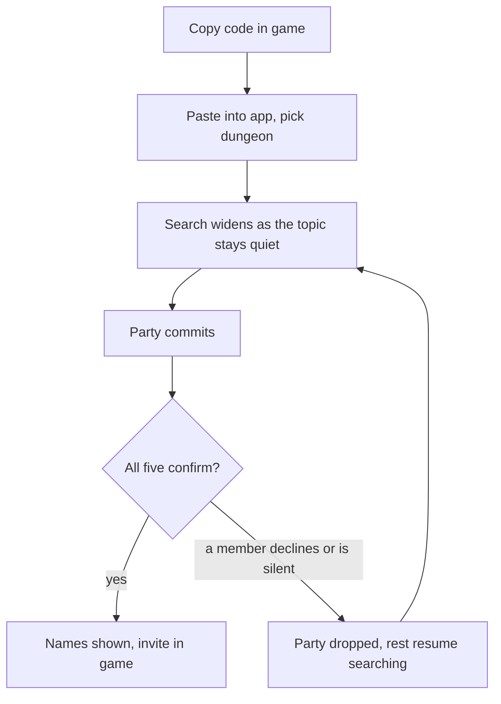

# 0034. System overview, goals, user journeys, non-functional requirements and risks

* **Status:** Accepted. This record contains what was in `docs/design-process/archive/forever-together.md` (archived 2026-11-21). It restates, and does not change, decisions in [0001](0001-native-desktop-app.md) to [0033](0033-header-and-character-strip.md); where they differ, those win.
* **Date:** 2026-11-21 (first draft 2026-11-20)
* **Deciders:** Hugh Kaznowski

## Context

Forever has a classic-style manual group finder and no random dungeon finder, so finding a group is slow, worst at the dungeons and levels where few people look. A hosted matchmaking service would need someone to run, pay for and keep it online, and would own player data. The author wants a tool anyone can run, copy and modify with no service behind it.

## Decision: the system

Three parts in one repository ([0020](0020-one-new-repository-standalone-addon.md)): a standalone addon that shows a character code as text and QR and does no networking ([0002](0002-addon-shows-data-only.md)); a Tauri 2 desktop app that takes the pasted code, joins a peer-to-peer network, agrees a party of five (1 tank, 1 healer, 3 damage) and shows the other members' names; and one web app embedded in the binary, served to the app's own window and to phones over the local network with a per-install token ([0012](0012-one-web-app-for-phone-and-desktop.md)). `WOWFT_WEB_DIR` overrides embedded files. Topic = region + realm + faction + dungeon ([0005](0005-topic-without-level.md)); level, item level and role are matching conditions. Bootstrap is remembered peers, peer exchange, then trusted peers ([0009](0009-bootstrap-and-peer-exchange.md), [0023](0023-no-supernodes.md)). Everything the addon reports is self-reported ([0003](0003-self-reported-data.md)).

## Goals

* A code small enough to scan from a game window (at most 122 characters), in one versioned format with shared test vectors ([0018](0018-code-format.md)).
* Pasted code is shown as understood; search is for one dungeon or all recommended ones; location is a preference, never a refusal ([0006](0006-dungeon-table.md)).
* A search starts strict and loosens in a fixed order: item level, secondary roles, level spread, more dungeons ([0011](0011-search-widening.md)).
* A peer confirms at most one party; a party is final only when all five confirm; an absent member's app declines and the rest resume ([0024](0024-liveness-and-decline.md), [0025](0025-leader-invitations.md)). After all confirm, names are shown labelled as claimed.
* Nothing hosted by the author. Local storage with `varaq`, TLS with rustls ([0008](0008-iroh-and-local-storage.md)).
* Starting success targets, unverified: in simulation at 3,000 peers, at least 70% of peers with a compatible five in their sample commit within 3 epochs; in real use on a crowded topic, median time to a committed party under 2 minutes.
* Functional tests only, with a seeded simulation of the agreement rule ([0014](0014-functional-tests-only.md)).

## Non-goals

Proving a character is real; tokens or authentication on the addon, QR or p2p network (a token only approves a phone); encrypting the LAN link; raids and groups over five; full gear lists and, in v1, professions; inviting players for the user; a hosted page, in-page camera, WebRTC or mobile apps; cross-realm, cross-region or cross-faction matching; shared reputation or blocking (each app keeps only a local temporary memory); sharding in v1.

## Critical user journeys

1. **Find a party from the desktop.** A level 24 Alliance character on a PvE realm pastes the code, picks The Deadmines and starts the search; the app shows progress, asks Confirm on commit, then shows the other four names, labelled as claimed.
2. **Phone as a second screen.** With phone link on, the phone scans the pairing QR, stores the token and removes it from the address bar, scans the addon QR and pastes the code; a request without the token is refused and a token reset un-pairs every phone.
3. **Quiet topic and a party that does not confirm.** Each widening stage is shown when reached; the absent member's app sends a Decline; if an app does not answer at all it is banned locally for about a minute, with no penalty otherwise.
4. **First start.** The app creates its permanent key, asks the built-in trusted peers (last resort, with backoff), saves what it learns, and uses remembered peers first next time.

## Non-functional requirements

* **Security.** Every API route except static files needs a bearer token. Pairing, token reset, phone link, trusted-peer changes, history clear and addon install accept only loopback requests. Host and Origin are checked, no cross-origin permission is sent, bodies and rates are limited, and the raw code is never returned. The token travels over plain HTTP on the local network, which the app states.
* **Privacy.** A permanent iroh key lets peers recognise a player across sessions, and connected peers learn each other's IP addresses. The app says so. The known-peers table is local and shares only peer IDs and topics. Trusted peers see which peers cold-start.
* **Performance.** The design assumes busy topics. No load tests.
* **Compatibility.** The code, topic names and every protocol message carry a version; a decoder refuses an unknown version; peers on different versions use different topics and do not meet. Table contents are not versioned.

## Risks

| Risk | Mitigation | Status |
|------|------------|--------|
| Forged data | In-game invite is the real check; labels say "claimed" | accepted |
| Free identities (a key costs nothing; rotation avoids the local ban; rank grinding) | Rate limits, human Confirm, local-only ban | accepted |
| Ghost or absent peers | Ready within 4 s, heartbeat, 60 s local ban | mitigated |
| Name harassment through proposals | Per-peer proposal rate limits | accepted |
| Peer table abuse | Entries dialed before they count, capped per response, reserved cache slots | mitigated |
| Agreement fails when samples differ | Leader invitations (0025), simulation only | open: ticket 0005 |
| Quiet topics depend on peer exchange | Reserved slots, widening, trusted-peer fallback | mitigated |
| Trusted peers as single point of failure, cold-start load | More keys over time, ordinary peers, backoff; key rotation needs a release | open: tickets 0008, 0010 |
| Young dependencies (`iroh-gossip`, `varaq`) | Spike checks; keychain fallback if `varaq` fails the key-file test | open: tickets 0003, 0004 |
| Dependence on n0's hosted relays and DNS through iroh's default preset | DHT address lookup alongside n0's DNS, and project hole-punching relays run by headless nodes (ADR 0041); n0's relays stay | mitigated on one machine: ticket 0049 (real NATs open) |
| IP addresses of every peer readable from DNS and the DHT by anyone with the peer ID (ADR 0041); peer IDs travel in gossip to every swarm member | Accepted by the author; say so to players | accepted |
| A relay sees which endpoint IDs connect from which addresses; the project relay is plain HTTP, so a path observer sees it too | Payload is end-to-end encrypted; the relay is opt-in on headless nodes only | accepted |
| A rate-limited relay still carries a trickle of traffic (about 2 kB/s per client) | The limit is low; bulk traffic starves | accepted |
| IP exposure, open LAN API | Stated in the app; token, Host and Origin checks, a visible on/off switch | accepted |
| Unverified client assumptions | Spike S0, provisional spec values | partly done: tickets 0001, 0002 |
| Too few users early | Widening, community communication | accepted |
| Scope before the first party | Build order, one release by decision | accepted |

## Consequences

The rejected alternatives (browser-only page, hosted signaling, signed QR, saved-variables reading, screen capture, level in the key, DHT, central server, libp2p, a workspace of crates, and others) are recorded in the ADR that rejected each and in the archived `docs/design-process/archive/forever-together.md`. Future work that is not decided lives in `tickets/`; the byte layouts are in `docs/rdf-code-spec.md`.
