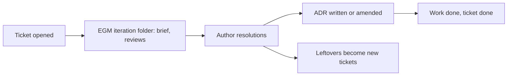

# 0036. Tickets drive work, EGM iterations live in one folder per ticket, and ADRs record the outcome

* **Status:** Accepted
* **Date:** 2026-11-21
* **Deciders:** Hugh Kaznowski

## Context

The project uses the elephant goldfish model (EGM: a concepts brief reviewed by several reviewer agents, then resolved by the author). Left alone, EGM agents choose where to write briefs and reports, so design material scatters, and nothing says which file is current. The author wants a clear, predictable system for designs and decisions as work iterates.

## Decision

Four kinds of document, each with one home and one job.

| Kind | Home | Job | Changes |
|------|------|-----|---------|
| Ticket | `tickets/NNNN-slug.md` | One unit of work or open question; the index of everything about it | Status and links change |
| EGM iteration | `docs/egm/NNNN-slug/` (same number and slug as its ticket) | The working papers of one design pass: brief, review reports, resolutions | Appended while open; frozen when closed |
| ADR | `docs/adr/NNNN-slug.md` | What was decided and why, in the present tense | Immutable once accepted, except status and "superseded by" |
| Spec and results | `docs/rdf-code-spec.md`, `docs/spike-s0.md` | Byte formats; measured facts | Edited in place |

**Rules**

1. **A ticket first.** Any EGM run starts from a ticket. The iteration folder is named after it. No ticket, no iteration.
2. **EGM writes only inside its folder.** Every EGM prompt names the output paths: `docs/egm/NNNN-slug/brief.md`, `reviews/<reviewer>.md` per round (`reviews/r1-<reviewer>.md`, `r2-...`), and `resolutions.md` for the author's answers. An agent never creates a file elsewhere in `docs/`, never edits an ADR, and never edits another iteration. The orchestrator (Claude Code) moves anything misplaced before committing.
3. **Fixed iteration layout.** `README.md` (status, rounds, links to ticket and ADRs), `brief.md` (the concepts brief; absent when a pass starts from a design draft), `design_draft.md` (the design draft, when the pass drafts one), `reviews/`, `resolutions.md`. Nothing else. Amended 2026-11-21 to add `design_draft.md`.
4. **Decisions leave the iteration as ADRs.** When the author resolves a question, the same change writes or amends an ADR that links the iteration folder as its source. The ADR states the decision; the folder keeps the debate. If they disagree, the ADR wins.
5. **Closing.** An iteration is closed when its ADRs exist and its leftover work is ticketed. The folder stays where it is (history, not moved to an archive), its README says `closed`, and the ticket links ADRs and folder.
6. **One commit per step, labelled.** `egm(NNNN): brief`, `egm(NNNN): review round N`, `egm(NNNN): resolutions`, `adr(MMMM): <title>`, `ticket(NNNN): <status>`. Never mix an EGM step with code.
7. **Ticket fields.** Each ticket has `Status` (open, in progress, blocked, done, dropped), `Priority` (P0 to P3, scale in `tickets/README.md`; added 2026-11-21), `Kind`, `Source`, `ADRs` and `EGM` (links or "none"), and `Blocked by` when it waits on another ticket. A ticket is done when its work is merged and its ADRs exist.
8. **Existing material.** `docs/design-process/archive/` is legacy and frozen: the old briefs and reports from before this rule. New iterations never go there.

## Consequences

* A reader finds a decision in `docs/adr/`, its debate in `docs/egm/<same number as the ticket>/`, and its work in `tickets/`.
* Iteration numbers follow ticket numbers, so they are not contiguous.
* The orchestrator must name output paths in every EGM prompt; the reviewers' own defaults are not trusted.
