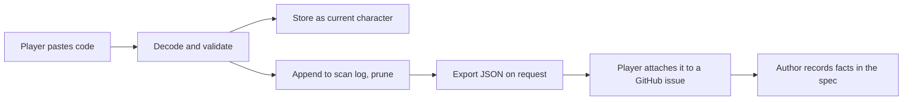

# 0038. The app keeps a log of the codes it has scanned and lets the player export it to attach to a GitHub issue

* **Status:** Accepted (decided by the author 2026-11-21; not built). Extends [0008](0008-iroh-and-local-storage.md) (local storage). Amends [0013](0013-single-rust-crate.md) (the module list gains `scans`). Cites [0003](0003-self-reported-data.md), [0018](0018-code-format.md) and [0027](0027-search-history.md). Items marked *default* are my choices where the author did not say; they are revisable.
* **Date:** 2026-11-21
* **Deciders:** Hugh Kaznowski

## Context

Live facts about the game (region numbers for US, KR, TW and CN, the Hardcore realm value, how item level and zone strings look in other languages) can only come from real clients, and the author has one EU client. Players hold the rest. The codes they paste already contain region, realm, item-level flag and zone. A log of those codes, exported on request, gives the author real samples with no service and no automatic upload ([0034](0034-system-overview-goals-and-risks.md): nothing is hosted).

It also shows how one character's code changes over time (level, item level, zone, spec), which is data the spec has no other source for.

## Decision

* **What is logged.** Every code the app accepts (`POST /api/character` succeeds) is appended to a local scan log: the raw `WFT1:` text and the time it was accepted (UTC seconds). The record is not decoded again; the code is the source of truth ([0018](0018-code-format.md)). An identical code (same `created` and `counter`) is not stored twice.
* **Per character, bounded.** A character is identified by region, realm, first name and surname (a name alone is not unique across realms). *Default:* faction is not part of the identity. At most **20 entries per character**; the oldest is dropped when a 21st arrives. Each entry expires **3 months (90 days)** after it was accepted. Pruning runs on every write and before every export. *Default:* a refreshed code for a known character is simply a new entry, so the sequence shows how it changed; the cap and the expiry stop it growing.
* **Store.** One key per entry under `scans/`, like `known_peers/` and `history/`: `scans/<region>/<realm>/<first name>/<surname>/<accepted UTC seconds, zero-padded>`. Each entry carries a schema version. An entry that fails to decode is skipped and never blocks a scan. A failing write is logged and never rejects a paste.
* **A new module `scans`**, a pure module over the key-value store with no new dependency, outside the engine.
* **Local only until the player acts.** The app never uploads anything. **Export** is a desktop-only (loopback) action that produces one JSON file: app version, spec version, export time, and the characters with their entries (raw code and accepted time). The player reads it, then attaches it to a new GitHub issue through the existing report link. The JSON is too large for a link, so the app offers the file and the link, not a prefilled body.
* **Consent wording, one sentence, before export:** the file contains character names, realms, zones and the times the codes were made. Names and zones are in the codes themselves, so removing them would remove the samples that matter. *Default:* export includes every logged character; the player can delete entries or the whole log first.
* **Controls.** "Clear scan log" (desktop only). The log is independent of the current character: `ClearCharacter` does not delete it, because other characters are the point. Search history ([0027](0027-search-history.md)) is never part of this export.
* **Test and doc data** use invented characters only ("Testa Fakename", "Testville"). Real exported files are never committed. Facts learned from them are recorded in the spec, not the files, as with the live captures.

## Amendment 2026-11-21: the export is encrypted to the first trusted peer's key

Decided by the author. The exported JSON is encrypted to the public key of the **first entry in `net::trusted::BUILTIN`**; the author holds the matching private key and decrypts it. An encrypted file is safe to attach to a public GitHub issue, which a plain file is not.

* **Encrypted only.** The app offers no plain export. If `BUILTIN` has no key yet (ticket 0008), export is unavailable and the card says so. *Default.*
* **Scheme (decided).** The `age` format with an ssh-ed25519 recipient built from `BUILTIN[0]`: `age` converts the Ed25519 key to X25519 itself, so the project writes no cryptography. The player cannot read the file back. *Caveat accepted by the author:* the iroh key is a signing key and now also receives encryption; a separate intake key and sealing to two keys were rejected. The author owns `BUILTIN[0]` and decrypts with `age -d -i <exported key>`.
* **Review before export.** Because the player cannot read the file afterwards, the app shows what will be sent (characters, number of scans, a sample entry) before it encrypts. The consent line stays. Only `BUILTIN[0]` is used; keys the player adds under `trusted_peers` are never an export recipient.
* **Format.** `age` ASCII armor, saved as `scans-<date>.wowft-scans.age`, pasteable into an issue or attachable. The key tag in the `age` header tells the author which key to use after a rotation. There is no custom header.
* **Key loss.** Without the private key nobody can read old files. Backups of that key are in [0039](0039-key-management.md) and ticket 0043.

## Consequences

* Region and realm values for players on other regions arrive as codes, and the author maps them as in ADR 0004.
* A third party reading an exported file learns nothing: it is encrypted to the author's key. Only the key holder, and anyone who obtains that key, can read names, realms and zones.
* Entries older than 90 days vanish even if nobody has exported them.
* Not decided: a size cap for the file. Hiding names in the export is less urgent now that the file is encrypted. The cap of 20 entries per character bounds a character, not the number of characters.
