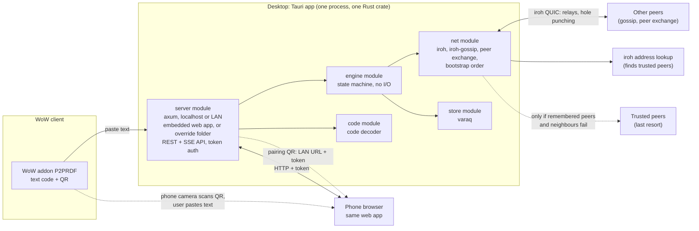
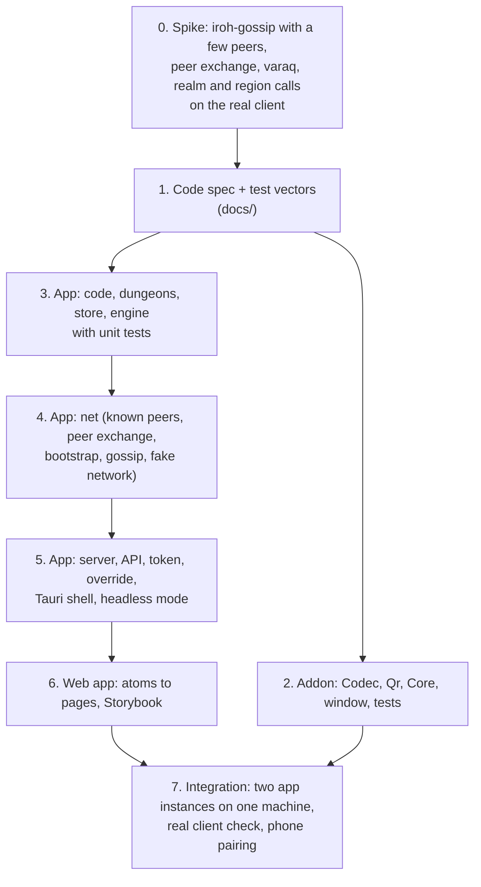

# p2prdf: peer-to-peer random dungeon finder

*   **Author:** Hugh Kaznowski
*   **Status:** Proposed
*   **Date:** 2026-11-20

--------------------------------------------------------------------------------

## Overview

p2prdf helps players of World of Warcraft Forever find a group for a dungeon without a central matchmaking server. It has three parts:

1.  **A standalone WoW addon** (`P2PRDF`, in the same repository as the app, touching no existing addon). It shows the player's character as a code they can copy as text or scan as a QR code. It does nothing else: no networking, no pairing, no tokens.
2.  **A desktop app** (Tauri 2, Rust and React/TypeScript, in its own open-source repository started from the author's template). The player pastes the code. The app joins a peer-to-peer network, searches for other players who want the same dungeon, agrees on a role-balanced party of five with them, and shows each member's character name so they can invite each other in game.
3.  **A phone web app.** The desktop app serves one statically hosted web app over the local network, and its own window shows the same web app. A phone opens it, scans the addon's QR code with its native camera app, and pastes the text into the web app. The phone and the desktop window use the same API. A per-install token, handed over through a pairing QR shown on the desktop, approves each phone. The web app files are embedded in the binary. If an environment variable names a folder, the app serves files from that folder first and falls back to the embedded files, so users can change themes and layout.

On Forever, a realm is a ruleset (PvP, PvE, RP-PvP, RP-PvE, and later Hardcore) that runs as a sharded mega server in each region. Players on the same realm can group with each other, and players on different realms cannot. Players can only form a party with their own faction, so a search topic is identified by `region + realm + faction + dungeon`, and peers who share that topic find each other. Level is not part of the topic. It travels in each player's search ad and is a matching condition, like item level. The app holds a fixed table of the dungeons (level range, minimum level, a faction hint, zone and whether the dungeon is available yet). The dungeons themselves are not tied to a faction. The faction hint only says which faction's side the dungeon is near, and is used to recommend dungeons. From the character's level and location it recommends dungeons, and the player picks one or searches the recommendations. The author expects very large player numbers (around two million per realm per region, with an unknown share running the app), so the design assumes crowded topics most of the time and loosens a search over time when a topic is quiet.

The author does not want to host a matchmaking service. The public DHT is used only through iroh's address lookup, to find the addresses of a few trusted peers whose public keys are built into the app. After that, the app's own peers exchange lists of known peers (with the topics each one claims) and gossip. Trusted peers, starting with one run by the author, are the last resort for first contact.

## The Problem

Finding a dungeon group in Forever today is assumed to mean shouting in chat channels, reading other people's shouts, or asking friends. That is slow, works worst at the levels and dungeons where few people are looking, and fills public channels with noise. (This paragraph is an assumption of the draft. The author should confirm what the client offers today, since the API export lists some group-finder functions such as `GetLFGInfoServer` and I have not checked whether they are usable.)

A central matchmaking service would fix this, but it needs someone to run it, pay for it and keep it online, and it becomes a single point of failure and a single owner of player data. The author wants a tool anyone can run, copy and modify, with no service behind it.

The proposed solution is a pair of small tools. The addon turns the live character (first name and surname, class, race, level, role and spec, item level, location and realm) into a short code, because an addon cannot talk to the network or write files while the game runs. A separate desktop app, with a phone web app as a second view of it, takes that code and does the finding. Peers discover each other through a peer-to-peer network, propose and accept parties among themselves, and give the players each other's names to invite in game. Everything the addon reports is self-reported and can be forged. The design accepts this and records it as a known limit.

## Goals

*   **Addon code.** The addon module shows a copyable text code and a QR code of the same data (first name, surname, realm, region, faction, class, race, level, role and spec, item level, location, a version byte and a typo check). The code is small enough that the QR scans reliably from a game window.
*   **One shared code format.** A written, versioned specification of the code, with test vectors that the Lua encoder and the Rust decoder both pass, and a clear "update the addon" or "update the app" message on an unknown version.
*   **Desktop app.** The app accepts a pasted code, shows what it understood, and searches for a party of five (1 tank, 1 healer, 3 damage dealers, relaxed after a wait) under the topic `region + realm + faction + dungeon`, matching on level, item level and role.
*   **Dungeon table and recommendation.** The app hard-codes the dungeon table (name, level range, minimum level, a faction hint, zone, status). It recommends dungeons from the character's level and its proximity to each dungeon's zone, and the player picks one or searches all recommendations. The faction in the table is a hint for the recommendation, not a rule about who may enter. Dungeons marked "Coming Soon" are shown but cannot be searched. Location is a preference, not a check: players who are far away are not refused, and the app tells them how far they are from the dungeon and from the other party members.
*   **Search that loosens over time.** A search starts strict and relaxes in a fixed, visible order (item level and role, then a larger allowed level spread between party members, then more shards of the topic, then more dungeons). The schedule is part of the matching algorithm. It is not controlled through the API, and the app only shows the current stage.
*   **Live progress.** The app shows how many players are searching, the current constraints, matches, rejections, and what happens next.
*   **Agreement among peers.** A player is never in two committed parties. Once the network agrees on a party, its members stop searching and start rejecting other proposals. Retries stop when all five confirm, and searching resumes if someone does not.
*   **Name reveal.** After all five confirm, the app shows the other members' character names, labelled as claimed by the other player, and the players form the party in game.
*   **No hosted service.** Peers find each other through remembered peers first, peer exchange with the peers they already know second, and the trusted peers only as a last resort. A trusted peer is not contacted while an earlier step works.
*   **Known-peers table.** Each app keeps a table of known peers with the topics they claim, as a least-recently-used cache. The maximum size is a setting, 100 by default. The table is stored locally and used for first contact and for answering other peers' requests.
*   **Permanent identity.** Each install generates its network key once and keeps it. The trusted peers' keys are permanent and their public parts are built into the app as a list, which users can extend in a setting.
*   **One web app for phone and desktop.** The desktop app serves one statically hosted web app (embedded in the binary), used by its own window and by phones. They use one API. A pairing QR shown on the desktop approves a phone with a per-install token, and the token can be reset to un-pair every phone.
*   **Override path.** An environment variable can name a folder of web app files that take priority over the embedded files, so users can change themes and layout. The API and the token rules are the same for custom and embedded files. The app states that a custom web app has the same access as the embedded one, so users should only point it at folders they trust.
*   **Local storage.** The app stores its identity, cached peers and settings with the `varaq` crate, and uses rustls for TLS.
*   **Functional tests, not performance tests.** The core state machine is tested with a small number of simulated peers (a handful to a few dozen, using the in-memory fake network) for correct behaviour: parties have the right roles, a peer confirms at most one party, unconfirmed parties are dropped and searches resume, widening follows the schedule. There are no load tests or large-scale simulations. The addon's encoder and QR have tests in the headless VM. A real phone scan and the on-screen look of the QR are manual checks.

## Non-Goals

*   **Proving a character is real.** Forgery is a known, accepted gap. Nothing in the addon, the code or the network can prove the data is true.
*   **Tokens or authentication on the addon, the QR or the p2p network.** A token exists only to approve a phone for the desktop app's local network API.
*   **Protecting the LAN token on plain HTTP.** The token is sent over HTTP on the local network, which the app states as a risk on untrusted networks. Encrypting that link is out of scope.
*   **Raids and groups larger than five.**
*   **Full gear lists.** A single item level number is the gear summary, if the client can supply it.
*   **Professions in the first version.** Professions are in the original idea but cost code size, and are deferred (see Open Questions).
*   **Inviting players for the user.** The app shows names. The players invite each other in game.
*   **A hosted web page, in-page camera or WebRTC.** The author chose a local, self-hosted design.
*   **Mobile apps.** The phone uses its browser and its native camera app.
*   **Cross-realm, cross-region or cross-faction matching.** Players on different realms, regions or factions cannot group, so they are never matched.
*   **Reputation or blocking between peers.** A local backoff for players who do not confirm is the only memory of past behaviour.

## Open Questions

*   **Where the table lives.** The author's table gives level ranges, minimum levels, a faction hint and zone names. It is stored as a data file in the app, and someone checks its numbers against the client.
*   **Project and protocol names.** The repository is `forever-together`, while the project, the addon (`P2PRDF`), the topic prefix and ALPN (`p2prdf/1/...`, `p2prdf/peers/1`), the slash command `/p2prdf` and the environment variable `P2PRDF_WEB_DIR` still use `p2prdf`. The author has not decided whether those names change to match the repository.
*   **Name calls.** Does `UnitName("player")` return first name and surname on the real client, does `GetUnitName` return "First Surname", and does the in-game invite accept that text (`adr/0022`)?
*   **Realm values.** Which calls on the real Forever client return the realm (the ruleset) and the region, and what values do they give for PvP, PvE, RP-PvP, RP-PvE and Hardcore? The candidates (`C_GameRules.GetActiveGameMode`, `GetCurrentGameModeRecordID`, `GetForeverExperiencePreset`, `IsHardcoreActive`, `GetCurrentRegion`) are only seen in the API export.
*   **Peer exchange coverage.** With no topic-keyed lookup, a peer on a quiet topic is found only if a peer you ask already knows it. How many neighbours must a new peer ask, and for how long, before a rare topic is considered empty? Does a 100-peer table hold enough peers for the topics a player's widening steps need?
*   **Table eviction.** The table is a least-recently-used cache. Should entries for the player's active topics be protected from eviction, so widening still has peers to ask, or is plain least-recently-used enough? What counts as a use: a successful dial, an answered request, or being listed in a response we used?
*   **Gossip at scale.** Does `iroh-gossip` behave with a few hundred peers per topic, and how large should a shard be before a key splits?
*   **Converging announcements.** How well does the rule converge when peers' samples differ, and which epoch length, ad cutoff, sample size and confirm timeout to start with? The first values are best guesses and are tuned from use on the real network, since the tests cover behaviour and not scale.
*   **Shard counts.** Which topics need more than one shard, and how many? The table ships with the app and is part of the protocol version, so it needs real traffic numbers or a measured estimate.
*   **Name matching.** The code carries the zone name as the client reports it, and the app matches it to the table's English zone names. A client running in another language reports localized names, so those characters get no same-zone ordering and an "unknown zone" label. Is that acceptable until map IDs and positions are added, which would also give real distances?
*   **Shared zones.** Several dungeons share a zone (Searing Gorge: Blackrock Depths and both Blackrock Spires; The Barrens: Wailing Caverns, Razorfen Kraul and Razorfen Downs; Tirisfal Glades: Scarlet Monastery and Ruins of Lordaeron). Zone proximity cannot tell them apart, so the recommendation lists all of them and relies on level and the player's pick.
*   **Faction source.** The code carries the character's faction (`UnitFactionGroup` is listed in the API export, unverified on the real client). The client also lists `AreCrossFactionGroupQueuesAllowed`. Should the app check that on the real client in case Forever allows cross-faction groups later, or treat same-faction parties as fixed?
*   **Table updates.** The table has dungeons marked "Coming Soon". How does the app learn when one becomes available: a new app release, or a data file the app can reload?
*   **Item level.** Does `GetAverageItemLevel` work on this client? If not, the fallback is an 18-slot loop over items that load asynchronously.
*   **Professions.** Should professions be in the first code? They add size to the QR and have no part in matching yet.
*   **`varaq` maturity.** Is a version 0.1.x store good enough for the node identity and peer cache, or does the secret key need the operating system's keychain?
*   **Trusted peer deployment.** Where does the author run the first trusted peer (the same app in headless mode on an always-on machine), and does iroh's address lookup resolve its address from the key alone on the real network? Who else may run one, and how are their keys added?
*   **Level widening schedule.** What is the starting maximum level spread between party members, the step sizes and intervals, and the final limits of the fixed schedule?
*   **Level bias in samples.** A peer's sample of ads should favour peers of a similar level, so that a dungeon with a wide level range does not fill it with players who are too far away to group with. How strong should that bias be, and does it hurt convergence on the agreement rule?
*   **QR scannability.** Does a QR drawn with `SetColorTexture` squares scan from a phone at typical UI scales and window positions?

## Critical User Journeys (CUJs)

### CUJ 1: Find a party from the desktop

*   **Given**: The desktop app is running with a stored identity. A level 24 Alliance character on a PvE realm is standing in Westfall, and the player has the addon installed.
*   **When**: The player opens the addon window with `/rdf`, copies the code with Ctrl+C, pastes it into the app, picks The Deadmines from the recommended dungeons and starts the search.
*   **Then**: The app shows what it understood from the code and its age, and the search progress (searchers, current constraints, next stage). When five compatible Alliance players with 1 tank, 1 healer and 3 damage dealers announce the same party, the app asks for Confirm. After all five confirm, it shows the other four players' first names and surnames, labelled as claimed, and searching stops. The players invite each other in game.

### CUJ 2: Use a phone as a second screen

*   **Given**: The desktop app is running and LAN mode is on. The phone is on the same network.
*   **When**: The player scans the pairing QR on the desktop with the phone's camera app, opens the link, then scans the addon's QR code with the phone's camera app and pastes the text into the web app.
*   **Then**: The web app stores the token, removes it from the address bar and shows the same interface as the desktop. It accepts the code, and search, progress and Confirm work from the phone. A request without the token is refused, and resetting the token on the desktop un-pairs the phone.

### CUJ 3: A quiet topic and a party that does not confirm

*   **Given**: A player is searching for a rarely run dungeon where few peers are online.
*   **When**: No party forms for a minute. Later a party commits, and one member does not press Confirm within the time limit.
*   **Then**: The app shows each widening stage as it is reached (secondary roles, item level range, level spread, more shards, more dungeons). When the party times out, the confirming members return to searching and the member who did not confirm gets a local backoff.

### CUJ 4: First start on a new install

*   **Given**: The app starts for the first time. It has no remembered peers.
*   **When**: A search is started.
*   **Then**: The app creates and stores its permanent key, asks the built-in trusted peers for peers for the topic (as the last resort, with backoff), saves the peers it receives, and joins the topic. The next start uses the remembered peers and does not contact a trusted peer.

## Technical Plan (Architecture)

### Components

### 1. The character code (addon to app)

The addon builds one record and shows it two ways: as text the player copies with Ctrl+C, and as a QR code of the same text. The record is a fixed-layout binary structure encoded as base45 text with a short prefix (for example `P2R1:`). The fields:

*   version (1 byte), flags
*   first name and surname as two separate length-prefixed fields (every Forever character has both), faction, class ID, race ID, level
*   realm value and region value (opaque values supplied by the client, compared as given)
*   role and spec (derived from talents; the player can override the role in the app)
*   item level (0 if the client cannot supply it)
*   location: for now only names and no map IDs or positions: the zone name as the client reports it. Players search from outside a dungeon, so the code has no dungeon field. Map IDs and precise positions are left for a later version of the code format
*   time the code was made, in epoch minutes, and a counter
*   a short check value that catches mistyped or truncated pastes

The check value is a typo check and does not prove anything about the character. Every field is a claim by the sender. Numeric IDs are used instead of names so that localized text never reaches the app. The format is written down in a specification file with test vectors. The Lua encoder and the Rust decoder both have to pass those vectors. A decoder that sees an unknown version refuses the code and tells the user to update the addon or the app.

The QR encoder is written in plain Lua (no QR library is installed in the client) and draws the result with `SetColorTexture` squares, using whole-pixel module sizes and a quiet zone around the symbol. The addon recomputes the code when the player asks for it and when location or level changes, and shows how old the code is. No timers poll the game API.

### 2. Dungeon table and recommendation

The app carries a fixed table (a data file, versioned with the app): dungeon ID, name, recommended level range, minimum level, a faction hint, zone, and whether the dungeon is available or coming soon. Recommendation uses names and metadata only. It sorts the available dungeons for a character: the level must fall inside the minimum level and the recommended range (with some slack at the edges), and dungeons whose zone name equals the character's zone name come first, followed by the rest. There is no distance calculation yet. A dungeon's ID in search keys is a fixed English slug (for example `the-deadmines`), and the display name comes from the table. The faction column only orders dungeons by which side they are close to. Nothing refuses a player because of where they are. The player picks one dungeon, or searches all recommended ones, which means joining several search keys.

### 3. Search keys, swarms and shards

A search topic is `region + realm + faction + dungeon`. Level is not part of the topic, so a quiet dungeon is a quiet topic and the set of topics is fixed and known from the dungeon table: about 400 (5 realms, 2 regions, 2 factions and the 20 dungeons marked available in the author's table), before sharding. The topic is hashed with a protocol prefix (`p2prdf/1/...`) into a 32-byte topic ID. Each topic is an `iroh-gossip` swarm. Few topics make peer exchange work better, because each peer's known-peers table covers a larger share of the topics it needs. A busy topic (the end-game dungeons share levels 55 to 60 and may hold thousands of players) is split into a fixed number of shards: the topic ID includes a shard number, and a peer's shard is derived from its peer ID. The shard count for a topic comes from a table that ships with the app and is part of the protocol version, so all peers agree on it.

Peers in one swarm hold a partial view of the swarm: about 5 active connections and 30 passive peers (the `iroh-gossip` defaults). Every peer also keeps a bounded sample of the latest search ads it has seen, about 100 entries, and matches within that sample. When the sample is full, the peer drops the ads that are furthest from its own level first, so that a dungeon with a wide level range (for example Scarlet Monastery, levels 28 to 45) still leaves it with candidates it can group with.

### 4. First contact and bootstrap

A peer needs at least one other peer ID in its topic before it can join. It tries these in order and stops at the first that works:

1.  **Remembered peers.** The peers saved from earlier runs for this topic, a few at a time.
2.  **Peer exchange.** The peer asks the peers it is already connected to, "which peers do you know for topic T?". Each answers from its own known-peers table. Entries it receives are hints: the peer dials them, and an entry counts as live only after the other side answers and says it is in the topic.
3.  **Trusted peers.** The app has a built-in list of trusted peer public keys, which a setting can extend. iroh's address lookup resolves each key to current addresses, so the keys alone are enough to dial them. A peer contacts a trusted peer only when every remembered peer is unreachable and no neighbour could help. It asks for peers for its topic and a general sample, saves them and disconnects. It retries with exponential backoff and jitter, and each trusted peer limits its own connections and request rates.

**Known-peers table.** Each app keeps a table of peers it knows. Each entry has the peer ID, the topics the peer claims to be in, when it was last seen and when it was last used. The table is a least-recently-used cache. Its maximum size is a setting, 100 by default (a trusted peer running headless would set a much higher number). When the table is full, the least recently used entry is dropped. The table is stored with `varaq`, so it survives restarts. It is separate from the swarm sample in section 3, which holds search ads for matching and lives only while a search runs.

**Peer exchange protocol.** A small iroh protocol, versioned like the rest (`p2prdf/1/...`). A request names up to a few topics and a maximum number of entries. A response lists entries that match those topics, filled with random entries if there are few. When two peers connect, each tells the other which topics it is in. Responses and requests are rate limited, and a peer that lists too many topics or sends too many entries is ignored. Peers cannot prove the topics they claim, so a claim is only a hint until the peer is seen in the swarm.

**Trusted peers.** A trusted peer is the same app running headless with a flag. It has a long-lived key, a large known-peers table, and nothing else special. Because every cold-starting peer that finds nothing else connects to one, the load on trusted peers follows the number of cold starts and not the number of users. More trusted keys can be added over time.

**Limits.** A topic with few peers is found only if some peer the new peer asks already knows one of them. The search asks several neighbours and widens its reach over time. The DHT gives no topic-keyed lookup here.

Each install generates its iroh key once, stores it, and keeps it permanently. The public parts of the trusted peers' keys are built into the app. A trusted peer is the same app running headless with a flag, on an always-on machine. The known-peers table ages out unreachable entries and is refreshed while the app runs, so most starts never contact a trusted peer.

### 5. Search ads and widening

Each searching peer gossips an **ad** on each of its topics when something changes and as a slow keep-alive (every 30 to 60 seconds), which keeps the broadcast load low in large topics: peer ID, a counter, role (and any secondary role it can fill), level, item level, faction, current constraint stage, zone, and the time. An ad expires if it is not refreshed. A peer that has committed to a party sends a final ad that marks it as taken, and others drop it from their samples.

A search starts strict and loosens in a fixed order on a shared schedule: item level and role mix, then a larger allowed level spread between party members, then more shards of the topic, then more dungeons from the recommendation. The schedule is fixed in the matching algorithm (its numbers are settings with defaults). The API cannot pause, skip or change it, and the app only displays the current stage. The stage a peer is at is part of its ad, so every other peer judges compatibility using the same data. Topics that were added for widening are left when the search ends. Widening the level spread does not need any new topic, because the topic already holds every level.

### 6. Agreeing on a party: converging announcements

Time is divided into epochs of a few seconds. In each epoch every peer runs the same pure function on the same kind of input, and no negotiation takes place:

1.  Take the ads in the sample, using only those published before a cutoff slightly earlier than the epoch start, so that peers with slightly different views still see mostly the same ads.
2.  Order the peers by `hash(epoch, peerId)`, a shared pseudo-random order that changes each epoch so no peer is always first.
3.  Walk that order and build parties greedily. A party needs one tank, one healer and three damage dealers (relaxed after a wait, or by a peer's declared secondary roles). Everyone in it must be compatible with the others under their ad's own constraints (level spread, item level, faction, dungeon). Peers who cannot be placed wait for the next epoch.
4.  The party that contains this peer is its **announcement**: the epoch and the list of members. The peer gossips it. Each peer announces at most one party per epoch.
5.  A party is **committed** when a peer has seen announcements for the same epoch and the same member list from all five members. When this peer is one of them, it stops searching and ignores other parties' invitations. If this peer is not in the party, nothing changes for it.

When two peers have the same sample, they compute the same parties. When their samples differ at the edges, some announcements will not match. That epoch then yields no commit for those peers, and the next epoch uses a new order. Convergence depends on how much the samples overlap, which is the reason first contact tries to keep a topic's peers in one swarm.

After a commit, each member presses **Confirm**. A party is final only when all five members have confirmed, and each confirmation is a message that names the party. A peer confirms at most one party. A peer that sees a commit late may already have announced a different party in a later epoch. That party can look committed to its other members, but it cannot be confirmed by the peer that moved on, so it times out and its members search again. The one-party guarantee therefore holds at the confirmation step, and an unconfirmed commit can be wasted work for four players. If someone does not confirm within the time limit, the party is dropped, the others resume searching, and the non-confirmer gets a local backoff.

After the final confirmation, the app shows the other members' character names (first name and surname), labelled as claimed by the other player, and the players invite each other in game. The text to type into the invite is "First Surname", which is unverified on the real client.

### 7. The local web app and API

One statically built web app (React and TypeScript, from the author's template) is embedded in the binary and served by an axum server inside the desktop app. The desktop window is a Tauri window that loads this web app from the local server, so the desktop and the phone use identical files and the identical API.

*   **Override.** If the environment variable `P2PRDF_WEB_DIR` names a folder, the server looks there first for each requested file and falls back to the embedded file. Requests are normalized so that paths cannot leave the folder. API routes cannot be overridden.
*   **API.** HTTP routes under `/api`: paste or replace the character code, read the current state, start, stop, choose dungeons, confirm a party, and read the pairing QR data and reset the token (the last two only from the desktop). Live progress (searchers, constraints, matches, rejections, party state) is pushed to the page with server-sent events.
*   **Binding.** The server listens on localhost by default and on the local network when the user turns on LAN mode in the app. The app shows whether LAN mode is on and the address.
*   **Token.** The app generates a per-install token. The pairing QR shown on the desktop contains the LAN address and the token in the URL fragment. The phone's camera app opens it, the web app saves the token, removes it from the address bar, and sends it with every API call. The server refuses calls without a valid token. The desktop window gets the token from the app when it opens. Resetting the token un-pairs every phone.
*   **Other checks.** The server checks the Host and Origin headers, sends no cross-origin permissions, caps request size, and never returns the raw character code. The token travels over plain HTTP on the local network, so anyone who can read that traffic could read it. The app states that this is unsafe on untrusted networks. A custom web app folder runs with the same access as the embedded one.

### 8. Local storage and TLS

The `varaq` crate stores the iroh secret key, the cached peers, the settings and the API token. iroh's QUIC connections use rustls. The secret key is permanent: it is created only if missing. If `varaq` is not mature enough for the secret key, the key moves to the operating system's keychain and `varaq` keeps the rest.

### 9. Crate and repositories

The desktop app lives in its own repository, started from the author's template. It is **one Rust crate**, the template's `src-tauri` crate, split into modules and not into separate crates:

*   `code`: decode and validate the character code. No I/O.
*   `engine`: the pure state machine (a module named `core` would clash with Rust's standard `core` crate) (ads, ranking, party building, widening, confirmation). An event goes in, actions come out. It does no I/O, so tests can drive it directly.
*   `net`: a network trait with an in-memory fake for tests, and the iroh implementation (gossip, bootstrap order, peer exchange, known-peers table).
*   `store`: `varaq` storage.
*   `server`: axum server, static file serving with the override, the API, token checks.
*   `main` and `lib`: the Tauri shell that starts the server, opens the window and shows the pairing QR, and a command-line flag that runs the app headless as a trusted peer.

The web app is in `src/`, as in the template.

The addon lives in the same repository under `addon/P2PRDF/`, and its tests under `addon/tests/`. The code specification and its test vectors live once, under `docs/`, and both the addon tests and the Rust tests read them from there. This design is a separate project: it does not touch the Social Hub addon or the `wow-forever-addons` repository, which only supplied context.

### 10. Failure and risk summary

*   **Forged data.** Anyone can announce any first name, surname, class, location or item level. Nothing is verified. The in-game invite is the real check.
*   **Peer table abuse.** Peers can claim false topics or list peers that do not exist. Entries are dialed before they count, entries per response are capped, and peers that misbehave are ignored. A small table gives little room for a single peer to dominate it, but also less coverage.
*   **Fragmented swarms.** If peers in one topic see different samples, the converging rule produces few commits. The remedies are larger samples, shard sizes that match real traffic, and the widening steps.
*   **Open LAN API.** Guarded by the token, Host and Origin checks and a visible on/off switch, with the HTTP sniffing risk accepted.
*   **Unverified client assumptions.** The realm and region calls, faction, item level, the QR's on-screen look and a real phone scan are checked in the real client, because the headless test VM cannot show them.

## Alternatives Considered

The decisions behind these alternatives are recorded in `adr/`. Where the author decided, the reason says so.

### Alternative A: Browser-only single HTML file with browser peer-to-peer networking

*   **Pros**: Nothing to install. One file that can be hosted anywhere or copied. Easy to share.
*   **Cons**: Browsers cannot open UDP sockets or accept inbound connections, so browser peers need relay or signaling servers to find each other and connect. Camera access needs HTTPS. A browser tab cannot keep a stable network identity.
*   **Reason for Rejection**: Rejected by author: browsers lack UDP and inbound connections and would need relays that the author does not want to host. The author moved to a native desktop app (`adr/0001`).

### Alternative B: A hosted HTTPS page with the phone camera, using WebRTC or public signaling brokers

*   **Pros**: The phone's camera works because the page is HTTPS. No app install on the phone.
*   **Cons**: An HTTPS page cannot call an `http://` address on the local network (mixed content), so it cannot hand data to the desktop app. A static host cannot relay the WebRTC handshake. Public signaling brokers (Trystero-style) work around that but depend on third parties, and a two-QR handshake needs a webcam on the desktop.
*   **Reason for Rejection**: Rejected by author: too much machinery, and the phone path works with the desktop app serving the web app itself and the phone's native camera scanning the addon's QR (`adr/0001`, `adr/0012`).

### Alternative C: A signed QR code

*   **Pros**: A receiver could check that the code came from the addon.
*   **Cons**: The addon is open-source Lua, so any signing key in it is public and anyone can sign forged data. A signature adds about 64 bytes to a code that has to scan from a game window.
*   **Reason for Rejection**: Rejected by author: a signature would not prove anything. A short typo check replaces it and forgery is a known gap (`adr/0003`).

### Alternative D: Reading the addon's `SavedVariables` file

*   **Pros**: No QR or copy step. The app could watch the file.
*   **Cons**: WoW writes `SavedVariables` only on `/reload` or logout, so the data is stale until then.
*   **Reason for Rejection**: Rejected by author: the data is not updated in real time (`adr/0002`).

### Alternative E: The desktop app captures the QR from the game window

*   **Pros**: No copying. Works without a phone.
*   **Cons**: Needs screen-capture permission. A QR on a game window at an angle or with scaling is harder to read than pasted text.
*   **Reason for Rejection**: Not chosen: copy and paste covers the desktop, and the phone's camera app covers the phone (`adr/0002`).

### Alternative F: Level in the search key (exact level or level bands)

*   **Pros**: Peers find players near their own level without looking at ads. Swarms stay small.
*   **Cons**: Spreads rare dungeons across many keys. A player who wants to widen the level range has to join more topics. About ten times more topics than a dungeon-only key, which is harder for peer exchange to cover.
*   **Reason for Rejection**: Rejected by author: topics should not encode level, so rare activities stay rare and deterministic and gossip better. Level moves into ads and matching (`adr/0005`).

### Alternative G: Deciding the dungeon from location only, or by client entrance data, or by proximity alone

*   **Pros**: No dungeon picker. Entrance data from the client (`GetDungeonEntrancesForMap`) could remove a hard-coded location table. Proximity-only topics need no dungeon table at all.
*   **Cons**: Players queue from cities, so refusing everyone who is not at an entrance excludes most of them. Entrance data is unverified on the real client, and entrances can be close together (Blackrock Mountain). Proximity-only topics cannot name a dungeon or its level range.
*   **Reason for Rejection**: Not chosen by author: the app hard-codes the dungeon table and recommends dungeons from level and zone name. Players pick, and location is a preference (`adr/0006`).

### Alternative H: A DHT noticeboard, DHT lists published by trusted peers, or libp2p provider records for first contact

*   **Pros**: A lookup by topic finds peers deterministically. Provider records are built for finding peers by key.
*   **Cons**: A shared noticeboard (BEP 44 items under keys that anyone can derive) can be overwritten and filled with junk, and it was untested at scale. Per-topic lists published by trusted peers need those peers to learn who is in every topic, which loads them with reports or with thousands of swarms. Provider records need a second network stack, concentrate hot keys on 20 nodes, and expire after 48 hours.
*   **Reason for Rejection**: Rejected by author: the DHT is used only to find the trusted peers, and the rest of discovery is peer exchange with a known-peers table (`adr/0009`).

### Alternative I: Remembered peers plus volunteer introducers only, with no peer exchange of topics

*   **Pros**: Simplest to build. Depends on no third-party network.
*   **Cons**: Cold starts all reach the trusted peers. Nothing ties peers in a topic together, so swarms may fragment.
*   **Reason for Rejection**: Not chosen: close to the final design, but without peers sharing the topics they know about it leaves too much of the load on the trusted peers (`adr/0009`).

### Alternative J: A proposer with per-peer leases, or an elected coordinator per shard

*   **Pros**: Leases give a clear rule that a peer holds one proposal at a time, so double-booking is prevented by design. A coordinator sees the whole shard and can make better matches and is easy to test.
*   **Cons**: Leases need an agreed epoch and many round trips, and waste leases under heavy proposing. A coordinator is a hot spot and a trust point, and two coordinators can both assemble parties when gossip splits.
*   **Reason for Rejection**: Not chosen by author: peers agree by converging announcements and a human Confirm (`adr/0010`).

### Alternative K: A central matchmaking or rendezvous server

*   **Pros**: Simple and fast. Easy to test. Works with very few users.
*   **Cons**: Someone has to run, pay for and keep it online. It is a single point of failure and a single owner of player data.
*   **Reason for Rejection**: Rejected by author: the project must not host a service (`adr/0001`, `adr/0009`).

### Alternative L: The whole network on libp2p (Kademlia plus gossipsub), with bootstrap nodes the author runs

*   **Pros**: One stack with Kademlia, gossip, relays and hole punching. Mature and widely used.
*   **Cons**: The author has to run bootstrap nodes. The author chose iroh for connections and gossip.
*   **Reason for Rejection**: Not chosen by author: iroh and iroh-gossip carry connections and gossip, and trusted peers replace bootstrap nodes (`adr/0008`).

### Alternative M: A Rust workspace of several crates

*   **Pros**: Crate boundaries enforce module boundaries. Faster incremental builds for small crates.
*   **Cons**: More manifests, more versioning and more files to manage for a small app.
*   **Reason for Rejection**: Rejected by author: excessive. One crate with modules (`adr/0013`).

### Alternative N: A LAN API with no token, or a per-session secret in the URL

*   **Pros**: No pairing step. A per-session secret changes on each start.
*   **Cons**: With no token, any device or web page on the network could call the API. A per-session secret would force re-pairing on every launch.
*   **Reason for Rejection**: Rejected by author after discussion: a per-install token approves each phone, and the addon and the p2p side carry no tokens (`adr/0012`).

### Alternative O: The addon as a module of Social Hub, or plain JSON in the code

*   **Pros**: A Social Hub module reuses its window, widgets, commands and test setup. JSON is easy to read and debug.
*   **Cons**: A Social Hub module ties a separate project to an unrelated addon, changes that addon, and ships the finder to every Social Hub user. JSON makes the code too large for a QR that scans reliably.
*   **Reason for Rejection**: Rejected by author (module): this is a separate project that touches no existing addon, and the addon, the app and the web app go into one new repository (`adr/0020`). Not chosen (JSON): the code is a compact binary record (`adr/0018`).

## Non-Functional Requirements

*   **Security.** The local API needs a bearer token on every route except the static files. Pairing, token reset, LAN mode and trusted-peer changes accept only loopback requests. The server checks Host and Origin, sends no cross-origin permissions, limits body size and request rates, and never returns the raw character code. The token travels over plain HTTP on the local network, so anyone who can read that traffic could read it. The app states this. A custom web app folder runs with the same access as the embedded one. The addon, the code and the p2p network have no authentication, and forged data is a known gap.
*   **Privacy.** A permanent iroh key lets other peers recognise the same player across sessions, and peers that connect to each other learn each other's IP addresses. The app says so. The known-peers table is stored locally and shares only peer IDs and topics. Trusted peers see which peers cold-start.
*   **Performance and load.** The design assumes crowded topics. Ads are sent on change plus a slow keep-alive, known-peers tables and samples are capped, peer exchange is rate limited, and hot topics are sharded. The numbers are starting defaults in one settings structure. There are no load tests.
*   **Rollout and compatibility.** The code, the topic names and every protocol message carry a version (`P2R1`, `p2prdf/1/...`). A decoder refuses an unknown version and tells the user to update the addon or the app. Peers on different versions use different topic names and do not meet.

### Additional Resources

*   `concepts_brief.md` (the brainstorm brief) and `adr/` (one record per decision).
*   `wow-forever-api.json` (the client API export) and the installed addons in `/Applications/World of Warcraft/_forever_/Interface/AddOns` as a second source of what exists at runtime.
*   `../kademlia-book/` (notes on bootstrapping, NAT, hot keys and security in Kademlia networks).
*   The author's app template: `https://git.lloopback.com/phughk/template-rust-app` (Tauri 2, React, Storybook, mise).
*   `iroh`, `iroh-gossip` (HyParView for membership, Plumtree for broadcast, default 5 active and 30 passive peers), `varaq` (embedded key-value store, version 0.1.1).

### Future Improvements

*   **Map IDs and positions.** Replace zone-name matching with map IDs and positions, so non-English clients get the same ordering and the app can compute real distances to a dungeon.
*   **Professions and gear detail** in the code.
*   **Client entrance data** (`GetDungeonEntrancesForMap`) to tell dungeons in a shared zone apart.
*   **Encrypted LAN link** for the phone, so the token is not sent in plain HTTP.
*   **Cross-faction groups**, if Forever allows them later (`AreCrossFactionGroupQueuesAllowed`).
*   **Reputation or blocking** between peers.

--------------------------------------------------------------------------------

## Detailed Implementation Plan

The whole project lives in **one repository, `forever-together`** (GitHub `phughk/forever-together`, at `/Users/hughkaznowski/Projects/github/forever-together`, which today holds only a BSD 3-Clause `LICENSE`), filled with files from the author's template. It holds the standalone WoW addon, the desktop app and the web app. The `wow-forever-addons` repository keeps all its addons unchanged. Its only change is the small set of test VM additions in item 11, because the new repository uses that VM as a git submodule. The brief, this draft and the ADRs move into the new repository when the design is finished. Every file touched is listed below. Numbers (timeouts, sizes) are starting values kept in one configuration structure, because the design says they are tuned from use.

### Order of work

### Shared definitions

**Character code, version 1.** The text is the prefix `P2R1:` followed by the base45 encoding (RFC 9285) of a binary record. The base45 alphabet (`0-9 A-Z space $ % * + - . / :`) is the same as the QR alphanumeric alphabet, so the text goes into a QR code in alphanumeric mode. All numbers are big-endian. Strings are a length byte followed by UTF-8 bytes, never cut in the middle of a character.

| Offset | Field | Size | Meaning |
|--------|-------|------|---------|
| 0 | version | 1 | `1`. A decoder refuses any other value with an "update" message. |
| 1 | flags | 1 | bits 0-1 role (0 unknown, 1 tank, 2 healer, 3 damage); bits 2-3 secondary role (same values, 0 none); bit 4 faction (0 Alliance, 1 Horde); bit 5 item level valid |
| 2 | class | 1 | class ID from the client |
| 3 | race | 1 | race ID from the client |
| 4 | level | 1 | character level |
| 5 | item level | 2 | average item level, 0 when unknown |
| 7 | spec | 2 | spec ID from the client, 0 when unknown |
| 9 | created | 4 | epoch minutes when the code was made |
| 13 | counter | 2 | increases each time the code is rebuilt in this session |
| 15 | region | 1 | region number from `GetCurrentRegion()` |
| 16 | realm | string, up to 24 bytes | opaque realm value from the client |
| next | first name | string, up to 24 bytes | character first name |
| next | surname | string, up to 24 bytes | character surname |
| next | zone | string, up to 32 bytes | zone name as the client reports it |
| last 2 | check | 2 | CRC-16/CCITT-FALSE over all earlier bytes |

A typical record is about 45 bytes, about 70 characters of text after encoding and the prefix. At error correction level M that fits a QR symbol of version 4 or 5 (alphanumeric capacity of 122 characters, from my memory of the QR tables, to be confirmed by the test vectors). The addon encoder picks the smallest version that fits, up to version 10.

**Dungeon table** (`src-tauri/data/dungeons.json` in the app repository, 29 entries from the author's table): `slug` (fixed English slug, for example `the-deadmines`), `name`, `levelMin`, `levelMax`, `minLevel`, `factionHint` (`alliance`, `horde`, `both` or `none`), `zone`, `status` (`available` or `coming_soon`). Only `available` entries (20 today) can be searched.

**Recommendation** (for a character with level L and zone Z): keep available dungeons with `minLevel <= L` and `levelMin - 3 <= L <= levelMax + 3`. Order them: zone equal to Z first (case-insensitive), then by the distance of L from the middle of the range, then by `factionHint` equal to the character's faction before `both` before the other faction. The player picks one dungeon or "all recommended".

**Topic ID:** `SHA-256("p2prdf/1/" + region + "/" + realm + "/" + faction + "/" + slug + "/" + shard)`, 32 bytes. The shard is `0` unless the shard table says otherwise for that topic. A peer's shard is `first byte of SHA-256(peer ID) mod shardCount`.

**Gossip messages** (all serialized with `postcard`). Gossip delivers the neighbour that forwarded a message and not its author, so every message carries the author's peer ID and an ed25519 signature made with the author's iroh key. Receivers verify the signature before using a message. This is to be confirmed in the spike.

*   `Ad { peer, counter, role, secondaryRole, level, itemLevel, faction, stage, firstName, surname, zone, createdAt }`
*   `Taken { peer, counter }` (a peer that committed to a party)
*   `PartyAnnounce { peer, epoch, members[5], partyId }`, where `partyId = SHA-256(topic, epoch, sorted members)`
*   `Confirm { peer, partyId }` and `Decline { peer, partyId }`

**Peer exchange protocol:** ALPN `p2prdf/peers/1`, one request and one response per stream. `Hello { topics[] }` is sent by each side when a connection opens. `Request { topics[] (at most 3), max (at most 20) }`. `Response { entries[] }` with `Entry { peer, topics[] (at most 20), lastSeen }`.

**Defaults** (one `Settings` structure in the app, shown on the Settings page where a person may change them):

| Setting | Default |
|---------|---------|
| epoch length | 10 s |
| ad keep-alive / ad expiry | 45 s / 120 s |
| sample size | 100 ads |
| confirm timeout | 60 s |
| known-peers cache size | 100 |
| trusted peer retry backoff | 30 s, doubling to 15 min, with ±20% jitter |
| peer exchange rate limit | 1 request per 10 s per peer |
| widening stages | 0: item level ±15%, level spread ≤ 3, exact roles; 1 (60 s): secondary roles allowed; 2 (120 s): item level ±30%; 3 (180 s): level spread ≤ 6; 4 (240 s): other shards of the topic; 5 (300 s): level spread ≤ 10 and other recommended dungeons |
| search time limit | 10 min |

**Local web API.** Every route except the static files needs `Authorization: Bearer <token>`. Routes marked "loopback" also need the request to come from the loopback address, so a phone cannot call them.

| Route | Purpose |
|-------|---------|
| `GET /api/state` | full snapshot: character, search, stage, counts, party, settings summary |
| `GET /api/events` | live updates (server-sent events, read with `fetch` streaming so the token travels in a header) |
| `POST /api/character` `{code}` | parse and store a pasted code; returns what was understood or a typed error (unknown version, bad check, truncated) |
| `DELETE /api/character` | forget the code |
| `GET /api/dungeons` | table and recommendations for the stored character |
| `POST /api/search` `{dungeons[]}` / `DELETE /api/search` | start or stop searching |
| `POST /api/party/confirm` / `POST /api/party/decline` | answer a committed party |
| `GET /api/settings` / `PUT /api/settings` | read or change settings (`lan_mode` and `trusted_peers` are loopback only) |
| `GET /api/pairing` (loopback) | LAN URL and token as a pairing URL for the QR |
| `POST /api/token/reset` (loopback) | new token, which un-pairs every phone |

### Target Files to Create/Modify

#### Part A: the addon and shared definitions (repository `forever-together`)

##### 1. `docs/rdf-code-spec.md` (Create)

*   **Type / Scope**: Specification.
*   **Proposed Changes**: The code format above, with field meanings, limits, the base45 and CRC definitions, the rules for unknown versions and a change policy (a layout change means a new version byte and a new prefix). It is the single source for both encoders.

##### 2. `docs/rdf-code-vectors.json` (Create)

*   **Type / Scope**: Shared test vectors, read by the addon tests and the Rust tests.
*   **Proposed Changes**: A list of cases. Each has a record (all fields), the expected binary as hex, the expected `P2R1:` text, and for a few small cases the expected QR module matrix as rows of `0` and `1`. Cases include: minimal record, maximum string lengths, accented first names and surnames, item level unknown, each role and faction, a wrong check, a truncated text, an unknown version, and base45 edge cases (odd and even byte counts). The QR matrices are generated once with an independent reference encoder, reviewed, and committed.

##### 3. `addon/P2PRDF/P2PRDF.toc` (Create)

*   **Type / Scope**: Addon manifest. The folder name `P2PRDF` equals the TOC name, as WoW requires.
*   **Proposed Changes**: `## Interface: 16001`, title, notes, author and version. No `SavedVariables`. File order: `Codec.lua`, `Qr.lua`, `Core.lua`, `Window.lua`, `Commands.lua`.

##### 4. `addon/P2PRDF/Codec.lua` (Create)

*   **Type / Scope**: Lua module with no game API calls.
*   **Proposed Changes**: `RD.Codec.EncodeRecord(record) -> bytes`, `RD.Codec.DecodeRecord(bytes) -> record | nil, err`, `RD.Codec.Base45Encode/Decode`, `RD.Codec.Crc16`, `RD.Codec.ToText(record) -> "P2R1:..."`, `RD.Codec.FromText(text) -> record | nil, err`. It truncates strings at character boundaries and clamps numbers to their field sizes.

##### 5. `addon/P2PRDF/Qr.lua` (Create)

*   **Type / Scope**: Lua module with no game API calls (about 250 to 350 lines).
*   **Proposed Changes**: `RD.Qr.Encode(text, opts) -> { size, version, modules }` where `modules[y][x]` is a boolean. It supports alphanumeric mode, error correction levels L, M, Q and H (level M by default), versions 1 to 10, Reed-Solomon over GF(256) with polynomial 0x11D, the data and error-correction block layout, finder, timing and alignment patterns, the format information (BCH), version information for version 7 and up, all eight masks with the standard penalty rules, and choice of the lowest-penalty mask. It refuses text that does not fit version 10.

##### 6. `addon/P2PRDF/Core.lua` (Create)

*   **Type / Scope**: Addon namespace and character collection. Starts with `local ADDON, NS = ...` and sets `NS.RD = {}` and `_G.P2PRDF = NS` for tests.
*   **Proposed Changes**: `RD.Collect()` reads the character from the game API (first name and surname from `UnitName("player")`, checked against `GetUnitName`, which on Forever returns the complete "First Surname". The second return of `UnitName` and `UnitFullName` is the surname and never a realm, so the realm comes only from whichever realm-value call the spike confirms (the game-mode calls), `GetCurrentRegion`, `UnitFactionGroup`, `UnitClass`, `UnitRace`, `UnitLevel`, spec and role calls from `C_SpecializationInfo` if present, `GetAverageItemLevel` with an 18-slot fallback, and `GetRealZoneText`). Missing values are stored as unknown and reported in a short diagnostic list (for example "region=?"). `RD.BuildCode()` returns the text, the record and the creation time and increments the counter. The module registers `PLAYER_LEVEL_UP`, `ZONE_CHANGED_NEW_AREA`, `PLAYER_ENTERING_WORLD`, `PLAYER_EQUIPMENT_CHANGED` and the spec change events only to mark the code stale. It never polls, and rebuilds only when the window is shown or Refresh is pressed.

##### 7. `addon/P2PRDF/Window.lua` (Create)

*   **Type / Scope**: The addon's own small window (plain frames, `SetColorTexture` fills and 1px `Interface\Buttons\WHITE8X8` backdrops, no Blizzard templates; a frame made with `BackdropTemplate` needs `SetBackdrop` called before it is visible).
*   **Proposed Changes**: A movable frame that closes with Escape (`UISpecialFrames`). It shows: the code in a single-line edit box that selects all text on focus so Ctrl+C works and restores the text if edited; a QR drawn from pooled textures with whole-pixel module size and a four-module quiet zone; what the code contains (name, realm, region, faction, class, race, level, role, item level, zone, dungeon) with unknown values marked; how old the code is; a Refresh button; and a line that says to paste the text, or scan the QR with a phone camera, into the app.

##### 8. `addon/P2PRDF/Commands.lua` (Create)

*   **Type / Scope**: Slash commands.
*   **Proposed Changes**: `/rdf` and `/p2prdf` toggle the window. `/rdf code` prints the code in chat. `/rdf help` lists them. The window covers the same functions.

##### 9. `addon/tests/setup.json` (Create)

*   **Type / Scope**: Fake world for the addon tests.
*   **Proposed Changes**: A player on a PvE realm, faction Alliance, level 24, with class, race, zone, `itemLevel`, `role`, `specID` and `world.region`. Other cases are set up by tests through `vm.reload()`: a Horde character, and a character with unknown values.

##### 10. `addon/tests/test_codec.lua`, `test_qr.lua`, `test_core.lua`, `test_window.lua` (Create)

*   **Type / Scope**: Tests, run in the headless VM.
*   **Proposed Changes**: `test_codec`: round trips for every vector, exact hex and text match, CRC detection of a flipped bit, truncated and unknown-version refusal, string truncation at character boundaries, base45 edge cases. `test_qr`: matrix equality with the vector matrices, version choice by length, refusal above version 10, finder and timing pattern checks, format information checks. `test_core`: `Collect` against the fake world (all fields, unknown values, Horde case), counter increments, staleness flags after the events, and an API-economy check with `vm.spy` that nothing is called until the window is shown or Refresh is pressed. `test_window`: `/rdf` opens the window, the edit box holds the same text as `RD.BuildCode()`, editing the box restores it, the number of QR textures equals the number of dark modules, and `/rdf code` prints the code. The tests say plainly that the real look of the QR and a phone scan are manual checks.

##### 11. `vendor/wow-forever-addons` (Create: git submodule) and the VM additions in `wow-forever-addons` (Modify: `wowluavm/src/prelude.lua`, `wowluavm/src/main.rs`)

*   **Type / Scope**: The headless WoW Lua test VM, kept in `wow-forever-addons` and used by `forever-together` as a git submodule (`adr/0021`). The submodule also provides `wow-forever-api.json`, which the VM reads with `--api`.
*   **Proposed Changes**: In `wow-forever-addons`, add to `wowluavm/src/prelude.lua` (defined before the `C_` wrapping block, as that repository's `CLAUDE.md` requires): `GetCurrentRegion` reading `world.region` (default 3), `GetAverageItemLevel` from `player.itemLevel`, and `C_SpecializationInfo.GetSpecializationRole` from `player.role`. In `wowluavm/src/main.rs`, add a `vm.read_json(path)` helper (using `serde_json` and `mlua` serialization, which the crate already has) so tests can load `docs/rdf-code-vectors.json`. Existing behaviour stays the same for the Social Hub suites, and `./run-tests.sh` in `wow-forever-addons` must still pass. Commit the change there, then point the submodule at that commit.

##### 12. `scripts/install-addon.sh` and `mise.toml` (Create/Modify)

*   **Type / Scope**: Install and test tasks for the addon.
*   **Proposed Changes**: `install-addon.sh` copies `addon/P2PRDF/` into `$WOW_ADDONS_DIR/P2PRDF` with `rsync -a --delete` (the variable is required and its value lives in a git-ignored `mise.local.toml`, as in `wow-forever-addons`). Mise tasks `test-addon` (builds the VM in `vendor/wow-forever-addons/wowluavm` and runs it on `addon/tests/` with `--api vendor/wow-forever-addons/wow-forever-api.json`) and `install-addon`.

##### 13. `adr/`, `concepts_brief.md`, `design_draft.md` (Move)

*   **Type / Scope**: Design documents, moved from `wow-forever-addons` when the design is finished.
*   **Proposed Changes**: Move the decision records and the final design into the new repository (`adr/`, `docs/designs/`). Keep one record per decision and add a record for any later reversal.

#### Part B: the app and web app (same repository, from the template)

##### 14. `package.json`, `pnpm-lock.yaml` (Modify)

*   **Type / Scope**: Web app packaging.
*   **Proposed Changes**: Rename the package. Add a QR generation library for the pairing QR (for example `qrcode`) and its types. No UI framework beyond the template's React.

##### 15. `src-tauri/Cargo.toml` (Modify)

*   **Type / Scope**: Rust crate manifest (the single crate).
*   **Proposed Changes**: Rename the package and library. Add dependencies: `iroh`, `iroh-gossip`, `tokio`, `axum`, `tower-http` (only if needed for headers), `serde`, `postcard`, `serde_json`, `varaq`, `rand`, `sha2`, `ed25519` support through iroh, `base64` or `data-encoding` as needed, `clap` for flags, `tracing`. Check that no OpenSSL dependency is pulled in (rustls only).

##### 16. `src-tauri/tauri.conf.json` and `src-tauri/capabilities/default.json` (Modify)

*   **Type / Scope**: Tauri configuration.
*   **Proposed Changes**: Rename the identifier and product. Declare no static windows. The main window is created in code after the server starts, loading the local URL. The window gets no IPC capabilities, because it talks to the app only over the HTTP API.

##### 17. `src-tauri/src/main.rs` and `src-tauri/src/lib.rs` (Modify)

*   **Type / Scope**: Entry points.
*   **Proposed Changes**: Parse flags: `--headless` (run as a trusted peer with no window), `--print-public-key` (print the peer ID and exit), `--data-dir`. For the window mode, start the runtime, load or create the identity, start the network and the server, then create a window at `http://127.0.0.1:<port>/#token=<token>`. For headless mode, start the network with a large known-peers cache and no server.

##### 18. `src-tauri/src/config.rs` (Create)

*   **Type / Scope**: Settings.
*   **Proposed Changes**: The `Settings` structure with the defaults table above, loading and saving through the store, and validation of values.

##### 19. `src-tauri/src/identity.rs` (Create)

*   **Type / Scope**: Permanent identity.
*   **Proposed Changes**: Load the iroh secret key from the store, or create and store it only when absent, and expose the public peer ID. Keep the secret in the operating system keychain instead if the spike shows `varaq` is not suitable for it.

##### 20. `src-tauri/src/code.rs` (Create)

*   **Type / Scope**: Code decoder (module `code`).
*   **Proposed Changes**: Parse `P2R1:` text into a `Character` record with typed errors (`UnknownVersion`, `BadCheck`, `Truncated`, `BadText`), and an encoder used only by tests. Strip spaces and line breaks from pasted text.

##### 21. `src-tauri/src/dungeons.rs` and `src-tauri/data/dungeons.json` (Create)

*   **Type / Scope**: Dungeon table and recommendation.
*   **Proposed Changes**: Embed the 29 entries from the author's table, parse them at start, and implement the recommendation rules above and the topic list (realm, region, faction and available dungeon combinations known at runtime).

##### 22. `src-tauri/src/engine/` (Create: `mod.rs`, `ad.rs`, `sample.rs`, `rank.rs`, `party.rs`, `widen.rs`, `state.rs`)

*   **Type / Scope**: Pure state machine (module `engine`, no I/O).
*   **Proposed Changes**: `ad.rs` holds the `Ad` and its validity and expiry. `sample.rs` keeps the bounded sample, dropping the ads furthest from the peer's own level first. `rank.rs` computes the epoch order with `hash(epoch, peerId)`. `party.rs` builds the greedy partition and returns the party that contains this peer. `widen.rs` holds the stage schedule and limits. `state.rs` handles events (tick, ad received, announcement received, confirm, decline, timeout) and returns actions (send ad, send announcement, show state, join or leave topics). A peer announces at most one party per epoch, confirms at most one party, and drops a party that is not confirmed within the timeout.

##### 23. `src-tauri/src/net/` (Create: `mod.rs`, `iroh_net.rs`, `gossip.rs`, `exchange.rs`, `bootstrap.rs`, `known_peers.rs`, `trusted.rs`, `fake.rs`)

*   **Type / Scope**: Networking (module `net`).
*   **Proposed Changes**: `mod.rs` defines the `Network` trait (join topic, leave topic, broadcast, receive events, dial peer). `iroh_net.rs` and `gossip.rs` implement it with iroh and iroh-gossip, sign and verify messages, and hold topic subscriptions. `exchange.rs` serves and calls the peer exchange protocol with its limits. `known_peers.rs` is the least-recently-used table (default 100, persisted, with last seen and last used). `bootstrap.rs` runs the order: remembered peers, peer exchange, trusted peers, with backoff and jitter and a rule never to contact a trusted peer while an earlier step works. `trusted.rs` holds the built-in array of trusted peer public keys (empty until the author supplies the first key) and merges keys from settings. `fake.rs` is an in-memory network for tests.

##### 24. `src-tauri/src/store/` (Create: `mod.rs`, `varaq_store.rs`, `mem.rs`)

*   **Type / Scope**: Storage (module `store`).
*   **Proposed Changes**: A `Store` trait (get, put, delete, scan by prefix) with a `varaq` implementation and an in-memory implementation for tests. Keys: `identity/secret`, `known_peers/<peerId>`, `settings`, `api/token`, `character`.

##### 25. `src-tauri/src/server/` (Create: `mod.rs`, `routes.rs`, `auth.rs`, `static_files.rs`, `events.rs`, `pairing.rs`)

*   **Type / Scope**: Local web server (module `server`).
*   **Proposed Changes**: Start axum on `127.0.0.1` by default and on `0.0.0.0` when LAN mode is on. `routes.rs` implements the API table. `auth.rs` checks the bearer token, the loopback rule for marked routes, and the Host and Origin headers, sends no cross-origin permissions, and limits body size and request rates. `static_files.rs` serves the embedded web app through Tauri's asset resolver, and first looks in the folder named by `P2PRDF_WEB_DIR` (path normalized so it cannot leave the folder; `/api` is never overridden). `events.rs` streams state changes as server-sent events. `pairing.rs` builds the pairing URL `http://<lan-ip>:<port>/#token=<token>` and resets the token.

##### 26. `src/` (web app: Create the atoms, molecules, organisms, templates and pages below; Modify `App.tsx`, `main.tsx`, `index.css`)

*   **Type / Scope**: React and TypeScript web app, one build for desktop window and phone.
*   **Proposed Changes**: Follow the template's atomic design with a Storybook story for each component and its meaningful states.
    *   `src/api/client.ts`, `src/api/types.ts`, `src/api/useAppState.ts`: typed API client, token handling (read the `#token=` fragment, store it, remove it from the address bar with `history.replaceState`, send it in the header), and the live event stream.
    *   Atoms: label, text area, badge, progress bar, spinner, stat number.
    *   Molecules: code paste box, character summary row, dungeon row, stage indicator, party member row, confirm button group.
    *   Organisms: character panel, dungeon list with recommendations, search progress panel (searchers, constraints, next stage, matches, rejections), party panel, settings panel (LAN mode, token reset, known-peers cache size, trusted peers), pairing panel (QR and URL, shown on the desktop only).
    *   Templates and pages: main layout, search page (no character yet, character loaded, searching, party committed, party confirmed with names labelled as claimed), settings page. Page stories cover: first run, a stale code, an unknown code version, an unknown zone, no recommendations, a long first name and surname, a quiet topic that has widened to the last stage, a party where one member has not confirmed, and phone width.

##### 27. `src-tauri/tests/` and inline `#[cfg(test)]` modules (Create)

*   **Type / Scope**: Rust tests.
*   **Proposed Changes**: `code`: every vector, plus the error cases. `dungeons`: table parses to 29 entries with 20 available, and recommendation order for several characters (a Barrens character at levels 15, 25 and 38, an end-game character, a level below every minimum). `engine`: parties have 1 tank, 1 healer and 3 damage dealers; secondary roles apply only from stage 1; level spread and item level limits follow the stage table; two peers with the same sample compute the same party; a peer announces one party per epoch and confirms at most one; an unconfirmed party is dropped and the others resume; widening follows the schedule . `net`: the LRU table evicts the least recently used entry and persists across a restart; peer exchange caps entries and topics and ignores a peer that exceeds them; bootstrap tries remembered peers first, then neighbours, then trusted peers, and never contacts a trusted peer while an earlier step works; backoff and jitter bounds; unverified entries do not count until dialed. `store`: round trips and the key layout. `server`: no token gets 401, a wrong Host or Origin is refused, loopback-only routes refuse a non-loopback address, the override folder takes priority, a path outside it is refused, `/api` is never overridden, resetting the token invalidates the old one. A small integration test runs a handful of `engine` instances over the fake network from search to final confirmation.

##### 28. `CLAUDE.md`, `README.md`, `mise.toml`, `adr/` (Modify/Create)

*   **Type / Scope**: Project documentation and tasks.
*   **Proposed Changes**: Document the module layout, the flags (`--headless`, `--print-public-key`, `--data-dir`), `P2PRDF_WEB_DIR`, the settings and defaults, how to run two instances on one machine, and how to add a trusted peer key. Add a mise task `test-addon` and make `check` run the addon tests as well. Keep `adr/` up to date.

### Prerequisites outside the code

*   **Trusted peer key.** The author runs the app once with `--print-public-key` on the always-on machine, and gives the public key to be added to `trusted.rs`. The private key stays on that machine and is never committed or shared.
*   **Client checks.** Someone logs the realm, region, faction, role, spec and item level calls on the real Forever client, and replaces unknown values in the code spec if needed.
*   **Spike results.** The spike confirms that iroh-gossip delivers signed messages as assumed, that `varaq` stores the identity safely, and that iroh's address lookup resolves a trusted peer from its key alone.

### Verification Plan

*   **Compilation/Build**: `mise run build`, `pnpm build`, and the VM build used by `mise run test-addon`. In `wow-forever-addons`, `./run-tests.sh` after the VM additions.
*   **Unit Tests**: `mise run test-addon` (all addon tests must pass) and `cargo test --manifest-path src-tauri/Cargo.toml`.
*   **Static Analysis & Linting**: `mise run check` (typecheck, clippy with warnings denied, rustfmt) and `pnpm typecheck`.
*   **Test Coverage Requirement**: Every item in the test lists above exists and passes. There are no load or large-scale tests.
*   **E2E/Integration**: Run two or three instances of the app on one machine with different data directories, paste codes for different characters (including a Horde character that must not match an Alliance one), and walk a search through widening, a committed party, confirmation and the name reveal. Run one instance with `--headless` as a trusted peer and check that a fresh instance with empty remembered peers reaches it only as a last resort.
*   **Manual checks the test VM cannot do**: Run `mise run install-addon`, `/reload` in the real client, and check that the window opens with `/rdf`, Ctrl+C copies the code, the QR looks right at several UI scales, a phone camera scans it, and the pasted text is accepted by the app. Pair a phone from the app's pairing QR, confirm a request without the token is refused, and reset the token.

--------------------------------------------------------------------------------

*Drafted with EGM*
