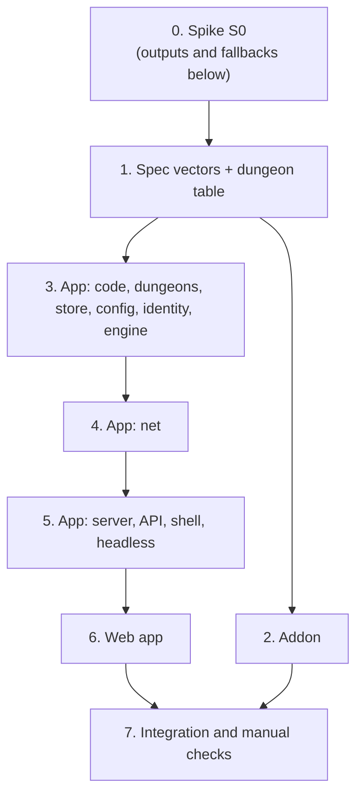

# forever-together implementation plan

> Paths were reorganised on 2026-11-21: `src-tauri/` is now `app/`, the React app is in `webapp/`, `adr/` is `docs/adr/`, `assets_vc/` is `assets/`.

Status: draft. **Do not start steps 1 to 7 until spike S0 (step 0) has reported.** The design is [`forever-together.md`](forever-together.md). Byte layouts and message definitions are in [`../rdf-code-spec.md`](../rdf-code-spec.md). Reasons for each decision are in [`../adr/`](../adr/README.md).

The project lives in one repository, `forever-together`, started from `template-rust-app` at commit `9048274` (already copied in). It holds the addon, the desktop app and the web app. The `wow-forever-addons` repository (now at `/Users/hughkaznowski/Projects/gitlloop/wow-forever-addons`) keeps all its addons unchanged. Its only change is the test VM additions in item 11.

## Order of work

| Step | Items | Exit command or condition | Must compile together |
|------|-------|---------------------------|-----------------------|
| 0 | spike S0 | every S0 output below is filled in and committed under `docs/spike-s0.md` | none |
| 1 | 1, 2, 21 (data file) | `docs/rdf-code-vectors.json` exists and the author has committed `dungeons.json` | none |
| 2 | 3-12 | `mise run test-addon` passes | addon only |
| 3 | 15, 17-22, 24 | `cargo test --manifest-path app/Cargo.toml code dungeons engine store config identity` passes, and the D1 simulation meets its floor | `engine` types before `net` |
| 4 | 23 | `cargo test ... net` passes on the fake network | `engine`, `net` |
| 5 | 16, 25 | `cargo test ... server` passes, `cargo clippy --all-targets -- -D warnings` clean | all of `app/` |
| 6 | 14, 26 | `pnpm typecheck` and `pnpm build` pass, Storybook builds | web app |
| 7 | 27, 28 | the integration and manual checks in the Verification Plan | everything |

## Item 0: Spike S0

Owner: the author. Output file: `docs/spike-s0.md`. For each row, record the result, the fallback taken if it fails, and the spec lines it changes.

| Output | Fallback if it fails |
|--------|----------------------|
| The call that returns the realm (ruleset), its values for PvP, PvE, RP-PvP, RP-PvE, Hardcore, and whether it fits 24 bytes | add a mapping table in the spec |
| The region call and its values | none, the code is not built |
| `UnitName("player")` and `GetUnitName("player")` return first name and surname, and the in-game invite accepts "First Surname" | split the combined name, spec change |
| `GetAverageItemLevel` works | the 18-slot fallback |
| `AreCrossFactionGroupQueuesAllowed` value, and whether cross-faction grouping exists | faction stays in the topic and also goes in the ad |
| A phone camera scans a QR drawn with `SetColorTexture` at UI scales 0.8, 1.0 and 1.2 | change module size, or text only |
| `varaq` keeps the secret key with file mode readable only by the user and survives a restart | OS keychain for the key |
| iroh-gossip identifies message authors | if yes, drop signatures (ADR 0019 replaced) |
| iroh address lookup resolves a trusted peer from its public key | list trusted peer addresses in the app |
| iroh's default hosted components (relays, DNS) are named, and whether they can be self-hosted or switched off | record as a dependency in the risks table |
| The seeded simulation (D1) reports the commit rate for converging announcements and for the proposer model at 3,000 peers and a sample of 100, with modelled sample divergence | **Done in the engine, result in `docs/spike-s0.md`: neither reached the floor, so the design was reopened and leader invitations ([ADR 0025](../adr/0025-leader-invitations.md)) were adopted; they reach it within 30 s in the model.** A live run can still change this: if direct messages are lost, add a retry. |

Floor (revised 2026-11-21, author decision): at least 70% of the peers that a central greedy build over every peer in the swarm could place in a party commit within 30 s (6 rounds of the 5 s epoch of ADR 0025). Peers that no mechanism could place, such as surplus non-tank peers when tanks are scarce, are outside the measure. This replaces the original wording, which counted all peers with a compatible five in their sample and could not be met by any mechanism in tank-scarce or small swarms.

## Shared definitions

### Constants and settings

Protocol constants are not user settings. A peer that changes them would break agreement.

| Protocol constant | Default |
|-------------------|---------|
| epoch length (one round of invitations) | 5 s |
| ad keep-alive / expiry | 45 s / 120 s |
| ad cutoff before an epoch | 2 s |
| invitee decision time after the epoch start | 2 s |
| sample size | 100 ads |
| accepted clock skew | not applicable: each peer uses its own arrival time. An invitation for epoch n-1 or n+1 is kept for one epoch and then dropped. |
| heartbeat and Ready reply window | 4 s |
| human Confirm click window | 15 s |
| local ban after no heartbeat reply | 60 s, never gossiped |
| search time limit | 10 min, then the search stops and the app says so |
| widening step | 60 s |

Widening stages (a stage clock starts when the search starts and restarts when a dropped party returns the peer to searching):

| Stage | Starts at | Rule |
|-------|-----------|------|
| 0 | 0 s | item level within 15% of the lower value, level spread at most 3, exact roles |
| 1 | 60 s | secondary roles allowed (always none in v1, so this changes nothing until the code carries them) |
| 2 | 120 s | item level within 30% |
| 3 | 180 s | level spread at most 6 |
| 4 | 240 s | level spread at most 10, and the other recommended dungeons |

The stricter of two peers' stages applies to a pair. A pair is compatible when both of their stages allow it.

| User setting | Default |
|--------------|---------|
| LAN mode | off |
| known-peers cache size | 100 |
| trusted peers (extra keys) | none |
| trusted peer retry backoff | 30 s doubling to 15 min, jitter of 20% applied before the cap |
| peer exchange rate limit | 1 request per 10 s per peer |

### Engine contract

*   `Ad` fields are in the spec. A compatibility check `compatible(a, b, stage)`: factions are equal; `abs(levelA - levelB) <= spread(stage)`; item level is compatible when either is 0 or `abs(ilA - ilB) <= pct(stage) * min(ilA, ilB)`; both are at least the dungeon's `minLevel`. The check is symmetric.
*   Party building (leader invitations, ADR 0025): once per epoch a tank takes the ads in its own sample that are old enough (cutoff), compatible with it and not banned, orders them by `pair_rank(epoch, tank, candidate)` and picks the first one healer and three damage peers that are compatible with each other; it also invites up to 2 more healers and 5 more damage peers that fit the party. An invitee answers the invitations of an epoch once, at epoch start plus 2 s, by accepting the leader with the lowest `rank(epoch, leader)`. The tank commits when its acceptors contain a compatible healer and three damage peers (first set in its own order) and sends `PartyAnnounce` to them. A peer fills at most one role in one party (1 tank, 1 healer, 3 damage).
*   Worked example for the first engine test: five Alliance peers, levels 24, 24, 25, 25, 26, roles tank, healer, damage, damage, damage, item levels all within 15%, same sample: at the second epoch boundary the tank invites the four, they accept 2 s later, the tank announces and all five commit to the same party, and no sixth peer is included.
*   Types: `Event` (`Tick`, `AdReceived`, `InviteReceived`, `AcceptReceived`, `AnnounceReceived`, `ReadyReceived` (carries the sender's ad), `ConfirmReceived`, `DeclineReceived`, `HeartbeatTimeout`, `UserConfirm`, `UserDecline`, `UserStart`, `UserStop`), `Action` (`SendAd`, `SendMessage`, `Join`, `Leave`, `ShowState`, `BanLocal(peer, 60 s)`), and a `Network` trait with `join`, `leave`, `broadcast`, `send_direct`, `next_event` and `dial`. All errors are an `enum NetError`. The `net` module verifies signatures before an event reaches `engine`.
*   A committed peer sends `Taken` and stops inviting and answering. A peer commits only on a `PartyAnnounce` from the leader it accepted for that epoch, so a late or unknown announcement does nothing. The sample drops, among ads at the same level distance, the one with the highest `pair_rank(0, owner, peer)`.
*   Human Confirm: after a commit, each app sends `Ready` within 4 s and shows the prompt. If no click arrives in 15 s the app sends `Decline`, the party is dropped and everyone resumes searching with no penalty. A peer that does not answer a heartbeat within 4 s is banned locally for 60 s. The ban is never gossiped.

### Local web API

Every route except the static files needs `Authorization: Bearer <token>`. The token is 32 random bytes, hex, compared in constant time. A missing or wrong token gives 401. A wrong Host or Origin, or a non-loopback caller on a loopback route, gives 403. Errors have the body `{ "error": "<code>", "message": "<text>" }`. A request body is at most 8 KiB. Each token may make at most 20 requests per second. The server picks a random free port on start and prints it.

| Route | Purpose |
|-------|---------|
| `GET /api/state` | snapshot: character, search, stage, counts, party, settings summary. `search` gains an optional `diagnosis` (situation code, `ended`, seen role counts, `ownRole`, `sampleFull`, `networkPeers`, `attempts` counters, `outlook`: an optional banded clause from the node's own history), ADRs 0026 and 0027 |
| `GET /api/events` | live updates, read with `fetch` streaming so the token travels in a header, with a heartbeat line every 15 s and automatic reconnect by the client |
| `POST /api/character` `{code}` | parse and store a code, return what was understood or a typed error |
| `DELETE /api/character` | forget the code (also deletes the search history) |
| `DELETE /api/history` (loopback) | delete every search-history entry, 204 (ADR 0027) |
| `GET /api/dungeons` | table and recommendations |
| `POST /api/search` `{dungeons[]}` / `DELETE /api/search` | start or stop |
| `POST /api/party/confirm` / `POST /api/party/decline` | answer a committed party |
| `GET /api/settings` / `PUT /api/settings` | read or change user settings. `lan_mode` and `trusted_peers` are loopback only. |
| `GET /api/pairing` (loopback) | the pairing URL |
| `POST /api/token/reset` (loopback) | new token, un-pairs every phone. The desktop window reloads and receives the new token. |
| `GET /api/addon` (loopback) | addon install status: bundled version, folder, candidates, installed version, `status` (ADR 0028) |
| `PUT /api/addon/folder` `{folder}` (loopback) | validate and save the AddOns folder as `addon_dir` |
| `POST /api/addon/install` (loopback) | install the bundled addon into the saved folder by stage and swap; no path in the body |

Loopback-only routes: `GET /api/pairing`, `POST /api/token/reset`, `DELETE /api/history`, `GET /api/addon`, `PUT /api/addon/folder`, `POST /api/addon/install`, and writes to `lan_mode` and `trusted_peers`. Loopback is decided by the socket's peer address. Changing `lan_mode` restarts the listener. Embedded files are served through Tauri's asset resolver.

## Target files

Each path appears once and is marked Create, Modify or Delete.

### Part A: addon and shared definitions

1.  `docs/rdf-code-spec.md` (Create, done). Update it with S0 results.
2.  `docs/rdf-code-vectors.json` (Create). Cases: minimal record, maximum string lengths, accented names, item level unknown, each role and faction, a wrong check, a truncated text, an unknown version, an internal space, trailing bytes, counter wraparound, base45 odd and even lengths. QR matrices as rows of `0` and `1` for a few small cases, generated once with an independent reference encoder and committed. `Qr.Encode` returns booleans, and the test converts `0`/`1` for comparison.
3.  `addon/ForeverTogether/ForeverTogether.toc` (Create). `## Interface: 16001` (the Forever flavour marker, confirmed in S0), no `SavedVariables`. File order: `Codec.lua`, `Qr.lua`, `Core.lua`, `Window.lua`, `Commands.lua`.
4.  `addon/ForeverTogether/Codec.lua` (Create). Starts with `local ADDON, NS = ...` and `NS.RD = NS.RD or {}`, so later files can rely on it. `EncodeRecord`, `DecodeRecord`, `Base45Encode`, `Base45Decode`, `Crc16`, `ToText`, `FromText`, using the spec's error vocabulary.
5.  `addon/ForeverTogether/Qr.lua` (Create, about 250 to 350 lines). `Qr.Encode(text, opts) -> { size, version, modules }`. Alphanumeric mode, level M, versions 1 to 10, Reed-Solomon over GF(256) with polynomial 0x11D, finder, timing and alignment patterns, format and version information, all eight masks with the standard penalty rules. Refuses text that does not fit version 10.
6.  `addon/ForeverTogether/Core.lua` (Create). `RD.Collect()` follows the table in the spec. `RD.BuildCode()` returns text, record and creation time and increments the counter. Events `PLAYER_LEVEL_UP`, `ZONE_CHANGED_NEW_AREA`, `PLAYER_ENTERING_WORLD`, `PLAYER_EQUIPMENT_CHANGED` and spec change only mark the code stale. No timers.
7.  `addon/ForeverTogether/Window.lua` (Create). Plain frames with `SetColorTexture`, closes with Escape. Shows the code in a single-line edit box that selects all on focus, the QR with whole-pixel modules and a four-module quiet zone, the fields understood (without dungeon), the code's age, a Refresh button, and a line telling the player to paste the text or scan the QR into the app.
8.  `addon/ForeverTogether/Commands.lua` (Create). `/wowft` toggles the window, `/wowft code` prints the code, `/wowft help` lists them.
9.  `addon/tests/setup.json` (Create). Top-level keys read by the VM: `player` (with `name`, `realm`, `faction`, `class`, `race`, `level`, `itemLevel`, `role`, `specID`), and top-level `region`. Other cases are set with `vm.reload()`.
10. `addon/tests/test_codec.lua`, `test_qr.lua`, `test_core.lua`, `test_window.lua` (Create). `test_window` checks the number of shown QR textures equals the number of dark modules, quiet zone excluded.
11. `vendor/wow-forever-addons` (Create: git submodule, URL and pinned commit recorded in `.gitmodules`) and the VM additions in `wow-forever-addons`. In `wowluavm/src/prelude.lua`: **modify** the existing `G.GetCurrentRegion` (line 154) to `return setup.region or 3`; add `GetAverageItemLevel` reading `player.itemLevel`; extend the existing `C_SpecializationInfo` stub only if a test needs it (role is already the fifth return of `GetSpecializationInfo`, from `player.specID`). In `wowluavm/src/main.rs`: add `vm.read_json(path)` registered after line 153 following the `vm_fn` pattern at line 107, which returns the parsed table or raises an error naming the path, resolved against the working directory. `UnitName` already returns `name, realm` with realm nil at home, and `GetUnitName` returns only `name`, so `Collect` splits the combined name and needs no VM change for the surname. Existing behaviour for the Social Hub suites stays the same, and `./run-tests.sh` in `wow-forever-addons` must pass. Update the VM repository's `CLAUDE.md` with the new setup keys.
12. `scripts/install-addon.sh` (Create) and `mise.toml` (Modify). The script refuses to run unless `$WOW_ADDONS_DIR` is set and ends in `AddOns`, then copies `addon/ForeverTogether/` with `rsync -a --delete`. New mise tasks `test-addon` (build the VM in `vendor/wow-forever-addons/wowluavm`, run `addon/tests/` with `--api vendor/wow-forever-addons/wow-forever-api.json`) and `install-addon`. `check` also runs `test-addon`.
13. Project documents (Move, done). The `adr/`, brief and design are already in this repository, under `adr/` and `docs/`.

### Part B: app and web app

14. `package.json`, `pnpm-lock.yaml` (Modify). Rename the package to `forever-together`. Add a QR library for the pairing QR (name and version pinned when chosen).
15. `app/Cargo.toml`, `app/Cargo.lock` (Modify). Rename the package. Dependencies `iroh`, `iroh-gossip`, `tokio`, `axum`, `serde`, `postcard`, `serde_json`, `varaq`, `rand`, `sha2`, `data-encoding`, `clap`, `tracing`. **Versions and features are pinned when step 3 starts** (open: a crate for the OS keychain, only needed if S0 chooses it; base45 is hand-written). Check that no OpenSSL dependency is pulled in.
16. `app/tauri.conf.json`, `app/capabilities/default.json` (Modify). Rename the identifier and product. No static windows. The window is created in code, loads the local URL, and has no IPC capabilities.
17. `app/src/main.rs`, `app/src/lib.rs` (Modify). Flags `--headless`, `--print-public-key`, `--data-dir`. Window mode starts the runtime, loads the identity, starts network and server, then opens `http://127.0.0.1:<port>/#token=<token>`. Headless mode starts the network with a large known-peers cache and no server.
18. `app/src/config.rs` (Create). The constants and settings above, loading and saving user settings. `addon_dir: Option<String>` holds the AddOns folder for the addon installer (ADR 0028, loopback only).
19. `app/src/identity.rs` (Create). Load or create the secret key once, keep it, expose the peer ID.
20. `app/src/code.rs` (Create). Decode and validate per the spec, plus a test-only encoder.
21. `app/src/dungeons.rs` (Create) and `app/data/dungeons.json` (Create, committed by the author before step 3). Recommendation per the spec and `topics_for(character, dungeons) -> Vec<TopicId>`.
22. `app/src/engine/` (Create: `mod.rs`, `ad.rs`, `sample.rs`, `rank.rs`, `lead.rs`, `party.rs`, `widen.rs`, `state.rs`, `sim.rs`). `sim.rs` is the seeded simulation used by S0 and kept as a test. A peer leads at most one party per epoch, answers one invitation per epoch and confirms at most one party.
23. `app/src/net/` (Create: `mod.rs`, `iroh_net.rs`, `gossip.rs`, `exchange.rs`, `bootstrap.rs`, `known_peers.rs`, `trusted.rs`, `fake.rs`). `known_peers.rs` reserves cache slots for the player's active topics before applying least-recently-used eviction. `bootstrap.rs` never contacts a trusted peer while an earlier step works. `trusted.rs` holds the built-in keys (empty until the author supplies one) and takes a `Vec<PeerId>` so tests pass their own.
24. `app/src/store/` (Create: `mod.rs`, `varaq_store.rs`, `mem.rs`). Keys: `identity/secret`, `known_peers/<peerId>`, `settings`, `api/token`, `character`, `history/<start UTC seconds>` (ADR 0027).
24a. `app/src/history.rs` (Create). Search history entries over the store: `record`, `prune` (180 days, 100 per dungeon, 500 total), `clear`, with the checkpoint and outcome rules of ADR 0027. The engine emits `SearchFacts`; the app layer records them.
24b. `app/build.rs` (Create), `app/src/addon_install.rs` (Create), `app/src/server/addon_routes.rs` (Create). The build script embeds `addon/ForeverTogether/` as a table of `include_bytes!` entries. The module detects the AddOns folder, reports status and installs by stage and swap with folder containment rules. The routes translate HTTP to the module (ADR 0028).
25. `app/src/server/` (Create: `mod.rs`, `routes.rs`, `auth.rs`, `static_files.rs`, `events.rs`, `pairing.rs`). Serves files from `WOWFT_WEB_DIR` first (path normalized so it cannot leave the folder, `/api` never overridden), then the embedded files. Pairing URL `http://<lan-ip>:<port>/#token=<token>`, with the LAN address chosen as the first private IPv4 address of the active interface.
26. `src/` (web app: Create components and stories, Modify `App.tsx`, `main.tsx`, `index.css`), `index.html` (Modify), `vite.config.ts` (Modify only if needed), `.storybook/` (Modify only if needed). Atomic design per `CLAUDE.md`. `src/api/` holds the client, types and the state hook with token handling and the event stream. Page stories cover: first run, a stale code, an unknown code version, an unknown zone, no recommendations, a long first name and surname, a quiet topic at the last stage, a party where one member has not confirmed (Ready received, Confirm not), phone width. The settings page shows the Phone link (LAN mode and sign-out), the Addon card (ADR 0028: install or update the bundled addon in the chosen AddOns folder), and under a collapsed Advanced section the known-peers size, backup contacts (trusted peers) and search history.
27. `app/tests/` and inline `#[cfg(test)]` modules (Create). See the Verification Plan.
28. `CLAUDE.md`, `README.md`, `mise.toml` (Modify). Document module layout, flags, `WOWFT_WEB_DIR`, running two instances on one machine, adding a trusted peer key. Also delete the template placeholder text in `README.md`. `.gitignore` is already copied from the template.

## Prerequisites outside the code

*   **Trusted peer key.** The author runs the app once with `--print-public-key` on the always-on machine and supplies the public key for `trusted.rs`. The private key is never committed or shared.
*   **Dungeon table.** The author commits `app/data/dungeons.json`.
*   **Spike S0 outputs.** See item 0.

## Verification plan

*   **Build.** `mise run build`, `pnpm build`, the VM build in `mise run test-addon`, and `./run-tests.sh` in `wow-forever-addons`.
*   **Unit tests.**
    *   `mise run test-addon` for the addon.
    *   `code`: every vector, every error, and the internal-space case.
    *   `dungeons`: 29 entries, all searchable, and recommendation order. Cases: a Barrens character at levels 15, 25 and 38, an end-game character, a null minimum level treated as no minimum, and a level below every level range. The exact expected lists are computed by hand from the committed table and written into the tests when the table is committed.
    *   `engine`: the worked example above; 1 tank, 1 healer and 3 damage per party; a tank invites for at most one party per epoch, an invitee accepts one leader per epoch (the lowest rank) and only that leader's announcement commits it, and a peer confirms at most one; `partyId` is deterministic; a `Taken` peer is dropped from samples; expired ads are dropped; `Decline` returns members to searching with no penalty; a missed heartbeat bans locally for 60 s and the ban is not sent; widening follows the stage table and the search limit; Horde and Alliance never match.
    *   `net`: signature rejection; LRU eviction and persistence across a restart; exchange limits; bootstrap order; backoff bounds; unverified entries do not count until dialed.
    *   `store`: round trips and key layout, and identity persistence across a restart.
    *   `server`: 401 without a token, 403 for a wrong Host, Origin or non-loopback caller on a loopback route, override priority, path escape refused, `/api` not overridable, token reset invalidates the old token, the pairing URL, event streaming, command-line flags.
    *   Simulation (`engine/sim.rs`): seeded, a few thousand synthetic ads with modelled sample divergence, run for both mechanisms. It is an algorithm check, not a load test (ADR 0014).
*   **Integration.** Three app instances on one machine with different data directories: paste codes for an Alliance tank, healer and three damage dealers, and a Horde character that must not match. Walk a search through widening, a committed party, Ready, Confirm and the name reveal. Run one instance with `--headless` and check that a fresh instance with no remembered peers reaches it only as a last resort.
*   **Manual checks the test VM cannot do.** `mise run install-addon`, `/reload` in the client, `/wowft` opens the window, Ctrl+C copies the code, the QR decodes with two phone scanners at UI scales 0.8, 1.0 and 1.2, the pasted text is accepted. Pair a phone from the pairing QR, confirm a request without the token is refused, reset the token.
*   **Static analysis.** `mise run check` and `pnpm typecheck`.
