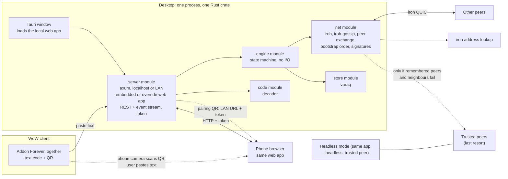
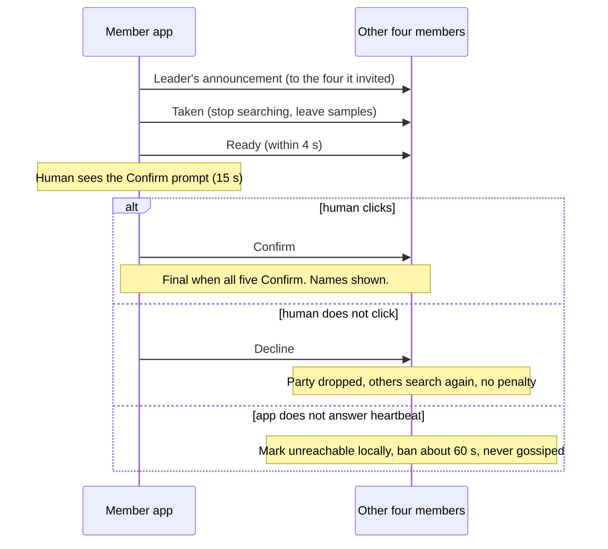

# forever-together (`wowft`): peer-to-peer random dungeon finder

*   **Author:** Hugh Kaznowski
*   **Status:** Proposed. Not ready for implementation until spike S0 reports (see the [plan](forever-together-implementation-plan.md)).
*   **Date:** 2026-11-21 (first draft 2026-11-20)

The project was drafted under the working name `p2prdf`. It is now `forever-together`, short code `wowft` ([ADR 0020](../adr/0020-one-new-repository-standalone-addon.md), amended). The records in [`adr/`](../adr/README.md) are required reading: where an ADR and this document disagree, the ADR wins. Byte layouts and message definitions are in [`../rdf-code-spec.md`](../rdf-code-spec.md). Defaults, the API table, the file list and the test plan are in the [implementation plan](forever-together-implementation-plan.md). Provisional parts depend on spike S0.

--------------------------------------------------------------------------------

## Overview

forever-together helps players of World of Warcraft Forever find a group for a dungeon without a central matchmaking server. It has three parts:

1.  **A standalone WoW addon** (`ForeverTogether`, touching no existing addon). It shows the player's character as a code to copy as text or scan as a QR code. It has no networking, pairing or tokens.
2.  **A desktop app** (Tauri 2, Rust and React/TypeScript). The player pastes the code. The app joins a peer-to-peer network, searches for players who want the same dungeon, agrees on a role-balanced party of five with them, and shows each member's character name so they can invite each other in game.
3.  **A phone web app.** The desktop app serves one web app, embedded in its binary, over the local network. Its own window shows the same web app. A phone opens it, scans the addon's QR code with its camera app, and pastes the text into the web app. A per-install token, handed over through a pairing QR on the desktop, approves each phone. If the environment variable `WOWFT_WEB_DIR` names a folder, files in it take priority over the embedded ones, so users can change themes and layout.

On Forever, a **realm** is a ruleset (PvP, PvE, RP-PvP, RP-PvE, later Hardcore) that runs on a shared server in each region. Players on the same realm can group, and players on different realms cannot. Players can group only with their own faction. A search **topic** is therefore `region + realm + faction + dungeon` ([ADR 0005](../adr/0005-topic-without-level.md)). Peers who share a topic find each other.

Level is not in the topic. It travels in each player's search ad and is a matching condition, like item level. The app holds a fixed table of dungeons (level range, minimum level, a faction hint, zone) and recommends dungeons from the character's level and zone ([ADR 0006](../adr/0006-dungeon-table.md)). The author expects very large player numbers and an unknown share running the app, so the design assumes busy topics and loosens a search over time when a topic is quiet. In v1 each topic is one swarm ([ADR 0005](../adr/0005-topic-without-level.md), amended).

Nothing is hosted by the author. Peers find each other through remembered peers first, then peer exchange, and only as a last resort through trusted peers. Trusted peers are ordinary peers ([ADR 0023](../adr/0023-no-supernodes.md)).

## The Problem

Forever has a classic-style group finder, not the random dungeon finder of retail. Finding a group by hand is slow. It works worst at the dungeons and levels where few people are looking. This project is a faster and more automatic finder.

A central matchmaking service would solve it, but it needs someone to run, pay for and keep it online, and it becomes a single point of failure and the single owner of player data. The author wants a tool anyone can run, copy and modify, with no service behind it.

The proposed solution is a pair of tools: the addon, which turns the live character into a short code, because an addon cannot use the network or write files while the game runs; and the app, which takes the code and does the finding. Everything the addon reports is self-reported and can be forged ([ADR 0003](../adr/0003-self-reported-data.md)). The design accepts this as a known limit.

## Goals

*   **Addon code.** The addon shows a copyable text code and a QR of the same data. The code is small enough that the QR scans from a game window (target: at most 122 characters, see the spec).
*   **One shared code format.** A written, versioned specification with test vectors that the Lua encoder and the Rust decoder both pass, and an "update the addon" or "update the app" message on an unknown version ([ADR 0018](../adr/0018-code-format.md)).
*   **Desktop app.** Accepts a pasted code, shows what it understood, and searches for a party of five (1 tank, 1 healer, 3 damage dealers) under the topic, matching on level, item level and role.
*   **Dungeon recommendation.** The player picks one dungeon or searches all recommended ones. Location is a preference, not a check. Every dungeon in the table can be searched.
*   **Search that loosens over time.** A search starts strict and relaxes in a fixed, visible order (item level, then secondary roles, then a larger level spread, then more dungeons). The schedule is part of the matching algorithm. The API cannot change it ([ADR 0011](../adr/0011-search-widening.md)).
*   **Live progress.** The app shows how many players are searching, the current constraints, and what happens next.
*   **Agreement among peers.** A peer confirms at most one party. A formed party announces that its members are taken, so others stop considering them. A party is final only when all five humans confirm. A member who does not confirm in time sends a Decline, and the rest return to searching ([ADR 0024](../adr/0024-liveness-and-decline.md)).
*   **Name reveal.** After all five confirm, the app shows the other members' first names and surnames, labelled as claimed by the other player.
*   **No hosted service.** The author hosts nothing. The design depends softly on trusted peers for first contact and on whatever hosted components iroh uses by default (see Risks).
*   **One web app for phone and desktop**, with a per-install token and an override folder ([ADR 0012](../adr/0012-one-web-app-for-phone-and-desktop.md)). Phone and LAN stay in v1.
*   **Local storage** with `varaq`, and TLS through rustls ([ADR 0008](../adr/0008-iroh-and-local-storage.md)).
*   **Success measures (starting targets, to be tuned).** In a simulation at 3,000 peers, at least 70% of peers that have a compatible five in their sample commit within 3 epochs. For a crowded topic in real use, the median time from starting a search to a committed party is under 2 minutes.
*   **Functional tests.** Behaviour is tested on the in-memory fake network, including a seeded simulation of the agreement rule ([ADR 0014](../adr/0014-functional-tests-only.md), amended). There are no load tests.

## Non-Goals

*   Proving a character is real.
*   Tokens or authentication on the addon, the QR or the p2p network. A token exists only to approve a phone for the local API.
*   Encrypting the LAN link. The token travels over plain HTTP on the local network, which the app states as a risk on untrusted networks.
*   Raids and groups larger than five.
*   Full gear lists and, in v1, professions.
*   Inviting players for the user. The app shows names and players invite each other in game.
*   A hosted web page, in-page camera or WebRTC. Mobile apps.
*   Cross-realm, cross-region or cross-faction matching.
*   Shared reputation or blocking between peers. Each app keeps only local, temporary memory of peers that did not answer.
*   Sharding in v1 (see Future Improvements).

## Open Questions

**Blocking: answered by spike S0 before the code format freezes.**

*   **Realm and region values.** Which client calls return them, and what values do they give? Candidates from the API export: `C_GameRules.GetActiveGameMode`, `GetCurrentGameModeRecordID`, `GetForeverExperiencePreset`, `IsHardcoreActive`, `GetCurrentRegion`.
*   **Name calls.** Does `UnitName("player")` give first name and surname, does `GetUnitName` give "First Surname", and does the in-game invite accept that text ([ADR 0022](../adr/0022-name-is-first-name-and-surname.md))?
*   **Faction.** Should the app check `AreCrossFactionGroupQueuesAllowed`? The faction is carried in the ad as well as the topic, so removing it from the topic later is a version change and not a redesign.
*   **Item level.** Does `GetAverageItemLevel` work on this client?
*   **QR scannability** of a QR drawn with `SetColorTexture` at typical UI scales.
*   **Agreement mechanism.** Leader invitations: a tank invites a party from its own sample and invitees follow the best-ranked leader ([ADR 0025](../adr/0025-leader-invitations.md)). Chosen after the simulation rejected converging announcements and the proposer model.
*   **`varaq` and iroh.** Is `varaq` 0.1.x good enough for the secret key? Does `iroh-gossip` identify message authors? Does address lookup resolve a trusted peer from its key? Which hosted components does iroh use by default?

**Tuning: starting values are in the plan.** Epoch length, ad cutoff, sample size, window lengths, widening steps, level bias in samples (how strong, and does it hurt convergence?), eviction rule for the known-peers cache.

**Later.**

*   **Zone matching.** Zone names are English in the table. Characters on other client languages get no same-zone ordering until map IDs are added.
*   **Shared zones.** Several dungeons share a zone, so zone proximity cannot tell them apart, and the recommendation lists all of them.
*   **Professions** in the code.
*   **Trusted peer deployment.** The first trusted peer is the same app in headless mode on an always-on machine run by the author. Who else may run one, and how are their keys added?

## Critical User Journeys (CUJs)

### CUJ 1: Find a party from the desktop

*   **Given**: The desktop app is running with a stored identity. A level 24 Alliance character on a PvE realm stands in Westfall, and the addon is installed.
*   **When**: The player opens the addon window with `/wowft`, copies the code with Ctrl+C, pastes it into the app, picks The Deadmines from the recommended dungeons and starts the search.
*   **Then**: The app shows what it understood from the code and its age, and the search progress. When a party commits, the app asks for Confirm. After all five confirm, it shows the other four players' first names and surnames, labelled as claimed, and searching stops. The players invite each other in game.

### CUJ 2: Use a phone as a second screen

*   **Given**: The desktop app is running and LAN mode is on. The phone is on the same network.
*   **When**: The player scans the pairing QR on the desktop with the phone's camera app, opens the link, then scans the addon's QR with the camera app and pastes the text into the web app.
*   **Then**: The web app stores the token, removes it from the address bar and shows the same interface as the desktop. Search, progress and Confirm work from the phone. A request without the token is refused, and resetting the token on the desktop un-pairs the phone.

### CUJ 3: A quiet topic and a party that does not confirm

*   **Given**: A player is searching for a rarely run dungeon where few peers are online.
*   **When**: No party forms for a minute. Later a party commits, and one member does not press Confirm in time.
*   **Then**: The app shows each widening stage as it is reached. The absent member's app sends a Decline. The party is dropped, the other four return to searching, and nobody is penalised. If a member's app does not answer at all, the others ban that peer locally for about a minute.

### CUJ 4: First start on a new install

*   **Given**: The app starts for the first time with no remembered peers.
*   **When**: A search starts.
*   **Then**: The app creates and stores its permanent key, asks the built-in trusted peers for peers for the topic (the last resort, with backoff), saves what it receives and joins the topic. The next start uses the remembered peers first.

## Technical Plan (Architecture)

### 0. Components

### 1. The character code (addon to app)

The addon builds one record and shows it two ways: as text the player copies with Ctrl+C, and as a QR of the same text. The record is a fixed-layout binary structure encoded as base45 with a short prefix. It carries the first name and surname as two fields, faction, class, race, level, realm and region (opaque values from the client), role and spec, item level (0 if the client cannot supply it), the zone name as the client reports it, a creation time and counter, and a typo check. It has no dungeon field, because players search from outside a dungeon. The exact layout, limits and error names are in the [spec](../rdf-code-spec.md).

The check is a typo check and proves nothing about the character. Every field is a claim by the sender. The Lua encoder and the Rust decoder both pass the same test vectors. A decoder that sees an unknown version refuses the code and tells the user to update the addon or the app.

The QR encoder is written in plain Lua, because no QR library is available in the client. It draws squares with `SetColorTexture`, using whole-pixel module sizes and a quiet zone. The addon recomputes the code when the player asks and shows its age. It does not poll the game API.

### 2. Dungeon table and recommendation

The app carries a fixed table (a data file, versioned with the app). The recommendation keeps dungeons whose minimum level (when known) and level range fit the character's level (with 3 levels of slack), and lists dungeons whose zone equals the character's zone first. There is no distance calculation. A dungeon's ID in topics is a fixed English slug. Nothing refuses a player because of where they are. The player picks one dungeon or all recommended ones, which means joining several topics. The sort rules are in the spec.

### 3. Topics and swarms

A topic is `region + realm + faction + dungeon`, hashed with a protocol prefix and a shard number into a 32-byte ID. In v1 the shard number is always 0 and each topic is one `iroh-gossip` swarm. The number of topics is roughly 5 realms, 2 regions, 2 factions and the dungeons (29 today), about 580, assuming those realm and region counts. That figure is an estimate: the app does not hard-code a realm list.

Peers in one swarm hold a partial view: about 5 active connections and 30 passive peers (the `iroh-gossip` defaults). Each peer also keeps a bounded sample of the latest ads it has seen and matches within it. When the sample is full, the peer drops the ads furthest from its own level first, so a dungeon with a wide level range still leaves it with candidates it can group with. This bias is **proposed**: whether it hurts agreement is an Open Question, and the simulation measures it.

**Load estimate (to be confirmed by the simulation).** In a swarm of 3,000 searching peers, each peer sends an ad every 45 seconds, about 67 ads per second across the swarm. Each ad is about 100 bytes plus a 64-byte signature, so about 11 KB per second spread across the swarm, before gossip duplication. With the default fan-out each peer receives each ad a few times, so a peer sees on the order of a few hundred messages per second of ads at the high end. `Taken`, `Ready` and `Confirm` messages go to the whole topic. Invitations, acceptances and party announcements are direct messages: a tank sends at most 11 invitations every 5 s, about 0.3 direct messages per second per peer across a swarm of 3,000 with 15% tanks. These figures are an intent, not a measurement.

### 4. First contact and bootstrap

A peer needs at least one other peer in its topic before it can join. It tries these in order, and stops at the first that works:

1.  **Remembered peers.** Peers saved from earlier runs for this topic, dialed three at a time, the first that answers is used.
2.  **Peer exchange.** The peer asks the peers it is connected to which peers they know for the topic. Entries are hints. An entry counts as live only after the other side answers and says it is in the topic.
3.  **Trusted peers.** A built-in list of public keys, extendable in settings. iroh's address lookup resolves each key to addresses. A peer contacts one only when every remembered peer is unreachable and no neighbour could help. It asks for peers for its topic and a general sample, saves them and disconnects. It retries with exponential backoff and jitter.

**Trusted peers are ordinary peers** ([ADR 0023](../adr/0023-no-supernodes.md)). A trusted peer is the same app, running headless with a flag. It learns peers through peer exchange like every other peer and is not a source of truth. It limits its own connections and request rates. Cold starts still reach it, because a new install has nothing else, so its load follows the number of cold starts. This is an accepted risk.

**Known-peers table.** Each app keeps a table of peers (peer ID, claimed topics, last seen, last used) as a least-recently-used cache, 100 entries by default, stored with `varaq`. Slots are reserved for the topics of the player's active search, so widening still has peers to ask, and quiet-topic peers are not the first evicted. It is separate from the sample of ads in section 3.

**Peer exchange protocol.** A small iroh protocol, versioned like the rest. A request names up to 3 topics and a maximum number of entries. A response lists entries for those topics, filled with random entries if there are few. Each side tells the other its topics when a connection opens. Rate limits apply. Peers cannot prove the topics they claim, so a claim is a hint until the peer is seen in the swarm. Framing and limits are in the spec.

**Limits.** A topic with few peers is found only if a peer the new peer asks already knows one of them. The DHT gives no topic-keyed lookup here.

Each install creates its iroh key once and keeps it. The public keys of the trusted peers are built into the app.

### 5. Search ads and widening

Each searching peer gossips an **ad** on each of its topics when something changes and as a slow keep-alive. An ad holds peer ID, a counter, roles, level, item level, faction, current stage, name, zone and time. An ad expires if it is not refreshed. A peer that has committed to a party sends `Taken`, and others drop it from their samples.

A search starts strict and loosens in a fixed order on a shared schedule: item level and exact roles, then secondary roles, then a wider item level range, then a larger level spread, then more dungeons from the recommendation. The stage table and its timings are in the plan. The API cannot pause, skip or change the schedule. A peer's stage is in its ad. When two peers are at different stages, the stricter stage applies to that pair. The stage clock restarts when a dropped party returns a peer to searching. At the search time limit, the search stops and the app says so. Topics added for widening are left when the search ends.

### 6. Agreeing on a party

Terms: a **leader** is the tank that builds a party. An **invitation** asks a healer or damage peer to join it. A party is **committed** when its leader has announced it to the four it invited and who accepted. **Ready** says a member's app is alive and has shown the prompt. **Confirm** is the human's click. **Decline** is a failed or refused confirmation. **Taken** says a peer is in a committed party.

**Leader invitations** ([ADR 0025](../adr/0025-leader-invitations.md), replacing converging announcements, [ADR 0010](../adr/0010-converging-announcements.md)). Spike S0 showed that peers cannot agree on a party by each computing it from their own sample: the samples differ, and the simulation commits about 2% of eligible peers that way. So one peer builds the party and nobody needs the samples to match.

*   Time is divided into epochs of 5 s. In each epoch a free tank looks at its own sample (ads published before a cutoff slightly earlier than the epoch start, compatible with it at the stricter stage), picks one healer and three damage dealers that are compatible with each other, and sends each a direct `Invite` that carries its own ad. It also invites a few spares (2 healers, 5 damage) who fit, and tries candidates in its own order, so different tanks try different people first.
*   Two seconds after the epoch start an invitee answers the invitations of that epoch once. It ignores invitations that are not from a tank, whose author does not match the ad, from banned peers or from tanks it does not fit, and accepts the leader with the lowest `hash(epoch, leaderId)`. All invitees use the same order, so the best-ranked leader always gets everyone it invited. The invitee now holds a lease on that leader for the epoch, and only that leader's announcement can commit it.
*   As soon as a leader's acceptors contain a healer and three damage dealers that are compatible with each other and with it, the leader announces the party to the four, commits and sends `Taken` and `Ready`. The invitees commit on that announcement.
*   Role scarcity decides who leads: parties need exactly one tank and tanks are the scarce role, so every tank is a leader and the rest follow. A topic with no tank forms no party.
*   The sample keeps, among ads at the same level distance, a random part chosen by a hash of the owner and the ad's peer, not the lowest peer IDs. With the old rule two thirds of the peers on a level were in nobody's sample and could never be invited.

In the simulation (3,000 peers, sample 100, delivery 0.95) this commits a mean of 78.4% of eligible peers within 30 s (74.6% in the worst of 8 seeds), against 1.9% for converging announcements and 12.1% for the proposer model. The numbers, the role-mix cap on every mechanism and what the model leaves out are in `docs/spike-s0.md`.

**After a commit.**

A peer confirms at most one party. A peer answers one epoch once and commits only on the announcement of the leader it accepted, so it is in at most one committed party. A leader whose announcement does not reach a member, or reaches it after it moved on, finds that member missing at the Ready check and the others drop the party after 4 s, with a local ban on the silent member (the cost of a lost message). The windows are 2 s for an invitee's decision, 4 s for Ready and heartbeats and 15 s for the human click. The times use each peer's own arrival time, so no shared clock is needed. An invitation for the previous or next epoch is kept for one epoch.

After the final confirmation, the app shows the other members' first names and surnames, labelled as claimed by the other player. The text to type into the invite is "First Surname", which is unverified on the real client. Members' names arrive in their own `Ready` messages, which carry the member's ad. A party in which two members claim the same first name and surname is refused ([ADR 0016](../adr/0016-peers-identified-by-key.md)). The character GUID is not carried.

### 7. The local web app and API

One statically built web app (React and TypeScript) is embedded in the binary and served by an axum server inside the desktop app. The desktop window is a Tauri window that loads this web app from the local server, so the desktop and the phone use identical files and the identical API.

*   **Override.** If `WOWFT_WEB_DIR` names a folder, the server looks there first for each file and falls back to the embedded file. Paths cannot leave the folder, and API routes cannot be overridden.
*   **API.** HTTP routes under `/api` for the code, state, dungeons, search, party answer, settings, pairing and token reset. Live progress is a stream the page reads with `fetch`, so the token can travel in a header. The route table, status codes and limits are in the plan.
*   **Binding.** The server listens on localhost by default and on the local network when LAN mode is on. The app shows whether LAN mode is on and the address.
*   **Token.** A per-install token. The pairing QR on the desktop holds the LAN address and the token in the URL fragment. The phone's camera app opens it, the web app saves the token, removes it from the address bar and sends it with every call. Resetting the token un-pairs every phone, so a lost phone costs a re-pair of the others.
*   **Other checks.** The server checks Host and Origin, sends no cross-origin permissions, caps request size and rates, never returns the raw character code, and allows only loopback callers on pairing, token reset, LAN mode and trusted-peer changes. The token travels over plain HTTP on the local network, so anyone who can read that traffic could read it. A custom web app folder runs with the same access as the embedded one.

### 8. Local storage and TLS

`varaq` stores the iroh secret key, the cached peers, the settings and the API token. iroh's connections use rustls. The key is created only if missing. If S0 shows `varaq` is not suitable for the secret key, the key moves to the operating system's keychain and `varaq` keeps the rest.

### 9. Repository and modules

One repository holds everything, started from `template-rust-app`. The desktop app is one Rust crate with modules (see [ADR 0013](../adr/0013-single-rust-crate.md)): `code`, `engine` (the pure state machine, named to avoid Rust's `core`), `net` (a network trait with an in-memory fake, and the iroh implementation), `store`, `server`, and the Tauri shell with a headless flag. The web app is in `src/`. The addon is in `addon/ForeverTogether/` with tests in `addon/tests/`, run in the headless test VM from `wow-forever-addons`, which this repository takes as a git submodule ([ADR 0021](../adr/0021-test-vm-referenced-from-wow-forever-addons.md)). The only change in `wow-forever-addons` is the small set of VM additions listed in the plan. The code specification and test vectors live once under `docs/`.

### 10. Risks and mitigations

| Risk | Impact | Mitigation | Owner |
|------|--------|------------|-------|
| Forged data (names, class, item level) | Strangers can be shown fake claims | In-game invite is the real check. Labels say "claimed". Accepted ([ADR 0003](../adr/0003-self-reported-data.md)). | accepted |
| Free identities: a key costs nothing | A key can be rotated to avoid the local ban and ground to rank first in `hash(epoch, peerId)` | Per-peer rate limits, human Confirm, the ban is only local. Rotation and grinding are accepted limits for v1. | accepted |
| Ghost or absent peers | Four players wait for a party that cannot form | Ready within 4 s, heartbeat, local 1-minute ban ([ADR 0024](../adr/0024-liveness-and-decline.md)) | author |
| Name harassment: someone makes strangers invite a victim | Spam for the named player | Per-peer proposal rate limits. Accepted. | accepted |
| Peer table abuse (false topics, nonexistent peers) | Wasted dials | Entries are dialed before they count and are capped per response. Reserved cache slots limit eviction of active-topic peers. | author |
| Agreement fails when samples differ | Few commits on busy topics | Simulation in S0 with a kill criterion, two candidate mechanisms | author |
| Quiet topics depend on peer exchange | A rare topic may look empty | Reserved cache slots, widening, trusted peers as fallback | author |
| Trusted peers as single point of failure | Cold starts cannot join if none is reachable | More trusted keys over time, trusted peers are ordinary peers, extra keys in settings. If none answers, the app says so and retries with backoff. Key rotation needs a release. | author |
| Cold-start load on trusted peers | Trusted peers overloaded | Rate limits and backoff. Accepted, to be measured. | accepted |
| Young dependencies (`iroh-gossip`, `varaq`) | Bugs, API changes | S0 tests them. Trigger for the keychain fallback: `varaq` fails the key-file test in S0. | author |
| Hosted components in iroh's defaults (relays, DNS) | A third-party dependency despite "no hosted service" | S0 names them and records whether they can be self-hosted or switched off | author |
| n0 relay and DNS dependency: the app runs iroh's `N0` preset, so first contact by public key and NAT traversal use n0's relays (`*.relay.n0.iroh.link`) and its DNS/pkarr address lookup (`iroh.link`) | If n0's services are down, blocked or retired, a new install cannot resolve a trusted peer's key and peers behind strict NATs cannot connect. Relays see only encrypted traffic and IP addresses. Not tested against the live service yet (S0 row stays "not run live"). | Self-host `iroh-relay` and `iroh-dns-server` or set `RelayMode::Disabled` with direct addresses. Remembered peers keep working without the lookup. The app shows the bootstrap source and peer count, so a failed first contact is visible. | author |
| IP exposure | Peers that connect learn each other's IP address | Stated in the app and in Privacy below | accepted |
| Open LAN API | Others on the network call the API | Token, Host and Origin checks, a visible on/off switch. Plain HTTP sniffing is accepted. | accepted |
| Unverified client assumptions | The code format may need changes | S0, spec values marked provisional | author |
| Too few users early on (empty room) | No parties form | Widening, success measures above, communication to the community | author |
| Scope: phone, LAN, signing, submodule and Lua QR encoder all precede the first party | Slow delivery | Build order in the plan. v1 stays one release by decision. | accepted |

## Alternatives Considered

The decisions are recorded in [`adr/`](../adr/README.md).

### Alternative A: Browser-only single HTML file with browser peer-to-peer networking

*   **Pros**: Nothing to install, easy to share.
*   **Cons**: Browsers cannot open UDP sockets or accept inbound connections, so peers need relay or signaling servers. Camera access needs HTTPS. A tab has no stable network identity.
*   **Reason for rejection**: The relays would have to be hosted by someone, which the project does not want ([ADR 0001](../adr/0001-native-desktop-app.md)).

### Alternative B: A hosted HTTPS page with the phone camera, using WebRTC or public signaling brokers

*   **Pros**: The phone camera works on HTTPS. No install on the phone.
*   **Cons**: An HTTPS page cannot call an `http://` address on the local network (mixed content), so it cannot hand data to the desktop app. A static host cannot relay the WebRTC handshake. Public brokers depend on third parties.
*   **Reason for rejection**: The desktop app serving the web app itself, with the phone's native camera app scanning the addon's QR, needs no third party ([ADR 0001](../adr/0001-native-desktop-app.md), [ADR 0012](../adr/0012-one-web-app-for-phone-and-desktop.md)).

### Alternative C: A signed QR code

*   **Pros**: A receiver could check the code came from the addon.
*   **Cons**: The addon is open-source Lua, so any signing key in it is public and anyone can sign forged data. A signature adds about 64 bytes to a code that has to scan from a game window.
*   **Reason for rejection**: A signature would prove nothing ([ADR 0003](../adr/0003-self-reported-data.md)).

### Alternative D: Reading the addon's `SavedVariables` file

*   **Pros**: No copy step. The app could watch the file.
*   **Cons**: WoW writes `SavedVariables` only on `/reload` or logout.
*   **Reason for rejection**: The data is not live ([ADR 0002](../adr/0002-addon-shows-data-only.md)).

### Alternative E: The desktop app captures the QR from the game window

*   **Pros**: No copying.
*   **Cons**: Needs screen-capture permission. A QR on a game window at an angle or scaled is harder to read than pasted text.
*   **Reason for rejection**: Copy and paste covers the desktop, and the phone's camera app covers the phone ([ADR 0002](../adr/0002-addon-shows-data-only.md)).

### Alternative F: Level in the search key (exact level or level bands)

*   **Pros**: Peers find players near their level without reading ads. Swarms stay small.
*   **Cons**: Spreads rare dungeons across many keys and multiplies the number of topics by the number of levels or bands. A player who widens the level range has to join more topics.
*   **Reason for rejection**: Rare activities should stay in one topic. Level moves into ads and matching ([ADR 0005](../adr/0005-topic-without-level.md)).

### Alternative G: Deciding the dungeon from location only

*   **Pros**: No dungeon picker.
*   **Cons**: Players queue from cities, so refusing everyone who is not at an entrance excludes most of them.
*   **Reason for rejection**: Replaced by a recommendation the player can override ([ADR 0006](../adr/0006-dungeon-table.md)).

### Alternative G2: Client entrance data (`GetDungeonEntrancesForMap`), or pure proximity matching

*   **Pros**: Entrance data would remove a hard-coded location table. Proximity-only topics need no dungeon table.
*   **Cons**: Entrance data is unverified on the real client, and entrances can be close together (Blackrock Mountain). Proximity-only topics cannot name a dungeon or its level range.
*   **Reason for rejection**: Not chosen for now. Listed under Future Improvements ([ADR 0006](../adr/0006-dungeon-table.md)).

### Alternative H: A DHT noticeboard for first contact

*   **Pros**: A lookup by topic finds peers deterministically.
*   **Cons**: Items under keys anyone can derive can be overwritten and filled with junk. It was untested.
*   **Reason for rejection**: The DHT is used only to find trusted peers, and the rest is peer exchange ([ADR 0009](../adr/0009-bootstrap-and-peer-exchange.md)).

### Alternative H2: Per-topic lists published by trusted peers, or libp2p provider records

*   **Pros**: Provider records are built for finding peers by key.
*   **Cons**: Per-topic lists make the trusted peers learn who is in every topic, which makes them supernodes. Provider records need a second network stack and concentrate hot keys on a few nodes.
*   **Reason for rejection**: Against the no-supernodes principle ([ADR 0023](../adr/0023-no-supernodes.md)).

### Alternative I: Remembered peers plus trusted peers only, with no peer exchange

*   **Pros**: Simplest to build.
*   **Cons**: Every cold start reaches the trusted peers, and nothing ties peers in a topic together.
*   **Reason for rejection**: Peer exchange keeps trusted peers from being supernodes ([ADR 0009](../adr/0009-bootstrap-and-peer-exchange.md), [ADR 0023](../adr/0023-no-supernodes.md)).

### Alternative J: A proposer with per-peer leases, or an elected coordinator per shard

*   **Pros**: Leases give a clear rule that a peer holds one proposal at a time. A coordinator sees the whole shard and makes better matches.
*   **Cons**: Leases need an agreed clock and extra round trips, and waste leases under heavy proposing. A coordinator is a hot spot and a trust point, and two coordinators can both assemble parties when gossip splits.
*   **Reason for rejection**: Converging announcements (ADR 0010) and the proposer model were simulated in S0 and did not reach the floor. Leader invitations ([ADR 0025](../adr/0025-leader-invitations.md)) keep the useful part of both: one peer builds the party and invitees hold a lease on it for one epoch, with a global preference order and spares instead of a coordinator. A coordinator per shard is still rejected: it is a hot spot and a trust point ([ADR 0023](../adr/0023-no-supernodes.md)).

### Alternative K: A central matchmaking or rendezvous server

*   **Pros**: Simple, fast, easy to test.
*   **Cons**: Someone has to run, pay for and keep it online. It is a single point of failure and a single owner of player data.
*   **Reason for rejection**: The project must not host a service ([ADR 0001](../adr/0001-native-desktop-app.md), [ADR 0009](../adr/0009-bootstrap-and-peer-exchange.md)).

### Alternative L: The whole network on libp2p (Kademlia plus gossipsub)

*   **Pros**: One stack with Kademlia, gossip, relays and hole punching.
*   **Cons**: It also needs well-known bootstrap nodes, which is the same dependency on a few always-on machines that the chosen design has with trusted peers, and it keeps a second stack.
*   **Reason for rejection**: iroh and iroh-gossip carry connections and gossip, and trusted peers replace bootstrap nodes ([ADR 0008](../adr/0008-iroh-and-local-storage.md)).

### Alternative M: A Rust workspace of several crates

*   **Pros**: Crate boundaries are enforced by the compiler.
*   **Cons**: More manifests and versions for one small app. The `engine` and `net` boundary is already enforced by a trait and a fake.
*   **Reason for rejection**: One crate with modules is enough ([ADR 0013](../adr/0013-single-rust-crate.md)).

### Alternative N: A LAN API with no token, or a per-session secret in the URL

*   **Pros**: No pairing step. A per-session secret changes on each start.
*   **Cons**: With no token any device or web page on the network could call the API. A per-session secret forces re-pairing on every launch. A single per-install token un-pairs every phone when one is lost.
*   **Reason for rejection**: A per-install token approves each phone with one reset button ([ADR 0012](../adr/0012-one-web-app-for-phone-and-desktop.md)).

### Alternative O: The addon as a module of Social Hub

*   **Pros**: Reuses its window, widgets, commands and test setup.
*   **Cons**: Ties a separate project to an unrelated addon, changes that addon, and ships the finder to every Social Hub user.
*   **Reason for rejection**: This is a separate project that touches no existing addon ([ADR 0020](../adr/0020-one-new-repository-standalone-addon.md)).

### Alternative O2: Plain JSON in the code

*   **Pros**: Easy to read and debug.
*   **Cons**: Too large for a QR that scans from a game window.
*   **Reason for rejection**: The code is a compact binary record ([ADR 0018](../adr/0018-code-format.md)).

### Alternative P: The game's own group finder, a chat channel or addon messages as the rendezvous

*   **Pros**: No app to install. Players already use the client's classic-style group finder.
*   **Cons**: The classic-style finder is manual, which is the problem this project addresses. The source repository's notes record that public chat sends are restricted outside hardware events, so an addon cannot post automatically.
*   **Reason for rejection**: It cannot be automatic. S0 may re-check addon-message routes (a rendezvous over a private channel) if the client allows them.

### Alternative Q: Trusting the forwarding neighbour instead of signing messages

*   **Pros**: No signing cost.
*   **Cons**: `iroh-gossip` delivers the forwarding neighbour, not necessarily the author, so a neighbour could forge messages from others.
*   **Reason for rejection**: Signed messages give each member a known author ([ADR 0019](../adr/0019-signed-gossip-messages.md)). Replaced if S0 shows gossip identifies authors.

### Alternative R: Base45 binary record against other encodings

*   **Pros**: Base45 fits the QR alphanumeric alphabet, so the QR is smaller than with base64 in byte mode.
*   **Cons**: Less familiar than base64. Spaces are valid base45 characters, so pasted text must not be stripped of inner spaces.
*   **Outcome**: Chosen. The Cons are handled by the spec's pasted-text rule ([ADR 0018](../adr/0018-code-format.md)).

## Non-Functional Requirements

*   **Security.** Every API route except static files needs a bearer token. Pairing, token reset, LAN mode and trusted-peer changes accept only loopback requests. Host and Origin are checked, no cross-origin permissions are sent, body size and request rates are limited, and the raw character code is never returned. The token travels over plain HTTP on the local network, which the app states. A custom web app folder runs with the same access as the embedded one. The addon, the code and the p2p network have no content authentication (forged data is a known gap), but gossip messages are signed for authorship.
*   **Privacy.** A permanent iroh key lets other peers recognise the same player across sessions, and peers that connect learn each other's IP addresses. The app says so. The known-peers table is stored locally and shares only peer IDs and topics. Trusted peers see which peers cold-start.
*   **Performance and load.** The design assumes busy topics. See the load estimate in section 3. There are no load tests.
*   **Rollout and compatibility.** The code, the topic names and every protocol message carry a version. A decoder refuses an unknown version. Peers on different versions use different topic names and do not meet. Table contents are not part of the version.

## Additional Resources

*   [`docs/design-process/concepts_brief.md`](../design-process/concepts_brief.md) (the brainstorm brief, partly superseded) and [`adr/`](../adr/README.md).
*   `wow-forever-api.json` in the `wow-forever-addons` repository, the client API export, and the installed addons in the game's `Interface/AddOns` folder as a second source of what exists at runtime.
*   The `kademlia-book` notes repository (bootstrapping, NAT, hot keys and security in Kademlia networks).
*   The `template-rust-app` repository, commit `9048274` (Tauri 2, React, Storybook, mise).
*   `iroh`, `iroh-gossip` (HyParView for membership, Plumtree for broadcast, default 5 active and 30 passive peers), `varaq` (embedded key-value store, version 0.1.1).

## Future Improvements

*   **Sharding of busy topics.** The shard number is already in the topic hash and fixed at 0, so shards can be added without renaming topics. This needs a shard table with real traffic numbers and a role-aware rule, since sharding by peer ID alone starves each shard of tanks and healers.
*   **Map IDs and positions**, replacing zone-name matching and giving real distances.
*   **Professions and gear detail** in the code.
*   **Client entrance data** (`GetDungeonEntrancesForMap`) to tell dungeons in a shared zone apart.
*   **Encrypted LAN link** for the phone.
*   **Cross-faction groups**, if Forever allows them later.
*   **Reputation or blocking** between peers (see `the tickets in `tickets/`` for ideas).
