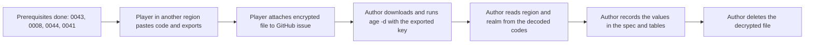

# Collecting region and realm values from other regions

*   **Author:** Hugh Kaznowski
*   **Status:** Initial draft, unreviewed
*   **Date:** 2026-11-22
*   **Ticket:** [ticket 0001](../../../tickets/0001-verify-live-client-calls.md). Closely related: [ticket 0042](../../../tickets/0042-collect-region-and-realm-values.md) (the collection step), tickets 0039 to 0041 (scan log), [0043](../../../tickets/0043-key-management.md), [0044](../../../tickets/0044-encrypted-scan-export.md), [0008](../../../tickets/0008-trusted-peer-builtin-key.md).
*   **Related decisions:** [ADR 0004](../../adr/0004-realm-is-a-ruleset.md), [ADR 0038](../../adr/0038-scan-log-and-opt-in-export.md), [ADR 0039](../../adr/0039-key-management.md). Where this document and an ADR disagree, the ADR wins.

--------------------------------------------------------------------------------

## Overview

This is a verification plan, not a feature. The addon reads the region with `GetCurrentRegion()` and the realm (the ruleset) with `C_GameRules.GetCurrentGameModeRecordID()` (see `realmValue` and `RD.Collect` in `addon/ForeverTogether/Core.lua`). The app hashes both raw values into the topic, so a wrong assumption about a value does not break matching; it only breaks the display names and any reasoning that treats a value as a known ruleset.

Verified on 2026-11-21 from the author's EU client: region 3 is EU; realm values 14 (PvP), 15 (PvE), 16 (RP-PvE) and 18 (RP-PvP); `GetAverageItemLevel` works; the name is first name plus surname ([spike results](../../spike-s0.md)). Still unverified: region numbers 1 (US), 2 (KR), 4 (TW) and 5 (CN), which are assumed from the standard numbering; the Hardcore realm value (the ruleset is not released); and whether the same realm ID means the same ruleset in every region.

## The Problem

The author has one EU client. The other values can only come from players in other regions, and their codes contain names and zones, so they cannot be posted as plain text on a public issue. ADR 0038 decided the route: a local scan log, exported as a file encrypted to `BUILTIN[0]`, attached to a GitHub issue. That route is not built yet, so this ticket cannot run today.

## Goals

*   A recorded, dated answer for each of: US, KR, TW and CN region numbers; the realm values each region reports for each ruleset; the Hardcore value once released.
*   The spec tables and the two name tables agree with what was seen.
*   No exported file and no real character data is committed.

## Non-Goals

*   Building the scan log, the export or the issue template (tickets 0039 to 0042, 0044).
*   Changing topic hashing. Topics keep hashing raw values (ADR 0004).
*   Cross-region or cross-faction matching (ADR 0034 non-goals).
*   Guessing the Hardcore value before it exists.

## Technical Plan

This ticket is a procedure that starts after its blockers are done.

### Prerequisites (all must be true before step 1)

1.  `net::trusted::BUILTIN` holds a key and the author has a `key export` backup of its secret (ticket 0008, ADR 0039).
2.  The app produces an encrypted export (ticket 0044) and shows the scan log (ticket 0041).
3.  An issue template exists (ticket 0042).

### Steps

1.  Post the request in the places players of each region read (the author decides where; see open questions).
2.  For each issue received, download the attached file to a directory outside the repository.
3.  Decrypt: `age -d -i <exported key file> <attachment>` (the workflow checked in the spike results for exports from `key export`).
4.  For each character entry, decode the raw `WFT1:` code with the project decoder (the Rust `code` module, or the Lua codec in the headless VM) and read the region and realm fields. Record only: region number, realm string, the faction, and the dungeon-independent fact "this value was seen on an account of region X on date D". Never copy a name or a zone.
5.  Delete the decrypted file and the attachment copy.

### Pass and fail criteria

A value is **verified** when it was seen in codes from at least one character whose owner states the region and ruleset in the issue (the owner's statement is what pairs the number with its meaning, because the code only carries the number). Whether one sample is enough is an open question.

| Observation | Outcome |
|---|---|
| Region number matches the assumed numbering | Mark that row verified with the date |
| Region number differs from the assumed numbering | Correct the row; the names tables change; topics of already-built codes for that region are unaffected |
| Realm value for a ruleset is the same as EU | Mark "same ID in region X" verified |
| Realm value for a ruleset differs from EU | Record per-region values; the display table must become region-aware (a design change, see open questions) |
| The game-mode call is missing or returns nothing, so `realmValue` falls back to `GetRealmName()` | Record it; this is a fault in the assumption of ADR 0004 and needs an ADR amendment, because a realm name is not a ruleset |
| Hardcore value seen | Record it and add it to the realm names |

## Alternatives Considered

*   **The author gets a client in each region.** Rejected as impractical for a one-person project; it is also what the scan-log route replaces.
*   **A plain-text export players can read first.** Rejected by ADR 0038's amendment: a plain file cannot be attached to a public issue safely.
*   **Players paste the raw value from `/wowft code` into the issue.** Rejected: the code contains the character name and zone, which is the problem the encrypted export solves.
*   **An addon diagnostic that prints only region and realm.** Not decided anywhere. It would let players post two numbers without names. It adds a command to the addon, and ADR 0002 keeps the addon data-only; see open question 2.

## Detailed Implementation

Files that change when values arrive. None changes before then.

*   `docs/spike-s0.md`: update the "Realm (ruleset) call" and "Region call and its values" rows from "partly verified" to verified per value with the date; add a short "Other regions" note. Why: ticket 0001's done-when names this file.
*   `docs/rdf-code-spec.md`, section "Realm and region" (table of regions, status column, the "Still assumed" paragraph): mark each seen value verified and with the date. Why: the spec is the single source for the values.
*   `addon/ForeverTogether/Names.lua` and `code::region_name` / `code::realm_name` in `app/src/code.rs`: change only if a value differs from the current table. The Lua and Rust tables must change in the same commit. Why: both display names; the shared vectors in `docs/rdf-code-vectors.json` use synthetic characters, and a vector may need adding for a new region with an invented character ("Testa Fakename").
*   `docs/adr/0004-realm-is-a-ruleset.md`: add an amendment with the date and the verified values. ADRs are immutable except by amendment, so this is an amendment, not an edit of the decision.
*   `tickets/0001-verify-live-client-calls.md` and `tickets/0042-collect-region-and-realm-values.md`: update status. Ticket 0001 stays open until Hardcore is released, unless the author splits that out (open question 3).

Code that already does part of the work: topics already hash raw values (`docs/rdf-code-spec.md`), and unknown values already display as `realm <id>` and `region <n>`, so an unmapped value does not break anything.

## Test and verification plan

*   Before any change: the existing vector tests (`mise run test`, `mise run test-addon`) pass.
*   After a table change: the same tests, plus a new vector for the changed region that uses an invented character.
*   Manual: decrypt one export with the exact command above before announcing the request, using a test export made by the author, to prove the round trip. The spike results record the `age` check for `key export` keys but not for an export made by the app's own encryption.
*   Record: date, region, realm values seen, number of independent samples, and the issue number. Not the files.

## Open questions for the author

1.  **What counts as verified for a region number or realm value?**
    *   **One sample with the owner stating region and ruleset.** Mechanism: one issue is enough to mark a row. Trade-off: fastest, and the rows are display-only. Fails when a player reports the wrong ruleset or the game reports a transient value.
    *   **Two independent samples.** Mechanism: two players in the same region agree. Trade-off: stronger. Fails when a region has too few players to find two, which leaves the row assumed indefinitely (likely for CN and TW).
    *   **One sample plus a decoded code that is consistent with the stated realm.** Mechanism: the owner states the ruleset and the decoded realm matches what the in-game UI shows in a screenshot. Trade-off: adds proof of meaning. Fails when screenshots expose names, which the encrypted route was meant to avoid.
2.  **Should the addon get a names-free diagnostic line for region and realm?**
    *   **No, use the encrypted export only.** Mechanism: nothing changes in the addon. Trade-off: no addon churn. Fails when the export is slow to reach players (it depends on three other tickets), so verification waits.
    *   **A `/wowft` subcommand that prints only region and realm values.** Mechanism: one Lua command, tested in the VM. Trade-off: players can post two numbers publicly today. Fails the ADR 0002 intent if the addon grows commands beyond showing the code, and it needs an ADR amendment.
3.  **When is ticket 0001 done, given Hardcore may not be released for a long time?**
    *   **Done when all regions are verified; Hardcore moves to a new ticket.** Mechanism: split the ticket. Trade-off: the P2 ticket can close. Fails if the Hardcore value is forgotten, because a new ticket needs an owner and a trigger.
    *   **Stays open until Hardcore is seen.** Mechanism: no split. Trade-off: nothing to forget. Fails by leaving a verification ticket open for an unknown time, which hides real progress in the backlog.
