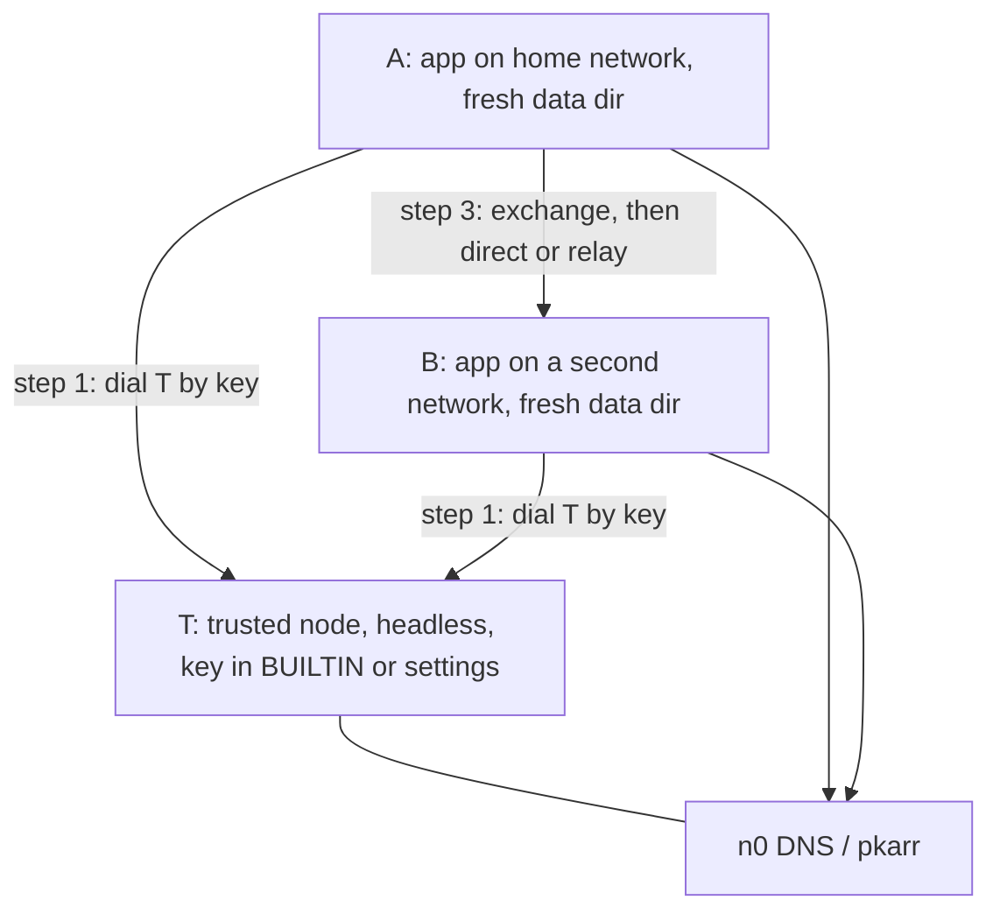

# Verifying iroh over the real network

*   **Author:** Hugh Kaznowski
*   **Status:** Initial draft, unreviewed
*   **Date:** 2026-11-22
*   **Ticket:** [ticket 0004](../../../tickets/0004-verify-iroh-live-network.md), blocked by [ticket 0008](../../../tickets/0008-trusted-peer-builtin-key.md). Feeds [ticket 0038](../../../tickets/0038-self-host-iroh-relay.md) and [ticket 0005](../../../tickets/0005-verify-agreement-live.md).
*   **Related decisions:** [ADR 0008](../../adr/0008-iroh-and-local-storage.md), [ADR 0009](../../adr/0009-bootstrap-and-peer-exchange.md), [ADR 0019](../../adr/0019-signed-gossip-messages.md), [ADR 0023](../../adr/0023-no-supernodes.md), [ADR 0039](../../adr/0039-key-management.md). Where this document and an ADR disagree, the ADR wins.

--------------------------------------------------------------------------------

## Overview

Only loopback iroh has been run: the tests in `app/src/net/iroh_net.rs` use `IrohConfig::Isolated` (no relay, an in-memory address lookup), and a 25 s headless smoke run on 2026-11-21 showed the process starts and stays up ([spike results](../../spike-s0.md)). The real app uses `IrohConfig::Default`, which is iroh's `N0` preset (n0's relays and DNS/pkarr address lookup). `build_network` in `app/src/runtime.rs` is the one place that chooses it.

This draft is a step-by-step plan for a two-machine run across the internet, with a third node as the trusted peer. It answers four questions from the ticket: does address lookup through n0 find a peer by key; does bootstrap run in the order of ADR 0009; does gossip identify authors (ADR 0019); and which hosted components does iroh use by default.

## The Problem

Four things are known only from documentation and source, not from a run:

*   **Address lookup.** A trusted peer is listed by public key only (`net::trusted`). Dialing it needs n0's DNS to resolve the key. Whether a freshly started node is resolvable within seconds, and what happens when `iroh.link` is unreachable, are not measured.
*   **Bootstrap order.** `net::bootstrap::run` tries remembered peers, then peer exchange, then trusted peers with a backoff of 30 s doubling to 15 min. Tests drive it with a fake clock and fake network.
*   **Gossip authorship.** The source check says an iroh-gossip `Message` carries no author, and `net::gossip` seals and opens a signed envelope (`seal` / `open`). Loopback tests cover it; no cross-machine run has.
*   **Hosted components.** The spike results name n0's relays (`use1-1`, `usw1-1`, `euc1-1`, `aps1-1` under `relay.n0.iroh.link`), the DNS service (`dns.iroh.link`) and iroh's default features (`metrics`, `fast-apple-datapath`, `portmapper`). Which of them a running node actually contacts is unmeasured.

A further gap makes this run hard to observe. `tracing` is a dependency of the app, but no subscriber is installed anywhere in `app/src` (checked by grep for `tracing_subscriber`, `fmt::init` and `set_global_default`: none), so every `tracing::warn!` and `tracing::info!` goes nowhere. `run_headless` also has no web server. A headless trusted node therefore reports nothing about what it does, and a window node shows only `NetworkView` (`peers` and `bootstrap`), where `peers` is the larger of connected peers and known peers (`LiveNet::peer_count`), so it can overstate connections.

## Goals

*   Recorded results, with dates, for each of the four questions, in `docs/spike-s0.md`.
*   A measured time from process start to first reached peer, for each bootstrap step.
*   A named list of every host and relay a default node contacts.
*   A decision (not made here) on whether ADR 0019 and ADR 0023 stay as written.

## Non-Goals

*   Choosing whether to self-host (that is [ticket 0038](../../../tickets/0038-self-host-iroh-relay.md), after this run).
*   Agreement behaviour (ticket 0005).
*   Load or scale tests (ADR 0014).
*   Windows and Linux network behaviour (the run is on whatever machines the author has; record the OS).

## Technical Plan

### Setup

*   **T** (the trusted node): an always-on machine with a public route, running `forever-together --headless --data-dir <dir>`. Its key is the one in `net::trusted::BUILTIN` (ticket 0008). Before the first release build exists, an alternative is to add T's public key to `trusted_peers` in the settings of A and B (the setting takes hex keys, loopback only); the run should say which was used.
*   **A** and **B**: window-mode apps with fresh, separate data directories (`--data-dir`), on two different networks. "Different" means different public IPs and different NATs, for example one on a home connection and one on a phone hotspot. Each with a character code pasted (invented character, "Testa Fakename", same faction, same region and realm, so they share a topic).
*   Each node's `GET /api/state` is polled once per second with its token (the token is in the window URL fragment; headless T has no API). Capture `network.peers` and `network.bootstrap` with timestamps.
*   A packet or connection monitor on A (for example the operating system's network monitor or a DNS query log) to list hosts contacted.
*   Wall clocks on all machines synchronised (NTP), because times are compared.

### Steps and pass criteria

1.  **First contact by key through n0 (answers address lookup).** Start T. Wait 60 s. Start A with no remembered peers and start a search so it has a topic (a headless node joins no topic: `LiveNet` has `headless` set and bootstraps on none). Record the time until `bootstrap` becomes `trusted`.
    *   Pass: A reaches T and reports `trusted` within the first backoff step (30 s). Record the time to the second.
    *   Fail: not reached within 3 minutes after one T restart. Record whether T's key resolves at all (DNS query to `dns.iroh.link` for it, if the author can do it), and go to step 6.
2.  **Remembered peers come first.** Stop A cleanly and restart it with the same data directory. Pass: `bootstrap` becomes `remembered`, not `trusted`, and T is not dialed (confirm in the connection monitor).
3.  **Peer exchange.** Start B (fresh) and let it bootstrap through T. Then check A and B know each other: A's search topic must show B's ad in its counts. Pass: `bootstrap` for B is `trusted`, and after the exchange A or B shows `peer_exchange` or a nonzero count of the other. Then stop T and confirm A and B stay connected and gossip continues for 5 minutes.
4.  **Gossip authorship across machines.** With A and B searching the same topic, each must see the other's ad. Pass: each node's compatible counts include the other. This shows signed envelopes verify across machines. It does not show the negative (a forged author is rejected); that is covered by loopback tests in `app/src/net/gossip.rs` and is stated as such. ADR 0019 stands if both nodes see each other's ads and nothing in the iroh-gossip API shows an author (already read from the 0.103.0 source).
5.  **Hosted components.** From the connection monitor on A, list every remote host and port for the whole run, from fresh start to step 3. Pass: the list is written out and each entry is mapped to a purpose (relay, DNS/pkarr, port mapping on the LAN, other). Any host not in the spike results row is a finding.
6.  **Degraded cases** (record, do not pass or fail):
    *   Block `dns.iroh.link` and `*.iroh.link` on A (hosts file or firewall) and restart A with an empty data directory: does the node ever reach T? With a remembered T from a previous run?
    *   Block UDP on A: is the relay used (the connection works but slowly), or does the connection fail?
    *   Record whether A and B end up on a direct path or through a relay. Reading this needs an iroh API that is not verified here (check the `iroh` 1.5 documentation for the endpoint's remote-info or path-type call before the run).

### What to record

For each step: date, OS and version of each machine, networks, iroh version (`app/Cargo.lock`), time values, and pass or fail. In `docs/spike-s0.md` update the rows "iroh address lookup resolves a trusted peer from its public key", "iroh's default hosted components...", and "iroh-gossip identifies message authors".

### What changes on each outcome

*   All pass: mark the three rows verified; ticket 0038 proceeds with measured data; ADR 0019 stays accepted.
*   Address lookup fails or is slow: ADR 0009 and 0023 need an amendment (listing addresses in the app, or self-hosting lookup), and ticket 0038 becomes urgent.
*   An unexpected host is contacted: add it to the design risks table in ADR 0034 (an ADR amendment).
*   Gossip turns out to carry authors: ADR 0019 is replaced, as the ADR itself says.

## Alternatives Considered

*   **Run only against two machines on one LAN.** Rejected: it exercises neither n0's DNS path for a remote peer nor relay or hole punching.
*   **Run a self-hosted relay and DNS first.** Rejected for this ticket: the question is what the defaults do (ticket 0038 decides afterwards).
*   **Trust the source reading.** The spike already did this; the ticket asks for a live run.

## Detailed Implementation

The run itself builds nothing. Code and doc changes tied to it:

*   `app/src/main.rs` (and `app/Cargo.toml`, a `tracing-subscriber` dependency): only if the author chooses to install a log subscriber (open question 1). Why: without it T gives no output, and `net::iroh_net`, `net::bootstrap` and `net::live` log nothing visible.
*   `app/src/net/live.rs` (`NetworkView`, `publish`) and `app/src/server/core.rs` (`NetworkView`): only if the author wants connected and known peers shown separately (see the `peers` overstatement). The web app type `webapp/src/api/types.ts` would change with it.
*   `docs/spike-s0.md`: three rows updated, a dated "Live network run" section with the tables of step times and the host list.
*   `docs/adr/0019-signed-gossip-messages.md` and `docs/adr/0023-no-supernodes.md`: amendments only if the results require; `docs/adr/0034-system-overview-goals-and-risks.md`: risk table row for hosted dependencies, if new hosts are found.
*   `tickets/0004-verify-iroh-live-network.md` and `tickets/0038-self-host-iroh-relay.md`: status updates.

## Test and verification plan

*   Before the run: `mise run test` passes, including the loopback iroh test and `fresh_install_bootstraps_through_a_trusted_peer` in `net/live.rs` (the fake-network version of step 1).
*   The run is the test. Keep a log file per node with the polled `/api/state` lines and the connection monitor output; these stay outside the repository because they contain IP addresses.
*   After the run: record only aggregate numbers and the host list in `docs/spike-s0.md`, never IP addresses of the author's machines.

## Open questions for the author

1.  **How should the run observe T and the nodes?** Answered by the author on 2026-11-23: install a `tracing` subscriber controlled by `RUST_LOG`, quiet by default (warnings only). Built in `app/src/lib.rs` (`init_logging`, not run for `key` commands) with `tracing-subscriber` in `app/Cargo.toml`. The author also said iroh itself does not need testing ("we know it does"); the scope of the run is open question 4.
2.  **Where does the trusted node T run?**
    *   **A cloud VM with a public IP.** Mechanism: the headless binary on a VM, key restored with `key import`. Trade-off: a stable test target that is also the production shape. Fails if the VM's provider blocks UDP or the run is judged by the author as hosting something (ADR 0034 says nothing is hosted; a trusted peer is an ordinary peer run by the author).
    *   **A machine at home behind NAT.** Mechanism: T behind the same kind of NAT as players. Trade-off: tests the harder path. Fails when T is not reachable even over relays, which then blames the home router rather than the design.
    *   **A third borrowed machine or friend.** Mechanism: a different person's network. Trade-off: independent network. Fails on scheduling and key custody (the secret key leaves the author's control, unless a throwaway key is used for the test and BUILTIN is filled later).
3.  **What are the numeric pass thresholds for first contact?**
    *   **Fixed from the design: reached within the first 30 s backoff step, steady connection afterwards.** Mechanism: pass or fail against numbers already in ADR 0035. Trade-off: clear. Fails by judging an acceptable but slower DNS publish as a failure.
    *   **Measure first, then set thresholds from the data and record them as ADR 0035 constants.** Mechanism: no gate in this run. Trade-off: avoids guessing. Fails by leaving the verification with no pass criterion until a second run.
4.  **Scope after the author's remark that iroh works.** Which of steps 1 to 6 still belong in this ticket? Options to decide between (not ranked): keep all steps; keep only what is specific to this app (bootstrap order, peer exchange, trusted fallback, steps 2 and 3); or drop the run and close the ticket on the author's say-so, recording the unverified rows in `docs/spike-s0.md` as accepted.
