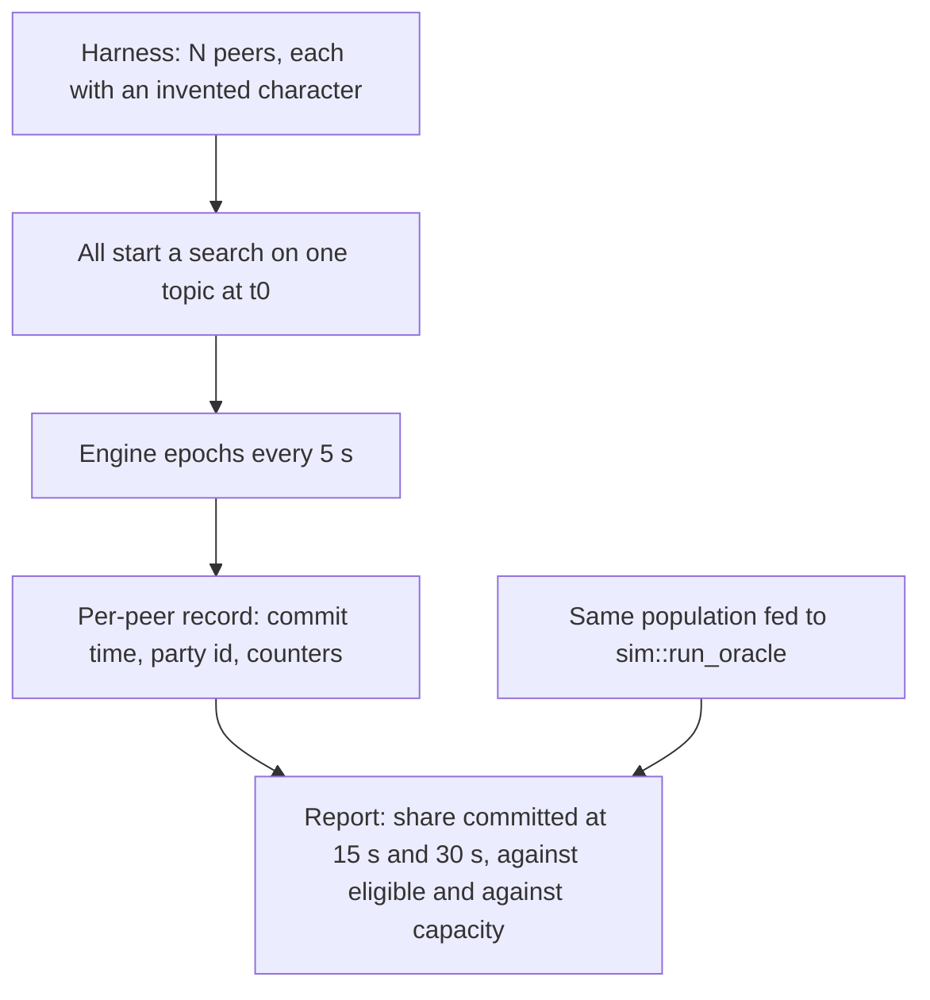

# Verifying leader invitations on a live network

*   **Author:** Hugh Kaznowski
*   **Status:** Initial draft, unreviewed
*   **Date:** 2026-11-22
*   **Ticket:** [ticket 0005](../../../tickets/0005-verify-agreement-live.md), blocked by [ticket 0004](../../../tickets/0004-verify-iroh-live-network.md). Uses the attempt counters of [ADR 0026](../../adr/0026-search-health-from-own-observations.md) and the history of [ADR 0027](../../adr/0027-search-history.md).
*   **Related decisions:** [ADR 0014](../../adr/0014-functional-tests-only.md) (amended: a seeded simulation only, a 10,000-peer simulator stays rejected), [ADR 0024](../../adr/0024-liveness-and-decline.md), [ADR 0025](../../adr/0025-leader-invitations.md), [ADR 0035](../../adr/0035-protocol-constants-engine-contract-and-api.md). Where this document and an ADR disagree, the ADR wins.

--------------------------------------------------------------------------------

## Overview

Leader invitations (ADR 0025) are implemented in `app/src/engine/lead.rs` (`plan_invites`, `choose_party`, `invite_preference`) and the engine state machine (`app/src/engine/state.rs`, `mod.rs`). In the seeded simulation (`app/src/engine/sim.rs`, results in the [spike results](../../spike-s0.md)) they commit 78.4% of eligible peers within 30 s (6 rounds of 5 s) at 3,000 peers, and 94.7% to 100% of what a central greedy build would place ("capacity"). The simulation has no churn, no real latency, no human Confirm, no real gossip layer, and it treats a lost direct message as lost for good. The engine does not retransmit lost direct messages (grep for `retransmit` and `retry` in `app/src/engine/` finds nothing).

This draft is a plan to run real instances over the real network, measure the same quantities, and decide whether thresholds are verified or must change.

## The Problem

*   The floor (70%) is unverified live. ADR 0025 says the floor is thin at 3 rounds (15 s): the mean is 73.0% and one seed in eight is under 70%.
*   The floor as originally worded depends on the role mix. The spike results re-measure it against capacity (what one central greedy build commits). Which definition a live run uses is not decided in an ADR.
*   Live numbers need many instances at once. Real players are few. The app has no mode that runs a search without a window (`--headless` has no search; `LiveNet` bootstraps on no topic when headless).
*   Message loss is unmeasured. iroh direct streams are reliable, so loss shows up as an unreachable peer, which retransmission would not fix (ADR 0025, Consequences).

## Goals

*   Live commit rates, within 15 s and 30 s of search start, for several swarm sizes and role mixes, in the same table shape as the simulation.
*   A live count of invitations sent, accepts received, drops and declines (ADR 0026 counters, `AttemptsView`), showing where messages are lost, if any.
*   A recorded decision input on whether to build retransmission of `Invite` and `PartyAnnounce`.

## Non-Goals

*   Changing the mechanism, its constants (`EPOCH` 5 s, `INVITE_WINDOW` 2 s and others in `app/src/config.rs`) or the wire messages in this ticket. Findings may lead to ADR changes.
*   A load test or 10,000 peers (ADR 0014).
*   Testing human behaviour. The Confirm click is automated.
*   Cross-faction or sharded topics.

## Technical Plan

### Harness

Neither the app nor the tests can run N live searching peers today. `app/src/integration_tests.rs` runs several in-process `LiveCore` instances over `FakeHub` (an in-memory network) with a clock running faster than real time; the test `five_alliance_players_form_a_party_and_the_horde_player_does_not` is the model. The live harness is the same shape with three differences:

1.  Each instance owns a real `IrohNet` (default config, so the run uses n0's relays and lookup) wrapped in `LiveNet`, instead of `FakeHub`.
2.  The clock is real time (scale 1).
3.  It reads each instance's state through `LiveCore` rather than HTTP, and confirms parties automatically.

It is an `#[ignore]` test (run on request), like the removed simulation report test, so `mise run test` stays fast. The population (roles 15% tank, 20% healer, 65% damage; levels 20 to 28; item level unknown for 30%) uses the generator already written for the simulation (`population` in `app/src/engine/sim.rs`, currently private), so the live numbers and the simulated numbers use the same peers, and `run_oracle` over the same ads gives the capacity figure.

### Where the instances run

Open question 1. The plan below holds for any choice: instances are spread over at least two machines, or one machine and several network paths, and all use `IrohConfig::Default` against the trusted peer from ticket 0008 (ticket 0004 must have passed first, because a live agreement run on a broken bootstrap measures the bootstrap).

### Steps

1.  **Warm-up.** Start N instances. Wait until each reports a nonzero peer count and the swarm has been stable for 60 s. Record the number of instances that never connect (these are removed from the denominators and reported).
2.  **Run.** All instances start the same search at t0 (one dungeon, one topic, same faction, stage 0). Record per instance: the time the engine first reports a committed party, the time all five confirm, `AttemptsView`, whether it was dropped or declined.
3.  **Repeat** 8 times with different seeds (different populations) and sizes (for example N = 30, 100 and, if the machines allow, 300) and two role mixes (15% tanks as in the simulation, 8% tanks).
4.  **Message loss probe.** Per run, compare the sum of `invites_sent` across instances with the sum of `invites_got`, and `accepts_got` with accepts sent. A gap means loss or unreachable peers. Record the gap and the number of unreachable peers per run.
5.  **Drops.** Count parties that fell apart after commit (`drops`, `declines`). With automated Confirm, declines should be 0; a nonzero value is a finding about the engine or harness.

### Metrics and pass criteria

*   **Capacity share at 30 s and at 15 s:** peers committed over what `sim::run_oracle` commits for the same population, per run and as min, mean and max across seeds.
*   **Eligible share at 30 s and at 15 s:** the original measure (peers that had a compatible five in their own sample at the start).
*   **Pass** (floor as worded in ADR 0034 and ADR 0025): at least 70% within 30 s on the measure the author chooses (open question 2), in every run with enough tanks.
*   **Compare** each live number with the simulated number for the same scenario; a live mean more than a stated margin below the simulated mean is a finding. The margin is not set in any ADR; see open question 2.
*   **Tank scarcity:** with 8% tanks the spike results show an eligible-share cap of 49% for every mechanism and a capacity share of 100%. A live run should reproduce the cap and the capacity result.

### What to record and where

In `docs/spike-s0.md`: a section "Leader invitations on a live network", with the date, number of machines, instance counts, run seeds, the table of shares next to the simulation's table, the counters (sent, got, drops, declines), the number of unreachable peers, and the harness commit. Mark the thresholds in the table at the top of the Seeded simulation section as verified or revised.

### Outcomes

*   Floor met on the chosen measure: ADR 0025 is amended with a "verified live" note and the date. The ADR 0034 risk row "Agreement fails when samples differ" moves from open to mitigated.
*   Floor missed with a message-loss gap: build retransmission of `Invite` and `PartyAnnounce` (a ticket; ADR 0025 names it as the first fix, and the simulation says one retry restores about 10 points at 5% loss).
*   Floor missed without a loss gap: the mechanism or its constants need an EGM pass and a new ADR. Candidates are in ADR 0025's "Considered, not simulated" list. This is a larger design change and is not decided here.
*   Live numbers far above the simulation: record, because the model is then too pessimistic.

## Alternatives Considered

*   **Real players only.** Rejected for the first run: there are too few, and a count of 30 s windows with unknown role mixes cannot be compared with the simulation.
*   **The in-memory network at larger N.** Already covered by the simulation and the integration tests; it cannot show network behaviour.
*   **Faster than real time.** Rejected for the live run. It is what the integration tests do, and it hides latency.
*   **A new binary mode (a headless searching peer).** Not rejected by an ADR; it would help with later ticket runs. It adds a product mode for testing; see the detailed section.

## Detailed Implementation

*   `app/src/live_swarm_tests.rs` (new, `#[cfg(test)]`, `#[ignore]` tests) and a line in `app/src/lib.rs` to include it: builds N `LiveCore` instances over real `IrohNet`, drives them, writes a report to standard output. Why: nothing else can run N searching peers.
*   `app/src/engine/sim.rs`: make the `population` function and the oracle entry reachable from the harness (`pub(crate)`). Why: same ads for live and for capacity. No behaviour change.
*   `app/src/app/mod.rs` (`LiveCore`): only if the harness cannot read per-instance state and counters without HTTP; an accessor may be needed. Check before adding.
*   `app/src/net/live.rs`: none expected. `NetworkView` is already published.
*   `docs/spike-s0.md`: results section as above.
*   `docs/adr/0025-leader-invitations.md`: an amendment after the run; `docs/adr/0034-system-overview-goals-and-risks.md`: risk row.
*   `tickets/0005-verify-agreement-live.md`: status; a new ticket for retransmission if a loss gap appears.

## Test and verification plan

*   Before the run: `cargo test --lib engine::` (including `engine::sim::tests::leader_mechanism_reaches_the_floor_in_thirty_seconds`) and `mise run test` pass, and ticket 0004's checks have passed.
*   Validate the harness itself first at N = 5 on the in-memory network against the existing integration test result, then at N = 30 on loopback iroh, before using the internet.
*   Run order: sizes ascending, one machine first, then more machines. Stop at the first run where more than a small number of instances fail to connect, and return to ticket 0004.
*   Keep per-run logs out of the repository (they contain IP addresses); keep the report table.

## Open questions for the author

1.  **Where do the live instances come from?**
    *   **Many instances on one or two machines of the author's, over iroh and n0's relays.** Mechanism: one process hosting N `IrohNet`s, or several processes. Trade-off: cheap and repeatable. Fails to represent real latency and NAT diversity (all traffic goes through one uplink), so the numbers can be optimistic.
    *   **Rented machines in several regions.** Mechanism: instances on cloud VMs in different regions, driven by one script. Trade-off: real latency and paths. Fails on cost and on key and token handling for many machines, and on the run being judged as hosting infrastructure (ADR 0034 says nothing is hosted).
    *   **Real players join a scheduled test.** Mechanism: a call for players at one time with real windows. Trade-off: the most realistic. Fails because the player count is unknown, the role mix is not controlled, and the Confirm click is human, so it measures people as much as the mechanism.
2.  **What is the live pass measure and margin?**
    *   **Capacity share at least 70% within 30 s.** Mechanism: the measure the spike results already use. Trade-off: removes the role mix from the result. Fails to answer the original floor wording ("70% of eligible peers"), which ADR 0034 still states.
    *   **Eligible share at least 70% within 30 s, with capacity reported next to it.** Mechanism: the original measure. Trade-off: faithful to the ADR wording. Fails by marking the mechanism as failing in tank-scarce swarms where no mechanism can pass.
    *   **Both must pass, plus a live to simulated margin.** Mechanism: stricter. Trade-off: catches both problems. Fails by flagging scarce-tank runs and requiring a margin value that no ADR sets.
3.  **At what live loss level is retransmission built?**
    *   **Any measurable gap between invites sent and received.** Mechanism: build the retry whenever loss appears. Trade-off: removes a known weakness early. Fails by adding engine complexity for loss that is only unreachable peers, which a retry cannot fix.
    *   **Only if the floor is missed and a gap exists.** Mechanism: the ADR 0025 reading. Trade-off: no unneeded code. Fails by leaving a few percent loss in place that quietly bans fair peers for 60 s (ADR 0025 consequence on lost commit messages).
    *   **Never, rely on iroh reliable streams.** Mechanism: treat loss as unreachable peers. Trade-off: simplest. Fails when the live run shows loss from stream timeouts rather than unreachable peers.
