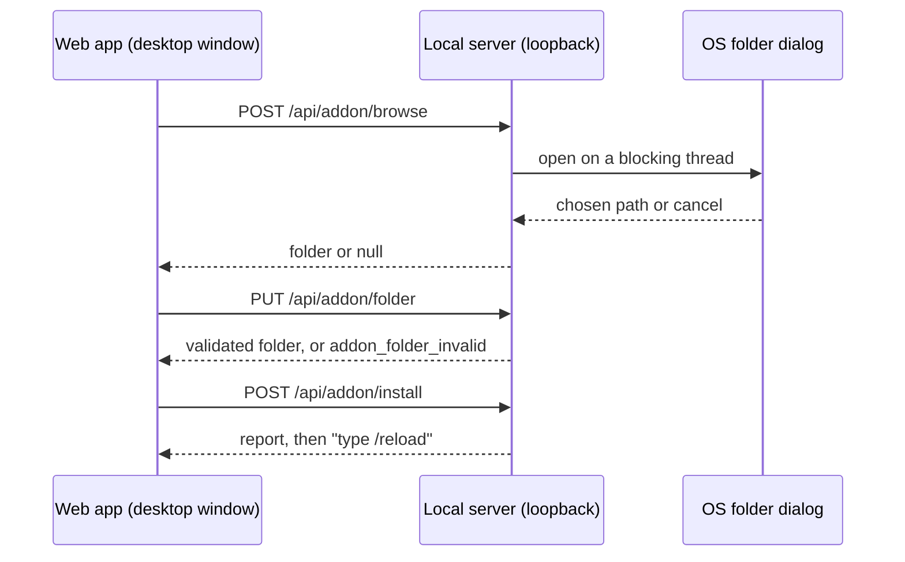

# Addon installer stage 2

*   **Author:** Hugh Kaznowski
*   **Status:** Initial draft, unreviewed
*   **Date:** 2026-11-22
*   **Ticket:** [ticket 0007](../../../tickets/0007-addon-installer-stage-2.md), blocked by [ticket 0006](../../../tickets/0006-verify-addon-installer-real-install.md).
*   **Related decisions:** [ADR 0028](../../adr/0028-the-desktop-app-installs-the-bundled-addon.md), [ADR 0031](../../adr/0031-one-screen-per-state-and-click-to-search.md), [ADR 0012](../../adr/0012-one-web-app-for-phone-and-desktop.md), [ADR 0029](../../adr/0029-atomic-design-and-show-dont-tell.md). Where this document and an ADR disagree, the ADR wins.

--------------------------------------------------------------------------------

## Overview

The desktop app can already install the addon it carries ([ADR 0028](../../adr/0028-the-desktop-app-installs-the-bundled-addon.md), first slice, built). In Settings, the Addon card shows the status, detects the AddOns folder on macOS and Windows, accepts a pasted path, and installs by staging and swapping the `ForeverTogether` folder. Stage 2 adds three things the first slice left out on purpose: a "Browse" button backed by a native folder dialog opened by Rust, a Linux detection rule, and an install offer in the first run.

## The Problem

*   A player who has the game in a non-default place must paste a path (`AddonPathField`). Pasting a path to a folder four levels deep is the weakest part of the card.
*   On Linux `detect_candidates` returns nothing (`Os::Linux => {}` in `app/src/addon_install.rs`), so every Linux player pastes.
*   The first-run screen ([ADR 0031](../../adr/0031-one-screen-per-state-and-click-to-search.md)) still says "Get the addon" and never offers the install, even when the app already knows the folder. A new player has to find Settings first.
*   The main window has no Tauri IPC on purpose (`app/capabilities/default.json`, [ADR 0012](../../adr/0012-one-web-app-for-phone-and-desktop.md)), so the web app cannot open a dialog itself. Any dialog has to be opened by the Rust side and reached through the local API.

## Goals

*   A loopback-only route that opens the operating system's folder picker and returns the chosen path. The web app then sends it through the existing `PUT /api/addon/folder`, so validation stays in one place.
*   A Linux detection rule in the same data table as the other systems, marked unverified until ticket 0006 answers it.
*   The first run offers "Install the addon" when a folder is known and the addon is not up to date, and falls back to the current text when it is not.
*   No new IPC permission, and no way for a phone or a web page to open a dialog on the desktop.

## Non-Goals

*   Reading the Battle.net configuration or the Windows registry ([ADR 0028](../../adr/0028-the-desktop-app-installs-the-bundled-addon.md), out of scope).
*   Detecting a running game, uninstall, rollback, update prompts. Release tracking is [ticket 0012](../../../tickets/0012-addon-releases-and-updates.md).
*   Changing the containment rules or the install algorithm. The dialog only produces a string that goes through them.
*   A dialog in `--headless` mode. Headless starts no web server (`run_headless` in `app/src/runtime.rs`), so the route cannot be called there at all. ADR 0028 says the route returns 409 when headless; in the current code the case cannot arise, which the ADR wording does not mention. The ADR wins until it is amended.

## Technical Plan

**1. Dialog route.** One new route, `POST /api/addon/browse`, next to the three that exist (`app/src/server/routes.rs` registers `/addon`, `/addon/folder`, `/addon/install`, each behind `require_loopback`). It needs the token and a loopback caller, like the others. It opens the dialog on a blocking thread, waits, and returns `{ "folder": "<path>" }` or `{ "folder": null }` when the player cancels. It saves nothing and validates nothing. The page then calls `PUT /api/addon/folder`, which already refuses a folder that is not `.../Interface/AddOns`. Because the dialog blocks the server's request until the player answers, the route needs a long timeout and an answer for "a dialog is already open".

**2. Linux detection.** `detect_candidates` gets a `Os::Linux` arm that builds paths from `home` and environment values, as the Windows arm builds from `ProgramFiles`. Which paths is an open question below, because nothing in the repository says how Forever runs on Linux. Candidates that fail `validate_folder` are dropped, as today, so a wrong guess costs nothing but a missing suggestion.

**3. First-run integration.** `CharacterPanel` renders the first run with `FirstRunStep` rows (step 1 "Get the addon", step 2 "Type /wowft, copy", step 3 "Paste here"). When `GET /api/addon` reports a folder (saved or detected) and a status other than `up_to_date`, step 1 gets an install button that runs the same `installAddonFlow` the Settings card uses (`webapp/src/api/addonFlow.ts`), which saves a detected folder on the first confirmed install ([ADR 0028](../../adr/0028-the-desktop-app-installs-the-bundled-addon.md), "a guess never writes silently"). A phone is not loopback, so `GET /api/addon` is refused there and the first run on a phone keeps today's plain step.

## Alternatives Considered

*   **Make the picker a Tauri IPC command.** Rejected by [ADR 0028](../../adr/0028-the-desktop-app-installs-the-bundled-addon.md) and [ADR 0012](../../adr/0012-one-web-app-for-phone-and-desktop.md): the window keeps `"permissions": []`, and a phone's web app would have no such command anyway.
*   **Let the route save the folder as it returns it.** Rejected: it would give a second place that validates and saves. One `PUT` stays the only writer of `addon_dir`.
*   **A separate first-run screen for the addon.** Rejected as a default by [ADR 0031](../../adr/0031-one-screen-per-state-and-click-to-search.md): one screen per state, and the first run is one card with three steps. The question of how much to add to that card is open below.

## Detailed Implementation

Files marked "new" do not exist yet. Everything else exists and is checked.

*   `app/Cargo.toml`: add the dialog dependency chosen in question 1 (none if the answer is a shell-out). Reason: the dialog is the only part of this ticket that needs a new crate.
*   `app/src/server/addon_routes.rs`: add `post_browse`. It holds the `addon_lock`-style guard so two dialogs cannot open together, runs the dialog in `spawn_blocking`, and returns the folder as a plain string. Add an injectable provider on the server configuration in `app/src/server/mod.rs` (`ServerConfig` already carries `addon_candidates: Arc<dyn Fn() -> Vec<PathBuf>>` as the test seam; a `pick_folder` provider follows the same shape), so tests do not open a real dialog.
*   `app/src/server/routes.rs`: register `/addon/browse` with `require_loopback`, beside the existing addon routes.
*   `app/src/server/mod.rs`: `Shared` and `ServerConfig` gain the provider (`from_env` sets the real one).
*   `app/src/addon_install.rs`: Linux arm in `detect_candidates` and its constants (the table that is "kept as data in one place and marked unverified"); update the file's UNVERIFIED comment. Add the unit test that replaces the `assert!(detect_candidates(.., Os::Linux).is_empty())` assertion.
*   `app/src/server/tests.rs`: tests that the route needs a token, refuses a non-loopback caller (as `addon_routes_need_a_token_and_a_loopback_caller` does for the others), returns the injected path, returns `null` on cancel, and refuses a second concurrent dialog.
*   `webapp/src/api/types.ts`, `httpApi.ts`, `mockApi.ts`, `fixtures.ts`: add `browseAddonFolder(): Promise<string | null>` to the `Api` interface, the HTTP client and the mock.
*   `webapp/src/api/addonFlow.ts`: a `browseAndSave` step that calls browse, then the existing save, and returns the same `AddonResult` shape the card already renders.
*   `webapp/src/components/molecules/AddonPathField.tsx` (and its stories): a "Browse" button beside the paste field, hidden or locked on a phone like the other controls (`Locked`).
*   `webapp/src/components/organisms/AddonSettings.tsx` and `.stories.tsx`: pass the browse handler through; stories for browse busy and browse cancelled.
*   `webapp/src/components/organisms/CharacterPanel.tsx`, `.stories.tsx`, `webapp/src/components/pages/FinderPage.tsx` and `FinderPage.stories.tsx`: the first-run install offer, with stories for: folder known and not installed, folder known and up to date (step shown as done), no folder (current text), and phone (no offer). The existing `FirstRunWithAddonLink` story must keep working.
*   `docs/adr/0028-...md`: the status line says the picker is a later server-side dialog. Either amend ADR 0028 or add a new ADR in the same change that builds this, as `CLAUDE.md` requires. Which one is for the author.
*   `docs/adr/README.md` and `tickets/0007-...md`, `tickets/README.md`: status updates when built (not part of this draft).

## Test and verification plan

*   Rust: the route tests above, with a fake provider. The Linux arm tests with a fake environment and a temporary directory tree, as the existing detection tests do. Run `cargo test --lib addon_install` and `cargo test --lib server::` (cargo takes one filter each), then `cargo clippy --all-targets -- -D warnings`.
*   Frontend: `pnpm --dir webapp typecheck` and `build-storybook`; play functions run in Firefox against the built Storybook (the gate [ADR 0029](../../adr/0029-atomic-design-and-show-dont-tell.md) names).
*   Not testable in the suite, so manual and unverified: the real dialog on macOS, Windows and Linux; that the dialog opens in front of the Tauri window; that cancelling returns control; that the dialog does not freeze the server for other requests. These belong with the checklist in [ticket 0006](../../../tickets/0006-verify-addon-installer-real-install.md), which also decides whether the Linux paths are right.

## Open questions for the author

1.  **How Rust opens the dialog.**
    *   **A. A native-dialog crate called from the route's blocking thread** (for example `rfd`). Mechanism: the crate wraps each system's dialog. Trade-off: one dependency, the same code path in tests behind the provider seam. Fails if a system requires the dialog to run on the main thread (on macOS this is reported for some toolkits and is unverified here), because the route thread is not the main thread.
    *   **B. The Tauri dialog plugin used from Rust only**, with no IPC permission. Mechanism: the Tauri side owns the main thread and the plugin posts the dialog to it. Trade-off: avoids the main-thread problem. Fails the moment the server has to run without Tauri (integration tests, `--headless`) unless a second path exists, and it ties the server module to Tauri, which ADR 0028 kept out of the installer logic.
    *   **C. Shell out to the system's own tool** (`osascript` on macOS, PowerShell on Windows, `zenity` or `kdialog` on Linux). Mechanism: spawn a process and read its output. Trade-off: no new crate. Fails where the tool is absent (common on minimal Linux installs) and adds three code paths to keep working.
2.  **What Linux detection looks at.**
    *   **A. Nothing, and rely on Browse.** Mechanism: leave the Linux arm empty. Trade-off: no guessed paths in the code. Fails the "Linux path detected" line of the ticket's Done when, which would then need rewording.
    *   **B. Wine and Proton default prefixes under the home folder** (for example a `drive_c/Program Files (x86)/World of Warcraft/_forever_/Interface/AddOns` below `~/.wine`). Mechanism: the Windows list rebased onto a prefix. Trade-off: reuses the Windows layout. Fails if Forever is run through a launcher that keeps its prefix elsewhere, or natively.
    *   **C. B plus the well-known launcher prefix folders** (Lutris, Bottles, Steam compatibility data). Mechanism: more roots to test. Trade-off: finds more installs. Fails on every launcher layout not listed, and each root is another guess to keep current without a Linux machine to test on.
    Whether Forever is played on Linux at all is not established in this repository.
3.  **Where the first run offers the install.**
    *   **A. Inside step 1.** The "Get the addon" row becomes an install button when a folder is known. Trade-off: no new row, the card stays three steps. Fails if the row then carries a button plus a link plus a status, which breaks the one-line rule of [ADR 0029](../../adr/0029-atomic-design-and-show-dont-tell.md).
    *   **B. A new step before "Type /wowft".** Mechanism: four steps, the install step shown only on a desktop with a known folder. Trade-off: clear order. Fails the viewport rule if a fourth step makes the card scroll at 1280x720 or 390x844.
    *   **C. A one-time Notice above the steps** that appears only when the addon is not installed, and disappears after install. Trade-off: the steps stay as they are. Fails when the notice and the steps both compete for the player's first tap.
4.  **ADR 0028 amendment or a new ADR** for stage 2 (`CLAUDE.md` allows either; the table in [ADR 0036](../../adr/0036-how-designs-and-decisions-are-maintained.md) calls an accepted ADR immutable except for its status, which points to a new ADR). A new ADR leaves 0028 immutable and adds a cross-reference. An amendment keeps the installer decision in one file. The choice fails if a reader reads only one of the two and misses the other.
