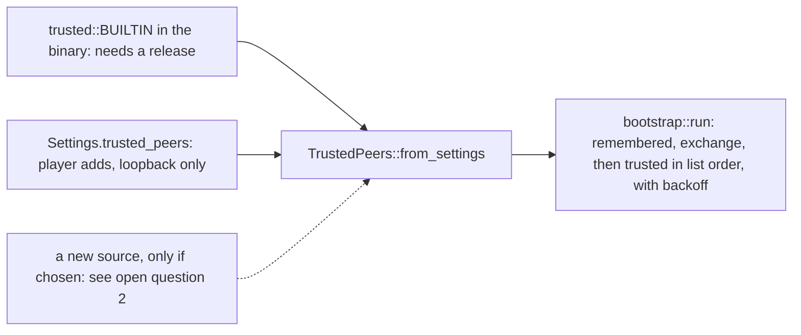

# Who may run trusted peers and how their keys are added

*   **Author:** Hugh Kaznowski
*   **Status:** Initial draft, unreviewed
*   **Date:** 2026-11-22
*   **Ticket:** [ticket 0010](../../../tickets/0010-trusted-peer-deployment-policy.md). Blocked by [ticket 0008](../../../tickets/0008-trusted-peer-builtin-key.md) (the first key). Related: [0038](../../../tickets/0038-self-host-iroh-relay.md) (hosted dependencies), [0043](../../../tickets/0043-key-management.md) (key tooling).
*   **Related decisions:** [ADR 0023](../../adr/0023-no-supernodes.md), [ADR 0009](../../adr/0009-bootstrap-and-peer-exchange.md), [ADR 0038](../../adr/0038-scan-log-and-opt-in-export.md), [ADR 0039](../../adr/0039-key-management.md), [ADR 0034](../../adr/0034-system-overview-goals-and-risks.md), [ADR 0035](../../adr/0035-protocol-constants-engine-contract-and-api.md). Where this document and an ADR disagree, the ADR wins.

--------------------------------------------------------------------------------

## Overview

A trusted peer is an ordinary install run headless (`forever-together --headless`) on an always-on machine, listed by public key. Installs dial it only as the last step of bootstrap, after remembered peers and peer exchange, with a backoff of 30 s doubling to 15 min ([ADR 0009](../../adr/0009-bootstrap-and-peer-exchange.md), [ADR 0023](../../adr/0023-no-supernodes.md), `app/src/net/bootstrap.rs`, `config::trusted_backoff`). Today only the author is expected to run one, and `net::trusted::BUILTIN` is empty (ticket 0008).

The ticket asks one thing: who else may run one, and how do their keys get into the list. The answer is a short ADR that extends ADR 0023. This draft states what the code and ADRs already fix and lists the choices that remain.

## The Problem

What exists:

*   Two sources of trusted keys: `trusted::BUILTIN` (a constant, compiled into the binary, so a change needs a release) and `Settings.trusted_peers` (hex keys the player adds in Settings, "Backup contacts"; changing it is loopback only, `touches_loopback_only` in `app/src/server/core.rs`). `TrustedPeers::from_settings` puts the built-in keys first, adds the player's, removes duplicates and reports entries that are not valid keys.
*   Bootstrap dials the list in order and stops at the first that answers (`bootstrap::run`). A node skips its own key.
*   **`BUILTIN[0]` has a second job:** it is the recipient of encrypted scan exports ([ADR 0038](../../adr/0038-scan-log-and-opt-in-export.md) amendment), and [ADR 0039](../../adr/0039-key-management.md) says every historical `BUILTIN[0]` secret must be kept because older builds keep encrypting to the key compiled into them. So the first entry cannot be reordered or replaced casually, whoever else is added.
*   A trusted peer cannot be told apart from any other peer on the wire. It limits connections and rates like any peer (peer exchange: one request per 10 s per peer, a peer that exceeds a limit is ignored for 10 minutes, `app/src/net/exchange.rs`), and a headless node holds more remembered peers (`HEADLESS_KNOWN_PEERS`).

What is open:

*   No rule says who may run a trusted peer other than the author, nor how their key is vetted and added.
*   A trusted peer sees what any peer sees: the peer IDs and claimed topics of those who ask it for peers, and (inference, not verified here) the network addresses of those who connect to it directly. An operator could log them. Nothing prevents this.
*   Removing or replacing a key (operator leaves, key compromised) needs a release, and older builds keep dialing the old key.
*   Because dialing is in list order, the first key receives all cold-start load and the others are used only if it fails.

## Goals

*   A stated rule for who may run a trusted peer.
*   A stated way for keys to be added, replaced and removed, including what happens on old builds.
*   A stated expectation of operators (what they run, what they must not do).
*   `BUILTIN[0]` stays the author's key and the export recipient.

## Non-Goals

*   Hosted services of any kind run by the project beyond peers ([ADR 0034](../../adr/0034-system-overview-goals-and-risks.md); relay and lookup are ticket 0038).
*   Giving trusted peers any privilege in the protocol. They stay ordinary peers (ADR 0023): no special messages, no say in matching.
*   Per-topic lists published by trusted peers (rejected in ADR 0023).
*   Reputation or blocking of peers ([ticket 0013](../../../tickets/0013-blocking-and-trust.md)).

## Technical Plan

How a key reaches a node today, and where a decision would add a path:

The ADR this ticket produces would be short: who may be listed, the path by which a key is added, replaced and removed, whether dial order is fixed or shuffled, and what operators agree to. It extends ADR 0023. The risk about trusted peers (single point of failure, "more trusted keys over time ... key rotation needs a release") is in the archived design doc's risk table (`docs/design-process/archive/forever-together.md`, history only); ADR 0034 does not carry it, so the new ADR states it.

**Constraint carried into every option:** new keys are appended after `BUILTIN[0]`, never inserted before it, because `BUILTIN[0]` receives scan exports. Dial order and export recipient are separate things and the code can treat them separately if dial order is ever shuffled.

## Alternatives Considered

*   **Trusted peers with special protocol powers** (for example answering peer requests for any topic from a global table). Rejected by ADR 0023 (supernode).
*   **A server-style registry of operators run by the author.** Rejected: nothing is hosted ([ADR 0034](../../adr/0034-system-overview-goals-and-risks.md)).

## Detailed Implementation

This is a decision, so the deliverable is documents. Files by option are listed in the open questions; common to all:

*   `docs/adr/NNNN-trusted-peer-deployment-policy.md` (new, next number, indexed in `docs/adr/README.md`): the decision; `docs/adr/0023-no-supernodes.md` gets a line that it is extended (the ADR README and the "Extended by" note are updated in the same change, per ADR 0036).
*   `README.md`: a short "Running a trusted peer" section if operators other than the author are allowed (what to run: `--headless`, which key commands, backing up the key per ADR 0039).
*   `tickets/0010-*.md` and `tickets/README.md`: status update.
*   Code changes only if an option below needs them (named there).

## Test and verification plan

*   For a documents-only outcome: the ADR links resolve, the README commands match `forever-together --help`, and the ADR's statements about code (dial order, settings source, duplicate removal) are checked against `app/src/net/trusted.rs` and `app/src/net/bootstrap.rs`.
*   If dial order is shuffled (question 3 B): a bootstrap test in `app/src/net/bootstrap.rs` next to `order_is_remembered_then_exchange_then_trusted`, with an injected random source so it stays deterministic.
*   If a new key source is added (question 2 B): tests for accepting a valid signed list and rejecting a wrong signature or older version.

## Open questions for the author

1.  **Who may run a trusted peer that ships in `BUILTIN`?**
    *   **A. The author only.** Mechanism: every shipped key is the author's, on machines the author runs; players may add others in Settings. Trade-off: one accountable party; no operator can log what peers ask. Fails when the author's machines are unreachable or the author stops: cold starts fail until a release adds a new key (the risk in [ADR 0034](../../adr/0034-system-overview-goals-and-risks.md)).
    *   **B. Named operators the author approves.** Mechanism: a pull request adds a key to `BUILTIN` (appended after `BUILTIN[0]`), with a written agreement; released with the next version. Trade-off: more than one point of contact for cold starts. Fails if an operator logs or misuses what peers send them, or disappears (the key then sits in old builds); the author must judge operators the project cannot verify.
    *   **C. Nobody else ships; anyone can run one and publish the key for players to add in Settings.** Mechanism: only the existing `trusted_peers` setting. Trade-off: no change to code or releases; no gatekeeping. Fails to help new installs: a player who has not added a key has only the author's, so it does not solve the single point of failure.
2.  **How does a key get added, replaced or removed without a release?** `BUILTIN` is a compile-time constant.
    *   **A. Only by release.** Mechanism: as today. Trade-off: nothing new to build or trust. Fails because old builds keep dialing a retired or compromised key (the backoff caps the cost at one try every 15 minutes) and cannot learn of a new one; a compromised key is a real problem on old builds, since an attacker holding it can be dialed as a trusted peer.
    *   **B. An author-signed list** carried through peer exchange or fetched. Mechanism: a new message or file signed by the author's key; installs verify it against a compiled-in public key and add the keys. Trade-off: keys can change without a release. Fails by adding a protocol feature and a signing key that must be kept safe (its compromise is worse than a bad entry), and a fetched list would be a hosted component ([ADR 0034](../../adr/0034-system-overview-goals-and-risks.md)); the exchange path would also be a change to the wire format, which the spec and vectors then track.
    *   **C. Only the player's settings for anything beyond the first release.** Mechanism: operators tell players to add their key. Trade-off: no new code. Fails in the same way as 1 C: new installs know none of them.
3.  **In what order do installs dial the trusted peers?** Today the list order, first answering wins.
    *   **A. Keep list order.** Mechanism: no change. Trade-off: predictable, `BUILTIN[0]` takes all cold-start load while it works. Fails when that load exceeds what one machine handles (the accepted risk in ADR 0023, to be measured), and the other operators' machines are untested until the first fails.
    *   **B. Shuffle the order per attempt** (the export recipient stays `BUILTIN[0]`). Mechanism: random start or full shuffle in `bootstrap::run`. Trade-off: spreads the load. Fails by sending cold starts to operators the author has not tested, and by making a slow or unreliable operator visible to a share of players, not only after the first one fails.
    *   **C. Prefer the nearest or fastest** (measure and remember). Mechanism: try all, keep the quickest, store it. Trade-off: best latency. Fails by contacting every trusted peer on each cold start, which defeats "last resort only" in ADR 0009, and the stored preference becomes a new thing to persist.
