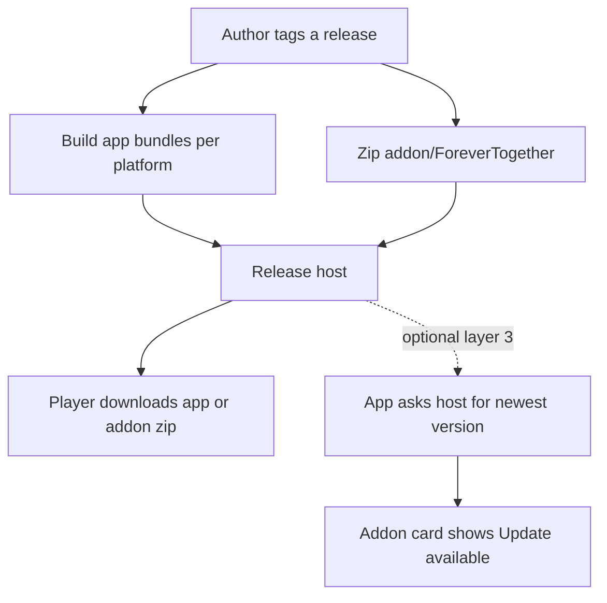

# Addon release flow and update tracking

*   **Author:** Hugh Kaznowski
*   **Status:** Initial draft, unreviewed
*   **Date:** 2026-11-22
*   **Ticket:** [ticket 0012](../../../tickets/0012-addon-releases-and-updates.md). Related: [ticket 0011](../../../tickets/0011-addon-page-url.md) (the page the link points to), [ticket 0006](../../../tickets/0006-verify-addon-installer-real-install.md), [ticket 0007](../../../tickets/0007-addon-installer-stage-2.md).
*   **Related decisions:** [ADR 0028](../../adr/0028-the-desktop-app-installs-the-bundled-addon.md), [ADR 0020](../../adr/0020-one-new-repository-standalone-addon.md), [ADR 0018](../../adr/0018-code-format.md), [ADR 0023](../../adr/0023-no-supernodes.md), [ADR 0034](../../adr/0034-system-overview-goals-and-risks.md). Where this document and an ADR disagree, the ADR wins.

--------------------------------------------------------------------------------

## Overview

Two artefacts exist: the desktop app (a Tauri bundle from `mise run build`) and the addon (`addon/ForeverTogether/`, version in the `.toc` line `## Version: 0.1.0`). The app embeds a copy of the addon at build time (`app/build.rs`, [ADR 0028](../../adr/0028-the-desktop-app-installs-the-bundled-addon.md)) and can install it. Nothing in the repository publishes either of them: there is no `.github/` folder, no workflow, no git tag, and the app has no HTTP client (`app/Cargo.toml` has `axum` for serving and `iroh` for peers, nothing that calls out). `app/tauri.conf.json` and `app/Cargo.toml` both say `0.1.0`, and the addon `.toc` also says `0.1.0`; nothing ties the three together.

## The Problem

*   The author bumps the addon `## Version:` by hand ([ADR 0028](../../adr/0028-the-desktop-app-installs-the-bundled-addon.md), version rules). Nothing checks that a changed addon file comes with a new version. The installer reports `files_differ` for the same version with different bytes, but that is the player's view after the fact.
*   Compatibility between app and addon is already enforced by the code format version, not by the `.toc` version: a decoder refuses an unknown version with an "update" message ([ADR 0018](../../adr/0018-code-format.md), `docs/rdf-code-spec.md`). So the addon version in the `.toc` is advisory.
*   There are no release artefacts. A player cannot get the addon without the app (embedded copy) or a checkout (`mise run install-addon`).
*   A player who installed addon 0.1.0 by hand, and later gets an app with 0.2.0, is told by the Addon card (`update_available`). A player who never opens Settings is not.
*   The ticket names two ideas: a CurseForge link, and the GitHub API for release tracking. Neither is decided, and the second means the app makes outbound requests it does not make today, which [ADR 0028](../../adr/0028-the-desktop-app-installs-the-bundled-addon.md) lists as out of scope ("download or release tracking, ... auto-update prompts") and the context of that ADR states ("No network is used").

## Goals

*   A written release process: what gets built, how the versions are set, where the files are published.
*   A decision on release artefacts and on update tracking, recorded in an ADR ([ADR 0036](../../adr/0036-how-designs-and-decisions-are-maintained.md)).
*   The version in the `.toc` cannot drift from what the app bundles without a visible failure.

## Non-Goals

*   Signing releases or addon files (also a non-goal in the key design draft).
*   Auto-installing an update without a click, or detecting a running game ([ADR 0028](../../adr/0028-the-desktop-app-installs-the-bundled-addon.md), out of scope).
*   Hosting anything run by the author ([ADR 0034](../../adr/0034-system-overview-goals-and-risks.md), [ADR 0023](../../adr/0023-no-supernodes.md)). A third-party release host is not the author's own service, but it is a dependency; question 3 covers it.

## Technical Plan

The plan has three independent layers, so each can be decided alone.

**Layer 1: artefacts.** What a release contains. The app already contains the addon, so one app bundle per platform is a complete release for a player who installs through Settings. A separate addon zip is needed only for players who do not run the app (for example a player using only a phone, which cannot install the addon at all, since the installer routes are loopback-only).

**Layer 2: versions.** One place sets the version, or a check keeps three places equal: the addon `.toc`, `app/Cargo.toml` and `app/tauri.conf.json`. A build-time check is possible because `app/build.rs` already parses the `.toc` version and fails the build when it is malformed.

**Layer 3: update tracking.** Whether the running app asks a release host for the newest version and tells the player.

The dotted path is the part that needs the author's decision.

## Alternatives Considered

*   **Track updates through the peer network** (peers announce their addon version). Rejected here for lack of any decision backing it: addon version is not in the code or in any protocol message, and adding it changes the wire format ([ADR 0018](../../adr/0018-code-format.md)). Noted so it is not rediscovered.
*   **Leave `installed_newer` and `update_available` as they are and write only the process.** This is option A of question 3, not a rejected alternative.

## Detailed Implementation

Files depend on the answers below. Only files that exist were checked; new files are marked.

*   `docs/adr/NNNN-addon-releases.md` (new, next free number; `docs/adr/README.md` indexes it): the decision and its consequences. Required by the ticket's Done when.
*   `docs/release-process.md` (new) or a section in `README.md`: the written process (tag, build, attach, set versions). Where it lives is a mechanical choice; the draft puts it in `README.md` unless the author wants a separate file.
*   `.github/workflows/release.yml` (new, only if the release host is GitHub and the author wants automation): builds with `mise` (pinned in `mise.toml`) and uploads. There is no CI of any kind today, so this is also the first workflow; it is optional.
*   `app/build.rs`: optionally fail the build when the `.toc` version and `app/Cargo.toml` version differ (layer 2). Pure addition to the existing parser.
*   `addon/ForeverTogether/ForeverTogether.toc`: the `## Version:` line is bumped by the author at release; no structural change.
*   `scripts/` (new script, optional): a script that sets all three versions from one argument, if the author prefers a script to a build check.
*   Layer 3 only: `app/Cargo.toml` gains an HTTP client dependency; `app/src/addon_install.rs` or a new `app/src/update_check.rs` (new) holds the pure comparison of a fetched version against `bundled_version()`; `app/src/server/addon_routes.rs` adds the status field or route; `app/src/config.rs` `Settings` gains an on/off setting if the check is opt-in; `webapp/src/api/types.ts`, `webapp/src/components/organisms/AddonSettings.tsx` (the `BADGE` table already has an `update_available` tone) and stories show it. Each is conditional on question 3.
*   `docs/adr/0028-...md`: its "out of scope" line about release tracking is superseded by the new ADR if layer 3 is built; mark it in the new ADR rather than editing 0028.

## Test and verification plan

*   Layer 2: a test that the three version strings agree (a Rust test reading the `.toc`, or the `build.rs` check). `cargo test --lib addon_install`.
*   Layer 1: a dry run on a clean checkout: follow the written process to produce the artefacts, unzip the addon zip into a temporary `Interface/AddOns` and run the installer's `inspect` against it; expect `up_to_date` with the app that bundles the same version.
*   Layer 3, if built: unit tests for version comparison with a fake fetch (functional, per [ADR 0014](../../adr/0014-functional-tests-only.md)); a test that no request is made when the check is off; manual: behaviour with no internet, with the host returning an error, and with the host rate-limiting (GitHub's anonymous API limit is documented as 60 requests per hour per address; unverified here).
*   Not verifiable here: that the Forever client loads an addon taken from the chosen host (ticket 0006).

## Open questions for the author

1.  **Release artefacts.**
    *   **A. App bundles only.** Mechanism: the addon travels inside the app and is installed from Settings. Trade-off: one thing to publish, no drift between app and addon. Fails for players who only want the addon, and for anyone whose app cannot write the AddOns folder (for example admin rights on Windows, unverified, ticket 0006).
    *   **B. App bundles plus an addon zip attached to the same release.** Mechanism: the process zips `addon/ForeverTogether`. Trade-off: serves manual installs and gives ticket 0011 a download. Fails if the zip and the bundled copy ever differ; the version check in layer 2 is meant to prevent that.
    *   **C. The addon on a separate addon site (CurseForge) in addition to B.** Mechanism: the author uploads the same zip there. Trade-off: players' addon managers can update it. Fails if the site does not serve the Forever client (unverified) and doubles the upload step per release.
2.  **Where the three version strings are kept equal.**
    *   **A. By hand, as now.** Fails the first time one is forgotten.
    *   **B. A build-time check in `app/build.rs`.** Mechanism: compare the `.toc` and `Cargo.toml` versions and fail the build. Fails if the author wants the addon to be versioned independently of the app (an addon fix without an app release), because the check would force a bump of both.
    *   **C. A script that sets all of them.** Mechanism: one argument writes all three files. Trade-off: no build coupling. Fails if the script is not run.
3.  **Update tracking.**
    *   **A. None.** Players get new versions by installing a new app, whose Settings card then shows `update_available`. Trade-off: no network use, consistent with the current ADR 0028 context. Fails for a player on an old app who never learns that a new one exists, including a code-format change ([ADR 0018](../../adr/0018-code-format.md)) that stops their addon and app from reading each other. That case already shows an "update" message on a refused code.
    *   **B. The app asks the GitHub releases API for the newest version, on request or at start.** Mechanism: one HTTPS GET, compare to `bundled_version()`. Trade-off: the player learns about updates. Fails on privacy and dependency grounds: every start reveals the player's address to GitHub, the app gains an HTTP client, and ADR 0028's "no network" statement needs a new ADR. Also fails without internet and under the anonymous rate limit.
    *   **C. B, but only when the player presses a button in the Addon card.** Mechanism: the same request, user-initiated. Trade-off: no background traffic. Fails the player who never presses it, which makes it close to option A in practice.
4.  **Release host.** GitHub releases, CurseForge, or both is the same question as ticket 0011's question 1; the answer should be given once. It fails differently depending on whether the repository is public and whether CurseForge serves the Forever client.
