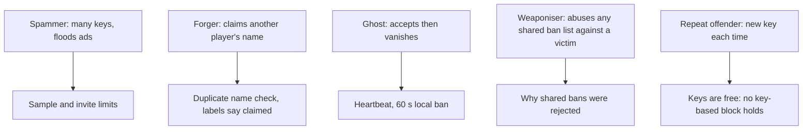

# Blocking, verification and trust networks

*   **Author:** Hugh Kaznowski
*   **Status:** Initial draft, unreviewed
*   **Date:** 2026-11-22
*   **Ticket:** [ticket 0013](../../../tickets/0013-blocking-and-trust.md)
*   **Related decisions:** [ADR 0003](../../adr/0003-self-reported-data.md), [ADR 0016](../../adr/0016-peers-identified-by-key.md), [ADR 0019](../../adr/0019-signed-gossip-messages.md), [ADR 0023](../../adr/0023-no-supernodes.md), [ADR 0024](../../adr/0024-liveness-and-decline.md), [ADR 0034](../../adr/0034-system-overview-goals-and-risks.md). Where this document and an ADR disagree, the ADR wins. ADR 0024 rejected gossiped bans and ADR 0034 lists shared reputation and blocking as a non-goal, so anything beyond a local list needs those amended.

--------------------------------------------------------------------------------

## Overview

This is an idea ticket: a design with a threat model, and an ADR, before any code. The ticket lists many mechanisms (block by IP, key or character name, verification, cosignatures, an authoritative ban, temporary blocking, less gossip to bad actors, trust networks). This draft sets out the threat model the existing design already has, which of those mechanisms the real code could support, and whether and when any is worth building. It decides none of them.

## The Problem

What exists:

*   A peer that does not answer a heartbeat within 4 seconds is banned locally for 60 seconds (`BAN` in `app/src/config.rs`). The engine keeps `bans: HashMap<PeerId, Duration>` in `app/src/engine/state.rs` and drops banned peers from samples and from inbound handling (`is_banned`, around lines 435, 835 and 885). The ban is emitted as `Action::BanLocal(PeerId, Duration)` and is never sent to the network ([ADR 0024](../../adr/0024-liveness-and-decline.md)). The ban is in memory only and is cleared by `bans.retain` as it expires.
*   A decline has no penalty at all ([ADR 0024](../../adr/0024-liveness-and-decline.md)).
*   Every gossip message is signed by the author's iroh key and checked in `app/src/net/gossip.rs` (`seal`, `open`), so a message cannot be forged for another key. A key costs nothing to make ([ADR 0034](../../adr/0034-system-overview-goals-and-risks.md) risk table: free identities, accepted).
*   Everything in an ad is self-reported ([ADR 0003](../../adr/0003-self-reported-data.md)). Names are claims; a duplicate claimed name refuses the party but a forger can still make strangers invite a victim's name ([ADR 0016](../../adr/0016-peers-identified-by-key.md)).

What a player cannot do today: remember that someone behaved badly (for example confirmed and then left, or claimed another player's name) beyond one minute, and keep that person out of future parties.

Which of the ticket's mechanisms the code could carry:

| Mechanism | What it keys on | Observable by this app | Obstacle |
|---|---|---|---|
| Block by public key | iroh `PeerId` | yes, every message | a new key evades it (free identities) |
| Block by character name | `Ad.first_name`, `surname` | yes, but self-reported | forgeable, can be used against a victim ([ADR 0016](../../adr/0016-peers-identified-by-key.md)) |
| Block by IP | peer address | iroh connections expose it to direct peers only; the code does not store it (unverified how `net/iroh_net.rs` surfaces it) | shared and changing addresses; privacy |
| Temporary block | key, with an expiry | yes | already exists for 60 s |
| Less gossip to bad actors | key | partly | gossip fan-out is chosen by iroh-gossip, not by this app (unverified how much control exists) |
| Cosignatures / verification | signatures over a claim by other keys | yes, signing exists | needs a trust root; no hosted authority ([ADR 0023](../../adr/0023-no-supernodes.md)) |
| Authoritative ban | a key that all apps obey | would use `net::trusted::BUILTIN` | contradicts no-supernodes and gives one key the power to ban anyone |
| Trust networks | signed vouching between keys | possible | spam, collusion, and a graph store; large design |

## Goals

*   A written threat model so each mechanism can be judged against it.
*   Say what the cheapest useful step is (a local list) and what it protects against.
*   Keep the no-hosted-service rule and the local-only nature of bans unless the author amends the ADRs.

## Non-Goals

*   Proving a character is real ([ADR 0034](../../adr/0034-system-overview-goals-and-risks.md) non-goal).
*   Code in this ticket. The done condition is a design and an ADR.
*   Moderation of in-game behaviour; the app sees only its own protocol.

## Technical Plan

Threat model, with who attacks what:

Existing controls (`MAX_INVITES_PER_EPOCH`, `MAX_EARLY` in `engine/state.rs`, `MAX_ENVELOPE` in `net/gossip.rs`) answer the spammer. The ghost is handled for 60 seconds. The weaponiser and the repeat offender are not answered by any key-based mechanism: a local block list defeats a repeat offender only until the offender makes a new key, and any shared list gives a weaponiser a tool. That is the core tension and the reason the open questions below matter.

The smallest design that adds value is a persistent local list of keys the player blocked, kept in the store (`app/src/store/`, a namespace beside `history/`), applied where `is_banned` is applied. The rest of the ticket depends on decisions about sharing, and each sharing mechanism needs its own threat model.

## Alternatives Considered

*   **Gossiped bans:** rejected by the author in [ADR 0024](../../adr/0024-liveness-and-decline.md) because a shared list can be used as a weapon against a victim.
*   **A hosted reputation service:** contradicts [ADR 0034](../../adr/0034-system-overview-goals-and-risks.md) (nothing hosted).
*   **Do nothing:** consistent with the current ADRs; the 60 s local ban and the in-game invite as the real check stay.

## Detailed Implementation

Nothing is implemented now. If the author chooses a local block list as the first step, the files are:

*   `app/src/engine/state.rs`: a block set consulted next to `is_banned`; new `Event::BlockPeer` and `Event::UnblockPeer`; a view field so the UI can show blocked peers.
*   `app/src/app/`: `LiveCore` loads the list at start and persists changes.
*   `app/src/store/` and `app/src/history.rs`-style module (new, `blocks`): persistence of the list in `varaq`, with a size cap.
*   `app/src/server/routes.rs` and `server/core.rs`: routes to block and unblock a member of a finished party (loopback only, like history clear, since it changes durable state), and an addition to `/state`.
*   `webapp/src/api/types.ts`, `httpApi.ts`, `mockApi.ts`, `fixtures.ts`: new calls and fixtures.
*   `webapp/src/components/molecules/MemberRow.tsx` (and its story): a block action; a Settings list of blocked peers (new molecule and organism stories under the atomic-design rules in `CLAUDE.md`).
*   `docs/adr/`: a new ADR amending ADR 0034's non-goal and ADR 0024 as needed; `docs/adr/README.md`.

## Test and verification plan

*   Engine tests on `engine` with the in-memory network: a blocked peer's ads are not sampled and its invites are ignored; a block survives a restart (store test with `MemStore`); an expired temporary block is cleared.
*   An integration test in `app/src/integration_tests.rs` style with two instances.
*   Any sharing mechanism needs a seeded abuse test in `engine::sim` (an attacker who blocks a victim through the shared signal) before acceptance.

## Open questions for the author

1.  **What identifies a blocked party.**
    *   **Option A, the iroh key only.** Reliable, cannot be forged. Fails against someone who makes a new key (free).
    *   **Option B, key plus the claimed name.** Catches a returning person who keeps a name. Fails against forgers: a claimed name can be copied to get a victim blocked on other players' apps, if names ever leave the local list.
    *   **Option C, key plus IP.** Catches key rotation from one address. Fails on shared or changing addresses, and needs the app to store addresses it does not store today (privacy cost; unverified how addresses are exposed).
2.  **Whether any block signal is shared between peers.**
    *   **Option A, never shared.** Matches ADR 0024. Fails when a repeat offender with fresh keys keeps reaching new victims.
    *   **Option B, signed attestations a player chooses to follow** (a player subscribes to keys they trust and uses their block lists). Fails if a followed key turns hostile and blocks innocents, and the graph needs a store and an abuse limit.
    *   **Option C, a list signed by a key in `net::trusted::BUILTIN`.** Fails the no-supernodes principle ([ADR 0023](../../adr/0023-no-supernodes.md)): one key can ban anyone, and its loss or compromise has network-wide effect.
3.  **What a block does.**
    *   **Option A, excludes the peer from samples, invites and parties only.** Cheap and local. Fails if the blocked peer still sees the blocker's ads (the blocker is still discoverable).
    *   **Option B, also stops sending the blocker's ads to that peer** (direct delivery rather than gossip). Fails because gossip is broadcast on the topic and the app cannot choose recipients (unverified how much control `iroh-gossip` offers).
    *   **Option C, also drops the connection.** Fails because the topic swarm is shared and connections are managed by iroh, so the peer reconnects through other members.
