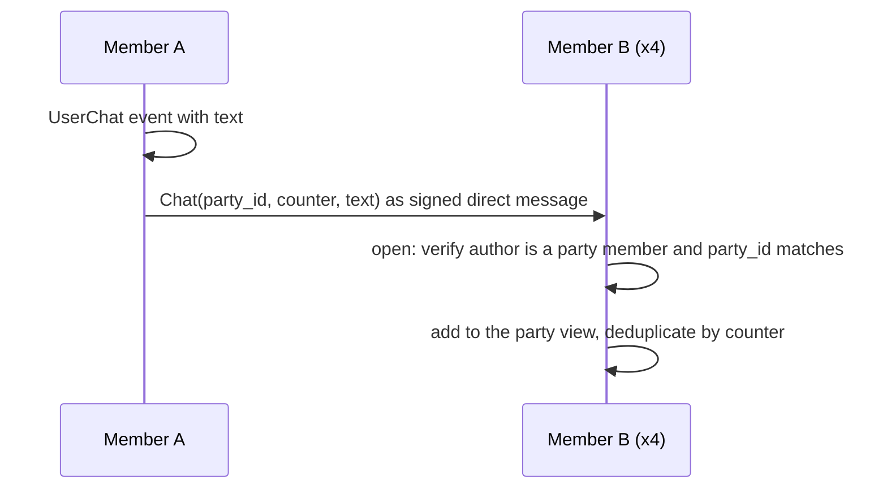

# Chat in the app once a group is formed

*   **Author:** Hugh Kaznowski
*   **Status:** Initial draft, unreviewed
*   **Date:** 2026-11-22
*   **Ticket:** [ticket 0014](../../../tickets/0014-chat-after-party.md)
*   **Related decisions:** [ADR 0016](../../adr/0016-peers-identified-by-key.md), [ADR 0019](../../adr/0019-signed-gossip-messages.md), [ADR 0024](../../adr/0024-liveness-and-decline.md), [ADR 0025](../../adr/0025-leader-invitations.md), [ADR 0034](../../adr/0034-system-overview-goals-and-risks.md). Where this document and an ADR disagree, the ADR wins.

--------------------------------------------------------------------------------

## Overview

This is an idea ticket. The ticket asks for text chat between party members after commit, with a design and an ADR that says how it fits peer identity ([ADR 0016](../../adr/0016-peers-identified-by-key.md)). This draft describes how it would fit the existing message path, and the questions about whether and when it is worth building.

## The Problem

Today the app ends its job once all five confirm: it shows the other four names, labelled as claimed, and the player sends the in-game invite ([ADR 0034](../../adr/0034-system-overview-goals-and-risks.md), journey 1). Between "party confirmed" and "everyone is in the in-game group" there is no channel: a player who is away from the game window, or whose in-game invite fails, cannot say so. In-game chat does exist once players are grouped, so the gap is only the period before and the case where the invite never works.

What the code gives a chat feature for free:

*   Members of a committed party are known by `PeerId`, with `party_id` shared (`engine/party.rs`, `party_id`). The `Ready` message already carries each member's own ad, so names are known from the member itself ([ADR 0024](../../adr/0024-liveness-and-decline.md) as amended by [0025](../../adr/0025-leader-invitations.md)).
*   Transport: every message is a signed envelope (`net/gossip.rs`), with a `to` field for a message meant for one peer, and `Network::send_direct` in `engine/mod.rs` already sends member-to-member messages for `Invite`, `Ready` and heartbeats.
*   A size bound exists: `MAX_ENVELOPE` is 2048 bytes in `net/gossip.rs`.
*   Liveness: heartbeats run during a committed party and a silent member is dropped after 4 seconds.

What it lacks: a message variant for text (the `Message` enum in `engine/ad.rs` has none), a place to hold messages (the engine has no chat state), an API route and a UI.

## Goals

*   If built: five members can exchange short text lines from the moment the party is confirmed, authored by key and shown with the claimed name.
*   No new network surface beyond the party's members.
*   No chat text stored or sent outside the party.

## Non-Goals

*   Chat before a party exists or between searchers.
*   Voice, images, files, links preview.
*   Replacing in-game chat.
*   Moderation or reporting tools beyond what [ticket 0013](../../../tickets/0013-blocking-and-trust.md) decides.

## Technical Plan

Messages ride the existing signed path. Each chat line is a `Message` variant carrying `peer`, `party_id`, a counter and a bounded text, signed by the author key, sent to each of the four others directly.

Rules: the receiver drops a chat from a key that is not in its party or has a different `party_id`, and from a banned peer; the engine caps rate (messages per second) and length (a fixed byte limit); lines are held in memory for the life of the party and discarded when the party ends or the app closes. Names appear only through the existing "claimed" labelling, so the duplicate name rule of [ADR 0016](../../adr/0016-peers-identified-by-key.md) is unchanged: identity is the key, and a chat line shows the key's claimed name, not a trusted one.

A message variant changes the wire, so it needs a protocol version note: [ADR 0034](../../adr/0034-system-overview-goals-and-risks.md) says every message carries a version and peers on different versions use different topics. The spec ([rdf-code-spec](../../rdf-code-spec.md), messages section) is updated with the new variant.

## Alternatives Considered

*   **Do not build it.** The in-game party chat covers most use, and the app's job is finding the party. Valid; the ticket is P3.
*   **Phone as chat screen.** Not examined; the phone is a second screen for the same API ([ADR 0012](../../adr/0012-one-web-app-for-phone-and-desktop.md)), so chat on the desktop appears on the phone automatically if the API carries it.
*   **Chat through a hosted relay or server:** rejected by the whole design (nothing hosted, [ADR 0034](../../adr/0034-system-overview-goals-and-risks.md)).

## Detailed Implementation

Nothing is implemented now. If built, the files (verified to exist) are:

*   `app/src/engine/ad.rs`: a `Chat` variant in `Message`; encoding and size limit.
*   `app/src/net/gossip.rs`: `author_of` and `Verified` handling for the new variant (the author inside the message must equal the envelope author, as for all variants).
*   `app/src/engine/state.rs`: a new `Event::UserChat` and `Event::ChatReceived`, an `Action` that sends direct messages to the four members, per-party history in memory, rate and length limits, and a `chat` field in `View` (`MemberView`/`View` near lines 299 and 309).
*   `app/src/engine/mod.rs`: the `Cluster` test harness learns to deliver the variant.
*   `app/src/server/routes.rs`, `server/core.rs`, `server/events.rs`: `POST /api/party/chat` (a route beside `/party/confirm`) and chat lines in `/state` and the event stream.
*   `webapp/src/api/types.ts`, `httpApi.ts`, `mockApi.ts`, `fixtures.ts`, `useAppState.tsx`: the new call and state.
*   `webapp/src/components/`: a message line (molecule), a chat input (molecule over `TextInput` and `Button`), a chat panel (organism), a place in the party template and page stories with 0, 1 and many lines and with long lines (design-system rules in `CLAUDE.md`: the screen must not need scrolling to be understood, text uses Overpass, names through the `Entity` atom).
*   `docs/rdf-code-spec.md`, `docs/adr/` (new ADR), `docs/adr/README.md`.

## Test and verification plan

*   Engine tests: a line from a member reaches the other four; a line from a non-member, a wrong `party_id`, a banned peer, an over-length or over-rate line is dropped; a duplicate counter is ignored; lines are gone after the party drops.
*   `gossip.rs` tests: sealing and opening the new variant, and a forged author is refused.
*   An integration test with several in-process instances (style of `app/src/integration_tests.rs`).
*   Web: Storybook stories for each state; typecheck.
*   Not verified by any of the above: delivery over the real iroh network (same status as [ticket 0004](../../../tickets/0004-verify-iroh-live-network.md)).

## Open questions for the author

1.  **Whether to build it.**
    *   **Option A, not now.** In-game chat covers it. Fails if parties often confirm and then never form in game because players cannot coordinate.
    *   **Option B, a minimal fixed-phrase channel** (a small set of preset lines such as "ready", "need 2 minutes", "invite me"). No free text means less abuse and less UI. Fails if players need something the presets lack.
    *   **Option C, free text.** Complete. Fails when abusive text appears: with free text, protection against it depends on [ticket 0013](../../../tickets/0013-blocking-and-trust.md), which is not decided.
2.  **Transport.**
    *   **Option A, direct signed messages to each of the four members** (the path `Invite` and `Ready` use). No new swarm. Fails if a member's direct path is down and the line is lost (the engine does not retransmit lost direct messages, per `CLAUDE.md`).
    *   **Option B, a gossip swarm per `party_id`.** Delivery by gossip and late joiners see new lines. Fails because it adds a swarm lifecycle (join, leave) for five peers and exposes the topic to anyone who learns the `party_id`.
    *   **Option C, the search topic with the existing `to` field.** No new swarm. Fails because the line is gossiped to the whole busy topic, then dropped by everyone but the recipient, which is wasted load and leaks that a conversation exists.
3.  **Lifetime of the text.**
    *   **Option A, memory only, gone when the party ends.** Nothing stored. Fails if the player wants to read what was said after a crash or restart.
    *   **Option B, kept until the app closes.** Same privacy as A with a longer window. Fails with the same restart case.
    *   **Option C, stored in `varaq` for a fixed time.** Survives restart. Fails the privacy position: chat text becomes personal data on disk, and the history feature ([ADR 0027](../../adr/0027-search-history.md)) keeps no names today.
