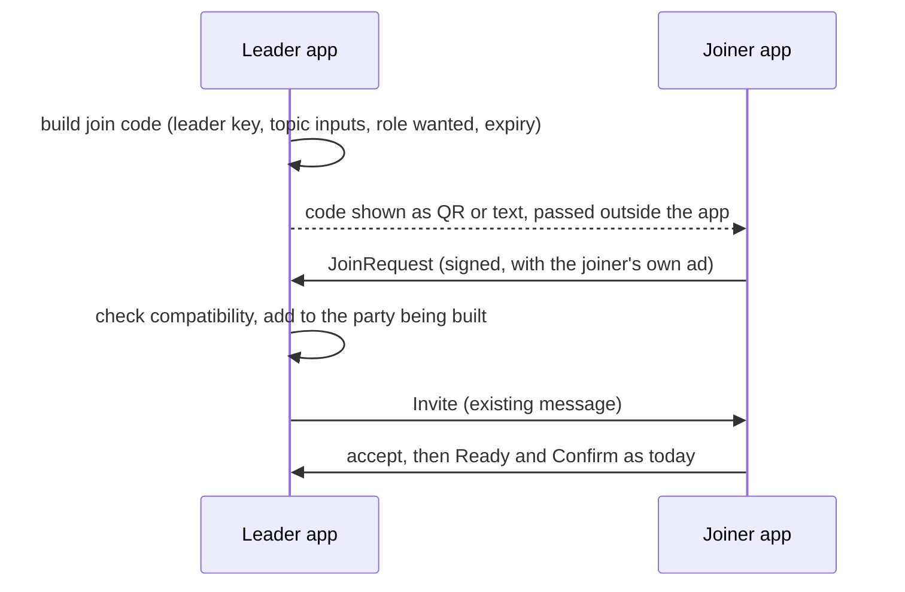

# Join a party by QR code

*   **Author:** Hugh Kaznowski
*   **Status:** Initial draft, unreviewed
*   **Date:** 2026-11-22
*   **Ticket:** [ticket 0015](../../../tickets/0015-join-party-qr.md). Related: [ticket 0002](../../../tickets/0002-verify-qr-phone-scan.md) (phone scan of the addon QR, unverified).
*   **Related decisions:** [ADR 0002](../../adr/0002-addon-shows-data-only.md), [ADR 0012](../../adr/0012-one-web-app-for-phone-and-desktop.md), [ADR 0016](../../adr/0016-peers-identified-by-key.md), [ADR 0025](../../adr/0025-leader-invitations.md), [ADR 0034](../../adr/0034-system-overview-goals-and-risks.md). Where this document and an ADR disagree, the ADR wins.

--------------------------------------------------------------------------------

## Overview

This is an idea ticket. "Share a party as a QR code so another player can join it" is short, and its meaning is not fixed. This draft separates the readings, shows what the code supports, and focuses on whether it is worth building. The first question is what "join" means, because parties today are not joined: they are agreed.

## The Problem

How a party forms now ([ADR 0025](../../adr/0025-leader-invitations.md)): once per 5 second epoch a tank invites a healer, three damage peers and spares from its own sample; invitees accept the lowest-ranked leader; the leader commits when it has a full party of five and sends `PartyAnnounce { members: [PeerId; 5], party_id }`; members then send `Ready`, `Confirm` or `Decline`. A party has exactly 1 tank, 1 healer and 3 damage and is bound to one topic. There is no message by which a player asks to enter an existing party, and no path to a party that did not come from a topic search.

Existing QR pieces:

*   The addon draws a QR of the character code (`addon/ForeverTogether/Qr.lua`); the phone camera app scans it and the player pastes the text ([ADR 0002](../../adr/0002-addon-shows-data-only.md), [ADR 0012](../../adr/0012-one-web-app-for-phone-and-desktop.md)). Whether the phone scan works at all is unverified (ticket 0002).
*   The app shows a pairing QR (`webapp/src/components/molecules/PairingQr.tsx`, using the atom `QrCode.tsx`) carrying `http://<lan ip>:<port>/#token` built by `pairing_url` in `app/src/server/pairing.rs`. That QR only works on the same local network, and is loopback-only to fetch.
*   The design's non-goals include an in-page camera, WebRTC and mobile apps ([ADR 0034](../../adr/0034-system-overview-goals-and-risks.md)), so the app cannot scan a QR itself. A QR is read by the phone's own camera app, which opens a URL or shows text.

The central constraint: a QR shown by one player must be read by another player's device. Two players on different networks, which is the normal case for strangers on the same realm, cannot use a LAN URL. So a party QR is either a code (text to paste, like the character code) or it is shown inside the game or a chat, where a camera cannot read it.

## Goals

*   If built: a player who already has some party members (friends, or a party from a previous run) can bring in more, without waiting for the automatic finder.
*   Reuse peer identity (keys, signed envelopes) and the confirm step.

## Non-Goals

*   An in-app camera, a hosted join page, WebRTC ([ADR 0034](../../adr/0034-system-overview-goals-and-risks.md)).
*   Inviting in game for the player (non-goal in the same ADR).
*   Raids and parties over five.

## Technical Plan

The three readings of the ticket, as a table:

| Reading | What the QR carries | How the scanner enters | Works across networks |
|---|---|---|---|
| A. Join a committed party | `party_id`, the leader's `PeerId`, topic inputs | ask the leader for a slot | yes, over iroh by key |
| B. Fill a party being built | topic, role needed, leader `PeerId` | answer the leader's invitation in advance | yes |
| C. Open the local web app on another device | the existing pairing URL | none: that is phone pairing, not a party | no, LAN only |

Reading C is already built and is not a party feature. Readings A and B need a new message and an engine path, and a text form of the data. A sketch of reading B:

The joiner's code is signed by the joiner's key like any message ([ADR 0019](../../adr/0019-signed-gossip-messages.md)), so the leader sees a key, not a trusted name ([ADR 0016](../../adr/0016-peers-identified-by-key.md)). The join code is a bearer capability: anyone holding it can request a slot, so it needs an expiry and a single use.

## Alternatives Considered

*   **Do nothing; use the character code and the finder.** The finder already does the matching. Valid.
*   **The existing pairing URL as a party link:** rejected here because it is LAN-only and pairs a phone, not a party member.
*   **A hosted join page:** contradicts [ADR 0034](../../adr/0034-system-overview-goals-and-risks.md).

## Detailed Implementation

Nothing is implemented now. If reading A or B is chosen, the files (verified to exist) are:

*   `app/src/engine/ad.rs`: a `JoinRequest` message variant, and a join code type (leader key, topic inputs, expiry) with an encoding; follows the style of `docs/rdf-code-spec.md` (versioned, base45, check bytes).
*   `app/src/engine/lead.rs`, `state.rs`: leader accepts a join request for an open slot; a manual-invite path alongside the automatic sample.
*   `app/src/net/gossip.rs`: no change expected beyond handling the variant; `engine/mod.rs` test cluster learns the variant.
*   `app/src/server/routes.rs`, `core.rs`: routes to create a join code and to submit one (new routes beside `/search`).
*   `webapp/src/components/`: reuse the atom `QrCode.tsx` and `CopyChip.tsx`; new molecules for "show join code" and "paste join code" (the pasted-text path mirrors `CodePasteForm.tsx`), a stories set per level.
*   `addon/ForeverTogether/`: no change if the code is shown in the app, not in game. A QR of a join code from the app is drawn by the existing `QrCode.tsx`.
*   `docs/rdf-code-spec.md` (new section), `docs/adr/` (new ADR), `docs/adr/README.md`.

## Test and verification plan

*   Engine tests: a valid join request fills the open slot; wrong role, wrong topic, expired code, reused code and a full party are refused; a join request to a leader that is not building a party is ignored.
*   Code tests: encode and decode round-trips and corrupt-code errors, with vectors in a file read by Rust tests.
*   Integration test with in-process instances.
*   Manual and unverified: a phone camera reading the QR from a desktop screen (same state as ticket 0002).

## Open questions for the author

1.  **What "join" means.**
    *   **Option A, join a party that is already committed** (reading A). Fails because a committed party is five by definition and has no free slot, so it only works for a party that lost a member, which the engine drops today ([ADR 0024](../../adr/0024-liveness-and-decline.md)).
    *   **Option B, fill an open slot of a party being built** (reading B). Fits the leader invitation. Fails if no leader is building, because a leader exists only when the finder runs.
    *   **Option C, not worth building.** The finder plus in-game friends covers it. Fails if players with friends want to group without queueing against strangers.
2.  **How the data travels.**
    *   **Option A, a QR only.** Fails across networks unless the QR image is sent as a picture, and fails if the phone scan is unreliable (unverified, ticket 0002).
    *   **Option B, a pasteable text code** (like the character code). Works anywhere text works. Fails on ease: typing or pasting a long code.
    *   **Option C, both** from one encoding. Fails only in cost: two UI paths to test.
3.  **How the code is secured.**
    *   **Option A, signed by the leader key, with expiry and single use.** The leader tracks used codes. Fails if the leader app restarts and forgets which codes were used (codes are not stored today).
    *   **Option B, signed and checked, but multi-use until expiry.** Simpler; a leaked code lets strangers fill the slot. Fails when the code is posted publicly.
    *   **Option C, unsigned code with a confirm click by the leader for each request.** No state. Fails when the leader is away, and the request waits until it times out.
