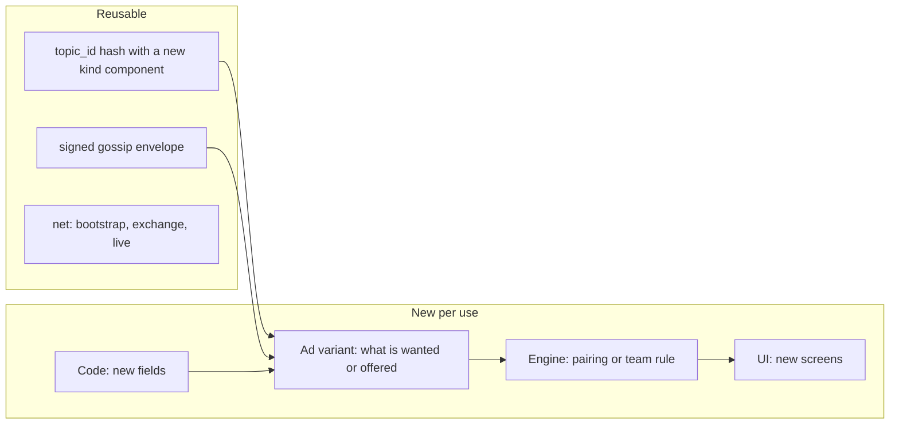

# Matchmaking for crafting, auctions, quests, PvP and arenas

*   **Author:** Hugh Kaznowski
*   **Status:** Initial draft, unreviewed
*   **Date:** 2026-11-22
*   **Ticket:** [ticket 0016](../../../tickets/0016-other-matchmaking-uses.md). Related: [ticket 0020](../../../tickets/0020-professions-and-gear-in-code.md) (professions and gear in the code), [ticket 0021](../../../tickets/0021-topic-sharding.md) (sharding).
*   **Related decisions:** [ADR 0005](../../adr/0005-topic-without-level.md), [ADR 0007](../../adr/0007-same-faction-parties.md), [ADR 0003](../../adr/0003-self-reported-data.md), [ADR 0019](../../adr/0019-signed-gossip-messages.md), [ADR 0025](../../adr/0025-leader-invitations.md), [ADR 0034](../../adr/0034-system-overview-goals-and-risks.md). Where this document and an ADR disagree, the ADR wins.

--------------------------------------------------------------------------------

## Overview

This is an idea ticket whose done-condition is a brief: does the topic model extend to other activities? The product today is a finder for five-player dungeon parties. The ticket asks about crafting (someone who wants an item and a crafter), auctions, quests, PvP, arenas and battlegrounds. This draft answers the question about the model and lists what each use would need. It focuses on whether and when anything is worth building.

## The Problem

What the current design assumes, from the code:

*   **Topic.** `dungeons::topic_id(region, realm, faction, slug, shard)` in `app/src/dungeons.rs` hashes a string with the prefix `wowft/1/`. The `slug` is an opaque string, so a non-dungeon slug hashes fine. The topic count (about 580) comes from 29 dungeons ([ADR 0005](../../adr/0005-topic-without-level.md)); a use with thousands of items or recipes would give thousands of topics, and each topic is a gossip swarm.
*   **Message and ad shape.** `engine::ad::Ad` has `role` (tank, healer, damage), `level`, `item_level`, `faction`, name and zone. `Message` has `Invite`, `PartyAnnounce`, `Ready`, `Confirm`, `Heartbeat`, all about a party of exactly five (`PartyAnnounce.members: [PeerId; 5]`). The engine in `app/src/engine/` (`lead.rs`, `rank.rs`, `sample.rs`, `widen.rs`, `party.rs`) is built for 1 tank, 1 healer, 3 damage.
*   **Code.** The addon shows one character record; professions and gear are not in it (a non-goal in v1, [ADR 0034](../../adr/0034-system-overview-goals-and-risks.md); ticket 0020). A crafter's skill level would be a new self-reported claim ([ADR 0003](../../adr/0003-self-reported-data.md)).
*   **Faction.** Topics split by faction ([ADR 0007](../../adr/0007-same-faction-parties.md)). Auctions in classic-style games usually span factions through neutral houses; whether that is true on Forever is unverified, and it conflicts with the faction split ([ticket 0023](../../../tickets/0023-cross-faction-groups.md)).

Per use, the structural difference is size and symmetry:

| Use | Group size | Roles | New data in the code | Fits the party engine |
|---|---|---|---|---|
| Crafting | 2 (requester, crafter) | asymmetric | profession, skill, recipe | No: two parties of one |
| Auctions | 2, one-off trade | asymmetric | item, price | No |
| Quests | 2 to 5 | none or loose | quest id, step | Partly: same size, no roles |
| PvP, arena | 2, 3 or 5 teams | role mix varies | rating, bracket | Partly |
| Battlegrounds | 10 to 40 | none | bracket | No: size beyond the engine |

## Goals

*   State whether the topic model extends and under what changes.
*   Say what the first use to try would be, only as an open question.

## Non-Goals

*   Building any of these. No ADR is proposed here.
*   Raids and groups over five ([ADR 0034](../../adr/0034-system-overview-goals-and-risks.md) non-goal; battlegrounds are the same problem).
*   Trading items or money inside the app; the app only finds counterparts, as it does for parties ([ADR 0034](../../adr/0034-system-overview-goals-and-risks.md): inviting players for the user is a non-goal).

## Technical Plan

The brief's answer: the hashing and the signed envelope ([ADR 0019](../../adr/0019-signed-gossip-messages.md), `app/src/net/gossip.rs`) extend without change; the engine and the code do not.

Reusable without change: `net/` (`iroh_net`, `live`, `bootstrap`, `known_peers`, `exchange`), `gossip.rs`, `identity.rs`, the store, the server and pairing. New: everything in the right-hand group. A two-party use needs a much simpler engine than the five-player leader invitation: a requester broadcasts an ad on a topic, a counterpart answers directly, both confirm. That is a subset of the `Invite` and `Confirm` messages already present.

## Alternatives Considered

*   **Stay a dungeon finder only.** Valid: the ticket's priority is P3, the dungeon agreement mechanism is itself not verified live ([ticket 0005](../../../tickets/0005-verify-agreement-live.md)), and the live network is not verified ([ticket 0004](../../../tickets/0004-verify-iroh-live-network.md)). Building a second use on an unverified first one adds risk without evidence.
*   **A separate app per use.** Not examined further; it duplicates `net/` and the install base.

## Detailed Implementation

None for the brief. If a use is chosen, the file list would be (all verified to exist unless marked new):

*   `app/src/dungeons.rs`: `topic_id` gains a kind component or a second function (question 2).
*   `app/src/engine/ad.rs`, `state.rs`, plus a new module per use if question 3 says so: ad variants and an engine for the new group shape.
*   `app/src/code.rs`, `addon/ForeverTogether/Core.lua`, `Codec.lua`, `docs/rdf-code-spec.md`, `docs/rdf-code-vectors.json`: new fields (professions) and a version bump.
*   `app/src/server/routes.rs`: new routes beside `/search` and `/party/confirm`.
*   `webapp/src/components/**`: new atoms and molecules by the design-system rules in `CLAUDE.md`, new template and page stories.
*   `docs/adr/`: a new ADR superseding the "dungeon only" parts of ADR 0005 and ADR 0034 non-goals.

## Test and verification plan

For the brief itself: the author checks the table above against how the game is played. For a chosen use: the same functional tests as the dungeon engine on the in-memory network (`app/src/net/fake.rs`), and a seeded simulation only if the use is symmetric and large.

## Open questions for the author

1.  **Which use, if any, is worth trying first.**
    *   **Option A, crafting (two parties).** Smallest group, no roles, reuses invite and confirm. Fails if crafter supply per topic is too thin (thousands of recipes make empty swarms) or if a skill claim is forged ([ADR 0003](../../adr/0003-self-reported-data.md)) with no way to check it.
    *   **Option B, PvP and arena teams.** Same shape as a party with a different composition rule. Fails if rating and bracket cannot be read from the client (unverified, no addon call is known) so teams are mismatched.
    *   **Option C, none for now.** Wait for live results of tickets 0004 and 0005. Fails if players ask for these uses first and the dungeon finder gets little use.
2.  **Topic namespace.**
    *   **Option A, a kind component inside the `wowft/1/` hash string.** Mechanism: the string gains a `kind` segment. Fails because existing dungeon topics would change hash unless dungeon keeps its current string; a mistake splits the swarm.
    *   **Option B, a new prefix (for example `wowft/2/` or a different family) for the new kinds.** Old and new never collide. Fails if the version rule ([ADR 0034](../../adr/0034-system-overview-goals-and-risks.md), compatibility) makes peers on the new prefix unreachable from old builds, which is wanted only if the kinds are meant to be separate.
    *   **Option C, keep dungeon-only topics and carry the activity inside the ad.** Fails: one swarm per dungeon would carry unrelated ads and break the "fewer topics gossip well" reasoning of ADR 0005.
3.  **Engine shape.**
    *   **Option A, generalise the party engine to a composition spec** (list of required roles and a size). Fails when two-party asymmetric uses make the spec almost empty and the five-player tuning (epochs, `MAX_INVITES_PER_EPOCH` in `engine/state.rs`) leaks into them.
    *   **Option B, a separate small engine per use.** Fails when behaviour such as bans, liveness and decline needs to stay consistent across engines and is copied.
    *   **Option C, a listing model without agreement:** ads are shown and the player contacts a counterpart in game. Fails when a listing board is a hosted-service-like feature that needs ads to persist longer than the current ad expiry (`AD_EXPIRY` in `config.rs`).
