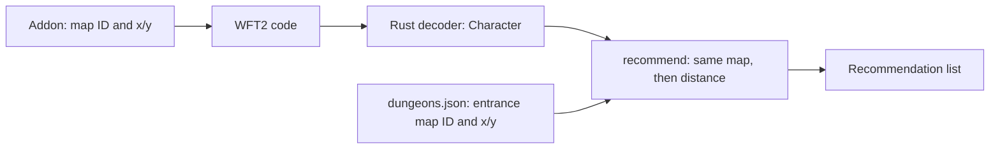

# Map position (x, y) in the character code

*   **Author:** Hugh Kaznowski
*   **Status:** Initial draft, unreviewed
*   **Date:** 2026-11-22
*   **Ticket:** [ticket 0017](../../../tickets/0017-location-xy-in-code.md). Closely tied to [ticket 0018](../../../tickets/0018-zone-matching-localisation.md) (map IDs) and [ticket 0019](../../../tickets/0019-shared-zone-dungeons.md) (dungeons in one zone).
*   **Related decisions:** [ADR 0003](../../adr/0003-self-reported-data.md), [ADR 0005](../../adr/0005-topic-without-level.md), [ADR 0006](../../adr/0006-dungeon-table.md), [ADR 0018](../../adr/0018-code-format.md). Where this document and an ADR disagree, the ADR wins.

--------------------------------------------------------------------------------

## Overview

The character code (spec section 1 in [rdf-code-spec.md](../../rdf-code-spec.md)) carries the zone only as a text string, at most 32 bytes (`MAX_ZONE` in `app/src/code.rs`). This ticket asks for more detail: a map ID and an x/y position on that map. A layout change means a new version byte and a new prefix (spec section 6), so this is a `WFT2` code.

## The Problem

*   The only location signal is the zone name. It is a translated string (see ticket 0018), and it cannot say how far a character is from a dungeon entrance.
*   `recommend` in `app/src/dungeons.rs` uses the zone only as a sort key: dungeons whose `zone` equals the character's zone (ASCII-lowercased) come first. No distance exists anywhere.
*   ADR 0006 states "Nothing refuses a player because of location" and "Map IDs and precise locations come later". This ticket is the "later" for precise locations.

What already exists: the addon reads the zone in `addon/ForeverTogether/Core.lua` (`GetRealZoneText`, falling back to `GetZoneText`), the decoder reads it in `app/src/code.rs`, and it flows into `engine::Ad.zone` (`app/src/engine/ad.rs`), `CharacterView.zone` and `zone_known` (`app/src/app/mod.rs`, `app/src/server/core.rs`) and the web app (`webapp/src/components/molecules/DungeonOption.tsx`, `CharacterSummary.tsx`).

Unverified: whether the Forever client exposes `C_Map.GetBestMapForUnit` and `C_Map.GetPlayerMapPosition` (names from the retail API, not checked on Forever), whether they return values in cities and instances, and what a position looks like for a character in a place without a map position. Nothing in `docs/spike-s0.md` covers these calls.

## Goals

*   The code can carry a map ID and an x/y position, with an explicit "unknown" value for each.
*   Spec, test vectors, Lua encoder, Rust decoder and web display change together, as the ticket requires.
*   Where a dungeon has a known entrance position, the app can order recommendations by distance on the same map.

## Non-Goals

*   Refusing a player for being far from a dungeon (ADR 0006 stands).
*   Putting a dungeon in the code (ADR 0018: players search from outside a dungeon).
*   Moving topics: topics stay `region + realm + faction + dungeon` (ADR 0005). Position never enters a topic.
*   Translating zone names. That is ticket 0018; this draft only notes how the two share one version bump.

## Technical Plan

The addon reads map ID and position once, when the code is built (the code is rebuilt on demand, not tracked live). The record gains fields; the decoder gains the same; the app derives a distance only when the character and the dungeon entrance are on the same map.

Proposed record change, subject to the open questions: new fields after `region` (map ID, 2 bytes; x and y, 1 byte each, 0 to 255 scaled from 0.0 to 1.0, with a reserved value for unknown), plus a flag bit or sentinel for "position valid" in the way item level uses flag bit 5. The 122-character QR target (spec "Size") must still hold for a typical record: 4 extra bytes is about 6 extra characters of base45 text, so a typical record stays near 76 characters. That arithmetic is an estimate, not a measurement.

## Alternatives Considered

*   **Position in the gossip `Ad` as well as in the code.** Not part of this draft; see open question 3.
*   **Computing position in the app, not the addon.** The app has no access to the game client, so it cannot. Rejected.
*   **Skipping the version bump by reusing reserved flag bits 6-7.** A v1 decoder rejects reserved bits (`InvalidField(flags)`), so old apps would refuse new codes with the wrong message rather than the "update" message. Rejected for that reason; the bump gives the clean refusal.

## Detailed Implementation

*   `docs/rdf-code-spec.md`: section 1 table, flags, size paragraph and "Collecting each field" table get the new fields; section 6 notes the prefix change; section 5 gains entrance fields if the table is extended. Add an ADR (or revise 0018) in the same change, as CLAUDE.md requires.
*   `scripts/gen-code-vectors.py` and `docs/rdf-code-vectors.json`: new records, new `decode_errors` for bad map or position, a v1 text that the new decoder reports as `UnknownVersion` or decodes (open question 2), regenerated QR rows and `limits`.
*   `addon/ForeverTogether/Codec.lua`, `Core.lua`, `Window.lua`: encode and decode the new fields; `Core.lua` collects them with `call(...)` guards and adds "map=?" to the missing-values diagnostic. Lua tests under the `wow-forever-addons` VM change with them.
*   `app/src/code.rs`: `Character` gains the fields; `decode`, the test encoder and the vector reader (`text_field` area near line 600) change; error names stay the spec vocabulary.
*   `app/src/dungeons.rs`: `Dungeon` gains optional entrance map ID and x/y; `recommend` adds the distance step; `app/data/dungeons.json` gains values supplied by the author (the spec says the author commits this file). `Dungeon` serializes to the web app, so `webapp/src/api/` types and `fixtures.ts` change.
*   `app/src/app/mod.rs`, `app/src/server/core.rs`: expose the new fields in `CharacterView` only if the UI uses them.
*   `webapp/src/components/molecules/CharacterSummary.tsx` and its stories: show position only if decided (open question 3).
*   `docs/spike-s0.md`: record the verification result for the two client calls.

## Test and verification plan

*   Live client: call both map functions in a city, in the open world, and inside a dungeon; record return values and nils. Pass: a map ID and two numbers in 0 to 1 outside instances; documented behaviour elsewhere.
*   Vectors: regenerate and run `mise run test-addon` and `cargo test --lib code::`; both read the same JSON.
*   Size: assert the typical record still fits QR version 5.
*   `cargo test --lib dungeons::`: same-map distance ordering; different-map and unknown-position cases fall back to the current order.

## Open questions for the author

1.  **What precision and which fields?**
    *   Option A: map ID only (2 bytes), no x/y. Mechanism: shares the work of ticket 0018. Trade-off: no distance. Fails when same-map dungeons need telling apart (ticket 0019 case: Searing Gorge holds three dungeons).
    *   Option B: map ID plus x and y at 1 byte each. Mechanism: about 0.4% of map width per step. Trade-off: smallest growth. Fails if entrances within one step must be told apart.
    *   Option C: map ID plus x and y at 2 bytes each. Mechanism: 16-bit scaled values. Trade-off: 2 more bytes and about 3 more text characters. Fails only if the client's own values are coarser, making the extra bytes useless.
2.  **How does v2 treat the zone string?**
    *   Option A: keep the string beside the new fields. Trade-off: largest code; display name stays correct. Fails if the 122-character QR target is exceeded at long names.
    *   Option B: drop the string and display a name from a map-ID table. Trade-off: smaller code. Fails when a map ID is not in the table (shown as `map <id>`, like `realm <id>`).
    *   Option C: keep a short string only when the map ID is unknown. Trade-off: more decoder rules. Fails on extra vector and test cases that are easy to get wrong.
3.  **Does position leave the machine?**
    *   Option A: code and local app only, never in gossip. Trade-off: no privacy cost. Fails if peers should rank each other by distance.
    *   Option B: map ID only in the `Ad`. Trade-off: small privacy cost, peers can group by area. Fails if the author wants no location sent at all (ADR 0003: all data is a self-reported claim anyway).
    *   Option C: a coarse cell (for example 8 by 8 per map) in the `Ad`. Trade-off: adds to every ad, in a protocol with a wire-format cost. Fails if cell edges split neighbouring players.
