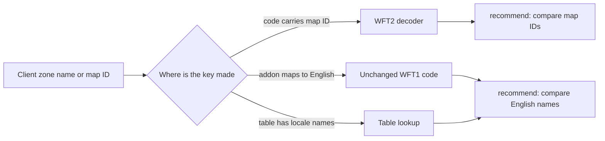

# Match zones on map IDs, not English names

*   **Author:** Hugh Kaznowski
*   **Status:** Initial draft, unreviewed
*   **Date:** 2026-11-22
*   **Ticket:** [ticket 0018](../../../tickets/0018-zone-matching-localisation.md). Related: [ticket 0017](../../../tickets/0017-location-xy-in-code.md), [ticket 0019](../../../tickets/0019-shared-zone-dungeons.md).
*   **Related decisions:** [ADR 0006](../../adr/0006-dungeon-table.md) (names the consequence: other-language clients get no same-zone ordering), [ADR 0018](../../adr/0018-code-format.md). Where this document and an ADR disagree, the ADR wins.

--------------------------------------------------------------------------------

## Overview

`recommend` in `app/src/dungeons.rs` puts a dungeon first when its `zone` equals the character's `zone`, compared as ASCII-lowercased strings. The dungeon table (`app/data/dungeons.json`) holds English names. The addon reports the client's own text (`GetRealZoneText`, then `GetZoneText`, in `addon/ForeverTogether/Core.lua`). A client in another language reports a translated name, so no dungeon matches.

## The Problem

*   A character on a German, French or other client never gets the same-zone ordering. Level filtering still works, and every dungeon stays searchable, so the loss is ordering only (ADR 0006).
*   `zone_known` in `app/src/app/mod.rs` (`character_view`) is false for those characters, which the web app can read as "zone not recognised".
*   Which locales Forever clients can use is unverified. This draft does not assume the list.

## Goals

*   The dungeon table is keyed by map ID, as the ticket's "Done when" says.
*   A character's location is matched by map ID, in every client language.
*   English-name behaviour does not regress for characters whose code has no map ID.

## Non-Goals

*   Distance or position (ticket 0017) and separating dungeons in one zone (ticket 0019).
*   Translating dungeon names in the web app.

## Technical Plan

The matching key moves from a string to a number. Where the number comes from is the open question: the code carries it (version bump), or the addon translates a name before encoding (no bump), or the table lists names per locale.

Mechanical points independent of the choice: `recommend` and `zone_known` share one comparison, so it is written once as a helper in `app/src/dungeons.rs` and both call it. Name comparison stays as the fallback for characters without a map ID.

## Alternatives Considered

See open question 1; the three options there are the alternatives. Rejected outright: asking the user to pick their zone from a list (extra step, against ADR 0031's click-to-search flow).

## Detailed Implementation

Common to all options:
*   `app/src/dungeons.rs`: shared zone comparison; tests in the same file (`recommend` tests near the bottom) cover the new case.
*   `app/src/app/mod.rs`: `zone_known` uses the same comparison.
*   `docs/spike-s0.md`: record which client calls return a map ID (unverified; the retail name is `C_Map.GetBestMapForUnit`) and which locales exist.

If open question 1 option A (map ID in code): `docs/rdf-code-spec.md` sections 1, 5, 6; `scripts/gen-code-vectors.py` and `docs/rdf-code-vectors.json`; `addon/ForeverTogether/Codec.lua`, `Core.lua`; `app/src/code.rs` (`Character`, `decode`, test encoder, vector reader); `app/data/dungeons.json` (new map ID per dungeon, which the author supplies); `Dungeon` in `dungeons.rs` and the web types and `webapp/src/api/fixtures.ts`; an ADR amending 0018 and 0006.

If option B (addon translates): a zone table in `addon/ForeverTogether/Names.lua` (map ID to English zone) and its Lua test; no change to code, spec layout or vectors beyond a test; the same table is a second source of truth next to `dungeons.json`.

If option C (locale names in table): `app/data/dungeons.json` gains a names map per locale; `Dungeon` and fixtures change; no addon change; the author or a contributor supplies translations.

## Test and verification plan

*   Live: on at least one non-English client, read the zone text and the map ID in a dungeon's zone. Pass: the ID equals on two clients of different languages standing in the same place. Record in `docs/spike-s0.md`.
*   Rust: `cargo test --lib dungeons::` with a character whose zone is a translated string or has a map ID, expecting the same-zone dungeon first.
*   If the code changes: `mise run test-addon` and `cargo test --lib code::` against regenerated vectors.

## Open questions for the author

1.  **Where does the map ID enter?**
    *   Option A: the code carries a map ID (new version). Mechanism: the decoder yields it, the table is keyed by it. Trade-off: cleanest; forces every user to update addon and app together (v1 decoders show the "update" message). Fails if the client call does not return a stable ID on Forever.
    *   Option B: the addon maps the ID to the English zone name and encodes the string as today. Mechanism: no wire change. Trade-off: no version bump; the zone list lives in Lua and in `dungeons.json`. Fails when the two lists drift, or when a zone has no entry (empty zone, as now).
    *   Option C: the table lists each dungeon's zone in every client locale. Mechanism: string comparison against any listed name. Trade-off: no addon or code change. Fails for locales nobody has translated, and when a client translation differs from the table's (unverifiable without that client).
2.  **Is the zone string kept for display?**
    *   Option A: keep it, for the character summary. Fails if the code size matters (ticket 0017 question 2).
    *   Option B: drop it and show the table's English zone name for known IDs. Fails for IDs not in the table.
3.  **Subzones and cities.** A character in Ironforge is in a city map, and the dungeon `Hall of Thanes` lists `Ironforge`. Option A: match the exact map ID only. Option B: map a child map to its parent zone ID. Option A fails for characters in a district; option B needs a parent table that does not exist yet and is unverified.
