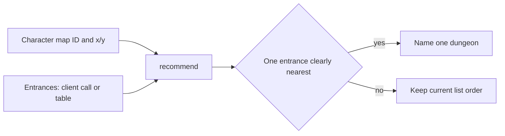

# Tell apart dungeons that share a zone

*   **Author:** Hugh Kaznowski
*   **Status:** Initial draft, unreviewed
*   **Date:** 2026-11-22
*   **Ticket:** [ticket 0019](../../../tickets/0019-shared-zone-dungeons.md). Related: [ticket 0017](../../../tickets/0017-location-xy-in-code.md), [ticket 0018](../../../tickets/0018-zone-matching-localisation.md).
*   **Related decisions:** [ADR 0006](../../adr/0006-dungeon-table.md) (lists `GetDungeonEntrancesForMap` as not chosen for now), [ADR 0018](../../adr/0018-code-format.md) (no dungeon field in the code). Where this document and an ADR disagree, the ADR wins.

--------------------------------------------------------------------------------

## Overview

When a character is in a zone that holds several dungeons, the recommendation lists all of them first. The ticket wants a recommendation that names one dungeon where the client allows it.

## The Problem

Checked against `app/data/dungeons.json` (29 dungeons, 24 distinct zones). Three zones hold more than one dungeon:

*   Tirisfal Glades: `ruins-of-lordaeron`, `scarlet-monastery`.
*   The Barrens: `wailing-caverns`, `razorfen-kraul`, `razorfen-downs`.
*   Searing Gorge: `blackrock-depths`, `lower-blackrock-spire`, `upper-blackrock-spire`.

For a character in one of these zones, `recommend` (`app/src/dungeons.rs`) ranks all of the zone's dungeons ahead of the rest, then orders them by level distance and slug. Level already separates some of them. Entrances in Blackrock Mountain are close together (the archived design notes this for Alternative G2), so position alone may not separate them either.

Players search from outside a dungeon (ADR 0006), and nothing refuses a search. So the gain is a better default, not a gate. Unverified: whether `GetDungeonEntrancesForMap` exists on the Forever client and what it returns; unverified: whether the addon can read a position at all (ticket 0017).

## Goals

*   For a character with a known position near one entrance, that dungeon ranks first.
*   Where two entrances are too close or no position is known, the order stays as today.

## Non-Goals

*   Refusing a search by location (ADR 0006).
*   Adding a dungeon field to the code (ADR 0018).
*   Changing topics.

## Technical Plan

This ticket only has effect if the app knows where the character stands (ticket 0017) on a map ID (ticket 0018). It then needs entrance positions: from the client at runtime, or from a table the author supplies.

"Clearly nearest" needs a threshold (distance ratio or minimum gap); the value is open question 2.

## Alternatives Considered

*   **Level only.** Already in use. It leaves Barrens dungeons with overlapping ranges (15 to 25 against others) ambiguous. Not enough alone.
*   **Ask the player.** Already possible: the player picks a dungeon. This ticket is about the default.

## Detailed Implementation

*   `app/data/dungeons.json` and `Dungeon` in `app/src/dungeons.rs`: entrance map ID and x/y per dungeon (table option) or none (client option).
*   `app/src/dungeons.rs` `recommend`: after the same-zone key and before level distance (or after it, open question 3), sort by entrance distance when both positions are known; add tests for the three zones above using invented positions.
*   `docs/rdf-code-spec.md` section 5: add the new fields and the changed sort order.
*   If the client option: `addon/ForeverTogether/Core.lua` reads entrances and the code must carry them, which is a version bump (ticket 0017); the table option avoids that.
*   `webapp/src/api/fixtures.ts`, `DungeonOption.tsx`: only if the UI marks "nearest". Stories for the three shared zones with real data, per the design-system rule that page stories cover variations.
*   `docs/spike-s0.md`: record the client call results.

## Test and verification plan

*   Live client: call `GetDungeonEntrancesForMap` for the three zones' maps. Pass: it returns entrance positions for the dungeons in the table. Record names, count, and positions.
*   Rust: `cargo test --lib dungeons::` with a character near each entrance and one midway.
*   Manual: Blackrock Mountain case, where entrances are close: confirm the list order stays unchanged when the gap is below the threshold.

## Open questions for the author

1.  **Source of entrance positions.**
    *   Option A: hard-coded in `dungeons.json`, measured or looked up by the author. Mechanism: no client dependency. Trade-off: author time for 29 entries. Fails if a measured position is off after a client update.
    *   Option B: the addon reads them with `GetDungeonEntrancesForMap` and the code carries the nearest dungeon slug or ID. Mechanism: client data. Trade-off: no table; contradicts ADR 0018's "no dungeon field" unless amended. Fails if the call is missing or incomplete on Forever.
    *   Option C: the app asks nothing and the table stores only a "preferred when in this zone" flag per dungeon. Trade-off: no position needed. Fails for the Barrens and Searing Gorge, which have several candidates.
2.  **The distance threshold for naming one dungeon.** Option A: fixed minimum gap in map units. Option B: nearest must be at least a set ratio closer than the second. Option A fails on large and small maps alike; option B fails when only one entrance is on the map.
3.  **Where distance sits in the order.** Option A: before level distance, so position wins. Fails when a level 60 stands next to a level 15 dungeon. Option B: after level distance, as a tie-break. Fails to help when ranges overlap and levels differ slightly.
