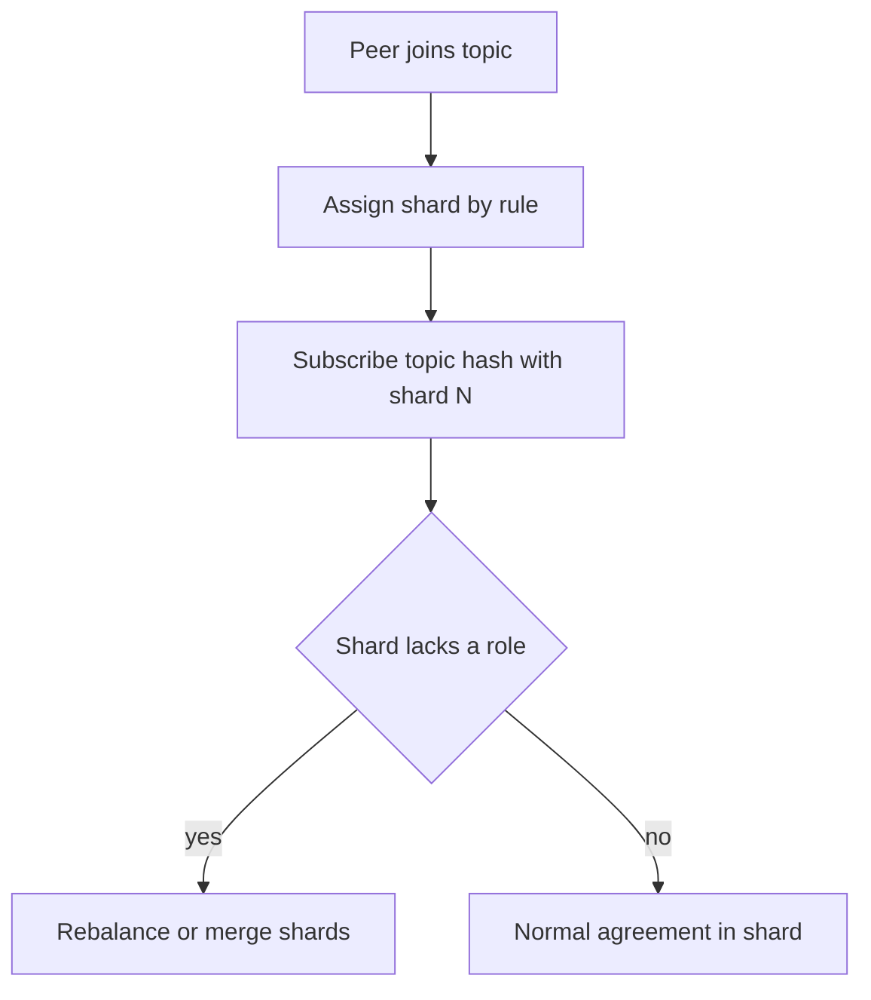

# Shard busy topics

*   **Author:** Hugh Kaznowski
*   **Status:** Initial draft, unreviewed (idea ticket: this draft is about whether and when to build)
*   **Date:** 2026-11-22
*   **Ticket:** [ticket 0021](../../../tickets/0021-topic-sharding.md). Blocked by tickets [0004](../../../tickets/0004-verify-iroh-live-network.md) and [0005](../../../tickets/0005-verify-agreement-live.md).
*   **Related decisions:** [ADR 0005](../../adr/0005-topic-without-level.md), [ADR 0023](../../adr/0023-no-supernodes.md), [ADR 0025](../../adr/0025-leader-invitations.md), [ADR 0035](../../adr/0035-protocol-constants-engine-contract-and-api.md). Where this document and an ADR disagree, the ADR wins.

--------------------------------------------------------------------------------

## Overview

A topic is hashed from `region + realm + faction + dungeon + shard`. The shard number is in the hash but is always 0 (`topic_id` and `topics_for` in `app/src/dungeons.rs`; spec section 2). One swarm exists per topic. The question is when one topic holds too many peers, and what splits it.

## Does it earn a place

What the code does now with a large topic: each peer keeps a sample of at most 100 ads (ADR 0035 table; `Sample` in `app/src/engine/sample.rs`, which evicts by level distance and a hash of owner and peer). So per-peer memory is bounded. What is not bounded is gossip traffic: every ad is gossiped to the swarm on change and on a slow keep-alive (ADR 0005). Whether that becomes a problem is unmeasured: ADR 0034 says "No load tests", and the verification tickets 0004 and 0005 have not run on a real network. Treat all load numbers as unknown.

So building shards before measuring a problem has a cost and no known gain. The ticket says the same: it needs real traffic numbers.

## What a measurement would need

Run many real or simulated peers on one topic (the simulation `engine::sim` uses a model, not the network) and record per-peer inbound messages per second, bytes per second, time to a full sample, and party formation rate. The condition that justifies sharding is a number the author sets (open question 1).

## If built: the mechanism

Sharding by peer ID alone gives each shard a random role mix. With few tanks and healers (the role mix already caps agreement, per `docs/spike-s0.md`), some shards would have no tank, so their damage peers never form a party. A role-aware rule must keep a tank, a healer and damage peers together in each shard.

The rebalance step is the unresolved part; its rule is open question 2.

Files that would change: `app/src/dungeons.rs` (`topic_id` callers pass a chosen shard instead of 0), `app/src/net/` (join several shard topics and exchange which shards exist: peer exchange `Hello` and `Request` carry topic IDs, spec section 4, with a limit of 20 per message), `app/src/engine/` (a shard decision input and a diagnosis that mentions shards, `diagnose.rs`), `docs/rdf-code-spec.md` section 2, `docs/adr/0035-...` constants, an ADR, and the simulation in `engine/sim.rs` extended to shards. Search history (ADR 0027) records topics, so shard changes interact with it.

## Alternatives Considered

*   **Shard by peer ID.** Rejected in ADR 0005: starves shards of tanks and healers.
*   **Lower the sample cap or ad rate instead.** Cheaper than sharding if the problem is bandwidth rather than swarm size. Not evaluated.

## Test and verification plan

First, tickets 0004 and 0005. Then a load run at several peer counts on one topic. Pass or fail is the author's threshold (question 1). If built: extend `engine::sim` with shards and compare the 70% floor and 30 s target (ADR 0034) with and without; add integration tests in `app/src/integration_tests.rs`.

## Open questions for the author

1.  **What triggers the work?**
    *   Option A: a measured per-peer message rate threshold. Fails if the rate is fine but the sample misses compatible peers.
    *   Option B: a measured drop in party formation rate with peer count. Fails if the drop is caused by role scarcity, which sharding makes worse.
    *   Option C: never in v1; revisit on user reports. Fails if the first busy day is the launch.
2.  **The shard rule.**
    *   Option A: shard by hash of peer ID within role (tanks spread evenly, healers spread evenly, damage spread evenly). Mechanism: each role is balanced by count. Trade-off: needs peers to know the role counts. Fails when a role has fewer members than shards.
    *   Option B: shard by level band within the topic. Trade-off: no role issue; shards start to look like the level-in-key design ADR 0005 replaced. Fails for rare dungeons with a narrow level range.
    *   Option C: grow shards only on demand: a peer asks for shard N+1 when its own shard exceeds a size and other peers move across by hash. Trade-off: dynamic; needs consensus on size without a server (ADR 0023). Fails when peers disagree about the size.
3.  **How do peers discover which shard to join?** Option A: always start in shard 0 and be redirected. Option B: try shard 0 and walk up. Option C: derive it from a published count. A fails if shard 0 itself is overloaded; B fails on slow start; C needs a number peers can trust (ADR 0003).
