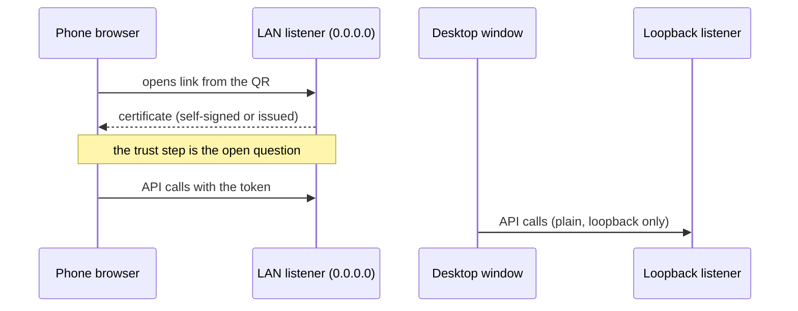

# Encrypting the phone link

*   **Author:** Hugh Kaznowski
*   **Status:** Initial draft, unreviewed
*   **Date:** 2026-11-22
*   **Ticket:** [ticket 0022](../../../tickets/0022-encrypted-lan-link.md). Related: [ticket 0031](../../../tickets/0031-auto-off-timer.md) (auto-off timer), [ticket 0030](../../../tickets/0030-per-phone-count.md) (per-phone count).
*   **Related decisions:** [ADR 0012](../../adr/0012-one-web-app-for-phone-and-desktop.md) (token over plain HTTP, accepted), [ADR 0032](../../adr/0032-settings-phone-link-and-advanced.md) (one Phone link card with a one-line risk), [ADR 0034](../../adr/0034-system-overview-goals-and-risks.md) (lists "encrypting the LAN link" as a non-goal for v1 and the open LAN API as an accepted risk), [ADR 0023](../../adr/0023-no-supernodes.md) (nothing hosted). Where this document and an ADR disagree, the ADR wins.

--------------------------------------------------------------------------------

## Overview

This is an idea ticket: decide whether it is worth building. The desktop app serves the web app over HTTP. With the Phone link switched on, it binds to `0.0.0.0` (`bind_addr` in `app/src/server/mod.rs`) and a phone opens `http://<lan-ip>:<port>/#token=<token>` (`pairing_url` in `app/src/server/pairing.rs`), taken from the pairing QR. The 32-byte token is then sent in a header with every request. Anyone who can read traffic on that network while a phone is paired can read the token and use it. ADR 0012 accepted this and the Phone link card carries a one-sentence warning.

## The Problem

*   A token on a shared network (a flat share, a university, a public Wi-Fi) can be captured by another device on it. The token gives the API access a paired phone has: character data, searches, settings a phone may change. It does not give the loopback-only routes (addon install, pairing, token reset, trusted peers), which a non-loopback caller is refused ([ADR 0034](../../adr/0034-system-overview-goals-and-risks.md), Security).
*   The app cannot tell a trusted home network from an untrusted one, so the warning is shown to everyone.
*   Encrypting the link is not simple here. A browser trusts a certificate for a name it can verify. A phone opening `https://192.168.x.y` has no such name, and the author hosts nothing ([ADR 0023](../../adr/0023-no-supernodes.md)). So an encrypted link means a certificate the phone will warn about, or a trust mechanism that involves another party.
*   A side effect worth knowing: `navigator.clipboard` is available only in a secure context. The copy buttons (`CopyChip`, `MemberRow`, `ContactRow` in `webapp/src/components`) catch the failure and keep the text visible, so over plain HTTP on a phone they probably do nothing. That is unverified on a real phone ([ticket 0035](../../../tickets/0035-web-app-only-mock-tested.md)), and it is an argument for a secure context that is independent of the token risk.

## Goals

*   If built: the token and the API traffic of a paired phone are not readable by another device on the same network.
*   A pairing step a player can do without installing a certificate by hand, or a decision to accept a warning once.
*   The desktop window keeps working unchanged: it loads the loopback URL.

## Non-Goals

*   Protecting a compromised phone or a compromised desktop.
*   Encrypting the iroh traffic (already encrypted by iroh) or the addon QR.
*   A hosted relay or certificate service ([ADR 0023](../../adr/0023-no-supernodes.md), [ADR 0034](../../adr/0034-system-overview-goals-and-risks.md)).

## Technical Plan

Only if the author chooses an encrypted option. The server today uses `axum::serve` over a `TcpListener` (`spawn_listener`, `app/src/server/mod.rs`) and `axum` is built without a TLS feature (`app/Cargo.toml`: `default-features = false, features = ["http1", "tokio", "json"]`). TLS on the LAN listener only, with the loopback listener left plain, would keep the desktop window and every `http://127.0.0.1` assumption (Host and Origin checks in `app/src/server/auth.rs`, the Tauri window URL) unchanged. The listener already moves between `127.0.0.1` and `0.0.0.0` when LAN mode toggles (`Ctl::Lan`), so a LAN-only TLS listener fits that switch.

## Alternatives Considered

*   **Application-layer encryption in the page** (the browser encrypts requests with a key from the QR). Rejected here as impractical: the browser's built-in crypto (`crypto.subtle`) is also limited to secure contexts, so it does not work on a plain-HTTP page. Not a recorded decision.
*   **Moving the phone link onto iroh.** Not possible: a phone's browser does not run iroh.
*   **A native phone app.** Out of scope ([ADR 0034](../../adr/0034-system-overview-goals-and-risks.md): no mobile apps).

## Detailed Implementation

Conditional on the chosen option. Existing files and what a TLS option would touch:

*   `app/Cargo.toml`: a TLS acceptor dependency and, for a generated certificate, a certificate-generation dependency. iroh already depends on a TLS library (rustls, [ADR 0008](../../adr/0008-iroh-and-local-storage.md)); whether it can be reused for HTTP without a second copy is not checked.
*   `app/src/server/mod.rs`: `spawn_listener` and `bind_addr`: a second listener for the LAN address that wraps connections in TLS; the shutdown and rebind logic (`Ctl::Lan`, `bind_with_retry`) must cover it.
*   `app/src/server/pairing.rs`: `pairing_url` builds `http://...`; it would build `https://...` and may carry a certificate fingerprint.
*   `app/src/server/auth.rs`: `host_allowed` and `origin_allowed` accept scheme `http` only (the Origin check requires "same scheme `http`"); the HTTPS origin must be accepted for the LAN listener and still refused for any other.
*   `app/src/store/mod.rs` and `app/src/keys.rs` or a new `app/src/server/tls.rs` (new): where the generated certificate and its key live. The store layout has fixed keys (`identity/secret`, `api/token`, ...); a new key such as `lan/cert` would be added there. The certificate key must not be the iroh identity key, which is also the peer ID ([ADR 0016](../../adr/0016-peers-identified-by-key.md), [ADR 0039](../../adr/0039-key-management.md)).
*   `webapp/src/components/organisms/LanSettings.tsx` and `PairingQr` molecule: the one-line risk text and any first-visit instructions for a certificate warning; stories for the new states.
*   `webapp/src/api/httpApi.ts` and `token.ts`: only if the origin or the fragment handover changes.
*   `app/src/server/tests.rs`: a test that the LAN listener serves TLS and the loopback one does not; the existing Host and Origin tests extended.
*   A new ADR (next free number, indexed in `docs/adr/README.md`) that supersedes the Security sentence and the non-goal in ADR 0034 and the accepted risk in ADR 0012; if "keep the warning", the new ADR records that decision and the reasons.
*   `tickets/0022-encrypted-lan-link.md`, `tickets/README.md`: status.

If the author decides to keep the warning, none of the code files change; only the ADR and the ticket.

## Test and verification plan

*   Decision only: an ADR; no test.
*   If built: functional tests per [ADR 0014](../../adr/0014-functional-tests-only.md): the LAN listener completes a TLS handshake with the generated certificate; the token is never sent in clear (a captured loopback-to-LAN test connection shows no plaintext token); plain HTTP on the LAN port is refused or redirected as chosen; the loopback-only routes still refuse a LAN caller.
*   Manual and unverified, on real devices: that an iPhone and an Android phone each open the page, what each browser shows for the certificate, whether pairing by QR works, whether the warning appears every visit, whether the page can be added to the home screen, and whether `navigator.clipboard` works afterwards.

## Open questions for the author

1.  **Encrypt, or keep the warning.**
    *   **A. Keep plain HTTP and the warning** (this is the ticket's second outcome). Mechanism: nothing changes in the code. Trade-off: no certificate handling, nothing to explain to a player. Fails on exactly the network the warning describes, and leaves the clipboard issue on phones.
    *   **B. A self-signed certificate generated by the app, trusted by one accepted warning in the phone browser.** Mechanism: the app makes a certificate for its LAN address and the player accepts the browser's warning once. The pairing QR may carry the certificate fingerprint so the app can show it for comparison. Trade-off: encryption with no outside party. Fails when the address changes (DHCP gives a new IP) so the certificate no longer matches and the warning returns, when a browser refuses to proceed past a warning (some phone browsers hide the bypass), and because accepting an untrusted-certificate warning as routine trains the player to accept real ones.
    *   **C. A certificate the phone's browser trusts without a warning**, obtained for a name that resolves to the player's private address. Mechanism: a public domain whose subdomains point at private addresses, with a certificate issued by a public authority. Trade-off: no warning. Fails the project's rule that the author hosts nothing ([ADR 0023](../../adr/0023-no-supernodes.md)), because the certificate's private key or a DNS service has to live somewhere the author or a third party operates, and a key shared by every install is exposed by definition.
2.  **If B or C: where the certificate lives and when it is made.** Options: created at first LAN-mode switch and stored under a new store key; created at every switch; or derived from the install. The first keeps one fingerprint but fails when the store is copied to another machine (the certificate names the wrong address); the second changes every time and fails any phone that remembered an exception; the third mixes the certificate key with the install identity, which [ADR 0039](../../adr/0039-key-management.md) keeps separate in intent but does not forbid.
3.  **Whether the auto-off timer (ticket 0031) and a shorter-lived token are an acceptable half-measure instead of encryption.** Mechanism: the phone link turns itself off after a set time and the token can be rotated, which shortens the window in which a captured token is useful. Trade-off: no TLS, a small change in the Settings card. Fails the case where an attacker is on the network during the window, which is the case the ticket is about.
