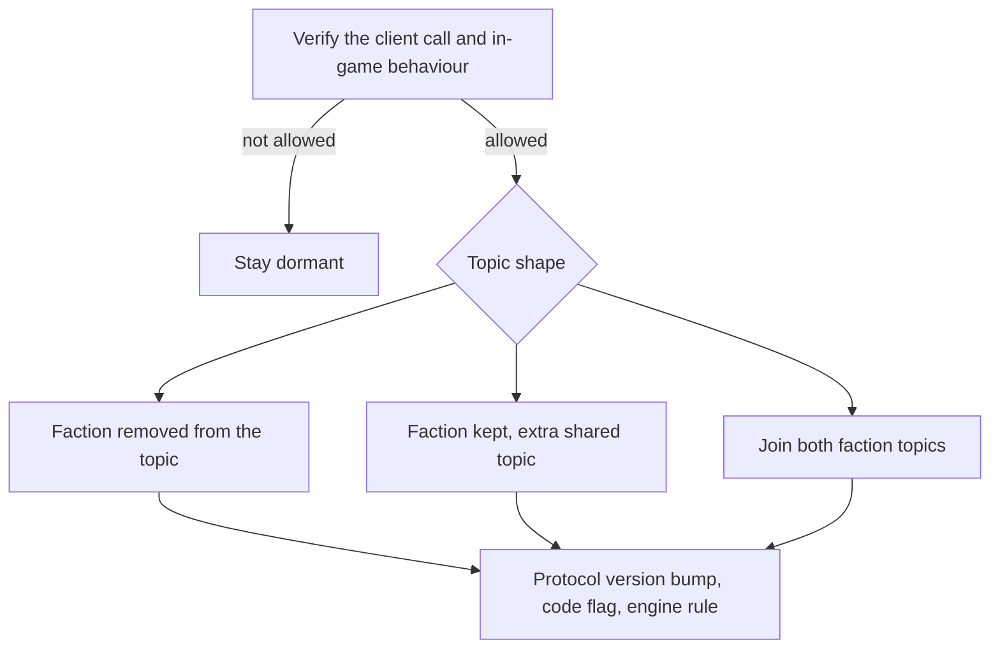

# Cross-faction groups

*   **Author:** Hugh Kaznowski
*   **Status:** Initial draft, unreviewed
*   **Date:** 2026-11-22
*   **Ticket:** [ticket 0023](../../../tickets/0023-cross-faction-groups.md). Related: [ticket 0001](../../../tickets/0001-verify-live-client-calls.md) (live client calls).
*   **Related decisions:** [ADR 0007](../../adr/0007-same-faction-parties.md), [ADR 0005](../../adr/0005-topic-without-level.md), [ADR 0034](../../adr/0034-system-overview-goals-and-risks.md) (lists cross-faction matching as a non-goal). Where this document and an ADR disagree, the ADR wins.

--------------------------------------------------------------------------------

## Overview

This is an idea ticket. Parties are same-faction only ([ADR 0007](../../adr/0007-same-faction-parties.md)). The ticket says to revisit only if Forever allows cross-faction groups. This draft records what such a change would touch, the one fact to verify first, and the choices the author would have to make. It recommends no build now.

## The Problem

Faction is hard-wired in three places, so enabling cross-faction groups later is a format and protocol change, not a setting:

*   **Topic hash.** `dungeons::topic_id` in `app/src/dungeons.rs` hashes `wowft/1/<region>/<realm>/<faction>/<slug>/<shard>`. An Alliance and a Horde player never share a topic.
*   **Code format.** Flag bit 4 of the code is faction (0 Alliance, 1 Horde); a neutral or unknown faction makes the code invalid ([rdf-code-spec](../../rdf-code-spec.md), flags table). Bits 6 and 7 are reserved and must be 0.
*   **Engine compatibility rule.** `engine/ad.rs` (the compatibility function, around line 106 to 113) rejects a pair whose `faction` differs, and the test `factions_never_match` pins it. `Ad.faction` is also carried in every ad and in `Ready`.

Whether Forever allows cross-faction groups is unknown. The addon call `AreCrossFactionGroupQueuesAllowed` is listed as unverified in [spike-s0](../../spike-s0.md) (row "AreCrossFactionGroupQueuesAllowed value"), and the addon does not call it today (no match in `addon/ForeverTogether/`).

## Goals

*   Say what has to be true before work starts, so the ticket can stay closed-until-triggered.
*   List every file a change would touch, so the cost is known.
*   Keep same-faction behaviour unchanged for servers where cross-faction is not allowed.

## Non-Goals

*   Building anything now.
*   Cross-realm or cross-region matching (a separate non-goal in [ADR 0034](../../adr/0034-system-overview-goals-and-risks.md)).
*   Deciding whether cross-faction groups are good for the game.

## Technical Plan

Step 0 is verification, step 1 is the decision, step 2 is code.

1.  **Verify on a live client** (needs the author's client, no code): in game, run `/dump AreCrossFactionGroupQueuesAllowed()` (or the real global name if it differs; unverified that it exists in this client). Record the value on a realm of each ruleset the author can reach, and whether an Alliance and a Horde character can in fact group in game. Put the result in the S0 table row in `docs/spike-s0.md`. Pass: the call exists and returns a boolean, and the in-game behaviour matches it. Fail or absent: the ticket stays dormant and nothing changes. If the call returns true on some realms only, record per realm, because realm is a ruleset ([ADR 0004](../../adr/0004-realm-is-a-ruleset.md)).
2.  **Decide the topic shape** (open question 1) and write an ADR that supersedes the same-faction part of [ADR 0007](../../adr/0007-same-faction-parties.md).
3.  **Change the code and protocol** per the file list below, behind a new protocol version so old and new peers do not meet in one swarm ([ADR 0034](../../adr/0034-system-overview-goals-and-risks.md), compatibility).

## Alternatives Considered

*   **Do nothing until asked.** This is the ticket's own position and stays valid until step 1 passes.
*   **Detect cross-faction at run time in the app by asking the player.** Rejected as a primary path only because the addon can report the call result; a manual toggle remains an option under open question 2.

## Detailed Implementation

Nothing is implemented now. If step 1 passes, these are the files (names verified to exist):

*   `addon/ForeverTogether/Core.lua`: collect the cross-faction call result when the call exists. `docs/spike-s0.md` row updated first.
*   `addon/ForeverTogether/Codec.lua` and `app/src/code.rs`: a flag for "cross-faction allowed" (reuse reserved bit 6, or a version bump, see question 2) and the matching decoder change. `docs/rdf-code-spec.md` and `docs/rdf-code-vectors.json` updated, Lua and Rust tests read the same vectors.
*   `app/src/dungeons.rs`: `topic_id` and `topics_for` change per question 1. The prefix `wowft/1/` becomes `wowft/2/` if the hash input changes ([rdf-code-spec](../../rdf-code-spec.md) section on topics).
*   `app/src/engine/ad.rs`: the faction clause of the compatibility function becomes conditional; the test `factions_never_match` is replaced by two tests (allowed and not allowed).
*   `app/src/engine/state.rs`: member and sample handling that assumes one faction (to be found with a grep for `faction` once the shape is decided; not read in full for this draft).
*   `app/data/dungeons.json`: the `factionHint` field in the recommendation order (spec section on the dungeon table) may need a rule change when both factions can enter.
*   `webapp/src/`: party member rows show faction only if it is now ambiguous; story updates for the Atoms to Pages levels that show a faction.
*   ADR: new ADR superseding the same-faction part of ADR 0007; `docs/adr/README.md` index.

## Test and verification plan

*   Step 1 above is a manual check with exact pass criteria.
*   After code: engine tests (a mixed-faction five forms a party when allowed and never when not allowed), the simulation in `engine::sim` with a mixed pool as an algorithm check, code vector tests in Lua and Rust, and a protocol-version test that a v1 and a v2 peer never share a topic.

## Open questions for the author

1.  **Topic shape when cross-faction is allowed.**
    *   **Option A, faction removed from the topic hash.** One swarm per `region + realm + dungeon`. Mechanism: `topic_id` drops the faction input. Trade-off: simplest, fewer topics (about 290 instead of about 580), larger swarms. Fails when a realm allows cross-faction for some activities but not others, because every player then shares one swarm and the engine must filter by rule.
    *   **Option B, faction kept, plus one extra shared topic per dungeon.** Same-faction topics continue; a new cross-faction topic carries players who opt in. Trade-off: same-faction behaviour is untouched and opt-in is explicit; a player is in two swarms. Fails when the shared topic splits the population so neither swarm has enough tanks or healers.
    *   **Option C, a peer joins both factions' topics and the engine merges samples.** Mechanism: `topics_for` returns both faction topics for an opted-in player. Trade-off: no new topic kind; double network load per search. Fails when ads from one faction swarm are never seen by the other faction's peers who did not join both.
2.  **How the app learns that cross-faction is allowed.**
    *   **Option A, a code flag set by the addon** from the client call (needs a reserved bit or a code version bump, and step 1 to pass). Fails if the call is wrong or absent on the live client.
    *   **Option B, a manual setting in the app** (a `Settings` field in `app/src/config.rs`). Fails when players set it wrongly and form parties the game then refuses.
    *   **Option C, both**, with the code flag as a hint and the setting as an override. Fails when they disagree and the app has no rule for which wins.
