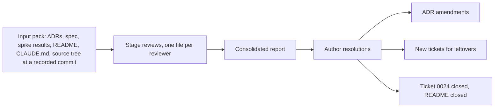

# Re-auditing the revised design

*   **Author:** Hugh Kaznowski
*   **Status:** Initial draft, unreviewed
*   **Date:** 2026-11-22
*   **Ticket:** [ticket 0024](../../../tickets/0024-re-audit-revised-design.md)
*   **Related decisions:** [ADR 0036](../../adr/0036-how-designs-and-decisions-are-maintained.md) (EGM layout and rules), [ADR 0034](../../adr/0034-system-overview-goals-and-risks.md) and [ADR 0035](../../adr/0035-protocol-constants-engine-contract-and-api.md) (the design as it now stands), [ADR 0025](../../adr/0025-leader-invitations.md), [ADR 0039](../../adr/0039-key-management.md). Where this document and an ADR disagree, the ADR wins.

--------------------------------------------------------------------------------

## Overview

This is a plan for a review pass, not a feature. The first audit ran on 2026-11-21 against the then design document (`docs/designs/p2prdf.md`, 627 lines) in five stages (zoom out, comprehension, critic, intermediate zoom out, implementation readiness) and a consolidated report. Its reports are in `docs/design-process/archive/reviews/`, with the author's answers in `author_decisions.md` (D1 to D9). The goldfish report resolved those findings the same day.

Since then the design changed in many places and moved. The design document and the implementation plan were folded into ADRs 0034 and 0035 and archived; leader invitations replaced converging announcements (ADR 0025); the UI got ADRs 0029 to 0033; search health and history (0026, 0027); the addon installer (0028); the scan log (0038); key management (0039). The ticket says a re-audit "has not been run".

## The Problem

*   The first audit's target no longer exists as one document. The design now lives in ADRs 0001 to 0039 (the file listing shows no `0037` in `docs/adr/`; the reason is not recorded in the files read for this draft), plus `docs/rdf-code-spec.md` and `docs/spike-s0.md`. A re-audit must choose what it reads.
*   Decisions were made one at a time, each reviewed (if at all) alone. Interactions between them have not been reviewed as a set: for example the interplay of the agreement mechanism (0025), liveness and bans (0024), search history and privacy (0027, 0038), and the key and trusted-peer role (0008, 0023, 0039).
*   The ticket's done-when says the reports go under `docs/design-process/archive/reviews/`. ADR 0036 (rule 2 and rule 8) and CLAUDE.md say EGM output goes in `docs/egm/<ticket number>-<slug>/` and that new work does not go in the archive. The ADR wins: reports go in `docs/egm/0024-re-audit-revised-design/reviews/`. The ticket text is out of date on this point and needs changing by the author or the orchestrator; this draft edits no ticket.
*   Some inconsistencies are already visible without a review and should be inputs, not findings to rediscover:
    *   ADR 0012 still names the environment variable `P2PRDF_WEB_DIR`, while the code and CLAUDE.md use `WOWFT_WEB_DIR` ([ticket 0037](../../../tickets/0037-adrs-mention-old-names.md) covers old names).
    *   The module comment in `app/src/engine/sim.rs` describes "one epoch (10 s)" for leader invitations, while ADR 0025 and `config::EPOCH` use 5 s.
    *   CLAUDE.md says ADRs "0001-0039" exist; there is no file `0037` in `docs/adr/`.

## Goals

*   A set of review reports that read the current design as one whole, with a verdict and a list of findings ranked by severity.
*   Each finding resolved by the author into an ADR change, a new ticket, or a recorded "accepted risk", as ADR 0036 rule 4 requires.
*   A statement of what the audit did not cover.

## Non-Goals

*   Re-opening decisions the author has already made. A reviewer may point out a conflict between decisions; reversing an Accepted ADR is listed under "decisions only the author can make", as the first audit did.
*   Reviewing code quality (the `code-review` workflow does that), UI visual design, or the unverified facts in tickets 0001 to 0006 (those need live runs; the audit should list them, not resolve them).
*   Applying fixes without the author's answers (the first round of 0043 ran with no remediation applied).

## Technical Plan

### Steps

1.  **Freeze the input.** Record the commit hash in this folder's README (the first review is round 1). Name the files read: `docs/adr/*.md` (current), `docs/rdf-code-spec.md`, `docs/spike-s0.md`, `README.md`, `CLAUDE.md`, `tickets/README.md` and the ticket files, and the source layout under `app/src`, `webapp/src`, `addon/ForeverTogether/`. The archive is not input except `author_decisions.md`, to avoid re-raising answered questions.
2.  **Run the stages.** Same stages as the first audit and as 0043 round 1: zoom out, comprehension, critic, intermediate zoom out, implementation readiness. Each writes one file, `docs/egm/0024-re-audit-revised-design/reviews/r1-<stage>_report.md`; the consolidated report writes `r1-consolidated_review_report.md`. An agent never writes elsewhere in `docs/`, never edits an ADR (ADR 0036 rule 2). The orchestrator names these output paths in every prompt and checks for misplaced files before committing.
3.  **Lenses.** In addition to the generic stages, each reviewer is given a list of cross-cutting questions that the one-at-a-time ADR process may have missed (the list is a mechanical choice and is part of the prompt, not of this draft's decisions):
    *   Do the constants in ADR 0035 agree with `app/src/config.rs`, the engine and the addon (epoch, windows, sample size, bans)?
    *   Do the privacy statements in ADRs 0027, 0034 and 0038 agree with what the code stores and exposes (history, scan log, API fields, logs)?
    *   Does every risk in ADR 0034 have an owner ticket, and does every unverified fact in CLAUDE.md "Current state" and `docs/spike-s0.md` appear in a ticket?
    *   Are the ADRs consistent about names (`wowft`, topic prefix, ALPN) and about what an "accepted" ADR still carries as unverified?
    *   Do the open tickets' "blocked by" chains match the real dependencies (for example 0004 on 0008)?
4.  **Consolidate.** One report: verdict, blockers, major and minor findings, and "decisions only the author can make", as in `docs/design-process/archive/reviews/consolidated_review_report.md`.
5.  **Resolve.** The author answers each decision. Resolutions go in `resolutions.md` in this folder. ADR amendments (each its own commit, `adr(MMMM): title`), new tickets (`ticket(NNNN): status`), and `egm(0024): review round 1`, `egm(0024): resolutions` commits, per ADR 0036 rule 6.
6.  **Close** when ADRs exist and leftovers are ticketed: README status `closed`; ticket 0024 links the folder.

### Pass and fail

A review has no pass or fail. The criteria are completeness checks the orchestrator can apply before closing:

*   Every stage report exists in `reviews/` and states its target, date and commit.
*   Every finding in the consolidated report has a resolution entry (ADR, ticket, or accepted).
*   No file was written outside this folder by an agent.
*   The ticket's done-when is updated to the real location of the reports.

## Alternatives Considered

*   **Put the reports in `docs/design-process/archive/reviews/` as the ticket says.** Rejected: ADR 0036 rule 8 freezes that folder.
*   **Skip the re-audit and rely on the live verification tickets.** Not rejected by an ADR. The audit and the live runs find different things (design inconsistencies versus facts about the world); see open question 2.
*   **One reviewer, one pass.** Rejected by the first audit's approach; fewer lenses miss cross-ADR conflicts. The trade-off is cost; see open question 3.

## Detailed Implementation

Files created or changed, all after the author approves a run:

*   `docs/egm/0024-re-audit-revised-design/README.md`: update status and rounds when the run starts; record the frozen commit.
*   `docs/egm/0024-re-audit-revised-design/reviews/r1-<stage>_report.md`: the stage reports (new).
*   `docs/egm/0024-re-audit-revised-design/reviews/r1-consolidated_review_report.md`: new.
*   `docs/egm/0024-re-audit-revised-design/resolutions.md`: new, the author's answers.
*   `docs/egm/README.md`: add this folder to the table (the author or orchestrator; agents do not edit it).
*   `docs/adr/*.md`: amendments per resolution. An Accepted ADR changes by amendment or a superseding ADR, with the date.
*   `tickets/README.md` and `tickets/NNNN-*.md`: new tickets for leftovers; `tickets/0024-re-audit-revised-design.md`: status and the corrected done-when.
*   `CLAUDE.md`: "Current state" line "A re-audit of the revised design has not been run" changes when the audit is closed.

## Test and verification plan

*   The orchestrator checks the layout rule before each commit: `ls docs/egm/0024-re-audit-revised-design/` shows only `README.md`, `design_draft.md`, `reviews/`, `resolutions.md`.
*   Every relative link in the new reports resolves (grep each link target).
*   Cited file paths and names in findings are verified by the orchestrator on a sample (a report that cites a function that does not exist is a defect of the report).
*   Commits follow the labels in ADR 0036 rule 6, one step each, never mixed with code.

## Open questions for the author

1.  **What is in scope?**
    *   **The whole current ADR set, spec and code.** Mechanism: every ADR 0001 to 0039 is an input. Trade-off: finds cross-ADR conflicts anywhere. Fails on length and cost, and returns findings on ADRs 0001 to 0024 that the first audit already covered.
    *   **Only what changed since the first audit (ADRs 0025 to 0039, the amendments to earlier ADRs, and the code behind them).** Mechanism: a smaller input pack with the old audit's decisions marked settled. Trade-off: focused. Fails by missing a conflict between a new ADR and an old one that was never amended.
    *   **Only the areas the open tickets flag as risky (agreement, network, keys, privacy).** Mechanism: a thematic review over those ADRs and modules. Trade-off: cheapest and most targeted. Fails by leaving the UI and installer decisions unreviewed.
2.  **When is it run relative to the live verification tickets (0004, 0005, 0035, 0006)?**
    *   **Before.** Mechanism: design findings are fixed before the live runs, so the runs test the revised design. Trade-off: avoids testing a design about to change. Fails when live results then force a second audit of the same areas.
    *   **After.** Mechanism: the audit reads the design together with measured results (the spike results hold real numbers by then). Trade-off: fewer assumptions to argue about. Fails by finding design flaws after the live runs have been spent on them.
    *   **In parallel.** Mechanism: the audit runs while the author runs the live checks. Trade-off: saves calendar time. Fails when a finding changes a constant a live run is measuring.
3.  **Which reviewers, and does the round apply fixes?**
    *   **The same five stages and a consolidated report, no remediation applied (as in 0043 round 1).** Mechanism: reports only; the author resolves. Trade-off: consistent with the previous audit. Fails to add a view the stages lack, such as a security lens on the LAN API and the key handling.
    *   **The five stages plus a security and privacy reviewer.** Mechanism: one more reviewer with ADRs 0003, 0012, 0016, 0019, 0027, 0038 and 0039 as its focus. Trade-off: covers the strongest risks in ADR 0034. Fails on cost and overlap with the critic stage.
    *   **A reduced pass (zoom out, critic, consolidated).** Mechanism: three reports. Trade-off: cheap. Fails to check implementation readiness, which the first audit found valuable (its blockers B3 to B8 came from that stage).
