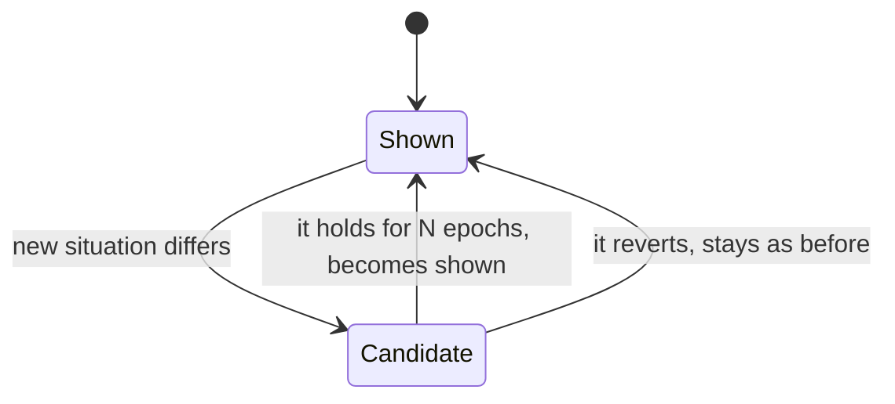

# Search diagnosis: hysteresis, doubt level and hints

*   **Author:** Hugh Kaznowski
*   **Status:** Initial draft, unreviewed
*   **Date:** 2026-11-22
*   **Ticket:** [ticket 0026](../../../tickets/0026-diagnosis-hysteresis-and-hints.md), blocked by [ticket 0025](../../../tickets/0025-diagnosis-attempt-counters.md)
*   **Related decisions:** [ADR 0026](../../adr/0026-search-health-from-own-observations.md) (lists hysteresis as not in the first slice), [ADR 0025](../../adr/0025-leader-invitations.md), [ADR 0003](../../adr/0003-self-reported-data.md), [ADR 0029](../../adr/0029-atomic-design-and-show-dont-tell.md). Where this document and an ADR disagree, the ADR wins.

--------------------------------------------------------------------------------

## Overview

This is an idea ticket, so the draft is short and asks whether and when to build. The ideas come from the archived search-diagnosis brief (`docs/design-process/archive/search_diagnosis_concepts_brief.md`, staging item 7, "Pacing rolling feedback" and the inventive-catalyst list). Four separate things are bundled:

1.  **Hysteresis.** Enter a situation only after it holds for N 5 s epochs, leave on a stricter condition, so the headline does not flicker. The brief estimated 15 to 20 s of lag.
2.  **Doubt level.** Complete view, slice or thin, from `sampleFull` and connection state. "Give up" advice would only be allowed on a complete view.
3.  **Feasibility sentence.** Parties possible = the smallest of tanks, healers and damage divided by 3, naming the bottleneck role.
4.  **Counterfactual hints.** "What would change this", computed by re-running the check under the next widening stage's rules.

## The Problem

What exists today (checked in the code):

*   A warm-up under 30 s (`warming_up`), and `nobody_answered` already needs invitations in at least `MIN_INVITE_EPOCHS` (2) epochs. These are one-off dwell rules, not general hysteresis (`app/src/engine/diagnose.rs`).
*   `diagnose` is pure and takes no clock, so it cannot remember the previous situation. `app/src/app/mod.rs` de-duplicates published state by equality, so a situation that flips every epoch causes a new publish each time.
*   `diagnosis.sampleFull` is on the wire (`app/src/server/core.rs`), so the raw input for a doubt level exists.
*   `engine::diagnose::bottleneck` computes the role with the lowest seen-to-need ratio and is used by the history estimator. That is the core of a feasibility sentence; the sentence and its copy do not exist.
*   Nothing computes the next stage's rules for a hint. Stage 1 (secondary roles) changes nothing in v1 (brief, finding on `widen.rs`).

**Whether flicker actually happens is not known.** No live capture exists. The counts come from samples and a burst of party commits can empty a sample, so flicker is plausible but unobserved. Every threshold would be unverified.

## Goals

*   Decide whether any of the four is worth building before live data exists.
*   If so, fix the order and where each lives (engine or web app), so the work can be ticketed.

## Non-Goals

*   Any promise that a group will form (ADR 0026).
*   Changing the situation list or thresholds of ADR 0026.
*   Using history to change a situation (`diagnose` stays pure and takes no history).

## Technical Plan

Only the hysteresis has a mechanism worth drawing, and it has two homes (open question 1). Common to both: the rule is a function of the sequence of per-epoch situations.

The doubt level and feasibility sentence need no new state: they are functions of the current counts. The hints need a second evaluation under the next stage's rules, which touches `engine::widen`.

## Alternatives Considered

*   **Build all four together** (the brief's option C): rejected in the brief as a second product with copy, tests and tuning per situation, and coupled to ADR 0025 internals.
*   **Smoothing the counts instead of the situation** (a moving average): not in the brief; rejected here because the situations are threshold rules and an average hides a real tank leaving.

## Detailed Implementation

Nothing is built by this draft. If the author chooses to proceed, the likely touch points are:

| File | Change | Why |
|---|---|---|
| `app/src/engine/diagnose.rs` | Dwell state input or a wrapper that takes the previous situation and epochs held. | Hysteresis in the engine keeps one definition for UI and history. |
| `app/src/engine/state.rs` | Store the shown situation and epoch counter on the engine, reset on `start`, frozen in the end snapshot. | `diagnose` cannot hold state itself. |
| `app/src/server/core.rs`, `app/src/app/mod.rs` | A doubt field on `diagnosis` (`#[serde(default)]`), computed from `sampleFull` and connection state. | The web app should not recompute engine rules. |
| `webapp/src/lib/diagnosisCopy.ts`, `webapp/src/api/types.ts`, `webapp/src/api/fixtures.ts` | Copy, types and fixtures for the new field or sentences. | The web app owns every sentence. |
| `webapp/src/components/molecules/DiagnosisSummary.tsx` and stories | New states, each with a story, including a long-sentence case. | Atomic design rule: every state has a story. |
| `docs/adr/` | An amendment to ADR 0026 or a new ADR. | The decisions live there. |

## Test and verification plan

Only if built. A pure table test over a scripted epoch sequence (A, B, A, A, B, B, B) for hysteresis; a table over `sampleFull` and connection state for doubt; story states for copy. Thresholds are marked unverified until a live capture records the situation per epoch for a real search (ticket [0005](../../../tickets/0005-verify-agreement-live.md) is the natural run).

## Open questions for the author

1.  **Where does hysteresis live, if built?**
    *   **A. In the engine.** Mechanism: the engine remembers the shown situation and epochs held, and `diagnose` or a wrapper applies the rule. Trade-off: one definition, testable with the simulated cluster; adds engine state and a rules-version question. Fails if the right dwell turns out to be a presentation matter (different for the phone and the desktop).
    *   **B. In the web app.** Mechanism: the front end keeps the last shown code and a timer. Trade-off: no engine change, tuning needs no backend release; the rule is duplicated for any other client and is tested with fake timers. Fails if two open views (desktop and phone) disagree because each has its own timer.
    *   **C. Not at all.** Mechanism: leave the existing dwell rules. Trade-off: no code. Fails if the live run shows the headline changing every epoch.
2.  **What triggers building any of it?**
    *   **A. Evidence of flicker in a live capture.** Mechanism: log the situation per epoch in a live run and count changes. Trade-off: no speculative work; waits for ticket 0005. Fails if the capture is never taken.
    *   **B. Player reports.** Mechanism: wait for issues. Trade-off: no instrumentation; the signal is vague. Fails if players do not report, they just stop trusting the headline.
    *   **C. Build the doubt level now.** Mechanism: it only reads existing fields, so it can ship before flicker is known. Trade-off: new copy and a new field. Fails if "thin view" wording reads as the app being broken.
3.  **Feasibility sentence and hints: separate tickets or dropped?**
    *   **A. Feasibility sentence only.** Mechanism: reuse `bottleneck`. Trade-off: small; mostly restates the role row ADR 0026's show-don't-tell amendment already draws. Fails if it duplicates what the role row shows.
    *   **B. Hints too.** Mechanism: evaluate the next stage's compatibility rules. Trade-off: needs a stage-aware rule evaluation and is the largest piece. Fails if the next stage adds nothing for most searches (stage 1 changes nothing in v1) and the hint is empty.
    *   **C. Drop both.** Mechanism: the headline and role row stay as they are. Trade-off: nothing to maintain. Fails if players ask "what can I change" and have no answer except the existing Search again and Change dungeon buttons.
