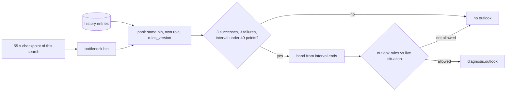

# Search history estimator (stage 8b)

*   **Author:** Hugh Kaznowski
*   **Status:** Initial draft, unreviewed
*   **Date:** 2026-11-22
*   **Ticket:** [ticket 0027](../../../tickets/0027-history-estimator.md), blocked by [ticket 0005](../../../tickets/0005-verify-agreement-live.md) and [ticket 0029](../../../tickets/0029-history-checkpoints.md)
*   **Related decisions:** [ADR 0027](../../adr/0027-search-history.md) (the later amendment "the estimator (stage 8b)" defines it), [ADR 0026](../../adr/0026-search-health-from-own-observations.md) (the `outlook` rules), [ADR 0003](../../adr/0003-self-reported-data.md). Where this document and an ADR disagree, the ADR wins.

--------------------------------------------------------------------------------

## Overview

The estimator looks at the player's earlier searches and, once a running search reaches its 55 s checkpoint, may add one hedged clause: "usually", "sometimes" or "rarely" found. It never shows a number, never reassures against a live problem, and is silent when history is thin.

**Finding: it is built.** The ticket's "Done when" (pure estimator module, skip-on-corrupt tests, no API field without a decision) appears met, with the API field decided in the ADR amendment. Evidence:

*   `app/src/history/estimate.rs`: `estimate` (pure), `outlook` (the display rules), the constants `MIN_SUCCESSES` 3, `MIN_FAILURES` 3, `MAX_WIDTH` 0.40, `USUALLY_FROM` 0.60, `RARELY_UP_TO` 0.35, and a 95% Wilson interval. The bin is `engine::diagnose::bottleneck`, so the situations and the estimator share one definition.
*   Wiring: `LiveCore` keeps a cache of entries (`history_cache` in `app/src/app/mod.rs`), loaded once and refreshed after each recorded entry, emptied on clear. `outlook_band` runs only once `SearchStats::checkpoint` exists. The 1 s tick never reads the store.
*   Wire and copy: `diagnosis.outlook` in `app/src/server/core.rs`; `OUTLOOK_COPY` and the `usually_found` drop rule in `webapp/src/lib/diagnosisCopy.ts`; `Outlook*` stories in `DiagnosisSummary.stories.tsx`.
*   Tests: table tests in `estimate.rs` (thresholds, stopped searches excluded, pooling) and the `outlook` tests in `app/src/app/history_tests.rs` (`the_outlook_appears_at_the_checkpoint_only_with_dependable_history`, `too_little_history_gives_no_outlook`, `the_outlook_is_never_shown_once_the_search_ended`).

Nothing is verified against real entries: none exist yet, and the ticket's condition ("build only after a live capture shows the fields are stable") was not met when it was built. The gate defaults to silence, so with no history the player sees nothing.

## The Problem

*   The ticket is open and blocked, but the code is in, so the backlog misstates the state. The ticket's rule "never reassuring against a live 'not connected' or 'no tank'" is enforced twice, in `outlook` (Rust) and in `diagnosisCopy.ts` (web app).
*   The constants (3 and 3, 0.40, 0.60, 0.35) are starting values with no data behind them.
*   `checkpoint_2` is recorded in every entry but no code reads it. The estimator uses `checkpoint_1` only (`similar()` excludes entries with `checkpoint_1 == None`).
*   `Stopped` entries are in neither count, so a player who stops often contributes little. The wait-time band was deferred (ADR 0027).
*   The estimator pools entries across dungeons unless the same dungeon passes the gate alone. Whether that pool is similar enough is unverified.

## Goals

*   Check the built estimator against the ADR and the ticket, step by step (below).
*   Decide the three open questions.
*   Leave a written way to test the constants once real entries exist.

## Non-Goals

*   Showing any history number, date or count (ADR 0027, resolution 8).
*   Regression models (the ticket says rates by state).
*   A wait-time estimate (deferred in the ADR).
*   Sending history to anyone.

## Technical Plan

The mechanism is in ADR 0027. In short: entries with the same bottleneck bin and own role, this build's `rules_version`, a checkpoint at 55 s; success is `Formed`, failure is `Expired`; the band comes from the interval; `outlook` filters it against the live situation.

## Alternatives Considered

*   **Regression on all fields:** rejected in the ticket and ADR; too little data per player.
*   **Buckets by dungeon, day and hour:** rejected in ADR 0027 because it blames the clock for a missing role.
*   **A bare success percentage:** rejected in the ticket; it would claim more than a small self-reported sample supports.

## Detailed Implementation

Nothing new is required. Changes depend on the author's answers:

| File | Change | Why |
|---|---|---|
| `tickets/0027-history-estimator.md`, `tickets/README.md` | Status and blocked-by updated. Not edited by this draft. | The ticket says blocked but the code is in. |
| `app/src/history/estimate.rs` | Only if question 2 uses `checkpoint_2`, or question 3 adds a replay test. | The estimator is the single reader. |
| `app/src/app/mod.rs` | Only if question 1 adds a switch. | The cache and `outlook_band` are the wiring. |
| `docs/adr/0027-search-history.md` | An amendment for any decision changed. | ADRs hold decisions. |

## Test and verification plan

1.  `cargo test --lib history::` and `cargo test --lib app::history_tests` from `app/`. Pass: all pass, including the outlook tests above.
2.  `cargo clippy --all-targets -- -D warnings`. Pass: clean.
3.  `pnpm --dir webapp typecheck` and `pnpm --dir webapp build-storybook`. Pass: the `Outlook*` stories render, `OutlookUsuallyFoundWithProblemDropped` shows no clause.
4.  Read `seed_history` and the outlook tests in `app/src/app/history_tests.rs`. Pass: they cover fewer than 3 formed or 3 expired (no `outlook`) and a dependable pool (a band), with invented entries only.
5.  After the first live weeks: copy the `history/` entries of a test install (invented character only), run the estimator offline over them, and record the share of searches at the 55 s checkpoint for which a band appeared and how often it agreed with the final outcome. Pass criteria are the author's (question 3).

Record: step results; for step 5 the counts. On the author's decision, adjust the constants (`rules_version` changes only if the counting rule changes, ADR 0027) or leave them.

## Open questions for the author

1.  **Is the estimator enabled in builds before any live data?**
    *   **A. Leave enabled.** Mechanism: the gate is silent without 3 successes and 3 failures. Trade-off: no code; the first clauses appear after weeks of play on constants nobody has tested. Fails if the first bands are wrong, because players see "usually found" or "rarely found" built on 6 entries that stopped early.
    *   **B. Off until the live run.** Mechanism: a build flag or a setting hides `outlook`. Trade-off: one more switch to maintain; entries still accumulate. Fails if the switch is forgotten and the estimator never turns on.
    *   **C. Enabled, but only the `rarely_found` and `sometimes_found` bands.** Mechanism: never speak good news until data exists. Trade-off: matches the rule that history never reassures; players hear only caution. Fails if "rarely found" discourages players from searching at all.
2.  **What happens to `checkpoint_2`?**
    *   **A. Leave it unread.** Mechanism: keep recording; no reader. Trade-off: no work, data ready if wanted. Fails if it is never used and the field is dead weight in every entry.
    *   **B. Use it for a second outlook at about 2 minutes.** Mechanism: compare the 115 s observation with entries that reached it. Trade-off: a later, better-informed clause; fewer comparable entries because many searches end before it. Fails if the pool never passes the gate at that point.
    *   **C. Drop the field.** Mechanism: stop recording `checkpoint_2` and remove it from `Entry` and the engine facts. Trade-off: smaller entries and less code; old entries still decode if the field keeps `#[serde(default)]`. Fails if a later estimator wants a second observation and the data was never collected (ticket [0029](../../../tickets/0029-history-checkpoints.md) records it for that reason).
3.  **How are the constants checked?**
    *   **A. Offline replay on the author's own entries.** Mechanism: run `estimate` over saved entries and compare with outcomes. Trade-off: cheap; one player's data. Fails if that player plays one role and one dungeon, so the pool never varies.
    *   **B. A test-only report like the one removed from the simulation.** Mechanism: a `#[ignore]` test that prints the table (the earlier S0 report followed this shape). Trade-off: repeatable; code to maintain. Fails if no real data is fed to it.
    *   **C. Leave constants until players report.** Mechanism: no checking. Trade-off: no work. Fails silently: a wrong band is not noticed.
