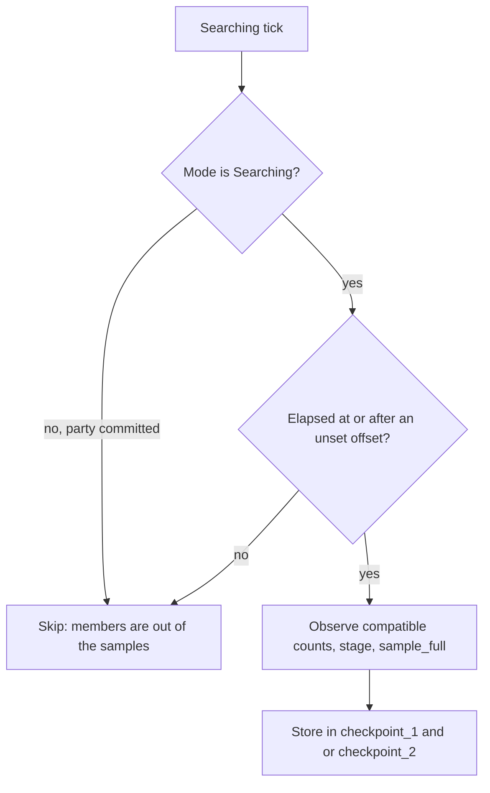

# Record history checkpoints at about 1 and 2 minutes

*   **Author:** Hugh Kaznowski
*   **Status:** Initial draft, unreviewed
*   **Date:** 2026-11-22
*   **Ticket:** [ticket 0029](../../../tickets/0029-history-checkpoints.md)
*   **Related decisions:** [ADR 0027](../../adr/0027-search-history.md) (the "Checkpoints" bullet), [ADR 0026](../../adr/0026-search-health-from-own-observations.md) (the compatible counts). Where this document and an ADR disagree, the ADR wins.

--------------------------------------------------------------------------------

## Overview

A history entry needs the role counts at fixed points in a search so a running search can be compared with past ones. The ticket asks for checkpoint capture in the engine facts record.

**Finding: it is built.** Evidence:

*   Constants: `CHECKPOINT_1` (55 s) and `CHECKPOINT_2` (115 s) in `app/src/config.rs`, with the reason: each is just before a widening step, and 120 s is also the ad lifetime.
*   Engine: `Checkpoint` and `SearchFacts.checkpoint_1`/`checkpoint_2` in `app/src/engine/state.rs`; `record_checkpoints` takes the counts on the first searching tick at or after each offset and never while a party is committed; `SearchStats.checkpoint` exposes the first one live.
*   Entry: `CheckpointEntry` (counts, widening stage, `sample_full`) and `Entry.checkpoint_1`/`checkpoint_2` in `app/src/history.rs`. A search that ends first stores `None`, not zeros.
*   `rules_version` includes the checkpoint seconds (`rules_version_from_config`), so a change of either offset starts a new version.
*   Tests: `app/src/engine/facts_tests.rs` (`a_solo_tank_to_expiry_gives_one_expired_fact_with_checkpoints`, `the_live_stats_carry_the_checkpoint_only_once_it_is_taken`, `a_search_that_ends_before_a_checkpoint_stores_none_not_zero`, `a_stop_at_90_s_has_the_first_checkpoint_only`) and `app/src/app/history_tests.rs`.

Used so far: only `checkpoint_1`, by the estimator ([ticket 0027](../../../tickets/0027-history-estimator.md)). Nothing reads `checkpoint_2`. Unverified: that the two offsets sit where the rules change in a live run.

## The Problem

*   The author has not confirmed the "Done when" against the code; the ticket is open (P2).
*   A checkpoint is taken on the first searching tick at or after its offset. While a party is committed no checkpoint is taken, so a search that commits around 55 s, then loses a member and returns to searching, takes the first checkpoint late. The entry stores the counts and the stage but not when they were taken, so a late checkpoint looks like an on-time one. The same gap can set both checkpoints in one tick with the same counts.
*   The 1 s tick sets the granularity: the "55 s" count is taken between 55 and 56 s.

## Goals

*   Confirm the capture against the ticket and the ADR (steps below).
*   Decide how late checkpoints are treated.

## Non-Goals

*   Reading the checkpoints (the estimator, ticket 0027).
*   More checkpoints, or periodic sampling.
*   Changing the offsets without a `rules_version` change.

## Technical Plan

No new mechanism.

## Alternatives Considered

*   **Counts only at the terminal event:** rejected in ADR 0027; the end state of a failed search does not describe the search a running player is in.
*   **A time series (every epoch):** not chosen in the ADR; larger entries and a heavier estimator for a gain that is unverified.

## Detailed Implementation

No file needs creating. Possible changes:

| File | Change | Why |
|---|---|---|
| `tickets/0029-history-checkpoints.md`, `tickets/README.md` | Mark done. Not edited by this draft. | Backlog matches code. |
| `app/src/engine/state.rs`, `app/src/history.rs` | Only for question 1 option B or C: a late flag, or an elapsed-seconds field on `Checkpoint` and `CheckpointEntry` with `#[serde(default)]`. | Late captures need to be distinguishable or dropped. |
| `app/src/config.rs`, `rules_version_from_config` | A `rules_version` change only if the capture rule changes meaning (option A of question 1 changes nothing; B and C change what a stored checkpoint means for new entries). | ADR 0027 ties the version to the counting rule. |
| `docs/adr/0027-search-history.md` | An amendment for the decision. | ADRs hold decisions. |

## Test and verification plan

1.  `cargo test --lib engine::` from `app/`. Pass: the four checkpoint tests pass.
2.  `cargo test --lib history::` and `cargo test --lib app::history_tests`. Pass: entries round-trip with checkpoints and decode when a checkpoint is `None`.
3.  Read `rules_version_from_config` and its test. Pass: the string contains both checkpoint seconds and a test keeps it equal to the config.
4.  Manual check of the late case in the cluster simulation: commit a party before 55 s, drop a member after 70 s, and read the facts. Pass criterion is the author's (question 1). Record whether the first checkpoint stage and counts describe the rules in force.

Record: results per step. If question 1 changes the rule, write the ADR amendment and the tests in the same change.

## Open questions for the author

1.  **How are late checkpoints treated?**
    *   **A. Keep as is.** Mechanism: the first searching tick at or after the offset sets it, however late. Trade-off: no code. Fails if a checkpoint taken at 3 minutes (after a drop) is compared with on-time ones and the estimator pools unlike searches.
    *   **B. Store the elapsed seconds with each checkpoint.** Mechanism: an additive field; the estimator can filter or weigh. Trade-off: small schema change, no data lost. Fails if no reader ever uses the field.
    *   **C. Drop checkpoints taken more than N seconds late.** Mechanism: the engine leaves the checkpoint `None` when elapsed exceeds offset plus N. Trade-off: the pool stays clean; fewer comparable entries. Fails if N is too small and most searches with a drop lose their checkpoint.
2.  **Does the ticket close with `checkpoint_2` unused?**
    *   **A. Close; ticket 0027 decides about `checkpoint_2`.** Mechanism: capture is the ticket's scope, use is the estimator's. Trade-off: clean split. Fails if question 2 of the draft for [ticket 0027](../0027-history-estimator/design_draft.md) drops the field and this ticket recorded something nobody wanted.
    *   **B. Keep open until a reader exists.** Mechanism: close both together. Trade-off: the ticket stays open although the code is done. Fails if the second checkpoint is never used and the ticket stays open.
