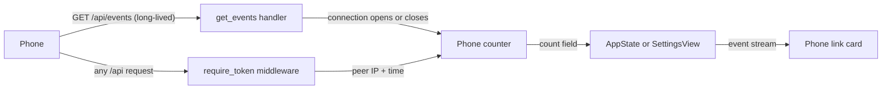

# Show how many phones are linked

*   **Author:** Hugh Kaznowski
*   **Status:** Initial draft, unreviewed
*   **Date:** 2026-11-22
*   **Ticket:** [ticket 0030](../../../tickets/0030-per-phone-count.md)
*   **Related decisions:** [ADR 0012](../../adr/0012-one-web-app-for-phone-and-desktop.md), [ADR 0029](../../adr/0029-atomic-design-and-show-dont-tell.md), [ADR 0032](../../adr/0032-settings-phone-link-and-advanced.md). Where this document and an ADR disagree, the ADR wins.

--------------------------------------------------------------------------------

## Overview

This is a feature idea, so the draft is short. The Phone link card in Settings has a switch, an "Add a phone" button and a "Sign out all phones" row. It does not say whether any phone is using the link. ADR 0032 (D9) left a per-phone count out of scope because it "needs server work". The work is on the server: today nothing in the server tells one phone from another.

## The Problem

*   Authentication is one per-install bearer token (`TokenManager` in `app/src/server/auth.rs`). Every phone that scanned the QR holds the same token, and the desktop window holds it too. The server has no list of phones.
*   `RateLimiter` buckets by a hash of the token, so it does not help either.
*   The Phone link card (`webapp/src/components/organisms/LanSettings.tsx`) can show "On" and "Not encrypted" but not whether anybody is connected. A player cannot tell whether switching it off now would cut someone off, or whether a forgotten phone is still linked.
*   The settings state (`SettingsView` in `app/src/server/core.rs`, mirrored by `Settings` in `webapp/src/api/types.ts`) has no field for it.

## Goals

*   The Phone link card shows a number next to its label, in the form already used elsewhere ("Phones: 2"), with no explanatory sentence (ADR 0029, show don't tell).
*   The number is truthful about what it counts, and the label does not claim more.
*   A Storybook story for the card with 0, 1 and several phones.

## Non-Goals

*   Naming phones or showing a device list. A name would need a per-phone record the server does not have.
*   Revoking one phone. Revoking stays "sign out all phones" (token reset) unless the author picks per-phone tokens below.
*   Counting peers on the internet. This is only the local web API.

## Technical Plan

Counting needs a definition first. Two of the three definitions below need no change to how phones sign in. They differ in what the server observes.

The diagram shows the two places the server already sees a phone: the event stream handler and the auth middleware. Which of them feeds the counter is open question 1.

Whatever the source, the count is a field the UI reads from state, so it updates through the existing event stream (`event_body` in `app/src/server/events.rs`). The card shows it only while the phone link is on.

## Alternatives Considered

*   **A counter held only in the browser.** Rejected: a browser cannot see other devices.
*   **Count phones through the iroh network.** Rejected: phones use the HTTP API, not iroh.

The three counting definitions are not rejected here; they are open question 1.

## Detailed Implementation

Common to every definition:

*   `app/src/server/core.rs`: add a count field. Whether it lives in `SettingsView` or in `AppState` or `NetworkView` is mechanical; settings values are persisted and this one is not, so `AppState` is the better fit. `AppState` is built in `app/src/app/mod.rs` (a field around line 1074 builds the settings view), so the count has to be merged in by the server layer, since the core does not know about HTTP connections.
*   `app/src/server/mod.rs` and `routes.rs`: a small shared counter object next to `Guard` (in `auth.rs`), updated by the source chosen in question 1.
*   `app/src/server/routes.rs`: `get_events` and `get_state` include the count. The caller's own connection is excluded from the number where it is a loopback caller (the desktop window is not a phone). `ConnectInfo<SocketAddr>` and `is_loopback_peer` already exist for this decision.
*   `webapp/src/api/types.ts`: add the field to `AppState`. `webapp/src/api/fixtures.ts` and `webapp/src/api/mockApi.ts`: give fixtures a value and let a story set it.
*   `webapp/src/components/organisms/LanSettings.tsx`: a prop with the count and a labelled value in the state row. If a molecule for "label: value" exists, use it; otherwise add one to molecules rather than styling inside the organism (CLAUDE.md design rules).
*   `webapp/src/components/pages/SettingsPage.tsx` and `webapp/src/App.tsx`: pass it down.
*   `webapp/src/components/organisms/LanSettings.stories.tsx` and `webapp/src/components/pages/SettingsPage.stories.tsx`: stories with 0, 1 and 3, and one on a phone-width viewport.
*   `app/src/server/tests.rs`: tests for the counter as described below.

Only for definition A (open connections): the handler wraps the event body so that a guard object increments the counter on creation and decrements it on drop. The stream already ends on token reset and on listener restart (`event_body`), which would drop the count to zero as it should.

Only for definition B (addresses seen): a map from peer IP to last-seen time, updated in the auth middleware, pruned on read, and a window length as a constant in `app/src/server/auth.rs`.

Only for definition C (per-phone tokens): `TokenManager` becomes a set of tokens, the pairing route issues one per scan, the pairing URL and `POST /api/token/reset` change, and the webapp token flow (`webapp/src/api/token.ts`, `NotPairedPage`) changes. This also changes what ADR 0032 and ADR 0012 say about the token, so it needs an ADR that amends them.

## Test and verification plan

*   Rust, in `app/src/server/tests.rs`, with the existing in-process server: open N non-loopback event streams (the tests already simulate a non-loopback caller for the loopback-only routes, `loopback_only_routes_refuse_a_remote_caller`), assert the count, drop one, assert N-1; a loopback caller adds nothing; a token reset returns it to 0.
*   Frontend: `pnpm --dir webapp typecheck`, `pnpm --dir webapp build-storybook`; check the stories at 1280x720 and 390x844 do not scroll the page (see [0033](../0033-ui-scroll-edge-cases/design_draft.md)).
*   Manual, not yet done: with a real phone, whether the count matches reality when the phone's browser tab is in the background or the screen is locked. Unverified: mobile browsers often close idle streams, which would make definition A under-count.

## Open questions for the author

1.  **What counts as a linked phone?**
    *   **A. Open event streams from non-loopback callers.** Mechanism: count live `GET /api/events` connections that do not come from loopback. Trade-off: shows who is connected now; no new state to persist; a phone that locks its screen drops out and comes back. Fails when mobile browsers drop background streams quickly, so the number flickers or reads 0 for a phone the player still thinks is linked.
    *   **B. Distinct non-loopback addresses seen within a window.** Mechanism: remember peer IP and last request time, count addresses seen in the last N minutes. Trade-off: steadier than A. Fails when two phones share an address (a NAT or a hotspot) or when a phone's address changes (DHCP, private Wi-Fi addresses), so it over- or under-counts.
    *   **C. Per-phone tokens.** Mechanism: each QR scan mints its own token, and the count is the number of tokens still valid. Trade-off: exact count, and it enables revoking one phone later. Fails on cost: it changes pairing, the reset route, and ADR 0032's "sign out all phones" meaning, and a count of issued tokens still includes phones that stopped being used.
2.  **Is a P3 count worth building before the live checks?** Options are to build it with the answer to question 1, to keep it parked until ticket 0035 (a real phone run) shows how phones behave on the link, or to drop it and rely on "sign out all phones". It fails as a priority if players do not leave the link on, in which case the count answers a question nobody has.
