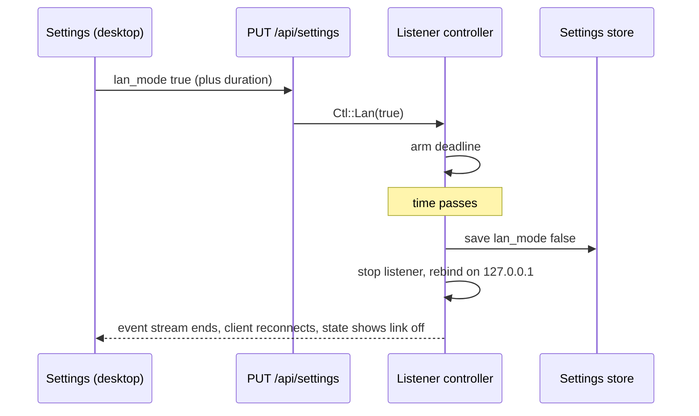

# Phone link auto-off timer

*   **Author:** Hugh Kaznowski
*   **Status:** Initial draft, unreviewed
*   **Date:** 2026-11-22
*   **Ticket:** [ticket 0031](../../../tickets/0031-auto-off-timer.md)
*   **Related decisions:** [ADR 0012](../../adr/0012-one-web-app-for-phone-and-desktop.md), [ADR 0029](../../adr/0029-atomic-design-and-show-dont-tell.md), [ADR 0032](../../adr/0032-settings-phone-link-and-advanced.md). Related ticket: [0022](../../../tickets/0022-encrypted-lan-link.md) (encrypting the link, which would reduce the reason for a timer). Where this document and an ADR disagree, the ADR wins.

--------------------------------------------------------------------------------

## Overview

When the phone link ("LAN mode", setting `lan_mode`) is on, the server binds `0.0.0.0` instead of `127.0.0.1` and accepts any IP-literal Host (`bind_addr` in `app/src/server/mod.rs`, `host_allowed` in `app/src/server/auth.rs`). The traffic is plain HTTP with a bearer token. The card tells the player to "Switch off when you are done" (`LanSettings.tsx`). Nothing switches it off. This ticket adds a time limit after which the server turns it off itself.

## The Problem

*   `lan_mode` is persisted in settings. `app/src/runtime.rs` reads it at start-up and binds accordingly, so a link left on stays on across restarts, indefinitely.
*   The only protection is the player remembering. ADR 0032 uses a one-sentence warning for that and leaves a timer as a ticket.
*   The switch-off path exists already: `PUT /api/settings` with `lan_mode: false` makes `request_lan(false)` send `Ctl::Lan(false)` to the listener controller, which stops the old listener and ends open event streams (`stop_listener`, `listener_generation`). A timer only has to trigger the same thing and keep the persisted setting in step.

## Goals

*   A setting that chooses how long the phone link stays on.
*   A server-side timer (the page may be closed), that turns the link off and persists `lan_mode: false`.
*   The card shows the remaining time as a value, not a paragraph. A story shows it.
*   Loopback only: a phone cannot extend or disable the timer (same rule as `lan_mode`, `touches_loopback_only` in `app/src/server/core.rs`).

## Non-Goals

*   Encrypting the link (ticket 0022).
*   Per-phone sessions or expiry per token.
*   Changing how the token is reset.

## Technical Plan

The timer belongs in the server's listener controller, next to the code that already handles `Ctl::Lan`, because it is the part that owns the listener and survives page reloads.

The deadline is sent to the UI as a server-clock millisecond value, as `confirmDeadline` already is for the Confirm click, so the card can render a countdown against `serverNow` without trusting the browser clock.

## Alternatives Considered

*   **A timer in the web page.** Rejected: it stops when the page closes and a phone could hold the page open; the server must own it.
*   **No setting, one fixed time.** Not rejected on its own; it is one of the options in open question 1.

## Detailed Implementation

*   `app/src/config.rs`: `Settings` gains a field for the auto-off length (a number of minutes, or none). It is `#[serde(default)]` already, so older stored settings load. A test next to `defaults_match_the_plan` pins the default.
*   `app/src/server/core.rs`: `SettingsView` and `SettingsPatch` gain the field (`SettingsPatch` has `deny_unknown_fields`, so the webapp and server change together); `touches_loopback_only` includes it. `AppState` or `SettingsView` gains the deadline (server-clock ms, null when off).
*   `app/src/app/mod.rs`: `settings_view` maps the new fields; `UpdateSettings` validates the value (a bounded set or range).
*   `app/src/server/mod.rs`: the listener controller arms a deadline when `Ctl::Lan(true)` arrives and cancels it on `Ctl::Lan(false)`. On expiry it saves `lan_mode: false` through the core (so the persisted setting and the bound listener agree), then runs the existing stop and rebind path. The deadline must be re-armed on server start if the link is on (`app/src/runtime.rs`), according to open question 2.
*   `app/src/server/routes.rs`: `put_settings` is unchanged except that the existing path starts the timer; the deadline is included in the state snapshots.
*   `webapp/src/api/types.ts`, `webapp/src/api/fixtures.ts`, `webapp/src/api/mockApi.ts`: the new fields; the mock turns `lan_mode` off at the deadline so stories can show it.
*   `webapp/src/components/organisms/LanSettings.tsx`: a duration choice (an existing `Select` atom) beside the switch and a countdown value while on; locked for a phone like the rest of the card. A `Countdown` molecule exists (`webapp/src/components/molecules/Countdown.tsx`) and should be reused if it fits.
*   `webapp/src/components/pages/SettingsPage.tsx`, `webapp/src/App.tsx`: pass the props and the setting change.
*   Stories: `LanSettings.stories.tsx` and `SettingsPage.stories.tsx` for on with time left, on with none (if allowed), and the moment after expiry. Check the card still fits at 1280x720 and 390x844 without a page scroll (ticket [0033](../0033-ui-scroll-edge-cases/design_draft.md)).
*   Tests, `app/src/server/tests.rs`: with a short duration and the test clock or a paused tokio clock, assert that after expiry `lan_mode` is false in the stored settings and a non-loopback request is refused. A test that a non-loopback caller cannot set the duration (403 `loopback_only`).
*   Docs: an ADR when the questions are decided (CLAUDE.md working rules), amending 0032 which lists this as out of scope. The ticket and `tickets/README.md` change by the author at close.

## Test and verification plan

*   Rust tests above, run with `cargo test --lib server::` from `app/`, plus `cargo clippy --all-targets -- -D warnings`.
*   `pnpm --dir webapp typecheck` and `pnpm --dir webapp build-storybook`.
*   Manual, not yet done: with a real phone on the link, confirm the phone shows the not-reachable state after expiry and that the desktop window recovers its event stream after the listener restart. Unverified: how the Tauri window behaves when the listener restarts (the stream ends and the client reconnects by design, but this has not been seen in a real window; see ticket 0035).

## Open questions for the author

1.  **What does the timer measure?**
    *   **A. Fixed time from switch-on** (for example, chosen from a short list when turning it on). Mechanism: one deadline per activation. Trade-off: simple and predictable. Fails when it cuts off a phone mid-use, which then needs a re-pair or a re-enable.
    *   **B. Idle time.** Mechanism: the deadline moves forward on every authenticated non-loopback request, and the link turns off after N minutes without one. Trade-off: never cuts off an active phone. Fails for a phone that stays open in a background tab, because its heartbeats (`HEARTBEAT` is 15 s in `events.rs`) count as activity unless the rule excludes them, and then idle detection depends on what counts as activity.
    *   **C. Chosen each time, with no default.** Mechanism: turning the link on opens a choice (such as 15 minutes, 1 hour, until I switch it off). Trade-off: the player decides each time. Fails by adding a step every time and by making "until I switch it off" available, which keeps the old problem for anyone who picks it.
2.  **What happens to a running timer when the app restarts?**
    *   **A. The link comes back off.** Mechanism: start-up ignores a persisted `lan_mode: true` or rewrites it. Trade-off: the safest default for an unencrypted link. Fails for a player who restarts the app and expects the phone to still work, and it changes today's behaviour.
    *   **B. The deadline is persisted and honoured.** Mechanism: store the absolute deadline, start with the link on until then. Trade-off: restart does not extend the exposure. Fails when the system clock changes or the machine sleeps, so the deadline is wrong in either direction.
    *   **C. The timer restarts in full.** Mechanism: re-arm the full duration at start. Trade-off: no persisted deadline. Fails because repeated restarts extend the exposure without limit.
3.  **Is a timer the default?**
    *   **A. On by default** with a stated length. Trade-off: protects players who never open this setting. Fails for players who leave the phone on a table at home and find the link off each time.
    *   **B. Off by default**, available as a choice. Trade-off: no change in behaviour for anyone. Fails because the protection reaches only players who find the setting, which is the group least likely to leave the link on by accident.
    *   **C. No separate setting**: one fixed length for everyone. Trade-off: fewest controls (fits ADR 0029). Fails when no single length suits both a short session and a long evening.
