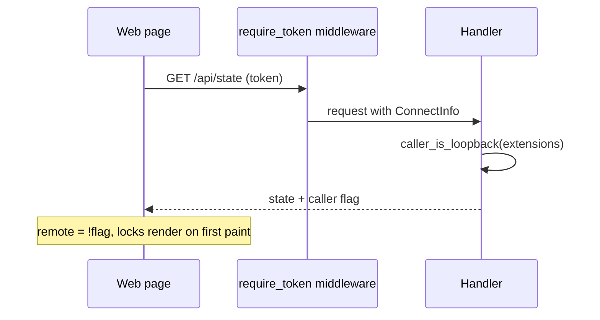

# Replace the hostname guess for the phone read-only flag

*   **Author:** Hugh Kaznowski
*   **Status:** Initial draft, unreviewed
*   **Date:** 2026-11-22
*   **Ticket:** [ticket 0032](../../../tickets/0032-remote-flag-from-server.md)
*   **Related decisions:** [ADR 0012](../../adr/0012-one-web-app-for-phone-and-desktop.md), [ADR 0028](../../adr/0028-the-desktop-app-installs-the-bundled-addon.md), [ADR 0032](../../adr/0032-settings-phone-link-and-advanced.md). Where this document and an ADR disagree, the ADR wins.

--------------------------------------------------------------------------------

## Overview

The web app has a `remote` flag. When true, controls that only the desktop may use show a lock and are disabled (`Locked` molecule, `RemoteBanner`, the `remote` prop through `SettingsPage`, `LanSettings`, `TokenSettings`, `AddonSettings`, `AdvancedSettings`, `PeerSettings`, `HistorySettings`). The server enforces the rule for real: loopback-only routes and loopback-only settings return 403 `loopback_only` to any caller whose socket address is not loopback. The flag only decides what the page shows. This ticket makes the server the source of the flag.

## The Problem

*   Initial value: `useState(!LOOPBACK.has(window.location.hostname))` in `webapp/src/App.tsx`, with `LOOPBACK` equal to `localhost`, `127.0.0.1`, `[::1]` and `::1` (line 12).
*   The page corrects the guess to `true` only after a 403 arrives, in five places in `App.tsx` that call `isLoopbackOnly` (`webapp/src/api/errors.ts`). It never corrects it back to `false`.
*   The two checks use different facts. The page looks at the URL's hostname. The server (`is_loopback_peer` in `app/src/server/auth.rs`) looks at the peer address of the TCP connection, including IPv4-mapped IPv6.
*   Cases where they can disagree (the first two follow from the code, none was observed): the page opened at an IP literal such as `127.0.0.2` (server accepts it, it is loopback, but it is not in `LOOPBACK`, so the page starts locked and stays locked); the page opened at a LAN IP in a browser on the desktop itself (the peer address is the LAN address, so the server treats it as remote, which agrees with the page). Behind a reverse proxy or a port-forward the peer address is the proxy's, so the server's answer would not describe the real person. This app does not support proxies (the `Host` check allows only `localhost` or an IP literal), so that case is out of scope here.
*   Which controls are locked is a second rule that is not written down in one place. ADR 0032 says "Controls only the desktop may change". Today a phone can change only `known_peers_size`; `lan_mode`, `lan_address` and `trusted_peers` (`SettingsPatch::touches_loopback_only`), `DELETE /history`, the addon routes, `/pairing` and `/token/reset` are loopback only. The page encodes that list by locking whole controls, which can drift from the server.

## Goals

*   The server tells the page, per caller, whether this caller may use the desktop-only controls.
*   The page takes its initial `remote` value from that answer, not from the hostname, and keeps the 403 handling as a fallback.
*   The lock icons are right on first paint after the first response, with no 403 round trip.

## Non-Goals

*   Changing which routes are loopback only.
*   Supporting a reverse proxy (it would need a trusted-proxy setting and an ADR).
*   Authenticating who the person is. This is a network location check, not a login.

## Technical Plan

The value depends on the caller, so it cannot be a plain field of the shared application state: `AppState` comes from a `watch` channel that all callers share (`event_body` in `app/src/server/events.rs` serialises the same snapshot to every stream). The caller's loopback status is known in the request handler (`caller_is_loopback(req.extensions())`, already used by `put_settings`).

How the flag travels (extra field, own route, or header) is open question 1.

## Alternatives Considered

*   **Keep the hostname guess and tighten it.** Rejected: it cannot see the peer address, which is the fact the server enforces.
*   **Drop the lock icons and rely on 403s.** Rejected by ADR 0032 (D3): locked controls are the design; a failing click is worse than a visible lock.

## Detailed Implementation

*   `app/src/server/routes.rs`: compute `caller_is_loopback` in `get_state` (and in `get_events`, depending on question 1), which today take only `State`. They need the request extensions, as `put_settings` does.
*   `app/src/server/core.rs` or a new small type in `app/src/server/`: the caller value (its name and whether it is one boolean or a set is open question 2). Not part of `AppState` unless question 1 chooses option B, and then it is added to the snapshot per connection, not in the core.
*   `app/src/server/events.rs`: only for option B, `event_body` takes the caller value and adds it to each state line, so the stream and the first fetch agree.
*   `webapp/src/api/types.ts`: the new field (and a new `Api` method for option A). `webapp/src/api/httpApi.ts`: read it. `webapp/src/api/mockApi.ts`: it already has a `remote` option ("make loopback-only routes answer 403"); the mock reports the flag from that option. `webapp/src/api/fixtures.ts`: fixture value.
*   `webapp/src/App.tsx`: initial `remote` from the response instead of `LOOPBACK`; remove the `LOOPBACK` set; keep the five `isLoopbackOnly` handlers as a fallback, but they can now also set `remote` back to false only if question 1's answer allows updates (it does for option B, which re-sends it on each event).
*   `webapp/src/api/useAppState.tsx`: carry the value if it is part of the state hook.
*   `app/src/server/tests.rs`: next to `loopback_only_routes_refuse_a_remote_caller`, assert that a loopback caller gets the flag as allowed, a non-loopback caller gets it as not allowed, and that the flag always agrees with the 403 result for `PUT /settings {"lan_mode": ...}`. One shared helper should drive both so the two cannot disagree.
*   Stories: `SettingsPage.stories.tsx` and `App.stories.tsx` already have phone variants (`ViewedOnPhone`, `InteractiveOnPhone`); they should set the flag through the mock rather than the hostname.
*   Docs: when decided, an ADR (or an amendment to 0032 stating the flag is server-reported) and `tickets/0032-remote-flag-from-server.md` changes at close, by the author.

## Test and verification plan

*   `cargo test --lib server::` from `app/`, plus clippy. `pnpm --dir webapp typecheck` and `pnpm --dir webapp build-storybook`.
*   Manual, unverified so far: a real phone on the link sees locks on first paint; the desktop window sees none; the desktop opened at the LAN IP in a browser sees locks (the server treats it as remote). Fold it into the real run in ticket 0035.

## Open questions for the author

1.  **How does the server report the flag?**
    *   **A. A new route, such as a "who am I" call.** Mechanism: `GET /api/whoami` returns the caller flag. Trade-off: the shared state stays caller-independent; one extra request on load. Fails if the page needs it to change while open, because it would have to poll or refetch after reconnects.
    *   **B. A per-caller field in the state responses and each stream line.** Mechanism: the handler adds the value to `GET /api/state` and every event line of that connection. Trade-off: always current, no extra request. Fails by making the state object differ per caller, so tests and anything that compares states must account for it; the event body needs the extra argument.
    *   **C. A response header on every API reply.** Mechanism: the middleware adds a header such as a caller marker; the page reads it from any response. Trade-off: no change to JSON types and always current. Fails for the first paint, because the page must have made one call first, and for the streaming reader in `webapp/src/api/eventStream.ts` if it does not expose headers the same way.
2.  **One yes/no value, or a set of permissions?**
    *   **A. One boolean** (the name in the ticket is "may change Advanced"). Mechanism: true for loopback callers. Trade-off: matches today's single `remote` prop everywhere. Fails the day a route is allowed to some remote callers and not others, then the boolean says less than the server enforces.
    *   **B. A list of named capabilities** (change the phone link, install the addon, clear history, edit trusted peers). Mechanism: the server reports each; the page locks each control by its own capability. Trade-off: the page cannot drift from the server's route table. Fails by adding a vocabulary to maintain in two places for rules that today are one rule.
