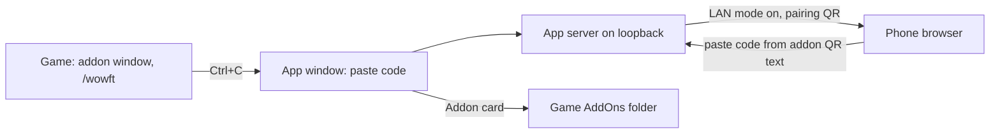

# Running the web app against the real API, in a real window and on a phone

*   **Author:** Hugh Kaznowski
*   **Status:** Initial draft, unreviewed
*   **Date:** 2026-11-22
*   **Ticket:** [ticket 0035](../../../tickets/0035-web-app-only-mock-tested.md), blocked by [ticket 0008](../../../tickets/0008-trusted-peer-builtin-key.md). Related: [ticket 0002](../../../tickets/0002-verify-qr-phone-scan.md), [ticket 0006](../../../tickets/0006-verify-addon-installer-real-install.md), [ticket 0033](../../../tickets/0033-ui-scroll-edge-cases.md).
*   **Related decisions:** [ADR 0012](../../adr/0012-one-web-app-for-phone-and-desktop.md), [ADR 0028](../../adr/0028-the-desktop-app-installs-the-bundled-addon.md), [ADR 0031](../../adr/0031-one-screen-per-state-and-click-to-search.md), [ADR 0032](../../adr/0032-settings-phone-link-and-advanced.md), [ADR 0034](../../adr/0034-system-overview-goals-and-risks.md) (journeys, security requirements), [ADR 0035](../../adr/0035-protocol-constants-engine-contract-and-api.md) (API). Where this document and an ADR disagree, the ADR wins.

--------------------------------------------------------------------------------

## Overview

The web app (`webapp/src`) has run against a mock API (`webapp/src/api/mockApi.ts`, started with `?mock` in the dev server on port 1420) and Storybook, and the Rust server has run against in-process clients in `app/src/server/tests.rs` and `app/src/integration_tests.rs`. The shipped path is different: `app/src/lib.rs` opens a Tauri window (1000 by 720) whose URL is the app's own HTTP server (`window_url`, `http://127.0.0.1:<port>/#token=...`), and a phone reaches the same server over the local network after LAN mode is turned on and the pairing QR is scanned. Nothing has exercised this chain end to end.

This draft is a scripted manual session with pass and fail criteria. It covers the window, the phone and the live-game inputs. It does not cover the network or agreement (tickets 0004, 0005).

## The Problem

*   Tauri, the embedded web files, the token handover and LAN binding have not been run together. Unit tests cannot show a blank window, a CSP problem (`app/tauri.conf.json` sets `csp` to null), a font that fails to load, a page that scrolls in the 1000 by 720 window, or a phone browser that rejects `fetch` streaming for `/api/events`.
*   The pairing flow depends on the OS firewall, the choice of LAN address (`lan_address` setting, `pairing_url` in `app/src/server/pairing.rs`) and the phone's browser. The `remote` flag in the web app is guessed from the hostname (ADR 0032), so locks on loopback-only controls can be wrong until a 403 arrives.
*   The code a live game produces has been captured once (spike S0); the path from the addon window's text box to the app's paste box has not been run in the real app.

## Goals

*   One recorded session with every step below passed, or each failure recorded with its cause.
*   A list of defects found, each turned into a ticket or fixed.

## Non-Goals

*   Finding a party with other peers (needs tickets 0004 and 0005).
*   Automated browser tests. Not decided in an ADR; a possible later ticket.
*   Windows or Linux window behaviour beyond what the author's machine runs. Record the OS.
*   Performance.

## Technical Plan

### Setup

*   A release-profile build of the app (`mise run build`) and a dev run (`mise run dev`), whichever the author picks (open question 2), on the author's machine with the Forever client installed.
*   A phone on the same Wi-Fi network as the computer, with its default browser. Note the phone model and browser.
*   A clean data directory (`--data-dir`) so first-run states appear, then a second run with the same directory to test persistence.
*   A character in game that can produce a code (the addon installed by step 5).
*   Browser devtools are not available in the Tauri window by default; for failures use the same URL in a desktop browser (copy the `window_url` printed to standard error by `start_window` without the token) to read the console.

### Steps (each has a pass criterion)

1.  **Window starts.** Run the app with a clean data directory. Pass: a window titled "Forever Together" opens at about 1000 by 720 and shows the finder page's first state (no character), with fonts (Overpass for text, Lora only for entity names) loaded, and no scrollbar on the main screen (ADR 0029, 0031).
2.  **Embedded files and the override.** Check the page loads with no `WOWFT_WEB_DIR` set. Then set `WOWFT_WEB_DIR` to a folder with an edited `index.html` and restart. Pass: the first shows the real app; the second shows the edited file (ADR 0012). Note: ADR 0012 still names the old variable `P2PRDF_WEB_DIR`; the code and CLAUDE.md use `WOWFT_WEB_DIR`. The ADR text is history; the run uses the code's name.
3.  **Paste a live code.** In game run `/wowft`, click the text box, press Ctrl+C, paste into the app. Pass: the app shows the character as understood (class, level, role, realm and region names, item level), and a code made stale by a level up or a zone change is refreshed by the Refresh button then re-pasted. Also test a bad paste (truncated text): the app shows a plain error and keeps the old character.
4.  **Start and stop a search.** Pick a dungeon, click start. Pass: the search screen appears; with no other peer the diagnosis shows a not-connected or alone state without errors; stop returns to the finder; `GET /api/state` stays consistent with what the page shows (compare the page with the same endpoint fetched with the token).
5.  **Addon card.** Settings, Addon card, install. This repeats the happy path of ticket 0006 and may be done together. Pass: status changes from `not_installed` to `up_to_date`; `/reload` in game loads the addon.
6.  **Settings page at window size.** Open Settings. Pass: the card grid fits 1000 by 720 without scrolling (ADR 0032), and the lock icons on controls a phone cannot change appear only on the phone.
7.  **LAN mode and pairing.** Turn on the Phone link. Pass: the pairing QR sheet opens with Done visible, the QR encodes `http://<lan-ip>:<port>/#token=<token>`; the phone's camera scans it, opens the page, the token is removed from the address bar (ADR 0034 journey 2), and the page shows the finder state. Check the firewall prompt (macOS) and what the app shows if the chosen address is wrong (the `lan_address` setting).
8.  **Phone limits.** On the phone: open Settings; the Advanced controls show locks; try a loopback-only action through the UI (for example Addon install, token reset): expect a refusal, not a change. From the phone browser (or a second device) request an API route without the token: expect 401.
9.  **Phone paste.** On the phone, scan the addon QR from the game window with the camera app (ticket 0002 covers the scan itself), copy the text, paste it into the phone's page. Pass: the character appears on the phone and on the desktop window (one core, two clients).
10. **Events on the phone.** Start a search on the desktop. Pass: the phone's page updates within a few seconds (the `fetch`-streaming `/api/events`, heartbeat every 15 s). Lock the phone and unlock after one minute: the page reconnects or shows a clear reconnect state.
11. **Token reset.** In Settings, "sign out all phones". Pass: the phone's next request fails and the page shows the not-paired state with a way back; pairing again works.
12. **Restart persistence.** Quit and restart with the same data directory. Pass: character, settings (LAN mode off or on as set), and the saved addon folder persist; the token and paired phones behave as ADR 0012 says.
13. **Quit behaviour.** Close the window. Pass: the process exits (no orphaned server on the port); the data directory lock is released (`key show` then runs without the "another process is using" error).

### What to record

In `docs/spike-s0.md`, a section "Real window and phone session" with the date, OS and version, app build and commit, phone and browser, the pass or fail of each step, and screenshots of failures only (screenshots must show an invented character if any; no real names). The ticket's done-when is one manual run recorded there.

### What changes on each outcome

*   All pass: ticket 0035 closes; CLAUDE.md's "Current state" line "No real window, phone, or live game has been tried" is updated by the author in a separate change (this draft edits no files outside its folder).
*   A step fails: a ticket per defect (the repository's ticket numbering applies), referencing the step; if the cause is an ADR assumption (for example the token handover or `fetch` streaming), an ADR amendment is needed.

## Alternatives Considered

*   **Rely on the existing in-process tests.** They cannot show window, firewall or browser problems.
*   **Automated end-to-end tests with a browser driver.** Not decided; a driver can cover desktop-browser steps 1 to 6 but not the Tauri window, the firewall prompt or the phone.
*   **Only test the dev server and skip the built bundle.** Rejected by the ticket's wording ("real window") unless the author decides otherwise (open question 2).

## Detailed Implementation

The session creates no files. Files that may change afterwards:

*   `docs/spike-s0.md`: the session record.
*   `webapp/src/**`, `app/src/server/**`: only to fix defects found.
*   `docs/adr/0012-one-web-app-for-phone-and-desktop.md`: an amendment if the token handover or events transport fails on a phone; its text also uses the old variable name (history, not a decision).
*   `README.md`: a short "Phone pairing" note if a firewall step is needed.
*   `tickets/0035-web-app-only-mock-tested.md`: status; new tickets for defects.

## Test and verification plan

*   Before the session: `mise run check` passes (typecheck, lint, test, test-addon) so failures in the session are not already known failures. `pnpm --dir webapp build-storybook` is not required.
*   The session is the test. Use one sheet with the 13 steps and a column for result and notes.
*   After any fix: the targeted tests for the changed side (CLAUDE.md "Only test what you changed") and a repeat of the failed step.

## Open questions for the author

1.  **When is the session run relative to ticket 0008?**
    *   **After 0008 in one session.** Mechanism: everything with a trusted peer present, so the peer count and bootstrap source display are real. Trade-off: one session, the network status is exercised. Fails by delaying the UI checks, which do not need the network (steps 1 to 3, 5 to 8 and 11 to 13 work with no peer).
    *   **Offline session now, a short network session after 0008.** Mechanism: run the steps above with no trusted peer and `WOWFT_NET=memory` or the real network with no peers, then repeat steps 4, 9 and 10 with a peer. Trade-off: finds UI defects early. Fails by splitting the record into two sessions and two dates.
2.  **Which build is tested?**
    *   **The bundled build (`mise run build`).** Mechanism: what players run, with embedded files. Trade-off: realistic. Fails by slower fix cycles.
    *   **The dev run (`mise run dev`).** Mechanism: faster edits. Trade-off: quick feedback. Fails to prove the embedded files and the bundle, which is the part the ticket worries about.
    *   **Both, bundle for the record.** Mechanism: dev run to shake out defects, bundle for the recorded pass. Trade-off: most coverage. Fails on time.
3.  **Which phones and browsers count?**
    *   **The author's phone only.** Mechanism: one device. Trade-off: realistic for the first run. Fails when Safari and Chrome differ (for example in `fetch` streaming or in storing the token in `localStorage`, which `webapp/src/api/token.ts` guards for private windows).
    *   **One iOS and one Android device.** Mechanism: both default browsers. Trade-off: covers the main differences. Fails when a second device is not available.
    *   **One device plus a desktop browser in a mobile emulation.** Mechanism: emulation covers layout only. Trade-off: no second device needed. Fails for pairing, the firewall and streaming, which emulation does not show.
