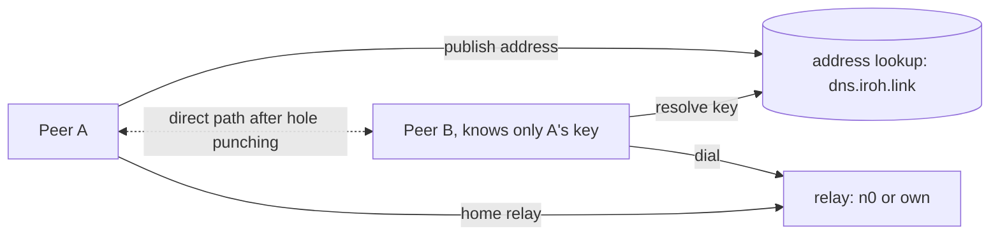

# Decide whether to self-host iroh relay and address lookup

*   **Author:** Hugh Kaznowski
*   **Status:** Initial draft, unreviewed
*   **Date:** 2026-11-22
*   **Ticket:** [ticket 0038](../../../tickets/0038-self-host-iroh-relay.md). Blocked by [ticket 0004](../../../tickets/0004-verify-iroh-live-network.md) (live network verification). Related: [ticket 0010](../../../tickets/0010-trusted-peer-deployment-policy.md).
*   **Related decisions:** [ADR 0034](../../adr/0034-system-overview-goals-and-risks.md) (risks table, "nothing is hosted"), [ADR 0009](../../adr/0009-bootstrap-and-peer-exchange.md), [ADR 0023](../../adr/0023-no-supernodes.md), [ADR 0008](../../adr/0008-iroh-and-local-storage.md). See [docs/spike-s0.md](../../spike-s0.md) rows on address lookup and hosted components. Where this document and an ADR disagree, the ADR wins.

--------------------------------------------------------------------------------

## Overview

The app starts its iroh endpoint with iroh's default `N0` preset (`IrohConfig::Default` in `app/src/net/iroh_net.rs`, chosen by `runtime::build_network`). That preset uses two kinds of hosted service run by n0 (the iroh developers):

1.  **Relays** (`*.relay.n0.iroh.link`, four regions per the spike notes). A relay carries encrypted packets while two peers are connecting and keeps carrying them if a direct path cannot be punched through the NAT.
2.  **Address lookup** (pkarr publishing to `dns.iroh.link`, resolved through DNS under `iroh.link`). A node publishes where it can be reached; another node that knows only its public key looks it up. The built-in trusted peers are listed by public key only (`net::trusted::BUILTIN`), so first contact needs this lookup ([ADR 0009](../../adr/0009-bootstrap-and-peer-exchange.md)).

This is a decision record: whether to keep this dependency, replace it, or add to it. The facts about iroh 1.5.0 come from reading docs and source (spike S0), not from a live run.

## The Problem

*   Both services are run by someone else. If n0 changes terms, rate-limits, moves, or stops them, new installs cannot find the trusted peer and peers behind strict NATs cannot connect.
*   [ADR 0034](../../adr/0034-system-overview-goals-and-risks.md) lists this as a risk with the mitigation "self-host if n0's services go away" and status open.
*   The project also states that nothing is hosted by the author ([ADR 0034](../../adr/0034-system-overview-goals-and-risks.md), [ADR 0023](../../adr/0023-no-supernodes.md): avoid supernodes). A relay or lookup server run by the author is a hosted component, though it matches no player or party. Whether that fits the principle is part of the decision.
*   The code can already take a different setup in one place: `IrohConfig` has `Default` and `Isolated { bind, lookup }` (no relay, in-memory lookup, tests and LAN experiments). There is no variant for custom relay or lookup servers.
*   The behaviour of the N0 services under real use is not known: how long a fresh node takes to become resolvable, what happens when `iroh.link` is unreachable, how often connections stay on a relay instead of going direct. Ticket 0004 is meant to answer this.

## Goals

*   An ADR that records one choice, with the evidence it was based on.
*   If the choice involves running servers: what is run, where the URLs are fixed (compiled in or settings), and how they change without breaking old installs.
*   Keep [ADR 0023](../../adr/0023-no-supernodes.md) intact or amend it explicitly.

## Non-Goals

*   Running the tests of ticket 0004 (that ticket owns the live verification).
*   Choosing a hosting provider or cost.
*   The deployment of trusted peers ([ticket 0010](../../../tickets/0010-trusted-peer-deployment-policy.md)).
*   Replacing iroh.

## Technical Plan

What the endpoint depends on today, and where a different choice would plug in:

Three things decide whether the dependency matters:

1.  **Lookup is probably needed for every dial by key, not only first contact.** `KnownPeers` stores only peer ID, topics and two timestamps per peer (`Record` in `app/src/net/known_peers.rs`), no addresses, and `IrohNet` dials by `EndpointId`. So remembered peers and peers learned by exchange are also resolved through the lookup unless iroh keeps addresses itself (unverified, part of ticket 0004). If so, a lookup outage stops all new dials, not just first contact, and already connected peers are the only ones unaffected.
2.  **A relay is needed for peers whose NAT blocks hole punching** (spike row: without n0's relays such peers cannot connect). It also helps the first seconds of every connection.
3.  **Trusted peers publish to the lookup too.** A self-hosted lookup would be used by every node, so changing it means a release for installs on old builds.

### Evidence needed from ticket 0004 before choosing

*   Time from a fresh trusted node starting to being resolvable from a second network.
*   Share of connections that use the relay and not a direct path, across two home networks and one mobile network.
*   Behaviour with `iroh.link` blocked (firewall rule on the test machine): does a node with remembered peers still join, which would show whether iroh caches addresses? does a fresh install fail cleanly?
*   Whether `RelayMap` and lookup can list more than one service in iroh 1.5.0 (so n0's could remain as a fallback). Stated in the spike as possible for `address_lookup(...)`; not run.
*   Whether n0 publishes any usage terms or rate limits for the hosted services. This is not in the repository and is unverified.

## Alternatives Considered

*   **`RelayMode::Disabled` with direct addresses only.** Rejected as a stand-alone choice: the spike notes say peers behind NATs that block hole punching cannot connect without a relay, and a node's address would have to be listed (`EndpointAddr`) instead of its key, so a changed IP needs a release.
*   **A DHT noticeboard.** Already dropped in the revised bootstrap design (archived concept brief, [ADR 0009](../../adr/0009-bootstrap-and-peer-exchange.md)).
*   **LAN discovery (mDNS) in place of lookup.** Only helps peers on one network; the spike notes that no LAN discovery is enabled and that it would need an added lookup.

## Detailed Implementation

What changes depends on the choice. Files that would be touched by each option, so the decision's cost is visible:

*   `app/src/net/iroh_net.rs`: a new `IrohConfig` variant (or fields on `Default`) carrying relay URL(s) and lookup service(s); the `Endpoint::builder(...)` match at the start of `IrohNet::start` handles it (`RelayMode::Custom`, `address_lookup(...)`, `clear_address_lookup()` per the spike notes). Not needed for option A.
*   `app/src/runtime.rs`: `build_network` passes the config; it currently always passes `IrohConfig::Default`.
*   `app/src/config.rs`: only if the URLs become a setting (an unusual need; see open question 2).
*   `app/src/net/trusted.rs`: the module comment on lookup is updated.
*   `docs/spike-s0.md`: the two rows on lookup and hosted components get the 0004 results and the decision.
*   `docs/adr/NNNN-*.md` (new): the decision; `docs/adr/0034-system-overview-goals-and-risks.md` risk row status; `docs/adr/0023-no-supernodes.md` amended or cited if a hosted relay is chosen.
*   `README.md`: an operations section for the servers if they are run (what, where, how to rebuild, backup of the relay key).
*   Tests: if a new variant is added, a loopback test in `app/src/net/iroh_net.rs` that starts an in-process `iroh-relay` and a lookup and connects two endpoints by key (the existing `Isolated` test shows the shape). Not needed for option A.

## Test and verification plan

*   Ticket 0004 produces the evidence list above, recorded in `docs/spike-s0.md`.
*   If servers are run, a check from a machine outside the author's network that a fresh app instance with a cleared data directory reaches the trusted peer by key within a stated time, with n0's services blocked.
*   The decision ADR names which of these results it relied on.

## Open questions for the author

1.  **Which services does the app depend on?**
    *   **A. Keep the N0 preset.** Mechanism: no code change; document the dependency and watch for failures. Trade-off: no servers to run, no cost, nothing hosted by the author. Fails the day n0's services are unavailable or limited, because every new install and every strict-NAT player is cut off, and a fix needs a release.
    *   **B. Run own relay and lookup only.** Mechanism: a new config variant pointing at servers the author runs (`iroh-relay`, `iroh-dns-server`); n0's services are not used. Trade-off: the author controls availability. Fails if the author's servers go down or are overloaded (the app has no fallback), and it creates the single point of failure that [ADR 0023](../../adr/0023-no-supernodes.md) tries to avoid; URLs compiled in need a release to change.
    *   **C. Both: own servers added to n0's.** Mechanism: a relay map and lookup list holding both, if iroh 1.5.0 supports several (unverified). Trade-off: either can fail without cutting the network. Fails by doubling the surface to understand and test, and the author still runs servers.
2.  **If servers are run, where are their addresses set?**
    *   **A. Compiled in** (a constant next to `trusted::BUILTIN`). Mechanism: change needs a release. Trade-off: no configuration surface. Fails when the servers move and old builds keep dialing the old address.
    *   **B. A setting with a default** (in `Settings`, loopback-only like `trusted_peers`). Mechanism: players or the author can override without a release. Trade-off: flexible and testable. Fails by letting a player point the app at an unknown server, and by adding a settings field and UI for a rare need.
    *   **C. A name the author controls** (a DNS name for the relay and lookup, resolved by ordinary DNS). Mechanism: the author can move the servers by changing a record. Trade-off: no release for a move. Fails if the domain lapses or is lost, and it adds a hosted dependency of its own (the author's domain).
3.  **When is the decision made?**
    *   **A. After ticket 0004 shows the live behaviour,** as the ticket says. Mechanism: wait. Trade-off: the decision rests on measurements. Fails if 0004 is delayed, leaving a P1 decision open.
    *   **B. Now, accept for v1 and revisit at a stated trigger** (for example: first observed lookup failure, or a stated number of players). Mechanism: an ADR that accepts n0's services with the trigger written in. Trade-off: closes the ticket and unblocks planning. Fails if the choice is made without the evidence the ticket says it needs, and the trigger is noticed too late.
