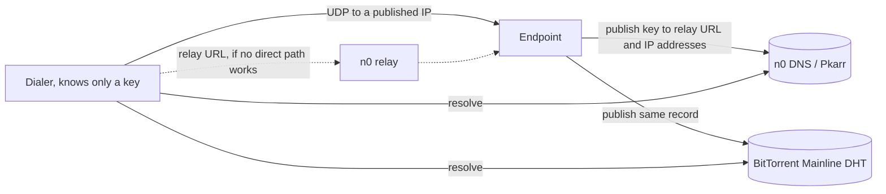

# Address lookup (n0 DNS plus DHT) and a hole-punching relay in headless nodes

*   **Author:** Hugh Kaznowski
*   **Status:** Rewritten 2026-11-23 after the author's decisions below, the last one made after reading the iroh DNS and DHT pages (saved locally by the author). Sections drafted: Overview, Problem, Goals, Non-Goals, open questions. Technical plan, alternatives and implementation not yet drafted. The first version of this file (keep or replace n0's services) and the second (relays built into the product) are in git history.
*   **Date:** 2026-11-23
*   **Ticket:** [ticket 0038](../../../tickets/0038-self-host-iroh-relay.md). Related: [ticket 0004](../../../tickets/0004-verify-iroh-live-network.md), [ticket 0010](../../../tickets/0010-trusted-peer-deployment-policy.md), [ticket 0021](../../../tickets/0021-topic-sharding.md).
*   **Related decisions:** [ADR 0008](../../adr/0008-iroh-and-local-storage.md), [ADR 0009](../../adr/0009-bootstrap-and-peer-exchange.md), [ADR 0023](../../adr/0023-no-supernodes.md), [ADR 0034](../../adr/0034-system-overview-goals-and-risks.md), [ADR 0040](../../adr/0040-membership-topic.md). Where this document and an ADR disagree, the ADR wins.

--------------------------------------------------------------------------------

## Overview

A relay is a server that two peers use to reach each other when they cannot yet, or cannot at all, connect directly. The app uses iroh's default `N0` preset, so it uses n0's public relays and n0's DNS-based address lookup (`IrohConfig::Default` in `app/src/net/iroh_net.rs`, chosen in `runtime::build_network`).

n0's price list (saved by the author as a local file outside the repository) charges for relays only: concurrent connected endpoints, egress and rate limits. The free tier is public, rate limited, and has no uptime guarantee. The price list does not mention address lookup. Direct traffic between peers costs nothing. Our own run (2026-11-23, [spike results](../../spike-s0.md)) saw one TCP 443 connection to n0's EU relay on a machine whose peers could have connected directly, which fits every online endpoint holding a relay connection and counting as a concurrent connection.

**The author's decisions (2026-11-23):**

1.  **The project does not carry traffic between nodes.** Nodes must have direct peer-to-peer UDP connections. No node of ours, trusted or not, forwards other peers' packets.
2.  **n0's relays stay as they are, as a fallback, and the project does no work on relaying.** Peers that cannot connect directly (symmetric NAT, carrier-grade NAT, strict firewalls) solve their own networking problems, for example by forwarding a port. The author does not want to spend effort on carrying TCP or other relayed traffic.
3.  **Anything the project adds is run by a headless node that is explicitly set to do it.** Window installs never serve other peers. The two trusted peers will get IP addresses of their own; trusted1 is `89.40.6.71` for now.
4.  **Address lookup:** the public lookup services are used, and DHT address lookup is added as a fallback. The project runs no lookup or rendezvous server. (Decided after reading the iroh DNS and DHT docs.)
6.  **Hole punching needs a relay in the service that runs under `--headless`.** (Added the same day, answering question 2.) The project's headless nodes, when explicitly set to, run a hole-punching relay. This changes decision 4's first sentence in earlier versions of this draft ("no relay of the project's own") and is in tension with decision 1; see "Hole punching in iroh 1.5.0".
5.  **The author's earlier model of how direct connections would work:** a server captures the remote address of every node that connects to it, and gives that address to whoever asks; the asker then sends UDP to that address directly and gets answers directly.

### Hole punching in iroh 1.5.0

Checked in the `iroh` 1.5.0, `iroh-relay` 1.5.0 and `noq` sources and docs. Not run.

*   **There is no hole-punching-only relay mode.** The `iroh` crate docs say a connection starts through the relay and "usually soon after" migrates to a direct path; if it cannot, it "will keep flowing over the relay server as a fallback". Hole punching in iroh 1.x is done by QUIC NAT traversal (`max_remote_nat_traversal_addresses` in `src/endpoint/quic.rs`, `noq`), whose frames travel inside the QUIC connection, and that connection is first carried by the relay. The relay forwards encrypted packets by endpoint ID only and cannot tell NAT-traversal frames from data (the `iroh-relay` server source has no concept of them).
*   **So a hole-punching relay carries traffic.** The first packets of every connection: the QUIC handshake and the NAT-traversal frames, which is small, and then everything for a peer pair that cannot punch through. Decision 1 (no traffic carried by the project's nodes) cannot hold for such a relay unless the traffic is limited.
*   **What the server can limit.** `iroh_relay::server::Limits.client_rx` is a per-client byte rate and burst (`ClientRateLimit`), and `AccessControl` decides only whether a client may connect. A low rate would let a handshake through and starve sustained traffic. Whether a handshake and the NAT-traversal frames pass inside a chosen limit, and how long the delay is, is not verified.
*   **Clients and the relay map.** `RelayMode::Custom(RelayMap)` takes several relays and the map can be changed while the endpoint runs; a client picks its home relay by latency and publishes it in its record. The project's relay would be added to the map next to n0's. A relay's address and certificate must be known to every client (open question 5).
*   **The relay server is embeddable.** `iroh-relay` 1.5.0 with feature `server` provides `Server`, `ServerConfig`, `RelayConfig` (HTTP or HTTPS; `tls: None` serves plain HTTP) and `QuicConfig` (address discovery). Its TLS options are Let's Encrypt for a name or a supplied certificate; the client can trust a fixed root (`CaTlsConfig`). A node known only by IP address has no name for a certificate.

### What the iroh DNS and DHT pages say

From [DNS address lookup](https://docs.iroh.computer/connecting/dns-address-lookup) and [DHT address lookup](https://docs.iroh.computer/connecting/dht) (the author's saved copies), plus the source of `iroh-mainline-address-lookup` 0.6.1 read from the cargo registry:

*   **DNS (default in the `N0` preset).** An endpoint publishes a signed record mapping its key to its home relay URL, over HTTP to a Pkarr server (`dns.iroh.link` by default); others resolve it by DNS or HTTP. n0's public servers are "free to use", "configured by default", and n0 says it is fine to run production systems on them if performance is acceptable. They rate-limit traffic and have no guaranteed uptime. n0 sells hosted DNS for capacity or SLAs, and `iroh-dns-server` can be self-hosted.
*   **DHT (not default).** The same signed records are stored on the BitTorrent Mainline DHT instead. No hosted server, any endpoint can publish and resolve, lookups are slower than DNS. It is a separate crate, `iroh-mainline-address-lookup`, and can run next to DNS (`Endpoint::builder(presets::N0).address_lookup(DhtAddressLookup::builder())`) or alone from `presets::Minimal`. The page shows version `0.4`; the registry has `0.6.1`, which depends on `iroh` 1.0 or newer, so it should work with the `iroh` 1.5.0 in `app/Cargo.lock`. Not built or run here.
*   **The record holds the home relay URL, not IP addresses, by default.** DNS says the publisher "publishes only the home relay URL, not direct IP addresses" unless an `AddrFilter` is set; `DhtAddressLookup` defaults to `AddrFilter::relay_only()` "to avoid leaking IP addresses". With the defaults, a node that resolves a key learns which relay to contact, and the connection then starts on that relay and is upgraded to a direct path by hole punching. So with default settings, both lookups lead through n0's relays. `AddrFilter::unfiltered()` publishes direct IP addresses as well; those records are public, so anyone who knows a peer ID could read the player's IP address from DNS or the DHT.

### Is n0's address lookup free?

Free to use, by the DNS page: no price, rate-limited, no uptime guarantee, and no published numbers. The price page lists relays and metrics only, so the earlier reading that the price list was silent on lookup was correct, and the DNS page fills the gap. A change in n0's terms would reach every install, because the preset is compiled in; the DHT fallback is what keeps first contact working if it did.

### How that model compares with what `iroh-relay` does

Not stated anywhere I could find. [n0's pricing page](https://www.iroh.computer/pricing) (the local copy the author saved) lists relays and metrics only. [The iroh docs on DNS address lookup](https://docs.iroh.computer/connecting/dns-address-lookup) say the N0 preset publishes to and resolves from the n0-hosted `dns.iroh.link`, and that if more capacity or uptime guarantees are needed one can run `iroh-dns-server` or contact n0 about hosted DNS. No rate limits, capacity or uptime numbers for the public service were found, and no price. So today it is free to use with no published limits and no guarantee. A change of terms would reach every install, because the preset is compiled in. The same docs describe self-hosting: build the endpoint from `presets::Minimal` and configure a pkarr publisher and resolver against your own `iroh-dns-server`. That server needs a public IP and DNS delegation for its zone (from the same docs; not verified here).

### How that model compares with what `iroh-relay` does

Checked against `iroh-relay` 1.5.0 source. Not run.

*   **The first half is what the relay's QUIC endpoint does.** A node opens a QUIC connection to it (ALPN `/iroh-qad/0`) and the server reports the address it saw the connection come from (`send_observed_address_reports` in `src/quic.rs`). A node learns its own public IP address and port, the way STUN works.
*   **The second half is not part of it.** The endpoint does not keep a table of nodes, and nobody can ask it for another node's address. It tells each connecting node its own address, nothing else. The "whoever asks gets the address" part is a lookup or rendezvous service. iroh has one as a separate service: nodes publish their addresses (including addresses found by that QUIC endpoint) to n0's DNS-based lookup, and a node that knows only a key resolves it.
*   **Direct UDP needs more than knowing the address.** Most home routers drop an incoming packet from an address the inside machine has not sent to first. If A sends to B's address and B has not sent to A's, B's router discards it. Both sides must send at about the same time. So whoever tells A about B must also tell B about A, and B must be listening for that message on a channel that is already open. In iroh today that channel is the connection each node keeps to its relay, which is how hole punching is coordinated. A router that picks a different outside port for each destination (a symmetric NAT) and carrier-grade NAT often defeat hole punching, and those peers cannot connect directly at all. Their only route is a relay carrying their traffic, which is where decision 2 (n0 as fallback) applies.

## The Problem

*   **What replaces the relay's coordination role.** With n0's relays kept as a fallback, hole punching keeps working as it does today for most peers: coordination travels over n0's relay connection. The project's own nodes add nothing there, and the dependency on n0's relays and DNS stays for first contact and coordination. If the aim is also to stop depending on n0 for those, the project needs its own introduction service, and the design must say what channel the target node listens on. This is open question 1.
*   **The project has no addresses to hand out.** `KnownPeers` stores peer ID, topics and two timestamps per peer and no addresses (`Record` in `app/src/net/known_peers.rs`), and `net::trusted::BUILTIN` stores keys only. The peer-exchange protocol (`app/src/net/exchange.rs`) exchanges peer IDs, not addresses. Any lookup the project provides has to store and pass on addresses.
*   **A server that learns addresses also learns who connects from where.** A rendezvous server sees every client's IP address and port and which key it belongs to. It cannot read traffic (iroh encrypts end to end), but it is a place where who-is-online-from-where is visible. Anyone can run a headless node, so clients must decide which of them they trust (open question 2).
*   **Certificates.** `iroh-relay`'s QUIC endpoint needs a TLS server configuration (`QuicConfig`; the server refuses to start without one), and the client must accept it. A server known only by an IP address cannot easily get a normal certificate. Whether Let's Encrypt issues one for a bare IP is not verified. The client can be told to trust a specific root or use its own verifier (`CaTlsConfig`).
*   **Relayed traffic is TCP.** The author prefers UDP because a lost TCP segment stalls everything behind it. In `iroh-relay` 1.5.0 the relay data protocol is a variant of Tailscale's DERP over WebSocket, so it is TCP, and the QUIC endpoint carries no data. Decision 1 keeps this out of our own nodes; it still applies to anyone who ends up on an n0 relay, which is outside our control.
*   **Abuse.** Any service that answers "where is X" can be asked about every key. `iroh-relay` has a per-client rate limit and an access-control hook, and the project's own peer exchange already limits requests (one per 10 s per peer).

## Goals

*   Peers connect directly over UDP whenever the network allows it, and no node of ours carries other peers' traffic.
*   Peers that cannot connect directly are not the project's problem to solve. n0's relays stay in the default configuration; the project neither builds relaying nor promises it works.
*   The two trusted peers, once they have their own IP addresses, are reachable at known addresses by new installs.
*   A headless node can be started in a role that serves the project's own address or introduction service, only when it is explicitly set to; window installs cannot.
*   The ADRs say that n0's relays and, if kept, its address lookup are accepted dependencies, with the evidence for it ([ADR 0023](../../adr/0023-no-supernodes.md) amended or cited).

## Non-Goals

*   Replacing iroh, or writing a relay protocol of our own. Decision 1 rules out a UDP relay of ours.
*   Hiding peers' IP addresses from each other or from a rendezvous server.
*   Making peers behind symmetric NATs or carrier-grade NAT connect. They use n0's relays if those work, or fix their own network.
*   Running the live tests of ticket 0004 (they remain the evidence source).

## Technical Plan

**Decided 2026-11-23:** records are published with direct IP addresses as well as the relay URL (open question 1, answered by the author: public addresses may be read from DNS and the DHT, allowing direct dialing).

What the endpoint looks like after the change, in `IrohNet::start` (`app/src/net/iroh_net.rs`), `IrohConfig::Default` branch:

*   Today the branch is `Endpoint::builder(presets::N0)`. That preset publishes a record with `AddrFilter` relay-only and resolves through n0's DNS. After the change the branch is built from `presets::Minimal` with `RelayMode::Default` (n0's relays, unchanged), a `PkarrPublisher::n0_dns()` with `.addr_filter(AddrFilter::unfiltered())`, the same `PkarrResolver::n0_dns()` and `DnsAddressLookup::n0_dns()` the preset adds, and a `DhtAddressLookup` (crate `iroh-mainline-address-lookup`) with the same unfiltered setting. Adding the unfiltered publisher on top of `presets::N0` would leave two publishers writing the same key, so the preset is not used. (API names read from `iroh` 1.5.0 `src/endpoint/presets.rs` and `src/address_lookup/pkarr.rs`; not built.)
*   **Who gains.** A direct UDP dial can succeed without a relay when the target has an address that accepts unsolicited packets: the trusted peers once they have their own IP addresses, peers with a public IPv6 address, and peers whose router maps a port (iroh's `portmapper` feature is on by default). A peer behind a router that drops unsolicited packets is still reached through hole punching, which needs the relay to coordinate. Publishing its IPs does not change that.
*   **What the project builds.** Only the endpoint configuration above, a dependency, and tests. No server, no new protocol, no new message.
*   **IPs become public.** Anyone who knows a peer's key can read its IP addresses from DNS or the DHT. Peer IDs travel in gossip to every swarm member (ADR 0016, ADR 0040), so any player can find the IP addresses of the peers in the swarms they join. This must be written down as a risk in [ADR 0034](../../adr/0034-system-overview-goals-and-risks.md) and a line added for players.

## Open questions for the author

Question 1 is answered above. Question 2 (DNS and DHT together) was asked and the author's reply was about hole punching (decision 6), so it is still open. Options below; none is ranked.

2.  **How DNS and DHT run together.**
    *   **A. Both on every node, every dial.** Mechanism: both lookups are added to every endpoint; iroh resolves with whichever answers (whether it queries them at once or in turn is not verified). Trade-off: one code path, no condition to test. Fails when DHT lookups are slow and iroh waits for them before using DNS's answer, which would slow first contact for everyone (to be measured).
    *   **B. DHT only for dials DNS cannot resolve.** Mechanism: the endpoint is built with DNS only; the app adds DHT as a second attempt when a dial by key fails. Trade-off: normal dials are exactly as fast as now. Fails by needing application code around dials (the app currently dials in `IrohNet::dial_peer` and the gossip join path), and a node whose record exists only on the DHT is invisible to the gossip join, which never goes through `dial_peer`.
    *   **C. Both on headless nodes only; window installs use DNS only.** Mechanism: a setting or mode switches the DHT on for `--headless`. Trade-off: window installs avoid the DHT dependency's UDP traffic, and the trusted peers are on the DHT. Fails when n0's DNS is down: window installs cannot resolve anything, and the trusted peers are still unreachable by key for them.
3.  **First contact with the trusted peers.**
    *   **A. By key only, through the lookup** (as today). Mechanism: `BUILTIN` stays 32-byte keys. Trade-off: no change to the data. Fails when both lookups are down; a new install has nothing to dial.
    *   **B. By IP address and key** (`89.40.6.71` for trusted1; trusted2's when it exists). Mechanism: `BUILTIN` entries gain an optional socket address; the first dial uses `EndpointAddr` with that IP, then the lookup if it fails. Trade-off: first contact works with the lookup down. Fails when the IP changes: old builds hold the old IP until a release, and the lookup by key is then the only route.
    *   **C. By address through a name the author controls** (a DNS name resolving to the trusted peer's address). Mechanism: `BUILTIN` holds a hostname. Trade-off: moving the server needs no release. Fails if the name lapses, and it adds the author's domain as a dependency.
4.  **Where the DHT dependency ships.**
    *   **A. In every build.** Mechanism: the crate is a normal dependency. Trade-off: simplest. Fails if the DHT client's background UDP traffic and dependency tree are unwelcome on players' machines (not measured).
    *   **B. Behind a Cargo feature, on in the release builds the author chooses.** Mechanism: `dht` feature gates the crate and the builder call. Trade-off: the author controls what ships. Fails by adding a build matrix: a build without the feature has no DHT fallback.
    *   **C. Only the headless build.** Mechanism: the crate is linked into the same binary but started only for `--headless`; equivalent to 2C in effect. Trade-off: same as 2C. Fails the same way.
5.  **How the project's hole-punching relay is limited.** *Answered 2026-11-23: option A, a low per-client rate limit.* It carries the first packets of every connection and, for peers that cannot punch through, all their traffic.
    *   **A. The iroh relay server with a low per-client rate limit** (`Limits.client_rx`). Mechanism: embedded `iroh-relay` under `--headless` with a flag, rate set so a handshake passes and sustained traffic does not. Trade-off: no fork, small code; decision 1 holds in effect (the relay cannot carry bulk traffic). Fails if the rate that lets NAT traversal finish also lets enough traffic through to be used as a relay, or if the rate starves the handshake and punching fails (not measured).
    *   **B. The iroh relay server with generous limits.** Mechanism: same server, limits sized for real traffic. Trade-off: peers that cannot punch through work. Fails against decision 1: the headless node carries player traffic, its operator pays the bandwidth, and every node sees who talks to whom.
    *   **C. A patched `iroh-relay` that drops a connection's packets after a fixed byte count.** Mechanism: a forked or vendored copy of the server's forwarding path. Trade-off: exact enforcement of "handshake only". Fails by maintaining a fork of a library the project otherwise takes unmodified, and by the byte count being a guess at what NAT traversal needs.
6.  **How clients learn and trust the project's relay.** *Answered 2026-11-23: option C, plain HTTP, no TLS.* The `iroh-relay` client maps an `http` relay URL to a plain `ws` connection (`src/client.rs`, read, not run), so no certificate is needed. The relay URL is an `http://` address with an IP and port, held beside the trusted key; the relay's `RelayConfig.tls` is `None`. Consequences to record: the relay connection is unencrypted at the HTTP and WebSocket layer, so an observer on the path to the relay sees which endpoint IDs connect to it; the QUIC payload between peers stays end-to-end encrypted.
    *   **A. A relay URL beside each key in `BUILTIN`, with the relay's certificate or root compiled in.** Mechanism: a URL with an IP address (`https://89.40.6.71`), `CaTlsConfig` trusting the compiled-in root. Trade-off: no domain needed. Fails if the certificate expires or the IP changes: old builds keep the old values until a release.
    *   **B. A relay URL on a name the author controls with an ordinary certificate.** Mechanism: a DNS name for the relay and Let's Encrypt. Trade-off: moves and renewals need no release. Fails if the name lapses.
    *   **C. Plain HTTP relay URL, no TLS** (`RelayConfig.tls = None`). Mechanism: nothing to certify. Trade-off: simplest. Fails if the `iroh` client does not accept an `http` relay URL in production (not verified), and traffic to the relay is then unencrypted at the HTTP layer (the QUIC payload is still end-to-end encrypted).
