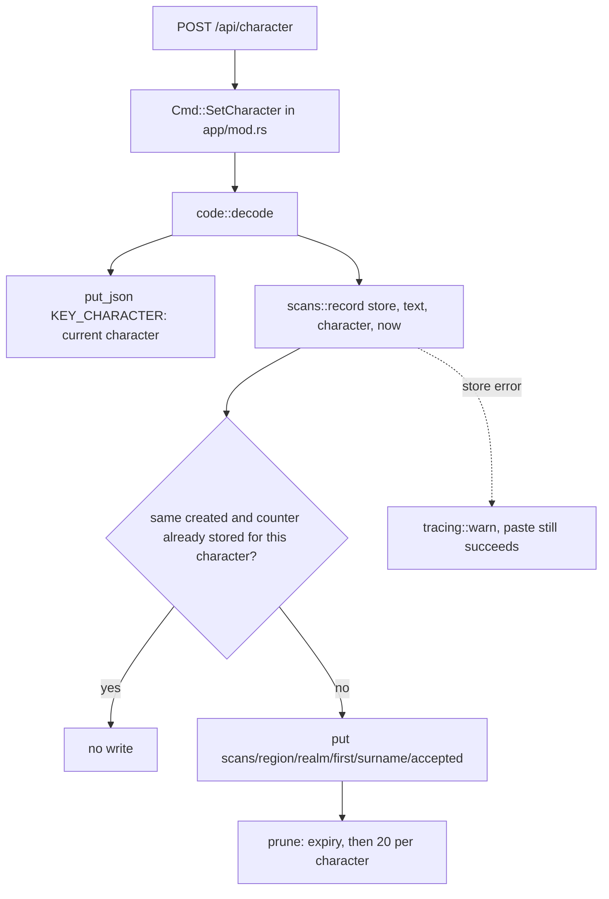

# Scan log: the `scans` store module

*   **Author:** Hugh Kaznowski
*   **Status:** Initial draft, unreviewed
*   **Date:** 2026-11-22
*   **Ticket:** [ticket 0039](../../../tickets/0039-scan-log-store.md). Later tickets that build on it: [0040](../../../tickets/0040-scan-log-export-api.md) (export API), [0041](../../../tickets/0041-scan-log-ui.md) (Settings card).
*   **Related decisions:** [ADR 0038](../../adr/0038-scan-log-and-opt-in-export.md), [ADR 0027](../../adr/0027-search-history.md), [ADR 0008](../../adr/0008-iroh-and-local-storage.md), [ADR 0039](../../adr/0039-key-management.md), [ADR 0013](../../adr/0013-single-rust-crate.md). Where this document and an ADR disagree, the ADR wins.

--------------------------------------------------------------------------------

## Overview

When a player pastes a character code and the app accepts it, ADR 0038 says the raw `WFT1:` text is appended to a local log with the time it was accepted. The log lets the author later learn real region and realm values (and how one character's code changes) from players in other regions. This ticket builds only the store side: a new pure module `app/src/scans.rs` over the key-value store, plus the one call that feeds it. Export, API and UI are tickets 0040 and 0041.

The closest existing code is `app/src/history.rs` (ADR 0027): one key per entry, a schema version, corrupt entries skipped and left in place, pruning on append, a failed write logged and never fatal. The new module copies that shape.

## The Problem

*   Nothing records the codes the app accepts. `Cmd::SetCharacter` in `app/src/app/mod.rs` decodes the text, stores the current character under `character` (`KEY_CHARACTER`) and drops the text. The previous character is overwritten.
*   Without a bound, a log of every paste would grow with each session. ADR 0038 sets the bounds (20 entries per character, 90 days) but nothing implements them.
*   Characters are identified by region, realm, first name and surname, and any of those strings can contain bytes that are unsafe in a path-like key (the realm fallback is a lowercased `GetRealmName()`, [rdf-code-spec.md](../../rdf-code-spec.md) "Realm and region"; names are arbitrary UTF-8 up to 24 bytes).

## Goals

*   Append one entry per accepted paste: raw code text plus accepted time (UTC seconds), under the key layout of ADR 0038.
*   Do not store an identical code twice (same `created_minutes` and `counter`, the two fields of `code::Character` that identify one scan).
*   Keep at most 20 entries per character, dropping the oldest on the 21st.
*   Drop entries 90 days after they were accepted. Prune on every write and before every export.
*   Skip entries that fail to decode or have another schema version; never block a paste on a failed write.
*   Read functions the export route (0040) and the Settings card (0041) need: the grouped log, counts, and clear.
*   Unit tests with invented characters only ("Testa Fakename", zone "Testville").

## Non-Goals

*   Export, encryption, routes, UI (tickets 0040, 0044, 0041).
*   Decoding stored codes into a second record format. The code stays the source of truth ([ADR 0018](../../adr/0018-code-format.md)); the module decodes with `code::decode` when it needs fields.
*   Putting faction in the character identity (ADR 0038 default: not part of it).
*   Search history. It stays separate and is never part of the log.
*   Replacing `dyn Store` across the code base ([ticket 0045](../../../tickets/0045-replace-dyn-store-with-generics.md)).

## Technical Plan

**Key layout** (ADR 0038): `scans/<region>/<realm>/<first name>/<surname>/<accepted UTC seconds, zero-padded>`. A new constant `PREFIX_SCANS = "scans/"` goes next to `PREFIX_HISTORY` in `app/src/store/mod.rs`. Each of the four character segments is percent-encoded for `/` and `%` so a name cannot add or hide a path level. The time segment is padded to 12 digits like `history/`, so a prefix listing returns one character's entries oldest first.

**Entry value:** JSON with `schema_version` (1), `accepted_utc` and `code` (the raw text, trimmed as `code::decode` trims it). The accepted time is also in the key. The value repeats it so an entry stays readable without parsing its key.

**Record**, in order: list the character's prefix; skip if any readable entry decodes to the same `created_minutes` and `counter`; write the new key (if that key already exists, because two different codes arrived in the same second, use the next free second); then prune.

**Prune**, in this order, each delete standing alone so a crash half way is harmless (the rule `history::prune` uses): entries whose accepted time is more than 90 days before `now`, then, per character, entries beyond the newest 20. A corrupt entry or one with another schema version is neither read nor counted by readers, and is left in place (as `history::load` does, so a newer build can read it). It still occupies a key, so the cap counts keys; expiry removes it by the time in its key, so it cannot live forever.

**Reads:** `load(store, now)` returns characters with their entries, oldest first within a character, after pruning; `summary(store, now)` returns number of characters and scans; `clear(store)` deletes every key under `scans/`.

**Time:** passed in by the caller (UTC seconds), as in `history`. `app/src/app/mod.rs` already has a clock for history.

**Where it is called:** inside `Cmd::SetCharacter`, after the current character was stored and only on success of the decode. A failure inside `scans::record` is logged and the paste still succeeds. `ClearCharacter` does not touch the log (ADR 0038); `clear_history` does not either.

## Alternatives Considered

*   **One key per character holding a list.** Rejected: ADR 0038 fixes one key per entry, and a rewrite of the whole list on each paste would also have to read it first.
*   **Storing decoded fields instead of the raw code.** Rejected: ADR 0038 says the code is the source of truth, and a later decoder fix would then apply to old entries.
*   **Hashing the character into the key.** Rejected: it would make a key unreadable when debugging and gains nothing over percent-encoding. (ADR 0038 names the key layout with the names in it.)

## Detailed Implementation

*   `app/src/scans.rs` (new): `Entry` (serde, `schema_version`, `accepted_utc`, `code`), constants `SCHEMA_VERSION`, `MAX_PER_CHARACTER = 20`, `MAX_AGE_SECS = 90 * 86400`; functions `record`, `load`, `summary`, `prune`, `clear`, and a private key builder and parser. Generic over the store (`S: Store + ?Sized`, as `keys.rs` does), no `dyn`, because ADR 0039 requires new code to avoid it. Unit tests in the same file.
*   `app/src/lib.rs`: add `pub mod scans;` (the module list in [ADR 0013](../../adr/0013-single-rust-crate.md) is amended by ADR 0038).
*   `app/src/store/mod.rs`: add `PREFIX_SCANS` and update the key-layout comment at the top of the file (it lists `identity/secret`, `known_peers/`, `settings`, `api/token`, `character`).
*   `app/src/app/mod.rs`: in `Cmd::SetCharacter`, call `scans::record` after `put_json(... KEY_CHARACTER ...)` succeeds; log a warning on error. The handler holds `m.store`, an `Arc<dyn Store>`, which coerces to the generic parameter with `.as_ref()` as `history::record_facts` calls do.
*   `app/src/app/tests.rs` (or a new `scans` test block): one test that a paste through the core adds an entry and a failed decode adds none.
*   Docs in the same change: README (one line under the layout or storage section if one exists), and a note in ADR 0038's Consequences only if the build differs from the ADR. No other doc changes.

## Test and verification plan

Unit tests in `scans.rs`, all on `MemStore` with an invented character ("Testa Fakename", realm `15`, zone "Testville") and a fake clock:

1.  Append stores one key under the expected prefix with the right value.
2.  A second append of the same code (same `created_minutes` and `counter`) stores nothing; a code with a higher `counter` stores a new entry.
3.  The 21st entry for one character removes the oldest; a second character is unaffected.
4.  An entry 90 days and one second old is removed on the next write; one exactly 90 days old stays (the boundary is decided in the code and tested both sides).
5.  A corrupt value and a value with `schema_version` 2 are skipped by `load` and left in place; a scan is still recorded beside them.
6.  A store whose `put` always fails: `record` returns an error value and does not panic; the core test confirms the paste still returns the character view.
7.  Names containing `/` and `%` stay inside their segment (two characters that would collide without encoding stay separate).
8.  `clear` removes only `scans/` keys.

Run `cargo test --lib scans::` and `cargo test --lib app::`, then `cargo clippy --all-targets -- -D warnings` and `cargo fmt` (touched side only, per CLAUDE.md).

## Open questions for the author

1.  **Is anything bounding the number of characters?** ADR 0038 says the 20-entry cap bounds a character, not the number of characters, and leaves a size cap open. Entries are about 70 characters of text each, so the practical risk is small, but it is unbounded in principle.
    *   **A. No further bound.** Mechanism: the 90-day expiry is the only limit. Trade-off: nothing to build or explain. Fails if a player pastes codes for very many characters (or a script posts to the API) so that the log, and later the export, grows large.
    *   **B. A cap on total entries** (for example drop the oldest entry overall past N). Mechanism: after the per-character prune, count all keys and delete the oldest beyond N, as `history::prune` does with its 500 total. Trade-off: bounds disk and export size; one busy character cannot be protected from eviction by others. Fails if N is smaller than what a player legitimately has, so valid samples are dropped before export.
    *   **C. A cap on the number of characters** (drop the least recently scanned character whole). Mechanism: group by prefix, order by newest entry, delete whole groups beyond M. Trade-off: keeps each kept character's sequence intact, which is the point of the log. Fails the same way if M is too small, and deleting a whole character may surprise the player.
