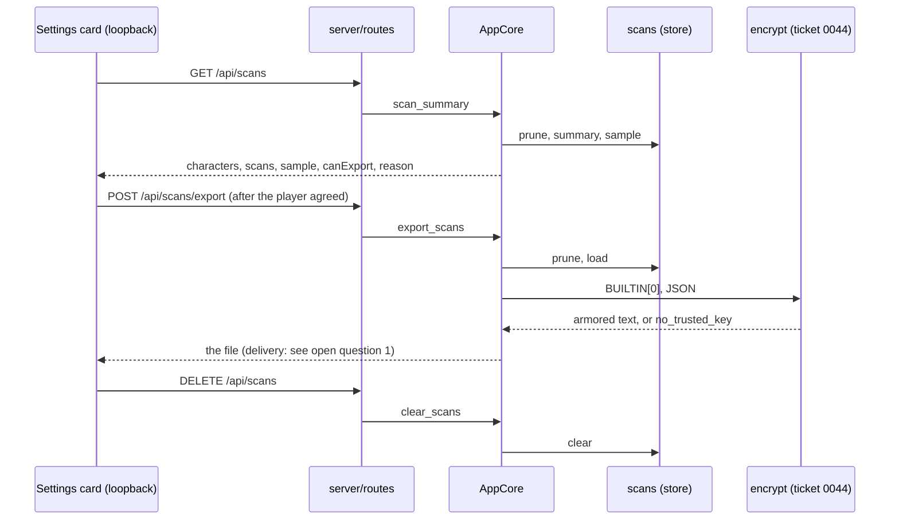

# Scan log: export and clear API

*   **Author:** Hugh Kaznowski
*   **Status:** Initial draft, unreviewed
*   **Date:** 2026-11-22
*   **Ticket:** [ticket 0040](../../../tickets/0040-scan-log-export-api.md). Blocked by [0039](../../../tickets/0039-scan-log-store.md) (store) and [0044](../../../tickets/0044-encrypted-scan-export.md) (encryption). Feeds [0041](../../../tickets/0041-scan-log-ui.md).
*   **Related decisions:** [ADR 0038](../../adr/0038-scan-log-and-opt-in-export.md), [ADR 0039](../../adr/0039-key-management.md), [ADR 0035](../../adr/0035-protocol-constants-engine-contract-and-api.md), [ADR 0027](../../adr/0027-search-history.md), [ADR 0034](../../adr/0034-system-overview-goals-and-risks.md) (security: loopback-only list). Where this document and an ADR disagree, the ADR wins.

--------------------------------------------------------------------------------

## Overview

The scan log (ticket 0039) lives in the store. ADR 0038 says export is a desktop-only action that produces one file, encrypted to `net::trusted::BUILTIN[0]`, and that the player sees what will be sent before it is encrypted because the player cannot read the file afterwards. This ticket adds the HTTP routes. They are loopback only, like `DELETE /api/history` ([ADR 0027](../../adr/0027-search-history.md)), the addon routes and pairing, and they sit behind the same token, Host and Origin checks as the other `/api` routes.

## The Problem

*   No route reads the log, builds the export or clears it.
*   The encryption function (ticket 0044) does not exist yet and its interface is only a draft in [docs/egm/0043-key-management/design_draft.md](../0043-key-management/design_draft.md) (Part 2): `BUILTIN[0]` bytes plus the JSON in, `age` armor out, unavailable if `BUILTIN` is empty. `BUILTIN` is empty today (`app/src/net/trusted.rs`, [ticket 0008](../../../tickets/0008-trusted-peer-builtin-key.md)), so every export request must be able to answer "no key yet".
*   The preview ADR 0038 requires has to come from somewhere other than the encrypted file.
*   The app's window is a Tauri webview. Whether it saves a file from a normal browser-style download is not verified in this repository.

## Goals

*   A route that returns what an export would contain, in counts plus one sample, and whether export is possible now (no key means not possible, with the reason).
*   A route that returns the encrypted file.
*   A route that clears the log.
*   All three loopback only; a phone gets 403 `loopback_only`.
*   The export contains the JSON of ADR 0038 (app version, spec version, export time, characters with raw code and accepted time) and never search history.
*   `ClearCharacter` does not clear the log (ADR 0038).

## Non-Goals

*   The encryption itself, the dependency check for `age` and the file name rule (ticket 0044, ADR 0038 amendment).
*   The UI (ticket 0041).
*   A plain (unencrypted) export. ADR 0038: encrypted only.
*   A decrypt route. The app cannot read its own export (ADR 0039).
*   A size cap for the file. ADR 0038 leaves it open; see the open questions.

## Technical Plan



**Routes** (new rows for the table in ADR 0035). The paths are my choice, mechanical:

| Route | Behaviour |
|---|---|
| `GET /api/scans` | Prunes, then returns `{characters, scans, sample, canExport, reason}`. `sample` is one entry (a character's decoded display fields and its accepted time), enough for the player to recognise what is in the file. `canExport` is false with `reason` `no_trusted_key` while `BUILTIN` is empty or the log is empty. |
| `POST /api/scans/export` | Prunes, builds the JSON, encrypts, returns the file. 409 `no_trusted_key` when `BUILTIN` is empty; 409 `empty_log` when there is nothing to export. POST because it is a request for an action the player confirmed, not a link to follow. |
| `DELETE /api/scans` | Clears the whole log, 204. |

Each route has the loopback layer (`require_loopback`, as `DELETE /api/history` has).

**Export JSON** (a schema, the field names are mechanical):

```
{ "app_version": <CARGO_PKG_VERSION>, "spec_version": <code format version>,
  "exported_utc": <seconds>,
  "characters": [ { "region": n, "realm": "...", "first_name": "...", "surname": "...",
                    "entries": [ { "accepted_utc": n, "code": "WFT1:..." } ] } ] }
```

`app_version` has no existing constant in `app/src` (no use of `CARGO_PKG_VERSION` was found), so it is read from the build. The code format has a version byte (always `1` today, checked by `code::decode_record`) but no named constant; the export needs one (`code::VERSION`) so the file does not hard-code a number. The JSON never includes search history: it is built only from `scans::load`, and a test asserts no `history/` key reaches it.

**Where the work runs.** Like `clear_history`, the three actions go through new `AppCore` methods so the task that owns the store does them. Encryption and pruning are quick and need no blocking pool.

## Alternatives Considered

*   **One route that previews and exports together.** Rejected: the player must see the preview before anything is encrypted (ADR 0038), and the UI needs the counts when the card first renders, without exporting.
*   **A `GET` for the export.** Rejected: a GET with a body that depends on the time and prunes the store is a side effect behind a link. A cross-origin page could trigger it, although Origin checks and the token already block that; the POST keeps it consistent with the other action routes.
*   **Passing the JSON from the browser to the server to encrypt.** Rejected: the server already holds the log, and trusting browser input for the file contents adds a route that encrypts arbitrary data to the project key.

## Detailed Implementation

*   `app/src/server/core.rs`: add to `AppCore`: `scan_summary`, `export_scans` (returns file name and text), `clear_scans`; add the summary view struct (camelCase serde like the other views) and the `CoreError` codes `no_trusted_key` and `empty_log` (409, via `CoreError::conflict` which exists).
*   `app/src/server/routes.rs`: three handlers and the routes in `build_router`, each with `route_layer(from_fn(require_loopback))` as the history route has; import `require_loopback` is already there.
*   `app/src/app/mod.rs`: new `Cmd` variants and their handling in `handle_cmd` next to `ClearCharacter`; `LiveCore` implements the three methods. `ClearCharacter` stays untouched.
*   `app/src/scans.rs` (ticket 0039): used as is; an `export_json` function (pure, takes `load` output and the clock, returns the JSON text) lives here or in a new `app/src/scan_export.rs` shared with ticket 0044. Where it lives is for ticket 0044's file list to settle; this draft assumes one function `build_export(entries, now, versions) -> String`.
*   `app/src/code.rs`: add `pub const VERSION: u8 = 1` and use it in `decode_record`.
*   `app/src/server/tests.rs`: the fake core used by `harness()` implements the new methods (the test file already records `calls()`).
*   `webapp/src/api/types.ts`, `httpApi.ts`, `mockApi.ts`: ticket 0041 adds the client side; this ticket only fixes the response shape so 0041 can start.
*   `docs/adr/0035-protocol-constants-engine-contract-and-api.md`: the API table gets the three rows in the same change (ADR 0036). `docs/adr/0034-system-overview-goals-and-risks.md` Security line lists loopback-only actions and gains "scan export and clear".

## Test and verification plan

Server tests in `app/src/server/tests.rs`, in the style of `delete_history_is_loopback_only_and_needs_a_token`:

1.  Each of the three routes: 401 without a token; 403 `loopback_only` from a LAN peer address with a token; the fake core receives no call in either case.
2.  From loopback with a token: `GET` returns the summary; `DELETE` returns 204 and records `clear_scans`.
3.  `POST /api/scans/export` with `BUILTIN` empty returns 409 `no_trusted_key`; with an empty log returns 409 `empty_log`.
4.  Core-level test (`app/src/app/tests.rs`) with a test recipient key: paste two invented characters, export, decrypt the output with the matching test identity inside the test, and check the JSON lists exactly those two characters and contains no search-history field even when `history/` has entries.
5.  `ClearCharacter` leaves the log intact; `clear_scans` leaves `history/` and `character` intact.
6.  Export prunes first: an entry 91 days old is absent from the JSON.

Run `cargo test --lib server::` and `cargo test --lib app::`, then clippy and fmt.

## Open questions for the author

1.  **How does the encrypted file reach the player?** The window is a Tauri webview and the file must end up somewhere the player can attach to an issue.
    *   **A. The response is the file** (`Content-Disposition: attachment`, file name `scans-<date>.wowft-scans.age`) and the UI triggers a browser-style download. Mechanism: nothing is written by the server. Trade-off: simplest server; the player chooses the location in the normal way. Fails if the Tauri webview does not save downloads (not verified here), which would show up only on a real desktop run.
    *   **B. The server writes the file to a folder and returns the path.** Mechanism: like the addon flow, where the server uses a folder saved through `PUT /api/addon/folder` (`app/src/server/addon_routes.rs`); here the folder could be the data directory's `exports/` or a typed path. Trade-off: works in any webview; the player has to find the file, and the app now writes files outside the store. Fails if the chosen folder is not writable, or if a typed path is allowed to point anywhere (the loopback restriction and token limit who can ask).
    *   **C. The response is the armored text in JSON** and the UI offers Copy and a download built in the browser from the text. Mechanism: the age armor is plain ASCII, so it can be pasted straight into an issue. Trade-off: no file handling on the server; the text sits in browser memory and the DOM. Fails if the text is too large for a comfortable paste (see question 2), and it still needs a browser-side download for the attach path.
2.  **What happens when the file would exceed what a GitHub issue accepts?** ADR 0038 leaves a size cap undecided; the limits are reported in [ADR 0039](../../adr/0039-key-management.md) (65,536 characters per issue body, an attachment extension allowlist, both unverified). Ticket 0044 owns the file name and extension; this route owns what it does with a large log.
    *   **A. No cap in the route.** Mechanism: export everything that survived pruning. Trade-off: no data is left out. Fails when a log is too big to paste and the extension is not accepted as an attachment, so the player cannot send it.
    *   **B. Refuse with a clear error** when the armored text exceeds N characters, telling the player to clear old scans or export later. Mechanism: size check after encryption. Trade-off: the author never gets a file GitHub cannot take; the player loses the ability to send until they delete. Fails if N is set from a limit that turns out to be wrong.
    *   **C. Trim the oldest entries until it fits, and say so in the response.** Mechanism: drop oldest entries across characters, re-encrypt, report how many were left out. Trade-off: always produces a sendable file. Fails if the trim removes the entries that matter (the rare region, the rare character); the player did not choose what was dropped.
