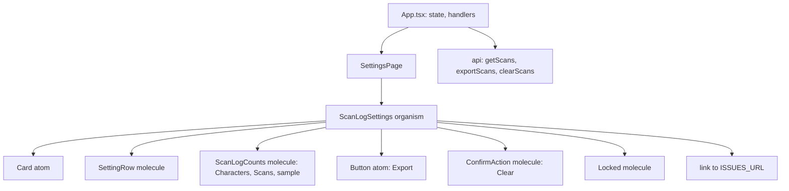
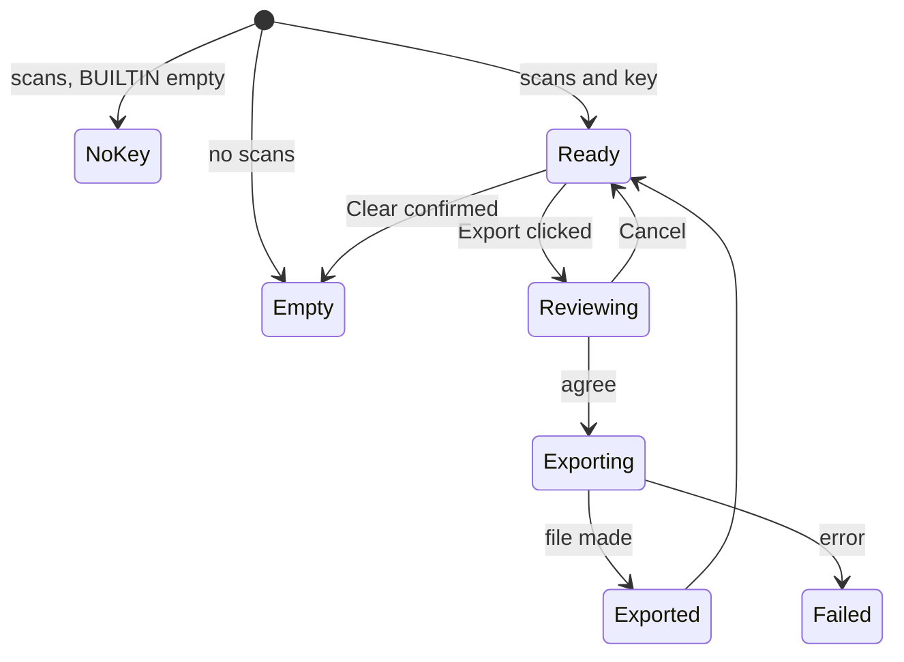

# Scan log: Settings card and export flow

*   **Author:** Hugh Kaznowski
*   **Status:** Initial draft, unreviewed
*   **Date:** 2026-11-22
*   **Ticket:** [ticket 0041](../../../tickets/0041-scan-log-ui.md). Blocked by [0040](../../../tickets/0040-scan-log-export-api.md) (routes). Depends indirectly on [0039](../../../tickets/0039-scan-log-store.md) and [0044](../../../tickets/0044-encrypted-scan-export.md).
*   **Related decisions:** [ADR 0038](../../adr/0038-scan-log-and-opt-in-export.md), [ADR 0029](../../adr/0029-atomic-design-and-show-dont-tell.md), [ADR 0032](../../adr/0032-settings-phone-link-and-advanced.md), [ADR 0030](../../adr/0030-dark-only-theme-and-fonts.md). Where this document and an ADR disagree, the ADR wins.

--------------------------------------------------------------------------------

## Overview

Players who want to help send their scan log as an encrypted file attached to a GitHub issue. The card is where they see how much is logged, review what would be sent, agree, export and optionally clear. It is desktop only: the routes are loopback only (ticket 0040), so a phone sees the card locked.

## The Problem

*   The Settings screen has no scan-log control and no way to learn the log exists.
*   ADR 0038 requires, before encryption: a preview (characters, number of scans, a sample entry), the one-sentence consent line, Export disabled with a reason while `BUILTIN` has no key, a Clear button, and a link to the issue page.
*   The app's UI rule (CLAUDE.md, ADR 0029) is show, don't tell: no paragraphs, one short sentence only where the screen cannot show the fact, and the card must fit 1280x720 and 390x844 without needing a scroll to be understood.
*   Settings already holds the phone link, the addon card and a collapsed Advanced section (`webapp/src/components/pages/SettingsPage.tsx`); history clear lives inside Advanced (`HistorySettings`).

## Goals

*   A card that shows, at a glance, "Characters: n" and "Scans: n" (a short value next to its label), the Export button, the Clear button and the issue link.
*   Export disabled, with a one-line reason, when there is no trusted key or nothing logged.
*   A preview before the file is made: the counts and one sample entry, with character names in the `Entity` atom (Lora) as CLAUDE.md requires for game entities.
*   The consent sentence from ADR 0038: the file contains character names, realms, zones and the times the codes were made.
*   Locked on a phone (`remote`), as the other desktop-only rows are.
*   Stories for empty, some, full, no key, exporting, exported, failed and phone.
*   `pnpm --dir webapp typecheck` and `build-storybook` pass.

## Non-Goals

*   Reading back or decrypting an export (the app cannot, [ADR 0039](../../adr/0039-key-management.md)).
*   Editing or deleting single entries. ADR 0038 offers whole-log clear only.
*   Choosing which characters go into the file (ADR 0038 default: every logged character).
*   Any explanation of what the project does with the samples beyond the consent line.

## Technical Plan

The card follows the existing split: an organism (`ScanLogSettings`) composed of existing atoms and molecules, wired by `SettingsPage` and `App.tsx`, with the API client carrying three calls.

States of the card (a flow, not a screen each):

**On a phone** the summary route answers 403, so the card shows the locked row with disabled buttons and no counts (the other desktop-only rows show their value; here the value is behind the loopback-only route).

**Atomic levels** (ADR 0029): the counts and sample are a molecule (label plus value pairs, one sample row); the card is an organism; `SettingsPage` places it. Nothing is added at atom level; Export uses `Button`, the lock uses `Locked`.

## Alternatives Considered

*   **A paragraph above the buttons explaining the log.** Rejected by the show-don't-tell rule in CLAUDE.md and ADR 0029; the counts and the single consent sentence carry the meaning, and an `InfoTip` on the title can hold a longer hint.
*   **A toggle that sends the file automatically.** Rejected: ADR 0038 says the app never uploads and nothing is hosted ([ADR 0034](../../adr/0034-system-overview-goals-and-risks.md)).
*   **Prefilling the issue body through the link.** Rejected: ADR 0038 says the encrypted file is too large for a link; the app offers the file and the link.

## Detailed Implementation

*   `webapp/src/components/molecules/ScanLogCounts.tsx` and `.stories.tsx` (new): two labelled values and one sample line (`Entity` for the name and zone, Overpass for numbers and time).
*   `webapp/src/components/organisms/ScanLogSettings.tsx` and `.stories.tsx` (new): the card. Props: summary (or null while loading or locked), `remote`, `busy`, `exported` (file name and time), `error`, `onExport`, `onClear`. Stories: Empty, Some, Full (the largest counts the log can reach, to check layout), NoKey, Reviewing, Exporting, Exported, Failed, ViewedOnPhone, Narrow 390 wide.
*   `webapp/src/components/organisms/AdvancedSettings.tsx` or `webapp/src/components/pages/SettingsPage.tsx`: place the card (see open question 1) and pass the props through (`onClearHistory` is the pattern).
*   `webapp/src/components/pages/SettingsPage.stories.tsx`: add the card to the page stories, including the phone variant.
*   `webapp/src/App.tsx`: fetch the summary when Settings opens, handlers for export and clear that call the API and set `remote` on a `loopback_only` error (as `onClearHistory` does with `isLoopbackOnly`).
*   `webapp/src/api/types.ts`, `httpApi.ts`, `mockApi.ts`, `fixtures.ts`: `getScans`, `exportScans`, `clearScans` and the summary type; the mock returns a fixture with invented characters ("Testa Fakename", zone "Testville") and a `no_trusted_key` option.
*   `webapp/src/styles/settings.css`: layout for the card and counts; reuse tokens from `tokens.css`.
*   `webapp/src/lib/links.ts`: `ISSUES_URL` exists. If ticket 0042 adds an issue template, a second constant for the template link is added there.
*   Docs: ADR 0032 (Settings layout) gains a line naming where the card sits.

## Test and verification plan

*   Storybook interaction tests: Export disabled in Empty and NoKey with the reason visible; clicking Export in Ready shows the preview and the consent sentence; Cancel returns; agreeing calls `onExport`; Clear asks once more (`ConfirmAction`); the issue link has `target="_blank"` and `rel="noreferrer"` like `ReportProblemLink`.
*   `pnpm --dir webapp typecheck`, `pnpm --dir webapp build-storybook`, `pnpm --dir webapp build`.
*   Manual: view at 1280x720 and 390x844 (the story viewports), check the card is understood without scrolling and that the phone variant shows the lock. A run in the real desktop app is needed to check the delivery of the file (ticket 0040, open question 1); that part is unverified until then.

## Open questions for the author

1.  **Where does the card sit in Settings?**
    *   **A. A top-level card** beside the phone link and the addon card. Mechanism: `SettingsPage` renders it in `sections`. Trade-off: visible without opening anything, so more players find it. Fails the 1280x720 fit if Settings already scrolls with three cards, and it makes a rarely used control as prominent as the phone link.
    *   **B. Inside the collapsed Advanced card**, next to search history ([ADR 0032](../../adr/0032-settings-phone-link-and-advanced.md) puts history controls there). Mechanism: a row under `HistorySettings`. Trade-off: Settings stays short; the log controls sit with the other privacy controls. Fails if players never open Advanced, so the author gets few exports.
    *   **C. A row in Advanced that opens the card on demand.** Mechanism: Advanced shows only the counts and an "Export" entry, which expands the card. Trade-off: a middle path. Fails by adding a second level of disclosure for one feature.
2.  **How is the preview and consent step presented?** The player cannot read the file afterwards, so the review has to be clear.
    *   **A. Inline two-step, as `ConfirmAction` does.** Mechanism: clicking Export replaces the buttons with the preview, the consent sentence and Agree / Cancel in the same card. Trade-off: no new pattern. Fails if the preview plus consent sentence make the card too tall at 390x844.
    *   **B. A preview that is always on screen** with the consent sentence under the Export button, one click to export. Mechanism: the card always shows counts and a sample. Trade-off: no extra step. Fails the consent intent if players do not read a sentence that is always there (they click through), and the card is taller by default.
    *   **C. A dialog.** Mechanism: a new overlay organism (the only `role="dialog"` in the web app today is the phone-link reveal in `LanSettings.tsx`). Trade-off: room for a bigger preview. Fails by adding an overlay pattern with focus handling for one use, and it must work at phone width even though the card is locked there.
3.  **Can the player stop the logging?** ADR 0038 gives only a Clear button and no switch.
    *   **A. No switch.** Mechanism: as ADR 0038. Trade-off: every accepted code is logged for up to 90 days, with only Clear to undo it. Fails if players dislike a local log of character names they cannot turn off.
    *   **B. A switch, on by default** (a new `scan_log` setting). Mechanism: `scans::record` is skipped when off, stored in `Settings` like `lan_mode`. Trade-off: a visible opt-out. Fails when players turn it off and the samples from other regions never arrive; it also adds a setting to `app/src/config.rs`, the settings API and its tests.
    *   **C. A switch, off by default (opt-in).** Mechanism: as B with the default flipped. Trade-off: the strongest privacy stance. Fails the purpose of the log: codes pasted before a player opts in are never recorded, so first-run samples are lost, and ADR 0038 says every accepted code is logged.
