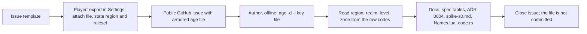

# Collecting region and realm values from players

*   **Author:** Hugh Kaznowski
*   **Status:** Initial draft, unreviewed
*   **Date:** 2026-11-22
*   **Ticket:** [ticket 0042](../../../tickets/0042-collect-region-and-realm-values.md). Blocked by [0041](../../../tickets/0041-scan-log-ui.md) and [0044](../../../tickets/0044-encrypted-scan-export.md); in turn it unblocks [ticket 0001](../../../tickets/0001-verify-live-client-calls.md). Source ticket for the log itself: [0039](../../../tickets/0039-scan-log-store.md), [0040](../../../tickets/0040-scan-log-export-api.md).
*   **Related decisions:** [ADR 0038](../../adr/0038-scan-log-and-opt-in-export.md), [ADR 0004](../../adr/0004-realm-is-a-ruleset.md), [ADR 0039](../../adr/0039-key-management.md), [ADR 0003](../../adr/0003-self-reported-data.md). See also [the code spec](../../rdf-code-spec.md) "Realm and region" and [spike results](../../spike-s0.md). Where this document and an ADR disagree, the ADR wins.

--------------------------------------------------------------------------------

## Overview

The author has one EU client. Verified so far (live capture 2026-11-21): region 3 = EU, realm values 14 = PvP, 15 = PvE, 16 = RP-PvE, 18 = RP-PvP. Everything else is assumed: regions 1 US, 2 KR, 4 TW, 5 CN (`code::region_name` in `app/src/code.rs`, `addon/ForeverTogether/Names.lua`), whether other regions use the same realm numbering, the Hardcore value (the ruleset is not released), and how zone strings look in other languages ([ticket 0018](../../../tickets/0018-zone-matching-localisation.md)).

This is a verification: it ends when the spec's tables mark each value as verified with a date.

## The Problem

*   A code carries a region number and a realm value as opaque data. It does not say "PvP". Mapping `14` to PvP, or `7` to anything, needs the player to say which ruleset they play. An export alone proves a (region, realm value) pair exists and what zone and level the character had; it does not prove the ruleset name.
*   Exports are encrypted to `BUILTIN[0]` (ADR 0038), which is empty until ticket 0008. Until then nothing can be collected safely.
*   The repository has no `.github/` folder, so there is no issue template. The app's report link points at `https://github.com/phughk/forever-together/issues/new` (`ISSUES_URL` in `webapp/src/lib/links.ts`).
*   Players in these regions have to be found; the ticket does not say how.

## Goals

*   An issue template that says what to attach, what to state (region name, ruleset name, client language), and that names are in the file only in encrypted form.
*   A repeatable author procedure to decrypt, read and record the values without committing any export.
*   Each value that arrives is recorded in the spec and ADR 0004 as verified with its date.

## Non-Goals

*   Building any part of the scan log (tickets 0039 to 0041, 0044).
*   Committing exported files or real character names anywhere ([CLAUDE.md](../../../CLAUDE.md): never commit real character data). Facts are recorded, not the files.
*   The Hardcore value until the ruleset exists (ticket 0001 keeps it open).
*   Zone-name matching in other languages (ticket 0018); zone strings seen in exports are noted for it, not solved here.

## Technical Plan

### Setup

1.  Ticket 0008 done: `net::trusted::BUILTIN` holds the author's trusted peer key, and its private key is backed up offline (`key export`, README "Keys").
2.  Tickets 0039 to 0041 and 0044 built, in a release the players can install. Check once with a test export from the author's own EU client: decrypt it with `age -d -i <exported key file>` and confirm it lists the characters.
3.  A machine for decryption that is offline and holds the key file. The private key is the trusted node's identity key ([ADR 0039](../../adr/0039-key-management.md)); it is not put on a shared or cloud machine for this.
4.  The issue template exists (below). The template file is `.github/ISSUE_TEMPLATE/scan-export.md` (new, in the repository root).

### Steps

1.  Publish the issue template. It asks for: the region (US, KR, TW, CN, other), the ruleset as the player sees it in the game (PvP, PvE, RP-PvP, RP-PvE, Hardcore, other), the client language, the app version, and the attached `scans-<date>.wowft-scans.age` file. It states in one sentence that the file is encrypted and only the author can read it, and that the player should not paste names into the issue text.
2.  Ask players in the target regions to export (the call for samples is open question 2).
3.  For each issue: save the attachment, decrypt it offline, and read the raw codes. The app has no decrypt command and no file viewer; to read the fields the author can paste each raw code into a development instance running with `WOWFT_NET=memory` and a throwaway `--data-dir` (the code goes through the same `code::decode`), or use the decoded fields shown in a test. (A small script under `scripts/` would also do; that is a new file and not part of this ticket.) Record only: region number, realm value, the ruleset the player stated, level, flag presence for item level, and the zone string's language.
4.  Cross-check: the region and realm in the code against what the player stated in the issue. A mismatch is not accepted as verified.
5.  Delete the decrypted file and the saved attachment from the working machine when the values are recorded.

### Pass and fail criteria

A value is **verified** when all of these hold (the threshold is open question 1):

*   a code contains it (region number, realm value);
*   the player states the matching name (region, ruleset) in the same issue;
*   the code decodes without error in the current decoder (`code::decode`), and the realm value is a decimal string as the spec expects.

A value **fails** (and the table is not changed) when the realm value is not a decimal string (this would mean the addon's fallback `GetRealmName()` was used, which the spec says is untested), when the region is 0, or when the player's stated ruleset disagrees with the value already verified for another region. A failure is itself a finding: it means "the same ID means the same ruleset in every region" (an assumption in the spec) is false, which needs [ADR 0004](../../adr/0004-realm-is-a-ruleset.md) revised.

### What to record, and what changes

| Outcome | Change |
|---|---|
| A region number is confirmed | `docs/rdf-code-spec.md` region table: status becomes "verified live, <date>"; `code::region_name` and `addon/ForeverTogether/Names.lua` comments updated. The names stay unless the number differs. |
| A region number differs from the assumption | Spec table, both name tables, their tests (`region_and_realm_display_names` in `app/src/code.rs` and `addon/tests/test_names.lua`), and a line in ADR 0004's amendment. Topics hash the raw number, so no topic changes. |
| A realm value is confirmed in another region | Realm table: add "verified in <region>" and the date. |
| A new realm value appears | Spec realm table row, `code::realm_name`, `Names.lua`, vectors if the synthetic vectors should include it, ADR 0004 amendment. |
| The same realm value names a different ruleset in another region | ADR 0004 amended: the display names become per region, in the spec table, `code::realm_name` (which takes no region today), `Names.lua` and their tests. Topics are unaffected: they hash region and realm value together. |
| Zone strings in another language | Note in [ticket 0018](../../../tickets/0018-zone-matching-localisation.md); no change here. |
| All target regions covered | `docs/spike-s0.md` rows updated; [ticket 0001](../../../tickets/0001-verify-live-client-calls.md) closed except the Hardcore value; this ticket closed. |

## Alternatives Considered

*   **Ask players to send plain codes in the issue.** Rejected by ADR 0038 and the encryption amendment: a public issue would show character names and zones.
*   **A telemetry endpoint that receives scans.** Rejected: nothing is hosted ([ADR 0034](../../adr/0034-system-overview-goals-and-risks.md)).
*   **Wait for the addon to be tested by friends in each region.** Not a design, the same collection with no template; it is what the issue template replaces.

## Detailed Implementation

Files created or changed by carrying out the plan (all docs or config, no application code):

*   `.github/ISSUE_TEMPLATE/scan-export.md` (new): the template described above. GitHub shows a template chooser at `/issues/new` once a template exists, so the report link behaviour in `webapp/src/lib/links.ts` (`ISSUES_URL`) changes for every reporter; whether to add a second link with `?template=scan-export.md` is a UI detail in ticket 0041.
*   `docs/rdf-code-spec.md`, "Realm and region": status column and dates, as in the table above.
*   `docs/adr/0004-realm-is-a-ruleset.md`: amendment with the date and the values.
*   `docs/spike-s0.md`: rows for realm and region updated.
*   `app/src/code.rs` and `addon/ForeverTogether/Names.lua`: only if a value differs, with their tests.
*   `tickets/0042-*.md`, `tickets/0001-*.md`, `tickets/README.md`: status updates.

## Test and verification plan

This ticket is the verification. Its own checks: the template renders in GitHub's new-issue form (check once from a browser); one dry run from the author's EU client through the whole chain (export, attach to a private test issue, decrypt, read) before inviting anyone; and at the end a grep of the repository for the exported file names and for any real character name from the files, which must find nothing.

## Open questions for the author

1.  **What counts as verified?**
    *   **A. One export per (region, ruleset) pair, with the player's stated ruleset.** Mechanism: as in the pass criteria. Trade-off: fastest. Fails if one player misreports a ruleset or uses a modified client, so a wrong value is recorded as verified.
    *   **B. Two exports from different players per pair.** Mechanism: two issues, two GitHub accounts, matching values. Trade-off: guards against one error; slower, and some regions may never get two players. Fails to finish for small regions (the ticket stays open indefinitely).
    *   **C. One export plus a screenshot of the realm or ruleset shown in the game.** Mechanism: the template asks for an image of the character-select or login screen with the ruleset label. Trade-off: checks the name against the game itself. Fails on privacy (the image shows names) and on effort for players.
2.  **How are players in these regions reached?** The repository has no community channel documented.
    *   **A. Only the issue template** and the README. Mechanism: wait for players who find the project. Trade-off: no outreach work. Fails if no player in KR, TW or CN installs the app, since those regions are likely the smallest audience.
    *   **B. The author posts a call in the places the game's players use** (forums, Discord servers, subreddits per region). Mechanism: a short message linking the template. Trade-off: direct, reaches the regions. Fails if the community rules forbid it, or if players cannot install a desktop app they do not trust yet.
    *   **C. Ask known contacts to run the app and export.** Mechanism: personal requests. Trade-off: reliable for a few regions. Fails to scale, and covers only regions where the author knows someone.
3.  **What happens to a value that never arrives?** The tables currently say "assumed" for US, KR, TW and CN.
    *   **A. Leave "assumed" and close the ticket after a stated date.** Mechanism: the status stays as it is. Trade-off: no change to the product. Fails if the assumed numbers are wrong and no one notices; display names would be wrong, topics are unaffected because topics hash raw values.
    *   **B. Show raw numbers (`region <n>`) in the app for unverified regions.** Mechanism: change `code::region_name` and `Names.lua` so only verified numbers get names. Trade-off: nothing wrong is displayed. Fails by making the UI less friendly for US players, which is the likeliest region after EU, if it is simply unverified.
    *   **C. Keep the names and add a note in the app for unverified regions.** Mechanism: a flag on the display name. Trade-off: honest and friendly. Fails by adding UI for a cosmetic detail ([ADR 0004](../../adr/0004-realm-is-a-ruleset.md): display names are cosmetic).
