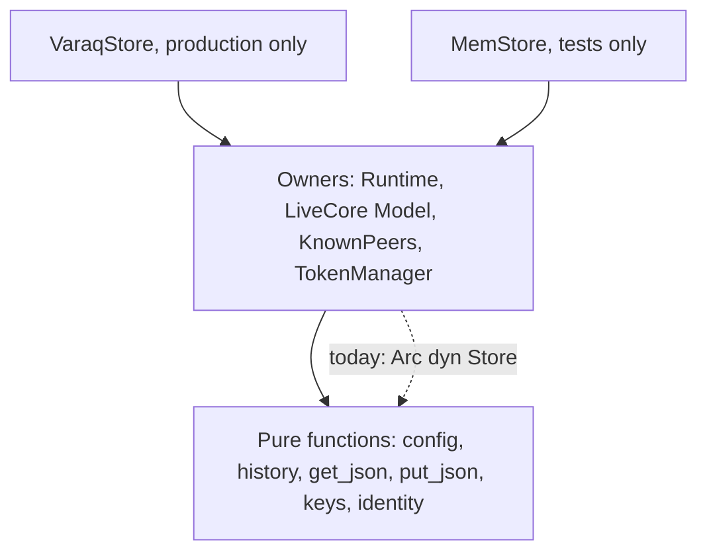

# Replace `dyn Store` with generics or concrete types

*   **Author:** Hugh Kaznowski
*   **Status:** Initial draft, unreviewed
*   **Date:** 2026-11-22
*   **Ticket:** [ticket 0045](../../../tickets/0045-replace-dyn-store-with-generics.md). Origin: [egm 0043-key-management](../0043-key-management/README.md).
*   **Related decisions:** [ADR 0039](../../adr/0039-key-management.md) (its "Style" line: new code uses generics and enums, not `dyn`; existing `dyn Store` use is this ticket), [ADR 0013](../../adr/0013-single-rust-crate.md) (module layout), [ADR 0008](../../adr/0008-iroh-and-local-storage.md). Where this document and an ADR disagree, the ADR wins.

--------------------------------------------------------------------------------

## Overview

A refactor chore. `Store` (`app/src/store/mod.rs`) is a four-method synchronous trait (`get`, `put`, `delete`, `list`) with two implementations: `VaraqStore` (the real one) and `MemStore` (tests). Production code passes it around as `Arc<dyn Store>` and `&dyn Store`. The ticket counted about 31 uses; `grep -rn "dyn Store" app/src` finds 30 at drafting time, 10 of them inside test code (`app/src/app/tests.rs`, `app/src/app/history_tests.rs`, `app/src/server/tests.rs`, one in a test module in `app/src/server/auth.rs`, and the `conformance` helper in `app/src/store/mod.rs`).

## The Problem

*   ADR 0039 set the style for new code and left the old code as a ticket. The two styles now sit side by side: `app/src/keys.rs` and `app/src/identity.rs` take `S: Store + ?Sized`, and the rest takes `dyn`.
*   `?Sized` is a hint that the new code did not fully leave `dyn` behind: it still accepts a `&dyn Store`, which is how the old callers reach it. Removing `dyn` therefore also touches those signatures if the aim is "no `dyn Store` anywhere" (the ticket says "outside tests").
*   In non-test code `MemStore` is never constructed. A search of `app/src` for `MemStore` outside test files, `store/`, `keys.rs` and `identity.rs` finds nothing, and `open_store` in `app/src/runtime.rs` returns `Arc<dyn Store>` built from `VaraqStore::open`. So the only place that holds either store at run time holds a `VaraqStore`. The ticket's mention of an enum for `Runtime.store` therefore deserves a check: an enum is needed only if the real app must pick between the two stores at run time, and nothing does (`WOWFT_NET=memory` picks the network, not the store).
*   The sites are not uniform. Pure functions (`app/src/config.rs`: `Settings::load` and `save`; `app/src/history.rs`: `record`, `record_facts`, `load`, `prune`, `clear`; `app/src/store/mod.rs`: `get_json`, `put_json`) take a borrow. Long-lived owners hold an `Arc`: `Runtime.store` and `NetContext.store` (`app/src/runtime.rs`), `Model.store` and `CoreDeps.store` (`app/src/app/mod.rs`), `KnownPeers.store` (`app/src/net/known_peers.rs`), `TokenManager.store` (`app/src/server/auth.rs`), and the `store` parameter of `Server::start` (`app/src/server/mod.rs`). The two groups need different treatment.

## Goals

*   No `dyn Store` outside tests (the ticket's Done when), with `cargo clippy --all-targets -- -D warnings` and the Rust suite passing.
*   One consistent rule for how a function takes a store.
*   No change in behaviour, and no new crate.

## Non-Goals

*   Changing the `Store` trait or the key layout.
*   Removing `Arc<dyn Assets>`, `Arc<dyn Fn ...>` in `ServerConfig` (`lan_ips`, `addon_candidates`) or other trait objects. Those are test seams for different things.
*   A performance gain. The store calls are disk or map operations; the cost of a virtual call is not the reason (nothing here was measured, and `samply` was not run).

## Technical Plan

**Borrowing functions.** The pure functions in `config.rs`, `history.rs` and `store/mod.rs` become generic over `S: Store + ?Sized`, as `keys.rs` already is, or over `S: Store`. With `?Sized` a call that still holds a `dyn` compiles, so the change can be done file by file. Without it, every caller must hold a concrete type at that moment, which forces the owners to change first.

**Owning types.** The owners are where the choice matters. A generic parameter on an owner spreads to everything that holds the owner. For example `Model` is private to `app/src/app/mod.rs`, but `LiveCore` (`app/src/app/mod.rs`, line 69) holds it, `Running.core` in `runtime.rs` holds `Arc<LiveCore>`, and `Server::start` is already generic over `C: AppCore`. A concrete `VaraqStore` on the production owners has no spread, but then the tests that build a `LiveCore` over `MemStore` (`app/src/app/tests.rs`, `history_tests.rs`, `server/tests.rs`) cannot, unless the owner stays generic and only `Running` fixes the type.

The dotted edge is what exists now. The question below is how the owners keep both inputs without `dyn`.

## Alternatives Considered

*   **Do nothing.** Not rejected: the code works, the trait is dyn-safe, and the ticket is priority P3. It is option C below.
*   **Make `Store` methods generic to avoid `dyn`.** Not applicable: the trait has no generic methods now, and adding them would make it not usable as `dyn` anyway, which is the point only if every site is changed.

## Detailed Implementation

The list is every file with a hit, and what changes depends on the owner decision below. The pure-function files change the same way in every option.

*   `app/src/store/mod.rs`: `get_json` and `put_json` take `S: Store + ?Sized`. The `conformance::check` helper (test code) may keep `dyn`.
*   `app/src/config.rs`: `Settings::load` and `Settings::save`, same change.
*   `app/src/history.rs`: `record`, `record_facts`, `load`, `prune`, `clear`, and the module comment that says "Pure functions over `&dyn Store`".
*   `app/src/identity.rs`, `app/src/keys.rs`: already generic with `?Sized`; only touched if `?Sized` is dropped (question 2).
*   `app/src/net/known_peers.rs`: `KnownPeers` holds `Arc<dyn Store>` in a field and in `new` and `load`. Becomes `KnownPeers<S>` or holds `Arc<VaraqStore>`.
*   `app/src/server/auth.rs`: `TokenManager` holds `Arc<dyn Store>` and `load_or_create` takes one; one test builds `Arc<dyn Store>` with `MemStore`.
*   `app/src/server/mod.rs`: the `store` parameter of `Server::start`; it is passed straight to `TokenManager::load_or_create`.
*   `app/src/app/mod.rs`: `CoreDeps.store` and `Model.store`. `LiveCore` is the type that decides how far a generic spreads.
*   `app/src/runtime.rs`: `Runtime.store`, `NetContext.store`, the return type of `open_store`, and the call sites in `start_window`, `run_headless` and the key runner (the `VaraqStore::open` at line 152 already uses a concrete store).
*   Test files (`app/src/app/tests.rs`, `history_tests.rs`, `server/tests.rs`): helper signatures such as `core_with(store: Arc<dyn Store>)` change in step with the owners.
*   `docs/adr/0013-single-rust-crate.md`: only if module layout changes (the ticket says an ADR is needed in that case). A generic parameter on a type does not move modules, so no ADR is expected unless an enum type is added in a new module (option B).
*   `tickets/0045-replace-dyn-store-with-generics.md`, `tickets/README.md`: status when done.

Because the repository runs only targeted tests for what changes (`CLAUDE.md`), this refactor is cross-cutting and calls for the full suite.

## Test and verification plan

*   Build step by step: change the pure functions first with `?Sized`, run `cargo test --lib config::`, `history::` (cargo takes one filter per run), then clippy.
*   Change each owner in its own commit, run the Rust suite after each, including the multi-instance integration tests (`app/src/integration_tests.rs`, about 16 s each).
*   Final: `grep -rn "dyn Store" app/src` shows only test code; `mise run lint` and `mise run test`.
*   Compile-time check that the real binary does not carry both stores through one type: expected by construction, not tested.
*   Not verified: compile time or binary size before and after (generics are monomorphised once per concrete store, so a second copy of each generic function exists in the test build).

## Open questions for the author

1.  **How owning types hold the store.**
    *   **A. Generic parameter on each owner** (`KnownPeers<S>`, `TokenManager<S>`, `LiveCore<S>`). Mechanism: each type is parameterised, production uses `VaraqStore`, tests use `MemStore`. Trade-off: tests keep their in-memory store, no enum. Fails by spreading: `LiveCore<S>` makes `Running`, `Server::start`'s `C` bounds and every test helper carry `S`, which may be more churn than the dyn it replaces.
    *   **B. An enum `AnyStore { Varaq(VaraqStore), Mem(MemStore) }`** implementing `Store`, held as `Arc<AnyStore>`. Mechanism: one concrete type, so owners are not generic. Trade-off: the smallest change at the owners, matches the ticket's wording. Fails because the enum exists only to carry `MemStore` into production code that never uses it, and it is a new type in a module (possibly an ADR 0013 question).
    *   **C. Concrete `Arc<VaraqStore>` in production owners; tests open a real `VaraqStore` in a temporary directory instead of `MemStore`.** Mechanism: no generics, no enum. Trade-off: removes `dyn` and spread. Fails on test speed and isolation if `VaraqStore::open` is slow or if tests need a store without a directory lock (`DataDirLock` is taken by `open_store`, not by `VaraqStore::open` itself; whether parallel tests conflict is not verified here).
2.  **Whether the borrowing functions keep `?Sized`.** With it, `&dyn Store` still compiles, so a half-finished migration builds and `dyn` can linger unseen. Without it, no `dyn` call can remain and the compiler finds the stragglers, at the cost of changing owners before the pure functions. It fails in the first case if the aim is a clean grep, in the second if the author wants the migration in small separate commits.
3.  **Whether to do it now.** The ticket is P3 and the existing code has no known fault from `dyn`. Doing it now keeps the codebase on one style ([ADR 0039](../../adr/0039-key-management.md)); leaving it keeps churn out of the files the P0 tickets touch (`runtime.rs`, `app/mod.rs`, `server/mod.rs`). It fails the first way if it collides with other work in those files, and the second if the `?Sized` mix in `keys.rs` and `identity.rs` is read as the project's style by later code.
