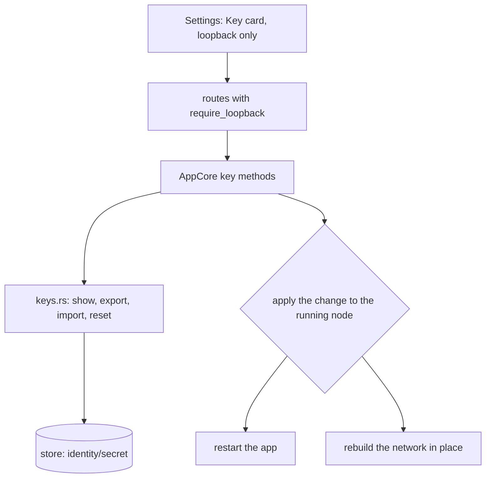

# Key actions in Settings, and the key commands on Windows

*   **Author:** Hugh Kaznowski
*   **Status:** Initial draft, unreviewed
*   **Date:** 2026-11-22
*   **Ticket:** [ticket 0046](../../../tickets/0046-key-actions-in-settings-and-windows.md). Blocked by [ticket 0043](../../../tickets/0043-key-management.md) (Part 1 built). Raised in [the 0043 draft](../0043-key-management/design_draft.md), decision 11.
*   **Related decisions:** [ADR 0039](../../adr/0039-key-management.md), [ADR 0034](../../adr/0034-system-overview-goals-and-risks.md), [ADR 0032](../../adr/0032-settings-phone-link-and-advanced.md), [ADR 0016](../../adr/0016-peers-identified-by-key.md), [ADR 0029](../../adr/0029-atomic-design-and-show-dont-tell.md). Where this document and an ADR disagree, the ADR wins. This work needs its own ADR because it amends ADR 0039's goal that no key operation is reachable from the web API.

--------------------------------------------------------------------------------

## Overview

Ticket 0043 built `forever-together key show | export | import | reset` (`app/src/cli.rs`, `app/src/keys.rs`, `runtime::run_key_command`). Two gaps were left on purpose:

*   **Windows release builds have no console.** `app/src/main.rs` sets `windows_subsystem = "windows"` in release, so a program started from a terminal writes nothing to it: `key show`, `key export --stdout`, the reset prompt and every error message are invisible. ADR 0039 declares the commands unsupported there.
*   **No key action in Settings.** The author asked for it, then deferred it because it puts key operations on the loopback web API and the secret key must not be reachable from the web app.

## The Problem

*   A Windows user cannot see their peer ID or back up a key. For the author's trusted node this does not matter (it runs headless on a server), but any player who wants a stable identity or to move installs cannot.
*   Settings can already do loopback-only actions that touch files or secrets: the phone link and token reset (`/api/pairing`, `/api/token/reset`), the addon folder and install (`app/src/server/addon_routes.rs`, which takes a typed folder path and writes files itself). So the mechanism exists; the question is how far the key may travel through it.
*   The running app holds the data-directory lock (`DataDirLock`, ADR 0039 decision 9) and owns the store through `LiveCore`. The CLI route cannot be used while the app runs, so Settings must act on the live store.
*   The app's own identity is loaded once when the network starts (`Identity::load_or_create` in `runtime::build_network`, and `me` in the `LiveCore` model). A key replaced in the store does not change the running endpoint until the network is rebuilt or the app restarts.
*   The API does not show the app's own peer ID today: `peerId` exists only on party members (`PartyMember`, with the `self` flag) in `app/src/server/core.rs`.
*   `README.md` "Keys" and ADR 0039 both say "unsupported on Windows release builds" and "no key operation on the web API". Both change with the outcome.

## Goals

*   A decided set of Settings key actions, and how each handles the secret.
*   A decided behaviour for applying a changed key to the running app.
*   Windows: either the commands work or the unsupported status is the documented, intended state.
*   Loopback only and locked on a phone (the Settings pattern: `Locked` molecule, `remote` prop, `require_loopback` on the routes).
*   The secret key never appears in logs. Whether it passes through the browser is the main open question.

## Non-Goals

*   Passphrases or keychain storage (decision 1 of the 0043 draft stands).
*   Linux and macOS behaviour of the CLI, which is built.
*   Changing the key file format (`app/src/keys.rs`).
*   Multi-key identities, rotation of `BUILTIN` without a release ([ticket 0010](../../../tickets/0010-trusted-peer-deployment-policy.md)).

## Technical Plan

Two separate strands share one ticket.

**Strand 1: Settings.** New routes behind `require_loopback` call into `keys.rs` through `AppCore`, using the store the app already holds (the `keys` functions are generic over `S: Store + ?Sized`, so they work on the app's `Arc<dyn Store>`). The public key can be shown with no secret crossing the API; the secret-handling options are open question 1.

**Strand 2: Windows.** The release build has no console, because of the subsystem flag, not because of any missing code. Options are open question 3.

What the card shows, kept within CLAUDE.md's show-don't-tell rule: the peer ID with a copy chip (`CopyChip` atom exists), and buttons for the actions chosen. A change warns in one sentence: other peers see a new peer ID (the text of `CHANGED_WARNING` in `app/src/runtime.rs`).

## Alternatives Considered

*   **Run the CLI from the window** (spawn `forever-together key ...` as a child process). Rejected as a mechanism: the app holds the data-directory lock, so the child would be refused; the app would have to release it, which makes the store unusable meanwhile.
*   **Show the secret key text in the page** so the user can copy it. Rejected: it is the case ADR 0039 forbids (key in the web app, in browser memory, possibly in screenshots), and it adds nothing the file options below do not.

## Detailed Implementation

Common files (any Settings option):

*   `app/src/server/core.rs`: `AppCore` methods for the chosen actions; a response view with the peer ID; `CoreError` codes for the `KeyError` cases (`FileExists`, `Encrypted`, `WouldReplace` and so on, mapped from `app/src/keys.rs`).
*   `app/src/server/routes.rs`: routes under a new prefix (for example `/api/key`), each with `route_layer(from_fn(require_loopback))`; the API table in [ADR 0035](../../adr/0035-protocol-constants-engine-contract-and-api.md) gets the rows.
*   `app/src/app/mod.rs`: new `Cmd` variants run on the task that owns the store and network; `LiveCore` implements the methods.
*   `app/src/server/tests.rs`: loopback-only and token tests like `delete_history_is_loopback_only_and_needs_a_token`; core tests for each action and each refusal.
*   `webapp/src/components/organisms/KeySettings.tsx` and `.stories.tsx` (new); a molecule for any file-path field (the addon card has `AddonPathField` to reuse or imitate); `SettingsPage.tsx` and `AdvancedSettings.tsx` or `App.tsx` wire it; `api/types.ts`, `httpApi.ts`, `mockApi.ts`, `fixtures.ts`. Stories: no key shown yet (loading), key shown, replacing (confirm), error, phone (locked).
*   `docs/adr/NNNN-*.md` (new, next number): the decision; `docs/adr/0039-key-management.md` and `docs/adr/0034-system-overview-goals-and-risks.md` (Security line: loopback-only actions) updated to say what now crosses the API; `README.md` "Keys".
*   `docs/spike-s0.md`: rows if anything is verified on Windows.

Windows-specific files depend on question 3 and are listed there.

## Test and verification plan

*   Rust: the server and core tests above; key round trip through the Settings route gives the same peer ID as through `keys::import_from_file`; a refused import (encrypted file, wrong type, would replace without confirmation) returns the matching code and changes nothing.
*   A test that no response body, log line or event contains the secret key bytes for the chosen option (the check differs by option: for typed-path, assert the response holds a peer ID and path only).
*   Frontend: `pnpm --dir webapp typecheck`, `build-storybook`; stories at 1280x720 and 390x844.
*   Windows: the commands and Settings are verified on a real Windows machine; none was available during the 0043 build and nothing about Windows behaviour (console, file locking by `File::try_lock`, default paths) is verified.

## Open questions for the author

1.  **How does the secret key move for import and export in Settings?**
    *   **A. A typed file path, read and written by the server.** Mechanism: the page sends a path; the server calls `keys::export_to_file` or `import_from_file` (as the addon install flow takes a folder path in `PUT /api/addon/folder`), and the browser never sees the key. Trade-off: the secret does not cross the API. Fails because a typed path is awkward (no file picker in the window; no Tauri dialog plugin is in `app/Cargo.toml`) and because a caller with the token on loopback can make the app write a file at any path it can reach (`export_to_file` refuses to overwrite, which limits the damage).
    *   **B. Download and upload through HTTP.** Mechanism: export returns the file, import takes an uploaded body. Trade-off: normal file pickers work. Fails the rule that the key is not reachable from the web API: any local process holding the token could fetch the key, and the browser or webview may keep a copy (download history, memory). Also depends on the webview supporting downloads (unverified; see ticket 0040's open question).
    *   **C. Show the public key and reset only.** Mechanism: no import or export in Settings. Trade-off: the secret never crosses the API and no file path is handled. Fails for a Windows user who needs a backup: reset without export destroys the only copy, so the card would have to warn that there is no way back.
2.  **How is a changed key applied to the running app?** Needed for any option with import or reset.
    *   **A. Save and restart.** Mechanism: the action writes the store and the card asks the player to restart the app (or the app restarts itself); the new key is read at start. Trade-off: smallest change. Fails if players do not restart: the app keeps the old peer ID while the store holds the new one, and `key show` and the card would disagree.
    *   **B. Rebuild the network in place.** Mechanism: `LiveCore` stops the engine and network and starts them with the new identity. Trade-off: no restart. Fails because identity is held in the model and network at several places (`Identity` in `build_network`, `me` in the model), and a search or committed party must be dropped safely first; it is the larger change and a source of subtle bugs.
    *   **C. Apply on the next start and show both IDs** ("current: X, after restart: Y"). Mechanism: the card reads the stored key and compares with the running one. Trade-off: honest about state; no forced restart. Fails by leaving the app on a different peer ID than the store for as long as the player waits, which matters for a trusted node but not for a player.
3.  **What does a Windows user get for the command line?**
    *   **A. Attach to the parent console in key mode.** Mechanism: in `main.rs` or `lib.rs`, when the mode is a `key` command on Windows, call the Win32 call that attaches to the parent process's console before any output (needs a Windows binding crate, target-gated in `app/Cargo.toml`). Trade-off: one binary. Fails when launched from a place with no console (a shortcut), where it still prints nothing, and stdin prompts behave differently in some shells (unverified).
    *   **B. A second console-subsystem binary** for `key` commands (a second `[[bin]]` calling the same `run_key_command`, shipped beside the app). Mechanism: the subsystem flag applies per binary. Trade-off: console behaviour is normal and testable. Fails if the Tauri bundle does not ship the extra binary without bundler configuration (unverified), and the user must know to run the other file name.
    *   **C. Document as unsupported and rely on Settings** (question 1). Mechanism: the README and ADR 0039 stay as they are; Windows users use the card. Trade-off: no Windows-specific code. Fails if Settings is not built or is option 1 C, since then Windows has no backup path at all.
