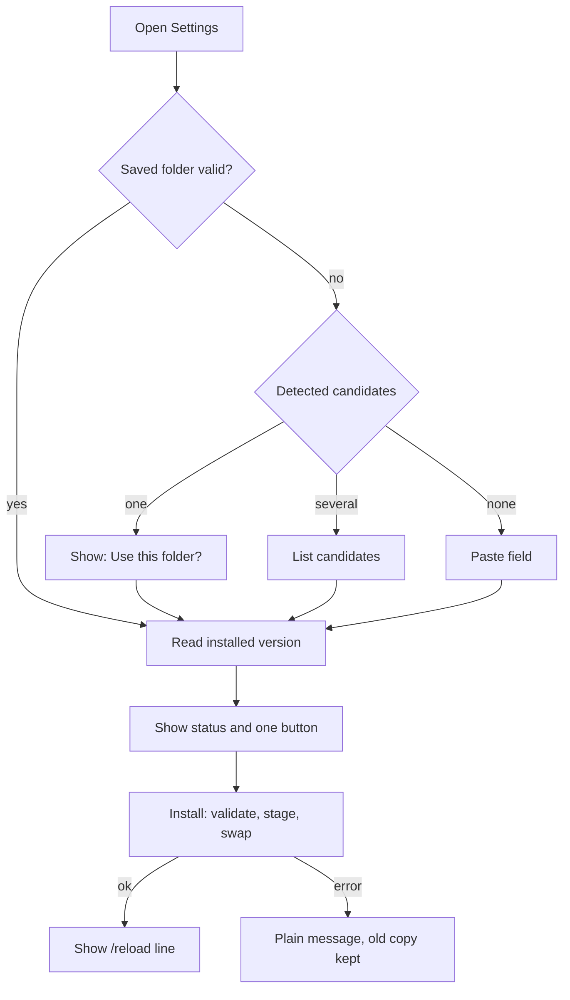

# Concepts brief: addon installer in the desktop app

Author: Hugh Kaznowski. Date: 2026-11-21. Mode: BRAINSTORM. Status: proposal, nothing built.

Origin: the author asked for an "Addon" row in Settings that says whether the addon is installed, which version, and installs or updates it in one click. This brief records what seven reviewers found when they checked the idea against the code and the ADRs. It does not replace an ADR. Decisions below become ADR 0028 once the author accepts them.

## Reviewer status

| Lens | Status |
| --- | --- |
| design | completed |
| codebase-details | completed |
| zoom-out | completed |
| comprehension | completed |
| implementation-readiness | completed |
| structural | completed |
| inventive-catalyst | completed |

## Overview

The desktop app carries a copy of the addon (`addon/ForeverTogether/`) inside its binary. Settings gets one "Addon" row. The row shows whether the addon is in the game's AddOns folder, which version is there and which version the app carries. It offers one button: Install, Update or Reinstall. No network is used.

The folder comes from detection (per-OS default paths), from a pasted path, or later from a native folder dialog. The installed version is read from the `## Version:` line of the installed `ForeverTogether.toc` and compared with the same line of the bundled copy (currently `0.1.0`).

After a successful install the row tells the player to type `/reload` in the game. The app cannot tell whether the game is running.

## Analysis

### What exists today (checked in the code)

- `scripts/install-addon.sh` copies the addon with `rsync -a --delete` and refuses unless `$WOW_ADDONS_DIR` ends in `AddOns`. It needs a repo checkout, bash and rsync. It is a developer path, not a player path.
- The main window loads `http://127.0.0.1:<port>` through `WebviewUrl::External` (`app/src/lib.rs`). `app/capabilities/default.json` grants it no IPC permissions on purpose. The page talks to the app only through the authenticated web API.
- Loopback-only routes use `route_layer(from_fn(require_loopback))` (`/history`, `/pairing`, `/token/reset`). Paired phones are refused on them.
- `Settings` (`app/src/config.rs`) is `#[serde(default)]`, so a new optional field loads from old stored settings. `SettingsView` and `SettingsPatch` use `deny_unknown_fields`. `touches_loopback_only()` lists the fields a phone may not write.
- Web files are embedded by Tauri through `generate_context!` and read by an `Assets` trait. The addon is not embedded. `Cargo.toml` has no embedding crate, no dialog plugin and no `tempfile`. Tests build temp dirs by hand (`temp_dir()` in `app/src/server/tests.rs`).
- The addon is 8 files: `Codec.lua`, `Qr.lua`, `Names.lua`, `Core.lua`, `Window.lua`, `Commands.lua`, `ForeverTogether.toc`, `icon.tga`. It has no saved variables.
- `docs/adr/` ends at 0027, so the next ADR is 0028. CLAUDE.md says "0001-0027" in one place.

### Facts that stay unverified

- The Forever client's folder layout. The author's macOS machine has `/Applications/World of Warcraft/_forever_/Interface/AddOns`. That is one observation, not a spec.
- The Windows default path (a guess) and every Linux path.
- Whether the game tolerates an in-place replace while it runs, and Windows file locking.
- Whether Windows `Program Files` needs admin rights for the app.
- A native folder dialog from the Rust side on macOS (main-thread rules).

### Findings by theme

1. **Arbitrary write (all lenses that looked at security).** An endpoint that writes to a folder given by the caller is a write-and-delete primitive. Loopback plus a token stops phones, but any local process or a DNS-rebinding page can still reach loopback. The limits must live in the installer, not only in the route.
2. **Picker.** A JS dialog plugin needs a capability for a window that loads a local http URL, which widens a deliberately closed boundary. Two ways around it: a pasted path (no cost), or a loopback-only route where Rust opens the native dialog itself (new dependency, blocks until closed, macOS main-thread care).
3. **One copy of the addon.** The binary must embed `addon/ForeverTogether/` from the source path, with no second copy in git.
4. **Install shape.** `rsync --delete` semantics are wrong for an installer inside a folder shared with other addons. Plain overwrite leaves stale files when the file list changes. A half-written folder can crash the addon on load.
5. **Version is a weak signal.** During development the version stays `0.1.0` while files change. A byte comparison against the bundle catches this.
6. **Detection can mislead.** A stale `_classic_` folder or an old install would take an install quietly. A confirm step on the first use of a detected folder removes that.
7. **Wording.** Gamers know "AddOns folder" and `/reload`, but not `.toc`, "bundled" or OS error text. Error text must be plain and the raw OS error goes under Details.
8. **Existing documents.** `docs/notes/ui_show_dont_tell_audit_brief.md` says the app cannot know whether the addon is installed and lists an installer as out of scope. That stops being true. ADR 0002, 0012, 0013 and 0020 need small amendments.

## Goals vs. Non-Goals

### Goals

- Settings shows whether the addon is installed in the chosen folder, which version, and the app's version.
- One button installs or updates. Same-version reinstall is allowed and both versions are shown.
- Folder detection is preferred over asking. Pasting a path always works.
- A failed write shows a plain-language error with the folder path.
- Desktop only, enforced on the server.
- The bundled copy is always `addon/ForeverTogether/`, proven by a test.
- Tests use temp dirs only, no real WoW install.

### Non-Goals

- No download, CurseForge, or remote URL.
- No change to the first-run "Get the addon" step in this slice. It may later read the same status.
- Nothing on the main screen. Settings only.
- No detection of a running game, no auto-update prompts, no uninstall.
- No Battle.net config or registry reading.
- No retry, rollback history or backup folder. The swap (see below) makes a failure leave the old copy in place, nothing more.
- No change to the addon itself (no version printing, no saved variables).
- No claim that the addon "works". The app only knows what is in the folder.

## Design

### Where the code lives

- `app/src/addon_install.rs`: pure logic, no HTTP, no Tauri. It holds the version parser, status comparison, folder validation, the per-OS candidate list (environment passed in so tests can fake it), inspection and install. A closed `AddonError` enum maps `io::ErrorKind` to a stable code.
- The bundle is a sorted list of `(relative path, bytes)`. It is generated by `app/build.rs`, which walks `../addon/ForeverTogether/`, skips dot files, emits `include_bytes!` entries and prints `cargo:rerun-if-changed=../addon/ForeverTogether`. The `## Version:` line is parsed at build time so a malformed version fails the build. This adds no crate (`include_dir` and `rust-embed` were weighed, see below).
- `app/src/server/addon_routes.rs`: translates HTTP to the module. The `AppCore` trait gets the folder setting and an action only if needed; the module itself is called directly from the route where it needs no engine state, which avoids touching the engine thread and the `FakeCore` mocks more than required. Filesystem work runs in `spawn_blocking` behind a mutex so two installs cannot overlap.
- `app/src/config.rs`: one field, `addon_dir: Option<String>`.

### API

All three routes are loopback-only, including the GET (it exposes folder paths).

| Route | Purpose | Body or response |
| --- | --- | --- |
| `GET /api/addon` | status | `bundled_version`, `folder` (or null), `folder_source` (`saved`, `detected`, null), `candidates[]`, `installed` (`missing`, `present`, `unreadable`) with `version`, and `status` |
| `PUT /api/addon/folder` | set and save the folder | `{ "folder": "<path>" }`, validated first |
| `POST /api/addon/install` | install into the saved folder | no path in the body |

`status` is one of `no_folder`, `folder_invalid`, `not_installed`, `up_to_date`, `update_available`, `files_differ` (same version, different bytes), `installed_newer`, `unknown_version`.

The install route never takes a path. It uses the saved, re-validated folder. This removes the caller's choice of destination. Errors reuse `CoreError` with a stable code and a message that names the folder; the raw OS error goes in a separate field for Details.

| Code | HTTP | Trigger |
| --- | --- | --- |
| `addon_folder_unset` | 409 | no folder saved or detected-and-confirmed |
| `addon_folder_invalid` | 400 | fails validation |
| `addon_folder_missing` | 404 | saved folder is gone |
| `addon_permission_denied` | 403 | `PermissionDenied` |
| `addon_read_only` | 409 | read-only file system |
| `addon_no_space` | 507 | disk full |
| `addon_locked` | 409 | Windows sharing violation |
| `addon_install_failed` | 500 | anything else |

### Folder rules (the containment)

Applied on save and again on every install:

1. Absolute path. Strip surrounding quotes and whitespace. Reject `..` and NUL. Expand `~` only on a pasted path.
2. Canonicalise, then require: exists, is a directory, last component `AddOns` (case-insensitive on Windows and macOS), parent `Interface`.
3. The writable target is the constant `<AddOns>/ForeverTogether`. The client never sends a sub-name.
4. Refuse if `ForeverTogether` is a symlink (tell the player it is a link, for example a dev link to the repo) or contains symlinked entries.
5. Never remove anything outside that one folder.

The grandparent folder name (`_forever_`, `_classic_` and so on) is not enforced. The client's folder name is unverified, and the `Interface/AddOns` shape already blocks `/` or a home directory.

### Install algorithm

Stage, then swap, in the same `AddOns` folder:

1. Remove a leftover `.ForeverTogether.new` from an earlier failed run.
2. Write every bundled file into `.ForeverTogether.new`.
3. Rename `ForeverTogether` to `.ForeverTogether.old`, rename `.ForeverTogether.new` to `ForeverTogether`, remove `.ForeverTogether.old`.
4. If a rename fails, report the mapped error and leave the previous folder in place; remove the stage.

The game ignores dot-prefixed folders, so a leftover cannot load as a second addon (unverified on Forever). Files the player put inside `ForeverTogether/` are removed by the swap, as with the script. The UI hint says the folder is replaced as a whole. This is open question 2.

A second install of the same bundle changes nothing visible and succeeds.

### Version rules

- Read the first `## Version:` line. Key is case-insensitive. Strip a BOM, CRLF and whitespace.
- Both values parse as dotted numbers: compare numerically. Otherwise compare as plain text for equality only and show both strings.
- Equal versions and equal bytes: `up_to_date`. Equal versions and different bytes: `files_differ`. Installed higher: `installed_newer`. Missing `.toc` or no parseable line: `unknown_version`. Install is allowed in every state except `no_folder` and `folder_invalid`.

### Detection

A table of candidates, kept as data in one place and marked unverified:

- macOS: `/Applications/World of Warcraft/_forever_/Interface/AddOns`.
- Windows: `%ProgramFiles(x86)%\World of Warcraft\_forever_\Interface\AddOns` and `%ProgramFiles%\...`, built from environment variables. Nothing user-specific is hard-coded.
- Linux: none in v1. A few Wine prefixes under the home directory can be added later.

Rules: keep candidates that pass validation. Exactly one: show it as "Use this folder?" and save it on the first confirmed install, so a guess never writes silently. Several: list them. None: show the paste field.

Other flavours (`_classic_`, `_retail_`) are not candidates. The addon targets Forever, and installing into the wrong client is the failure to avoid. A player with another layout pastes the path.

If the saved folder disappears, status becomes `folder_invalid` with the old path shown and detection runs again.

### Picker

v1 ships detection plus paste. The author accepts OS pickers, so stage 2 adds a "Browse" button backed by a loopback-only route where Rust opens the dialog (no new IPC capability, `capabilities/default.json` keeps `"permissions": []`). It returns 409 when headless. This is deferred because it adds a dependency and needs a live macOS check.

### UI

New organism `AddonSettings`, placed as its own card between the phone link and Advanced. `SettingsTemplate` currently states a two-card default view, so the template note changes to three. A row inside Advanced would hide the main action.

The row follows "show, don't tell": a status badge, a values line, one button. The folder row shows only when it is needed or after "Change folder".

| State | Badge | Values | Button |
| --- | --- | --- | --- |
| No folder found | Not found | none | Use a folder (opens paste field) |
| Folder invalid | Wrong folder | the path | Change folder |
| Not installed | Not installed | In this app: 0.1.0 | Install addon |
| Up to date | Up to date | In game: 0.1.0 | Reinstall |
| Update available | Update available | In game: 0.1.0, new: 0.2.0 | Update addon |
| Same version, files differ | Files differ | In game: 0.1.0, this app: 0.1.0 | Reinstall |
| Installed newer | Newer than this app | In game: 0.3.0, this app: 0.2.0 | Install 0.2.0 anyway |
| Version unknown | Unknown version | In this app: 0.1.0 | Update addon |
| Success | Installed | Now: 0.2.0 | none; line "In the game, type /reload" with a copy chip |
| Failed | Could not install | the plain message and path | Try again or Change folder |

Wording rules: say "version", never `.toc`; say "this app" not "bundled"; say "Reinstall" not "overwrite". The InfoTip (160 characters or fewer) says the folder is replaced as a whole and to use `/reload` or restart the game. Raw OS text sits under `Details`. Phones see the `Locked` pattern with the shared `remote` flag, and the server refuses anyway.

Failure messages (plain English): folder not found, "That folder is gone. Pick it again."; permission denied, "This app is not allowed to write there. Close the game and try again, or pick another folder."; read-only, "That drive is read-only."; other, "Something stopped the install. Nothing was changed."

New webapp pieces: molecule `AddonVersionPair`, molecule `AddonPathField`, organism `AddonSettings`, `describeAddonError` in `webapp/src/api/errors.ts`, API client methods, mock API support. Existing stories that change: `SettingsPage`, `Templates` (settings), `pages/App`, plus new `AddonSettings` stories for every state above and a phone (locked) variant.

### Flow

## Alternatives Weighed

| Choice | Option taken | Rejected | Reason |
| --- | --- | --- | --- |
| Bundling | `build.rs` generates `include_bytes!` table | `include_dir`, `rust-embed`; Tauri `bundle.resources` | no new crate for 8 files; resources are missing in headless runs and tests; version parsed at build time |
| Picker | detection and paste first, server-side dialog later | Tauri dialog plugin with a remote-URL capability; drag a folder | would end the no-IPC design; drag gives no real path without IPC |
| Install | stage and swap | `rsync --delete` semantics; plain overwrite; one-generation `.bak` | `--delete` removes things the app does not own; overwrite leaves stale files; a backup folder inside `AddOns` risks loading twice |
| Settings vs verbs | resource and verb routes, only the folder in settings | install state in `PUT /settings` | install is an action, and a settings field is an easy place to forget the loopback guard |
| Install request | no path in the install body | path in the body | removes the caller's choice of destination |
| Version signal | version plus byte comparison | version string only | development edits keep `0.1.0` |
| Detection | confirm a detected folder once | write to the first hit silently | a stale folder is worse than one click |
| Script | keep `install-addon.sh` for developers | delete it; or make it call an app flag | see open question 4 |
| Addon prints its version | no | yes | adds a feature to an addon that has none |
| Battle.net config as hint | deferred | now | format not owned by us, Forever may differ |
| Flavour list | `_forever_` only | all flavours | wrong-client installs |

## Risks (top three)

1. **Local write and delete through the API (Blocker).** Mitigation: the folder rules above, a constant target name, no path in the install body, symlink refusal, loopback on every route, hostile-path tests.
2. **Unverified folder facts (Major).** `_forever_`, the Windows default and the game's tolerance of a swap are guesses until a live run. Mitigation: candidates are data, confirmed once, marked unverified in docs, and a failed detection is a normal state.
3. **Stale or half-installed addon (Major).** Version-only comparison misses edited files, and a partial copy can break the addon. Mitigation: byte comparison status and stage-and-swap.

Smaller: two install paths (script and app) can drift; a new `AppCore` method breaks `FakeCore`; a Settings card plus a notice may push past the no-scroll target at 1280x720 (keep the folder row hidden unless needed).

## Acceptance criteria

1. `GET /api/addon`, `PUT /api/addon/folder` and `POST /api/addon/install` return 403 from a non-loopback caller and 401 without a token.
2. The version parser reads `0.1.0` from the real `.toc`, and handles BOM, CRLF, a missing line and an empty or unparseable value (no version).
3. Status is correct for: no folder, invalid folder, not installed, equal, older, newer, same version with different bytes, unreadable `.toc`.
4. Folder validation rejects relative paths, files, missing dirs, a wrong last component, a wrong parent, `..` and NUL, each with `addon_folder_invalid`. A pasted path with quotes or spaces is cleaned and then validated.
5. Install writes exactly the bundled files into `<AddOns>/ForeverTogether`. Sibling addons are byte-identical afterwards. After install the status is `up_to_date`.
6. A second install of the same bundle succeeds and changes no file content.
7. Extra files inside the old `ForeverTogether` folder are removed by the swap (or kept, per open question 2; the test follows the decision).
8. A failure part-way leaves the previously installed copy intact and removes the stage folder.
9. A symlinked `ForeverTogether` is refused with a message that says it is a link.
10. Each error code returns its HTTP status, and the message names the folder.
11. The embedded bundle equals `addon/ForeverTogether/` (relative paths and bytes), excludes dot files, contains every file the `.toc` lists, and its version equals the on-disk `.toc` version.
12. An old settings JSON without `addon_dir` loads. The field survives a restart. A phone cannot change it (`touches_loopback_only`).
13. The row appears in the window and is locked on a phone. Same-version reinstall shows both versions.
14. `app/capabilities/default.json` still has `"permissions": []` and no network call is made.
15. Detection returns the macOS default when it exists in a fake home, builds Windows candidates only from injected environment values, and drops candidates that do not exist.

## Test plan

Functional, in temp dirs, no real WoW install.

- **Pure module** (`app/src/addon_install.rs` tests): version parsing table; status matrix over a built `AddOns` tree; install into empty, older, equal-version-edited and extra-file trees; siblings untouched; read-only destination (Unix `chmod`) gives `addon_permission_denied`; symlinked target refused; leftover stage cleaned; a forced failure (one target path is a directory) leaves the old copy; hostile paths (`/`, a home directory, `../AddOns`, a path not ending in `AddOns`) refused.
- **Bundle test**: acceptance item 11. It also fails when a file is added to the addon folder but the generated table is stale.
- **Detection**: fake environment and a temp home.
- **Routes** (`app/src/server/tests.rs`, extend `FakeCore` only if the trait changes): 401, 403, bad JSON, unknown field, response shapes, error mapping.
- **Settings**: round trip and old-JSON load (`app/src/config.rs`, `app/src/app/tests.rs`).
- **Frontend**: stories for every state plus the phone variant; `pnpm --dir webapp typecheck`; `pnpm --dir webapp build-storybook`.
- Run Rust (`cargo test --lib addon_install::`, `cargo test --lib server::`, clippy) and frontend checks for touched sides only.

Manual checks for the author on a real install:

1. Fresh install into the real Forever AddOns folder; in game, `/reload`, then `/wowft` opens the window.
2. Edit the addon version, rebuild, and see Update available, then update.
3. Reinstall at the same version and see both versions.
4. Try with the game running (macOS first; Windows if available).
5. Try a read-only folder and a wrong folder.
6. Check the detected macOS path matches the real one, and a leftover `.ForeverTogether.*` folder does not load.
7. Open Settings on a phone and see the row locked.

Stays unverified until then: the Forever folder layout beyond the author's macOS machine, the Windows and Linux defaults, game behaviour during an in-place swap, Windows locking and admin rights, the dot-folder being ignored on Forever, and a native dialog if built.

## Key Decisions & Staging for Next Steps

### Decisions proposed (need the author's yes)

1. Embed with `build.rs` and `include_bytes!`, no new crate.
2. Install by stage and swap; the whole `ForeverTogether` folder is replaced.
3. Three loopback-only routes, no path in the install body, only `addon_dir` in settings.
4. v1 picker is detection plus paste. A server-side native dialog is stage 2.
5. Candidates: `_forever_` only. Confirm a detected folder once before the first write.
6. A byte-comparison status `files_differ` in addition to version.
7. The Addon card sits between the phone link and Advanced.

### Open questions for the author

1. Should "installed newer" ask for a second click, or just use the "Install 0.x anyway" button as written?
2. Is deleting files the player added inside `ForeverTogether/` acceptable (matches the script)? The alternative is to keep unknown files and remove only files the app listed before, which needs an installed-file manifest.
3. Should first run's "Get the addon" step later read this status? Not in this slice.
4. Should `mise run install-addon` stay as is, or call an app flag such as `--install-addon <dir>` so there is one implementation? The flag is cheap and gives a headless path.

### ADR and document changes

- ADR 0028, "The desktop app installs the bundled addon". Amends 0002 (addon stays data only; the app writes its files, never reads saved variables), 0013 (module list gains `addon_install`), 0020 (addon also embedded in the binary). Amends 0012 only if a Tauri picker is chosen. Update `docs/adr/README.md` and the "0001-0027" range in CLAUDE.md.
- Annotate `docs/notes/ui_show_dont_tell_audit_brief.md` (lines on "cannot know whether the addon is installed", D2, and the installer exclusion) as outdated; do not rewrite its history. Update `docs/notes/ui_notes.txt` if it lists this item.
- README tasks table and first-run text, CLAUDE.md module list and "not verified" list, the implementation plan (API table and file list), and one sentence in each of README and the script header saying which path is for developers and which for players.

### Build order

1. **ADR 0028 and the contract.** Freeze API shapes, status names, error codes and folder rules in the ADR.
2. **Pure module and bundle** (`app/build.rs`, `app/src/addon_install.rs`, tests). Highest risk, no dependencies on other work.
3. **Routes, settings field, core wiring** (`server/`, `config.rs`, `app/`), after step 2 signatures are committed.
4. **Webapp** (molecules, organism, API client, mock API, stories), in parallel with step 3 against the frozen JSON contract.
5. **Docs and script note.**
6. **Manual run on the real install**, then record the verified and unverified items in `docs/spike-s0.md` style.
7. **Stage 2**: native dialog route, extra candidates, first-run integration.

### Parallel split (files owned per agent)

- Agent A: `app/build.rs`, `app/Cargo.toml` (only if a dependency is needed), `app/src/addon_install.rs` and its tests, the `mod` line in `app/src/lib.rs`.
- Agent B: `app/src/server/core.rs`, `routes.rs`, `addon_routes.rs`, `server/tests.rs`, `app/src/app/mod.rs`, `app/src/app/tests.rs`, `app/src/config.rs`. Starts after A's signatures.
- Agent C: everything under `webapp/src/` for this feature.
- Agent D: `docs/adr/0028-*.md`, `docs/adr/README.md`, README, CLAUDE.md, the two notes files, `scripts/install-addon.sh` comment.

### Smallest slice and deferrals

Smallest slice: steps 1 to 5 with the macOS candidate, a Windows guess built from environment variables, and the paste field. Deferred: native dialog, Linux detection, Battle.net hints, drag and drop, first-run integration, installed-file manifest.

## Resolutions (2026-11-21)

The author accepted decisions 1 to 7 and answered the open questions. They are recorded in [ADR 0028](../adr/0028-the-desktop-app-installs-the-bundled-addon.md).

1. Embed with `build.rs` and `include_bytes!`, no new crate. Accepted.
2. Stage and swap, replacing the whole `ForeverTogether` folder, so files a player added inside it are removed, like the dev script. Accepted (open question 2: yes, acceptable).
3. Three loopback-only routes, no path in the install body, only `addon_dir` in settings. Accepted.
4. v1 picker is detection plus a pasted path. A server-side native dialog is stage 2. Accepted.
5. Candidates are `_forever_` only. A detected folder is confirmed once before the first write. Accepted.
6. A byte-comparison status `files_differ` besides the version status. Accepted.
7. The Addon card sits between the Phone link card and Advanced. Accepted.

Open questions:

1. "Installed newer" uses the same single button ("Install 0.x anyway"), with no second click.
2. Replacing the whole folder is accepted (see 2 above).
3. The first-run "Get the addon" step stays unchanged in this slice.
4. `mise run install-addon` and `scripts/install-addon.sh` stay as they are: a development convenience, not part of the app. The README tasks row and the script header say the script is for developers and the Settings Addon card is for players. `_forever_` is the only detected flavour.

Notes: the author bumps the `## Version:` in the addon `.toc` by hand, and players use release builds (GitHub tags and release artifacts the author adds), so "installed newer" is rare.

Still unverified until a live run on a real install: the Forever folder layout beyond the author's macOS machine, the Windows and Linux defaults, game behaviour during an in-place swap, Windows locking and admin rights, and dot-prefixed folders being ignored.

## Implementation status

Built and merged 2026-11-21 (stage 1, the smallest slice). Not yet run on a real install.

| Step | Work | Status |
| --- | --- | --- |
| 1 | ADR 0028 and the contract | done |
| 2 | Pure module and bundle (`app/build.rs`, `app/src/addon_install.rs`, tests) | done: 17 tests, bundle-equals-source test included |
| 3 | Routes, settings field, core wiring (`app/src/server/addon_routes.rs`, `addon_dir`) | done: route and settings tests pass; the full Rust suite passes (282) |
| 4 | Webapp (molecules, organism, API client, mock API, stories) | done: typecheck, build, Storybook build pass; every addon story and play function ran clean in Firefox against the mock; Settings fits 1280x720 and 390x844 |
| 5 | Docs and script note | done |
| 6 | Manual run on the real install | pending, for the author (checklist in "Test plan") |
| 7 | Stage 2: native folder dialog route, Linux detection, first-run integration | not started |

Not checked: the webapp has only run against the mock API, and field names were cross-checked by reading the Rust and TypeScript sides. No real window, no real WoW install, no Windows or Linux machine.
